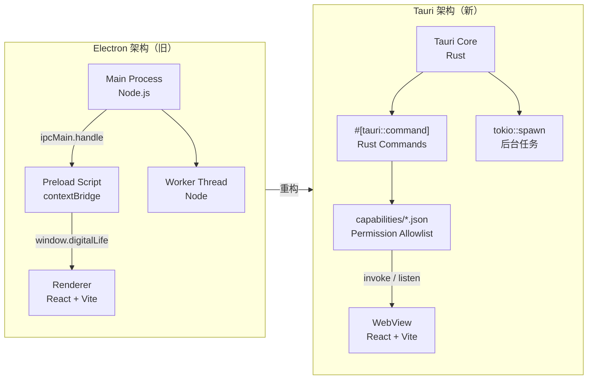
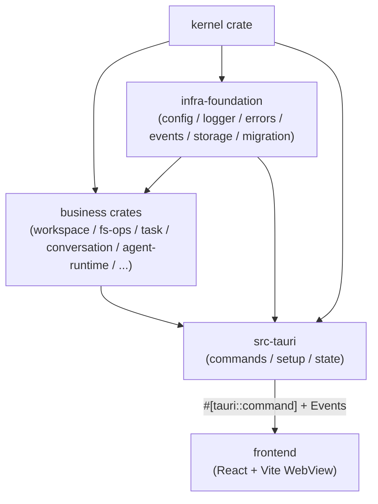

# Rust + Tauri 重构计划（从 Electron / TypeScript 迁移）

本文档是 `AI Digital Life` 从 **Electron + TypeScript** 重构到 **Rust + Tauri 2.x** 的最终落地计划与团队参考。它取代历史的 Electron 实现叙述；与本文件冲突的旧文档段落均以本文件为准。

---

## 一、迁移驱动力


| 维度     | Electron 现状                            | Rust + Tauri 目标                          |
| ------ | -------------------------------------- | ---------------------------------------- |
| 安装包大小  | 数十至上百 MB                               | 个位数 MB（复用 OS WebView）                    |
| 内存占用   | Chromium 全量                            | 仅 WebView + Rust 进程                      |
| 启动速度   | 中等                                     | 显著更快                                     |
| 内存安全   | 依赖 TypeScript + Node                   | Rust 借用检查器静态保证                           |
| 权限模型   | `contextIsolation` + 自己维护白名单           | Tauri 2.x Capability + Permission（细粒度声明） |
| 原生模块兼容 | `better-sqlite3` 等需 `electron-rebuild` | Cargo crate 编译期解决                        |
| 类型契约   | 手写 `shared/ipc.ts`                     | `kernel` crate `serde` 类型双端复用            |
| 并发模型   | EventEmitter + Promise                 | tokio + 通道 + 借用检查                        |
| 打包     | `electron-builder`（未落地）                | `cargo tauri build`（一等公民）                |


---

## 二、目标技术栈

### 2.1 主栈一览


| 层                    | 选型                                                                |
| -------------------- | ----------------------------------------------------------------- |
| 桌面框架                 | Tauri 2.x                                                         |
| 后端语言                 | Rust (stable)                                                     |
| 异步运行时                | `tokio`                                                           |
| 持久化                  | SQLite via `rusqlite`                                             |
| 数据库迁移                | 自维护（`crates/migration`，借鉴 `refinery` 思路）                          |
| 序列化                  | `serde` / `serde_json`                                            |
| 日志                   | `tracing` + `tracing-subscriber`                                  |
| 错误（库 crate）          | `thiserror`                                                       |
| 错误（应用 / `src-tauri`） | `anyhow`                                                          |
| 文件监听                 | `notify`                                                          |
| HTTP 客户端             | `reqwest`（rustls TLS）                                             |
| 凭据存储                 | `keyring`                                                         |
| 进程执行                 | `tokio::process::Command`                                         |
| 前端框架                 | React 19 + Vite + Zustand + TypeScript                            |
| 桥接                   | `#[tauri::command]` + `@tauri-apps/api` 的 `invoke()` / `listen()` |
| 打包                   | `cargo tauri build`                                               |
| 单测                   | `cargo test`（Rust） + `vitest`（前端）                                 |
| E2E                  | `tauri-driver`（WebDriver 协议）                                      |
| 包管理（Rust）            | Cargo workspace                                                   |
| 包管理（前端）              | `pnpm`（推荐）或 `npm`                                                 |


### 2.2 已废弃的栈项

- Electron / `electron-rebuild`
- `better-sqlite3`（Node binding，由 `rusqlite` 取代）
- `chokidar`（由 `notify` 取代）
- `pino`（由 `tracing` 取代）
- `electron-builder`（由 `cargo tauri build` 取代）
- Node Worker Thread（由 `tokio::spawn` 取代）
- Preload 脚本（Tauri 原生隔离不需要）

---

## 三、架构映射




### 3.1 安全模型对照


| Electron                          | Tauri 2.x                                        |
| --------------------------------- | ------------------------------------------------ |
| `contextIsolation: true`          | WebView 默认隔离（无 Node API）                         |
| `sandbox: true`                   | Tauri 进程隔离 + WebView OS 沙箱                       |
| `nodeIntegration: false`          | WebView 无 Rust 直接访问                              |
| `ipcMain.handle` 白名单              | `#[tauri::command]` + `capabilities/*.json`      |
| `contextBridge.exposeInMainWorld` | `@tauri-apps/api` 的显式 `import` + `invoke()`      |
| `webContents.send` 推送             | `app.emit()` / `window.emit()` Tauri Events      |
| Preload 脚本                        | 不需要（Tauri 原生）                                    |
| `ses.setPermissionRequestHandler` | `tauri.conf.json` `app.security` + capability 文件 |


### 3.2 依赖方向（不可逆向）




---

## 四、目标 Cargo Workspace 结构

```
ai-digital-life/
├── Cargo.toml                  # workspace root：列出所有成员、共享 [workspace.dependencies]
├── Cargo.lock
├── tauri.conf.json             # Tauri 应用配置（窗口、CSP、bundler）
├── package.json                # 顶层脚本壳（运行 cargo tauri、转发到 frontend）
├── pnpm-workspace.yaml         # 仅声明 frontend/ 工作区
│
├── src-tauri/                  # Tauri Rust 入口
│   ├── Cargo.toml              # bin crate
│   ├── build.rs                # tauri-build
│   ├── src/
│   │   ├── main.rs             # tauri::Builder::default().invoke_handler(...).run(...)
│   │   ├── setup.rs            # 初始化：config、logger、storage、迁移、worker
│   │   ├── state.rs            # tauri::State 共享上下文
│   │   ├── error.rs            # AppError（serde + thiserror）
│   │   └── commands/           # #[tauri::command] 处理函数（按 domain 分文件）
│   │       ├── app.rs
│   │       ├── workspace.rs
│   │       ├── conversation.rs
│   │       ├── agent.rs
│   │       ├── patch.rs
│   │       ├── command.rs
│   │       ├── terminal.rs
│   │       └── retrieval.rs
│   ├── icons/
│   └── capabilities/
│       ├── default.json        # 主窗口默认 capability
│       └── workspace.json      # 工作区窗口 capability
│
├── crates/                     # 业务 crate（library）
│   ├── kernel/                 # 共享类型 / 常量 / 错误码（serde derive）
│   ├── config/                 # 配置分层与持久化
│   ├── errors/                 # thiserror 错误类型
│   ├── events/                 # 跨 crate 事件总线
│   ├── logger/                 # tracing 初始化、结构化字段
│   ├── migration/              # SQLite 迁移注册与执行
│   ├── storage/                # rusqlite 仓储接口（spawn_blocking 包装）
│   ├── workspace/              # 工作区识别、会话恢复、git 快照
│   ├── fs-ops/                 # notify 监听、原子写、路径作用域
│   ├── task/                   # 任务状态机、审批
│   ├── conversation/           # 会话 / 消息
│   ├── agent-runtime/          # 单 Agent 顺序规划
│   ├── model-gateway/          # DeepSeek / MiniMax 路由 + 流式
│   ├── change-engine/          # patch 预览、应用、回滚、checkpoint
│   ├── context-engine/         # 上下文选择
│   ├── prompt-engine/          # 提示词组装
│   ├── terminal/               # 命令执行 + 流式输出
│   └── editor/                 # 编辑器侧逻辑（如有）
│
├── frontend/                   # WebView 前端 (React + Vite + Zustand)
│   ├── package.json
│   ├── vite.config.ts
│   ├── tsconfig.json
│   ├── index.html
│   └── src/
│       ├── main.tsx
│       ├── app/                # UI、store、区域布局、组件
│       ├── design-system/      # tokens / components / icons / theme
│       ├── styles/             # 分层 CSS
│       ├── locales/            # i18n（zh-CN / en-US）
│       ├── lib/
│       │   ├── bridge.ts       # 类型化 invoke 包装（与后端 kernel 类型对齐）
│       │   └── events.ts       # listen() 订阅工具
│       ├── preview-bridge.ts   # 浏览器开发态桥接（经本地开发服务访问真实工作区）
│       └── mock-bridge.ts      # 非文件系统能力的开发态 mock
│
├── docs/
│   ├── architecture/           # 本文件所在目录
│   └── design-system/
│
├── tests/
│   ├── integration/            # Rust 集成测试（穿过 Tauri Command 表面）
│   └── e2e/                    # tauri-driver / WebDriver
│
├── AGENTS.md
├── CONTRIBUTING.md
└── README.md
```

---

## 五、分阶段实施路线

> 时间为预估，并行能力强时可压缩。

### Phase R0：基础设施搭建（1–2 周）

目标：可启动一个空 Tauri 窗口，前端能 `invoke` 一个 echo 命令；Cargo workspace 结构落地。

任务清单：

- 备份当前 `apps/` `packages/` `workers/`（建 `legacy-electron/` 标签或归档分支）
- 删除 Electron 依赖：根 `package.json` 中的 `electron`、`@electron/rebuild`、`better-sqlite3`、根 `rebuild` 脚本
- 初始化 `Cargo.toml`（workspace 根）、`src-tauri/`、`tauri.conf.json`、`build.rs`
- 建立 `crates/{kernel, errors, logger, config, events, storage, migration}` 7 个基础 crate（仅模块骨架 + 占位类型）
- 落地 `frontend/` 目录（已从历史 `apps/desktop/renderer/` 迁入），独立 `package.json`、`vite.config.ts`
- `frontend/src/shared/ipc.ts` + `frontend/src/preview-bridge.ts` / `frontend/src/tauri-bridge.ts`：保持 `DigitalLifeBridge` 不变；浏览器开发态通过本地 Vite 工作区接口访问真实目录并支持基础文件/目录创建，桌面壳通过 Tauri Command 访问真实目录；用 `app_get_info`、工作区打开、文件树读取与创建操作端到端验证
- CI（即使本地）配置：`cargo fmt --check`、`cargo clippy -D warnings`、`cargo test`、`npm --prefix frontend run typecheck`
- 写入 `tauri.conf.json` 安全基线：显式 CSP、`withGlobalTauri: false`、空插件列表
- `src-tauri/capabilities/default.json` 仅放 `app_get_info`，验证 capability 拒绝未注册命令

退出门：`cargo tauri dev` 能拉起窗口，前端能 `invoke('app_get_info')` 拿到 Rust 端版本号。

### Phase R1：核心服务迁移（2–3 周）

目标：工作区打开 / 恢复 / 文件读取 / 配置 / SQLite 持久化 全链路在 Rust 端可用。

任务清单：

- 实现 `crates/storage`：rusqlite 连接管理 + 仓储接口（spawn_blocking 包装），覆盖 sessions / workspaces / config kv
- 实现 `crates/migration`：版本表 + 注册式迁移；编写从历史 `app-state.db` / `app-state.v1.json` 的迁移脚本
- 实现 `crates/config`：分层（构建时 / 运行时 / 用户偏好 / 工作区 / 临时），持久化 `config/config.json`
- 实现 `crates/workspace`：根识别、最近列表、会话快照、git 状态读取（`git2` 或子进程）
- 实现 `crates/fs-ops`：原子写（带可选 SHA256 预检）、`notify` 监听、debounce 与作用域校验
- 在 `src-tauri/src/commands/{app, workspace}.rs` 暴露相应 Tauri Command，登记到 `capabilities/default.json`
- 在 `src-tauri/src/setup.rs` 中初始化 tracing、storage、迁移评估、runtime-status 标记
- 前端 `bridge.ts` 全面替换 `window.digitalLife.*` -> `invoke('snake_case_cmd')`
- 引入 Tauri Event：`digital-life://workspace-file-changed`、`digital-life://retrieval-status`
- 集成测试 `tests/integration/workspace.rs`：建临时目录 -> open workspace -> read_file -> 校验事件

退出门：前端能从工作区列表选择一个目录、查看文件树与文件内容、收到文件变更事件；SQLite 状态正确持久化、迁移诊断可见。

### Phase R2：业务逻辑迁移（2–3 周）

目标：单 Agent 薄切片 + 模型路由 + 命令执行 + 终端流式 全部 Rust 化。

任务清单：

- `crates/task`：任务状态机、审批决策、checkpoint 引用
- `crates/conversation`：会话 / 消息持久化
- `crates/prompt-engine`、`crates/context-engine`：提示词与上下文选择
- `crates/model-gateway`：`reqwest` 实现 DeepSeek / MiniMax 路由 + 流式（`tokio::sync::mpsc` -> Tauri Event）
- `crates/agent-runtime`：单 Agent 顺序规划、运行 / 步骤 / 工具调用元数据
- `crates/change-engine`：patch-set / file-patch / hunk 持久化、应用、回滚、checkpoint payload
- `crates/terminal`：`tokio::process::Command` + 流式 stdout/stderr -> `digital-life://terminal-stream` 事件
- `src-tauri/src/commands/{conversation, agent, patch, command, terminal, retrieval}.rs` 全部上线
- 模型 API Key 改用 `keyring` 存取，绝不出现在 `config/config.json` 或日志
- 终端 / 模型流的取消（`CancellationToken`）端到端打通
- 集成测试：补丁预览 -> apply -> 验证失败 -> 自动回滚 -> repair preview

退出门：在 `cargo tauri dev` 中可完成一次「会话 -> 单 Agent 请求 -> 补丁预览 -> 应用 -> 验证 -> 回滚」全链路；终端命令流式输出可见且可取消。

### Phase R3：验证与打包（1–2 周）

目标：发布候选可打包、E2E 通过、文档与治理与代码完全一致。

任务清单：

- 引入 `tauri-driver` + WebDriver E2E（迁移原 Playwright `workspace-shell.spec.ts` 用例）
- 性能对比基线：启动时间、空闲内存、安装包大小、SQLite QPS（与历史 Electron 基线对照）
- `tauri.conf.json` bundler 配置：Windows MSI/NSIS、macOS dmg、Linux AppImage
- 签名与公证占位（不在本阶段强制完成，但配置项就绪）
- `cargo deny` / `cargo audit` 加入门禁
- 审视所有 capability 文件，确保无 `"all"` / `"**"` 通配
- 文档收口：删除 / 归档 `legacy-electron/`，更新 README 命令、CONTRIBUTING 命令、所有架构文档残留 Electron 表述
- 发布说明（`docs/runbooks/release-r1.md`）：技术栈切换、迁移影响、用户数据兼容性

退出门：`cargo tauri build` 可在 Windows 产出可分发 MSI；`cargo test --workspace` 与 `tauri-driver` E2E 全绿；所有规则、AGENTS、技能、架构文档与代码同步。

---

## 六、用户数据与持久化兼容

历史 Electron 实现的持久化资产：

- `state/app-state.db`（SQLite，`better-sqlite3` 写入）
- `state/runtime-status.json`
- `config/config.json`
- 旧 `state/app-state.v1.json`（更早版本兼容）

迁移策略：

1. SQLite 文件本身格式与驱动无关，`rusqlite` 可直接打开 `app-state.db`。
2. `crates/migration` 在启动时检测 schema_version；若发现 Electron 时代写入的字段需要重命名（如 snake_case 化），登记一个一次性迁移。
3. `config/config.json` 字段名保持不变（已是 snake_case 友好）。
4. 用户态 API Key 迁移：首启检测旧 `config.json` 中是否存有明文 key（不应出现，但兜底），若有则迁移到 `keyring` 并清空原字段，记录审计。

---

## 七、风险与缓解


| 风险                                 | 缓解                                                                        |
| ---------------------------------- | ------------------------------------------------------------------------- |
| 团队 Rust 经验不足                       | 已安装 8 个项目级 Rust 技能（见 §九）；保留 React 前端降低改动面                                 |
| Tauri 2.x 生态相比 Electron 不成熟        | 关键依赖（rusqlite、tokio、reqwest、notify、keyring）均为 Rust 主流 crate；Tauri 2.x 已稳定 |
| `tauri-driver` E2E 工具链 Windows 兼容性 | Phase R3 优先验证 Windows；保留 Playwright 用于纯前端开发态                              |
| 模型流式输出取消语义                         | `CancellationToken` + `tokio::select!` 模式；集成测试覆盖                          |
| 历史 Electron 用户安装包升级路径              | Tauri MSI 与 Electron NSIS 共存于不同 ProductCode；首启检测旧数据目录并迁移                  |
| 一次性大重写导致长时间不可用                     | 严格按 R0 → R3 分阶段，每阶段产出可运行产物；旧 Electron 仓在 `legacy-electron/` 分支保留快速回退      |
| 原生模块 / 平台差异                        | Cargo target 矩阵 + CI 覆盖 Windows / macOS / Linux；路径 / 大小写敏感性按规则约束          |


---

## 八、文档与治理同步

本计划已经同步以下治理文件：

- 根 `[AGENTS.md](../../../AGENTS.md)`：技术栈基线、子 Agent 路由表（`desktop-shell` -> `tauri-shell`）、禁止项更新
- `[ai-digital-life/AGENTS.md](../../AGENTS.md)`：技术栈、设计系统约束、目录结构、文档入口
- `[ai-digital-life/README.md](../../README.md)`：技术栈、命令、目录
- `[ai-digital-life/CONTRIBUTING.md](../../CONTRIBUTING.md)`：cargo / vitest 检查命令、Tauri Command 新增清单
- `[docs/architecture/system-overview.md](./system-overview.md)`：运行路径、安全基线、持久化
- `[docs/architecture/tech-stack-alignment.md](./tech-stack-alignment.md)`：逐项替换决策
- `[docs/architecture/theming.md](./theming.md)`、`[internationalization.md](./internationalization.md)`、`[workspace-and-retrieval.md](./workspace-and-retrieval.md)`：术语 Renderer/Main/IPC -> WebView/Rust 后端/Tauri Command
- `[docs/architecture/renderer-shell-redesign.md](./renderer-shell-redesign.md)`、`[stage-one-validation.md](./stage-one-validation.md)`：标记为 Electron 时代历史归档
- `[docs/development/project-engineering-constraints.md](../../../docs/development/project-engineering-constraints.md)`：技术基线、分层、SQLite、安全、性能、测试、禁止项、自动化检查
- `[docs/development/agent-routing.md](../../../docs/development/agent-routing.md)`：Tauri 与桌面安全边界路由
- `[docs/development/agent-topology.md](../../../docs/development/agent-topology.md)`：`tauri-shell` 角色定义
- `[docs/development/hook-policy.md](../../../docs/development/hook-policy.md)`：`sensitive-surface-guard` / `architecture-consistency-guard` 适配
- `[docs/development/future-codebase-governance-checklist.md](../../../docs/development/future-codebase-governance-checklist.md)`：架构文档建议、自动化检查
- `.cursor/rules/*.mdc`：4 条规则全部更新（删除 `ai-digital-life-electron-shell.mdc`，新建 `ai-digital-life-tauri-shell.mdc`）
- `.agents/skills/*`：`desktop-electron-security` 重命名为 `desktop-tauri-security`；`project-architecture`、`testing-quality-gates`、`workspace-retrieval` 更新为 Rust + Tauri 上下文

---

## 九、已安装的 Rust 项目辅助技能

通过 `npx skills add` 安装到 `~\.agents\skills\`：


| 方面                       | 技能包                                                 | 安装量  |
| ------------------------ | --------------------------------------------------- | ---- |
| Rust 基础与最佳实践             | `mindrally/skills@rust`                             | 225  |
| Tauri 桌面开发               | `nodnarbnitram/claude-code-extensions@tauri-v2`     | 3.6K |
| Rust 安全实践                | `mohitmishra786/low-level-dev-skills@rust-security` | 65   |
| Rust 测试                  | `affaan-m/everything-claude-code@rust-testing`      | 2.1K |
| Rust 性能优化                | `zhanghandong/rust-skills@m10-performance`          | 767  |
| Rust 错误处理                | `zhanghandong/rust-skills@m06-error-handling`       | 705  |
| Rust + SQLite (rusqlite) | `daiki48/dotfiles@rusqlite-guide`                   | 18   |
| Rust 异步 / 并发 (tokio)     | `geoffjay/claude-plugins@tokio-patterns`            | 67   |


> 安装量低的技能（如 `rusqlite-guide`）是当前生态中唯一对口的项目级技能；后续若 skills.sh 出现更高质量的替代品，可通过 `npx skills update` 与 `npx skills add` 替换。

---

## 十、执行顺序总结

1. **文档与规则先行（已完成）** — 所有治理文件已同步到 Rust + Tauri 真源。
2. **安装 Rust 技能（已完成）** — 8 个方面的技能就绪。
3. **代码实施按 R0 → R1 → R2 → R3 推进** — 每阶段独立可验收，禁止跳阶段。
4. **每阶段完成后** — 同步本文件「分阶段实施路线」中的勾选项；如发现技术决策调整，先改本文件，再改代码。
