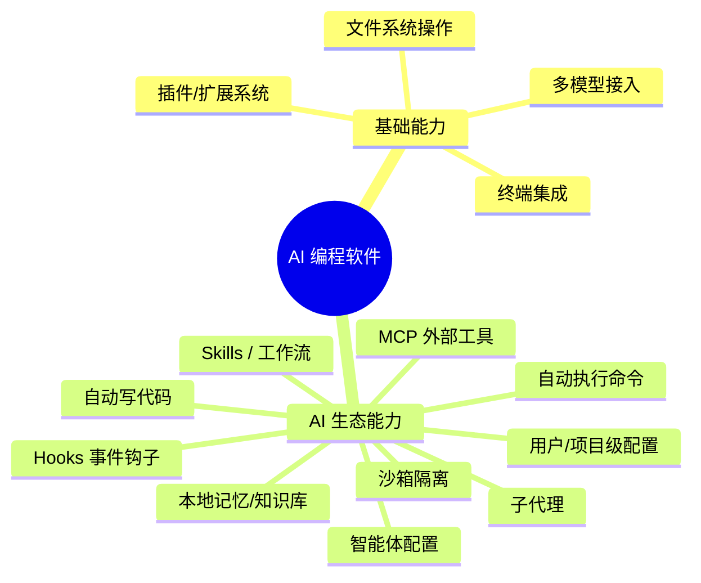

先把结论放前面：

- 这几款工具本质上都是“带 Agent 能力的编程环境”，共性是：  
  能读/改文件、跑终端命令、接入外部工具（MCP）、可配置规则/技能/子代理。  
- 差异主要在于：  
  - 形态：CLI / IDE / 桌面 / Web 的组合不同；  
  - 安全与隔离：Claude Code、Codex 有比较系统的沙箱/权限体系，Cursor/TRAE 更偏权限白名单；  
  - “知识库/记忆”：TRAE 有官方本地 Memories，Cursor 主要靠社区插件，Claude Code/Codex 有类似 CLAUDE.md / .codex 的持久化上下，但不是严格意义上的“向量知识库”。

下面我按你提到的几个维度，系统讲清楚：Codex（CLI/App）、Claude Code、Cursor、Trae 各自有什么功能。

---

## 一、整体结构（先看“都有什么”）

用一张结构图先概览一下这些工具的功能维度：

接下来按工具展开，并在每一项里标明：谁有、谁没有、谁更完善。

---

## 二、基础功能：终端 / 文件系统 / 插件 / 多模型

### 1. OpenAI Codex（CLI + App + Web）

**形态**：  
- CLI：本地终端 TUI，直接在项目目录里跑 `codex`。  
- App：桌面应用。  
- Web：ChatGPT 里的 Codex Web。

**基础能力：**

- **终端 & 文件系统**
  - CLI 启动后是全屏终端 UI，可以在你的仓库里读文件、改文件、跑命令，你实时看到它的操作计划并可以逐条审批。【turn19fetch0】
  - App 中内置集成终端，可以跑脚本、Git 操作等，Codex 也能读取终端输出。【turn7search0】【turn7search1】

- **插件 / 扩展**
  - 官方文档中明确有 **Plugins** 体系，可以把 Skills、Hooks、Subagents、MCP 打包成插件分发。【turn19fetch0】
  - 有 `.codex/skills`、`rules`、`hooks`、`AGENTS.md` 等配置目录，支持项目级和全局配置。【turn19fetch0】

- **多模型接入**
  - Codex 默认使用 OpenAI 自家的 GPT‑5.x‑Codex 等模型，通过 OpenAI API 调用。【turn12search16】
  - 可以通过 **外部模型配置** 接入其他模型（包括自托管网关），文档中有 “External models” 一节。【turn17fetch0】

> 总结：Codex 在“基础 IDE 能力”上更像一个 Agent 化的 CLI/桌面 App，而不是传统 IDE；终端和文件操作是核心能力，插件/模型扩展都比较完整。

---

### 2. Claude Code（CLI + VS Code/JetBrains + 桌面 + Web）

**形态**：  
- 终端 CLI：`claude` 命令。  
- VS Code / JetBrains 插件。  
- 桌面应用。  
- Web：claude.ai/code 的云端会话。

**基础能力：**

- **终端 & 文件系统**
  - 官方定位：**agentic coding tool，能读代码库、改文件、跑命令**。【turn8fetch1】
  - 内置工具包括：文件读写、搜索、执行命令、Web 访问等。【turn7search4】

- **插件 / 扩展**
  - 有 **Plugins & Marketplaces** 层，把 Skills、Subagents、Hooks、MCP 打包成插件。【turn1fetch0】
  - 扩展点包括：CLAUDE.md（持久上下文）、Skills（可复用工作流）、MCP（外部服务）、Hooks、Agent Teams 等。【turn1fetch0】

- **多模型接入**
  - 支持模型别名（`default`/`sonnet`/`opus`/`haiku` 等），可以在 CLI 启动参数、环境变量、设置中配置。【turn13fetch0】
  - 支持 Anthropic、Bedrock、Vertex、Foundry 等多种后端，也可通过 LLM Gateway 接第三方模型。【turn13fetch0】【turn12search2】

> 总结：Claude Code 在“基础 IDE 能力”上更偏一个 Agent 层，可以挂在多个 IDE/终端上；模型配置、权限体系、沙箱隔离都比较完善（后面单独讲）。

---

### 3. Cursor（AI IDE）

**形态**：  
- 一个完整的 IDE（基于 VS Code 技术），原生集成 AI Agent。  
- 有自己的 CLI、Cloud Agents 等。【turn13fetch1】

**基础能力：**

- **终端 & 文件系统**
  - 内置终端，Agent 可以在终端中跑命令；文档明确：终端命令需要你审批，也可以配置自动允许的白名单。【turn16fetch2】
  - Agent 可以读/写工作区文件，默认改配置文件需要额外审批。【turn16fetch2】

- **插件 / 扩展**
  - **Plugins** 目录：把 Rules、MCP Servers、Skills 等打包成插件，社区有 Cursor Directory。【turn1fetch1】
  - **Rules**：支持项目规则（`.cursor/rules`）、用户规则、团队规则、AGENTS.md 四种，用来给 Agent 注入持久化指令。【turn16fetch0】
  - **Skills / Subagents / Hooks / MCP**：在 Customizing 菜单中集中管理。【turn8fetch2】【turn8fetch4】

- **多模型接入**
  - 官方支持多种前沿模型：Claude 4.6、GPT‑5.x、Gemini、Grok、Composer 等，通过 Models & Pricing 页面统一管理。【turn13fetch1】
  - 提供 **Auto / Composer / API 三个用量池**，可以选择不同模型或让系统自动选模型。【turn13fetch1】

> 总结：Cursor 是“完整 IDE + 强 Agent 体系”，在传统 IDE 能力（终端、文件、调试）之上，叠加了 Rules / Skills / MCP / Subagents 这套 Agent 扩展栈。

---

### 4. Trae / TraeIDE（AI IDE）

**形态**：  
- TraeIDE：基于 VS Code 的 AI IDE，支持 macOS / Windows / Linux。【turn1fetch1】【turn10search4】  
- TRAE：还有 SOLO Coder / SOLO Builder 等云端/桌面 Agent 模式。【turn6fetch3】【turn10search6】

**基础能力：**

- **终端 & 文件系统**
  - IDE 内置终端，Agent 可以执行命令；v3.5.40 重构了终端执行为“只读终端卡片 + 后台任务坞”，支持长时运行命令管理。【turn11fetch2】
  - Agent 工具包括：Read / Edit / Terminal / Preview / Web search。【turn6fetch3】

- **插件 / 扩展**
  - 作为 VS Code 衍生 IDE，**兼容大部分 VS Code 扩展**。【turn1fetch1】
  - 另外有一套 TRAE 自己的扩展：Skills、Rules、Memories、Agents、MCP 等。【turn6fetch0】【turn6fetch1】【turn6fetch2】【turn6fetch3】

- **多模型接入**
  - Models 文档显示支持多家模型提供商：AWS、Anthropic、OpenAI、Gemini、xAI、OpenRouter、Ollama、DeepSeek、阿里云、腾讯云等。【turn12search10】
  - 可以在“Models 面板”中添加多个模型，并在自定义 Agent 中选择不同模型。【turn6fetch3】

> 总结：Trae 在基础 IDE 能力上更接近“增强版 VS Code”，同时官方内置了 Skills / Rules / Memories / Agents 这套 Agent 管理体系，模型接入非常灵活。

---

## 三、AI 生态功能：自动写代码 / 自动执行命令 / Skills / MCP / 子代理 / 沙箱 / 本地记忆

### 1. 自动写代码 & 自动终端执行

**共性**：  
这四款工具都可以：

- 在你的项目里**读代码、改文件、创建/删除文件**；
- 在终端里**运行测试、构建、Git 命令**等，通常需要你确认（或配置自动允许）。

差异主要在“安全边界”和“自动化程度”。

#### Claude Code

- 内置工具：文件操作、搜索、执行命令、Web 访问等。【turn7search4】
- 默认是“权限驱动”：
  - 默认只读，写文件、跑命令都需要你明确批准。【turn11fetch1】
  - 提供 **Sandboxed Bash Tool**：可以在指定目录和网络边界内自动执行命令，减少反复点确认。【turn11fetch0】
- Web 端有云端隔离环境，你可以在 Web 上跑会话，再通过 `--remote` / `--teleport` 把任务拉回本地终端。【turn7search3】

#### Codex

- CLI / App 中可以**读仓库、改文件、跑命令**，并在 TUI 中展示计划和差异，你可以逐步接受/拒绝。【turn19fetch0】
- 安全机制：
  - 有 **Agent approvals & security** 文档，支持审批模式、网络代理、沙箱配置等。【turn22fetch1】
  - 支持在 **Sandbox agents** 中运行（通常是容器化环境），用于生产级隔离。【turn22fetch0】

#### Cursor

- Agent 工具：文件读写、终端、搜索等。【turn16fetch2】
- 安全默认：
  - 改工作区文件不需要审批，但改配置文件需要。【turn16fetch2】
  - 终端命令默认需要审批，可以通过白名单自动允许某些命令。【turn16fetch2】
- 没有像 Claude Code 那样强调 OS 级沙箱，更多是权限白名单 + 工作区信任（workspace trust）机制。【turn16fetch2】

#### Trae

- Agent 工具集中包括 **Terminal** 工具，可以在终端中执行命令并返回结果。【turn6fetch3】
- v3.5.x 版本重构了终端执行为“只读终端卡片 + 后台任务坞”，强调稳定性与可观测性。【turn11fetch2】
- 文档中提到 Windows 上有“沙箱相关修复”，说明它有一定程度的终端沙箱能力，但细节不如 Claude/Codex 详细。【turn11fetch2】

---

### 2. Skills（技能 / 工作流）

#### Claude Code

- **Skills** 是扩展层的一种：可复用的知识 + 工作流，可以是纯知识，也可以包含可执行脚本。【turn1fetch0】
- 可以在对话中通过 `/skill` 调用，或让 Claude 自动判断何时加载。
- Skills 可以在当前会话中运行，也可以在隔离的 **子代理** 中执行。【turn1fetch0】

#### Codex

- 有 **Skills** 目录和文档，用于打包可复用的工作流（例如 OSS 维护、前端 UI 构建）。【turn19fetch0】【turn17fetch0】
- 官方文档中有 “Using skills to accelerate OSS maintenance” 等教程。【turn19fetch0】

#### Cursor

- **Agent Skills**：一个开放标准，用 `SKILL.md` 定义技能，支持跨项目、跨工具复用。【turn8fetch2】
- Skills 可以包含脚本、模板、参考资料，Agent 会根据上下文自动判断何时使用，也可以通过 `/skill` 手动调用。【turn8fetch2】
- Skills 存放在 `.agents/skills/`、`.cursor/skills/`、`~/.agents/skills/`、`~/.cursor/skills/` 等目录，并且兼容 `.claude/skills`、`.codex/skills` 目录。【turn8fetch2】

#### Trae

- **Skills**：每个技能是一个 SKILL.md 文件，描述任务目标、约束、推荐流程、脚本/模板等。【turn6fetch0】
- 技能分为：
  - 全局技能：对所有项目生效；
  - 项目技能：只对当前项目生效。【turn6fetch0】
- Skills 与 Rules 的区别：
  - Rules：一次性加载所有规则，始终在上下文中；
  - Skills：按需加载，只在相关任务时注入，节省 token。【turn6fetch0】

---

### 3. MCP（Model Context Protocol）—— 接入外部工具和数据

**MCP** 现在基本是这几家共同的“外部工具总线”。

#### Claude Code

- 官方文档：**Claude Code can connect to hundreds of external tools and data sources through MCP**。【turn12search4】
- 用途示例：从 JIRA/Linear 读需求、从 Sentry 读监控、在 GitHub 上创建 PR 等。【turn12search4】

#### Cursor

- 有专门的 MCP 文档，支持 stdio、SSE、Streamable HTTP 三种传输方式。【turn1fetch0】
- 支持 Tools、Prompts、Resources、Roots、Elicitation、MCP Apps 等能力，可以让 MCP 工具返回交互式 UI。【turn1fetch0】
- 配置方式：`mcp.json` 中定义本地/远程 MCP 服务器。【turn1fetch0】

#### Trae

- 支持 MCP 协议，支持 stdio、SSE、Streamable HTTP 三种传输。【turn8fetch5】
- 在自定义 Agent 中可以添加 MCP servers，把 MCP 工具变成 Agent 的工具。【turn6fetch3】

#### Codex

- 文档中有 “MCP and Connectors”、“MCP server” 等章节，支持把 Codex 作为 MCP 客户端或服务端。【turn17fetch0】【turn19fetch0】

---

### 4. 智能体配置 / 子代理（Agents & Subagents）

#### Claude Code

- **Subagents**：在隔离上下文中运行自己的循环，最后把摘要结果返回给主会话。【turn1fetch0】
- **Agent teams**：多个独立会话协同，共享任务队列和点对点消息，适合并行研究、多方案对比等。【turn1fetch0】
- **Hooks**：在主循环外执行的脚本，用于事件驱动的自动化（例如每次编辑后跑 ESLint）。【turn1fetch0】

#### Codex

- 文档中有 **Subagents** 一节，支持类似 Claude 的子代理模式，用于并行任务、上下文隔离。【turn19fetch0】
- 还有 **Agent approvals & security** 文档，管理代理行为和权限。【turn22fetch1】

#### Cursor

- **Subagents**：专门用于处理大上下文、并行任务的子代理，例如 Explore、Bash、Browser 三个内置子代理，分别负责代码库探索、终端命令、浏览器操作。【turn8fetch4】
- 子代理有独立上下文，可以并行执行，使用不同模型。【turn8fetch4】

#### Trae

- **Agents**：在设置中可以创建自定义 Agent，配置：
  - 名称、头像、Prompt；
  - 可调用的工具：Read / Edit / Terminal / Preview / Web search；
  - MCP servers；
  - 是否允许其他 Agent 调用（可被 SOLO Coder 调用）。【turn6fetch3】
- **SOLO Coder / SOLO Builder**：TRAE 的多 Agent 模式，可以自动推进整个开发流程。【turn10search6】

---

### 5. 用户/项目级别配置 & Hooks

#### Claude Code

- **CLAUDE.md**：项目级持久上下文，每次会话都会加载，用于存放项目约定、编码规范等。【turn1fetch0】
- **Permissions / Sandboxing / Terminal configuration** 等都是用户/项目级配置项。【turn11fetch0】【turn11fetch1】
- **Hooks**：在特定事件（工具调用前后、会话结束等）执行的脚本，用于自动化工作流。【turn1fetch0】

#### Codex

- 配置文件（Config File）中可以设置 Rules、Hooks、AGENTS.md、MCP、Skills、Subagents 等，支持项目级和全局配置。【turn19fetch0】

#### Cursor

- **Rules**：支持项目规则（`.cursor/rules`）、用户规则、团队规则、AGENTS.md。【turn16fetch0】
- CLI 中有 **Permissions** 配置，可以按 Shell、Read、Write、WebFetch、MCP 等粒度控制权限，配置在 `~/.cursor/cli-config.json`（全局）或 `<project>/.cursor/cli.json`（项目级）。【turn16fetch1】
- **Hooks**：支持内置钩子和自定义钩子，例如 `PreToolUse` / `PostToolUse`、`beforeSubmitPrompt` 等。【turn8fetch3】

#### Trae

- **Rules**：用户规则（所有项目生效）和项目规则（`.trae/rules` 目录），可以设置：
  - Always Apply / Apply to Specific Files / Apply Intelligently / Apply Manually 等模式。【turn6fetch1】
- **Memories**：用户级和项目级的本地记忆条目，上限各 20 条，用于记录偏好和规则。【turn6fetch2】

---

### 6. 沙箱隔离 & 安全机制

#### Claude Code —— 安全体系最完整

- **Sandboxed Bash Tool**：
  - 使用 OS 级原语实现文件系统和网络隔离：
    - 文件系统：默认只能写当前工作目录及其子目录；可以配置允许/拒绝路径。【turn11fetch0】
    - 网络：通过代理限制只能访问指定域名，新域名默认触发审批。【turn11fetch0】
  - macOS 使用 Seatbelt，Linux/WSL2 使用 bubblewrap。【turn11fetch0】
- **权限驱动架构**：
  - 默认只读，敏感操作需要明确批准；支持命令白名单、批量接受编辑等。【turn11fetch1】
- Web 云端会话有独立的隔离环境和网络控制。【turn7search3】

#### Codex

- 有 **Sandbox agents** 概念，通常在容器化环境中运行，用于生产级隔离。【turn22fetch0】
- **Agent approvals & security** 文档涵盖审批模式、网络代理、治理等。【turn22fetch1】

#### Cursor

- 默认敏感操作需要审批，终端命令可以通过白名单自动允许。【turn16fetch2】
- 支持 **workspace trust**，对不信任仓库可以限制 AI 功能。【turn16fetch2】
- 没有像 Claude Code 那样强调 OS 级沙箱，更偏“工作区 + 权限白名单”。

#### Trae

- 终端执行在 v3.5.x 重构为只读卡片 + 后台任务坞，并修复了 Windows 上的沙箱相关问题。【turn11fetch2】
- 安全细节公开较少，但至少有“终端执行隔离”的概念。

---

### 7. 本地记忆 / 知识库

#### Trae —— 官方内置 Memories

- **Memories**：
  - 分为全局记忆和项目记忆，都存储在本地，不跨电脑同步。【turn6fetch2】
  - 可以自动从对话中识别偏好/规则，也可以手动添加；达到上限时自动淘汰低价值记忆。【turn6fetch2】
- 这是目前这几家工具中，**官方明确支持“本地记忆库”的实现**。

#### Claude Code / Codex / Cursor

- **Claude Code**：
  - 有 CLAUDE.md、Skills、Hooks 等持久化上下文，但更像“规则/工作流”，而不是语义检索的记忆库。【turn1fetch0】
- **Codex**：
  - 有 `.codex/skills`、`AGENTS.md` 等持久化配置，但官方文档里没有强调向量化的记忆知识库。【turn19fetch0】
- **Cursor**：
  - 官方没有内置“记忆系统”，但社区有：
    - Memory Bank：一套规则，用来在会话间保持记忆。【turn25search1】
    - Recallium：自托管 MCP 记忆系统，配合 Cursor 等使用。【turn25search0】

---

## 四、按你关心的点做一个横向对比

### 1. “自动终端执行命令 + 自动写代码”能力

| 工具          | 自动改文件                              | 自动跑命令                                             | 默认安全策略                            | 沙箱/隔离                                |
| ----------- | ---------------------------------- | ------------------------------------------------- | --------------------------------- | ------------------------------------ |
| Claude Code | ✅ 需审批或沙箱内自动                        | ✅ 有 Bash 工具，可沙箱内执行                                | 默认只读，敏感操作需审批                      | OS 级沙箱（文件+网络）【turn11fetch0】          |
| Codex       | ✅ TUI 中展示计划，可逐条审批                  | ✅ 可读终端输出、执行命令【turn7search0】                       | 审批模式 + 网络代理 + 沙箱代理                | Sandbox agents / 容器级隔离【turn22fetch0】 |
| Cursor      | ✅ 改工作区文件默认允许，配置文件需审批【turn16fetch2】 | ✅ 终端命令默认需审批，可白名单自动允许【turn16fetch2】                | 工作区信任 + 白名单                       | 无 OS 级沙箱，偏权限控制【turn16fetch2】         |
| Trae        | ✅ 有 Read/Edit 工具【turn6fetch3】      | ✅ Terminal 工具 + 只读终端卡片【turn6fetch3】【turn11fetch2】 | 终端执行隔离、Windows 沙箱修复【turn11fetch2】 | 有终端沙箱概念，细节未完全公开                      |

### 2. Skills / MCP / 子代理 / Hooks

| 能力     | Claude Code                            | Codex                              | Cursor                                              | Trae                                                 |
| ------ | -------------------------------------- | ---------------------------------- | --------------------------------------------------- | ---------------------------------------------------- |
| Skills | ✅ 扩展层，可复用工作流【turn1fetch0】              | ✅ 有 Skills 目录和教程【turn19fetch0】     | ✅ Agent Skills 开放标准【turn8fetch2】                    | ✅ SKILL.md + 全局/项目技能【turn6fetch0】                    |
| MCP    | ✅ 连接数百种外部工具【turn12search4】             | ✅ MCP and Connectors【turn17fetch0】 | ✅ 完整 MCP 文档，支持 Tools/Prompts/Resources【turn1fetch0】 | ✅ 支持多种 MCP 传输和工具类型【turn8fetch5】                      |
| 子代理    | ✅ Subagents + Agent teams【turn1fetch0】 | ✅ Subagents【turn19fetch0】          | ✅ Subagents（Explore/Bash/Browser）【turn8fetch4】      | ✅ 自定义 Agent + SOLO Coder【turn6fetch3】【turn10search6】 |
| Hooks  | ✅ 事件驱动脚本【turn1fetch0】                  | ✅ Hooks 配置【turn19fetch0】           | ✅ Hooks（PreToolUse/PostToolUse 等）【turn8fetch3】      | ❌ 官方文档暂未强调 Hooks（但可通过规则+脚本模拟）                        |

### 3. 用户/项目级配置 & 本地记忆

| 能力              | Claude Code | Codex | Cursor | Trae |
|-------------------|------------|-------|--------|------|
| 项目级规则        | ✅ CLAUDE.md + Hooks 等【turn1fetch0】 | ✅ Rules / Hooks / AGENTS.md【turn19fetch0】 | ✅ 项目规则 + AGENTS.md【turn16fetch0】 | ✅ 项目规则（.trae/rules）【turn6fetch1】 |
| 用户级规则        | ✅ 用户设置 + 权限【turn11fetch1】 | ✅ 全局配置文件【turn19fetch0】 | ✅ 用户规则【turn16fetch0】 | ✅ 用户规则【turn6fetch1】 |
| 本地记忆知识库    | ❌（持久上下文，但非语义记忆） | ❌（无官方记忆库） | ❌（社区有 Memory Bank / Recallium）【turn25search1】【turn25search0】 | ✅ 官方 Memories（本地记忆条目）【turn6fetch2】 |

---

## 五、怎么根据你列的需求选型？

如果你关心的是：

- **强安全隔离 + 审计**：  
  优先看 **Claude Code**（OS 级沙箱 + 权限驱动）和 **Codex**（Sandbox agents + 审批体系）。
- **Agent 扩展生态（Skills / MCP / 子代理 / Hooks）**：  
  四家都比较完整，其中 **Cursor** 和 **Claude Code** 的 Agent 文档和社区案例最多；**Trae** 内置 Skills/Rules/Memories 比较统一。
- **本地记忆 / 知识库**：  
  **Trae** 是目前唯一官方内置 Memories 的 IDE；其他家需要你自己用 CLAUDE.md / 规则 / 社区记忆系统实现。
- **多模型接入 / 自定义模型**：  
  **Cursor** 和 **Trae** 都支持多家模型提供商；**Claude Code** 通过 LLM Gateway 支持多种后端；**Codex** 默认 OpenAI 自家模型，但也可配置外部模型。

如果你告诉我：  
- 你主要用什么语言/技术栈；  
- 更看重安全还是效率；  
- 是个人用还是团队/企业用；  

我可以基于上面的功能矩阵，帮你给出更具体的“选哪几个、怎么组合”的建议。