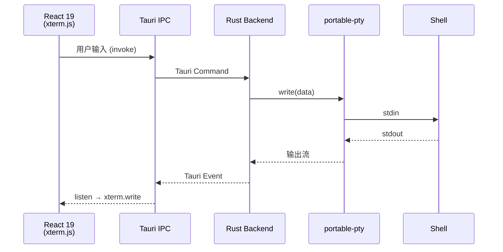
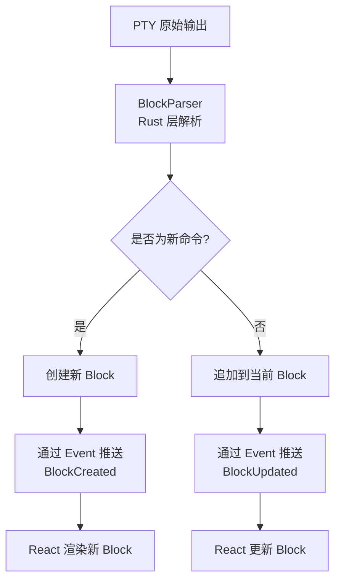

基于你的 **Rust + Tauri + React 19 + Zustand** 技术栈，实现一个兼顾Agent和用户的终端，我推荐以下三种方案。这些方案都经过了市场验证，且与你现有的技术栈高度兼容。

---

## 方案一：务实高效型（xterm.js + portable-pty）

### 架构与数据流

这是目前社区中最主流、最成熟的方案，也是开源项目 **Terax** 和 **Lia Terminal** 的实战验证之选。

### 组件划分与职责

* **React 19 (xterm.js)**：负责终端渲染与用户交互，可配合 `react-xtermjs` 库简化集成。
* **Tauri IPC**：桥接前端与 Rust 后端，通过 `invoke`/`listen` 机制实现双向通信。
* **Rust Backend (portable-pty + dscode-terminal)**：管理 PTY 生命周期（创建、读写、resize、关闭），`dscode-terminal` 提供了开箱即用的 Tauri 集成和线程安全的状态管理。
* **Zustand**：管理终端会话状态（标签页、Block 结构、Agent 交互记录）。

### ✅ 优点
* **技术难度**：低，团队可快速上手，开发效率高。
* **生态成熟度**：xterm.js 社区活跃，文档和 addon 丰富（如 `fit`、`search`、`webLinks`）。
* **与 Tauri 契合度**：优秀。`dscode-terminal` 提供可选 `tauri` feature flag，可直接通过 Tauri 事件系统转发 PTY 输出。

### ⚠️ 缺点
* **Agent 集成成本**：xterm.js 原生为纯文本流，实现 Warp 风格的“Block 模型”需在应用层额外开发。
* **渲染性能**：大量输出时，Web 渲染性能不如原生方案。

### 🔍 实施注意事项
* 需通过 `tauri.conf.json` 中的 `permissions` 数组授予 PTY 相关权限。
* PTY I/O 操作是同步的，需使用独立线程并通过 `AtomicBool` 实现安全关闭，`dscode-terminal` 已处理好这些细节。
* `portable-pty` 可作为 fallback，对 Windows 10+ 提供稳定的 PTY 支持。

### 推荐指数：⭐⭐⭐⭐⭐（强烈推荐）

---

## 方案二：AI 原生增强型（xterm.js + PTY + Block 模型）

方案一实现了基础终端，本方案在此基础上增加 **Block 模型**，为 Agent 提供结构化信息：

* **Block Parser 设计**：在 Rust 层检测 Shell 提示符（如 `$ `、`# `）或命令退出码，将 PTY 输出分段为独立的命令-输出对。
* **结构化事件**：定义 `BlockCreated`、`BlockUpdated`、`CommandFinished` 等 Tauri 事件，前端按 Block 渲染而非原始文本流。
* **Warp 参考**：Warp 的核心创新正是 Block 模型——每个 Block 关联命令文本、退出码、执行时间等元数据，为 Agent 提供精确的上下文。
* **Agent 接口增强**：Agent 可通过 IPC 按 Block ID 获取结构化数据（输入、输出、退出码、工作目录），便于调试、上下文收集和错误分析。

### ✅ 优点
* **渐进式开发**：可在方案一基础上逐步构建。
* **Agent 友好**：提供结构化上下文，Agent 可直接获取特定命令的完整输入输出。
* **用户友好**：UI 体验更现代，命令输出可独立操作（复制、分享）。

### ⚠️ 缺点
* **开发复杂度**：Block 解析和渲染逻辑需自行实现。
* **提示符兼容性**：不同 Shell 和自定义提示符的检测可能不准确。

### 🔍 实施注意事项
* 提示符检测建议使用 ANSI OSC 序列或 Shell 集成（如注入 `trap` 函数）以提高准确度。
* Block 模型的状态管理适合用 Zustand 的 `Map<blockId, Block>` 结构，支持高效的增删改查。

### 推荐指数：⭐⭐⭐⭐（强烈推荐，但需更多投入）

---

## 方案三：高性能原生型（嵌入 Ghostty / Alacritty 终端核心）

Warp 级性能，技术门槛高。Rust 应用通过进程间通信（IPC），如 Unix Domain Socket 或 stdin/stdout 管道，与 Zig 编写的 `libghostty` 库交互。

### ✅ 优点
* **极致性能**：GPU 加速渲染，Warp 和 Alacritty 已证明此路线。
* **终端兼容性**：核心库经过大量用户验证，VT100/VT220 等兼容性好。

### ⚠️ 缺点
* **集成复杂度**：目前 `libghostty` 生态不成熟，多窗口/多 Tab 管理需大量底层工作。
* **UI 灵活性**：原生渲染引擎可能与 React UI 的协调比纯 Web 方案复杂。

### 🔍 实施注意事项
* 建议密切关注 `libghostty` 的进展，目前阶段集成风险较高。
* 当产品面临极端性能瓶颈时，可将此方案作为升级选项。

### 推荐指数：⭐⭐⭐（技术储备与长期规划）

## 跨方案关键决策点比较

| 维度 | 方案一：务实高效型 | 方案二：AI原生增强型 | 方案三：高性能原生型 |
|---|---|---|---|
| **技术难度** | ★★☆ | ★★★☆ | ★★★★★ |
| **开发效率** | ★★★★★ | ★★★★☆ | ★★☆ |
| **Agent友好度** | ★★☆ | ★★★★★ | ★★★ |
| **终端兼容性** | ★★★★★ | ★★★★☆ | ★★★★★ |
| **渲染性能** | ★★★☆ | ★★★☆ | ★★★★★ |
| **技术风险** | 极低 | 低 | 高 |
| **适用阶段** | MVP快速验证 | 产品功能打磨 | 性能极致优化 |

### 总结与行动计划建议

**推荐选择方案一作为起点，快速验证核心功能，随后在方案二上持续打磨终端体验。** 具体实施步骤如下：

1.  **第1阶段（1-2周）**：克隆 [Lia Terminal](https://github.com/harryfrzz/lia-term)或 [Terax](https://terax.app)源码，学习其 `xterm.js + portable-pty + Tauri IPC` 的集成方式，搭建基础终端框架。
2.  **第2阶段（3-4周）**：设计并实现 Block 解析逻辑，在 Zustand 中建立 Block 状态模型，改造 React 渲染层以支持 Block 视图，并为 Agent 提供结构化数据接口。
3.  **第3阶段（按需启动）**：当终端性能成为瓶颈时，调研 `libghostty` 的成熟度，评估是否替换底层渲染引擎。

### 💎 总结与实施建议

针对你的 **Rust + Tauri + React 19** 技术栈，**强烈建议从方案一开始，这是已验证、风险最低的路径**，同时用**方案二的“Block模型”作为Agent友好的核心设计原则**。

具体实施建议：
*   立即尝试用 `dscode-terminal` 的 `tauri` feature 快速跑通一个 PTY + xterm.js 的原型。
*   在Zustand store中，从一开始就为每个命令的输出设计结构化的“Block”模型，而非简单的文本流。
*   保持对 `libghostty` 项目的关注，待其生态成熟，可在未来作为性能升级的可选路径。

这种“立足当下，规划未来”的策略，能让你在快速交付的同时，为产品构建起真正的技术护城河。