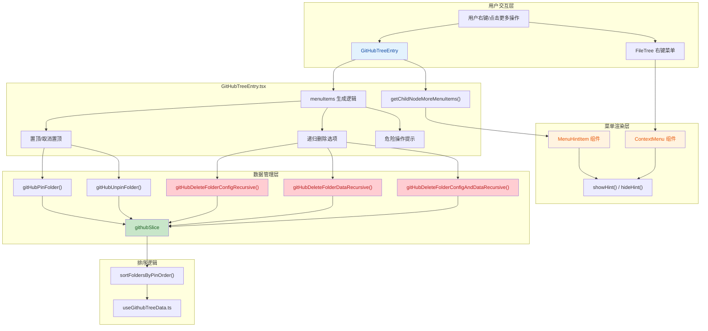

## 1. 高层摘要 (TL;DR)

*   **影响范围**: 🔴 **高** - 对GitHub树形目录的菜单系统进行了全面重构，新增多项功能
*   **核心变更**:
    *   新增**置顶/取消置顶**功能，支持目录排序
    *   新增**递归删除**功能，可批量删除嵌套子目录的CI配置和数据
    *   新增**危险操作提示**（"!"图标），悬停显示详细说明
    *   重构菜单系统，支持**分组显示**（白色选项 vs 红色选项）和**分割线**
    *   新增**"从此区域移除不显示"**功能，用于隐藏工作区目录

---

## 2. 可视化概览 (代码与逻辑映射)



---

## 3. 详细变更分析

### 🎨 组件架构与UI改进

#### **GitHubTreeEntry.tsx** - 核心菜单重构

**变更内容**:
-   重构了菜单项生成逻辑，支持新的菜单结构
-   新增**置顶/取消置顶**功能，所有目录和工作区顶级目录都支持
-   新增**"从此区域移除不显示"**选项（仅工作区顶级目录）
-   新增**"删除目录"**选项（嵌套子目录和非工作区目录）
-   新增**递归删除选项**：
    -   `删除CI配置[嵌套]`
    -   `删除数据[嵌套]`
    -   `删除CI配置及数据[嵌套]`
-   添加了**分割线**（`sep-danger` 和 `sep-recursive`）
-   使用 `MenuHintItem` 组件渲染带提示的菜单项

**菜单项分组结构**:
```
─── 白色字体功能选项 ───
刷新
置顶 / 取消置顶
重命名
设置
从此区域移除不显示     ← 仅工作区顶级目录
──────────────────    ← sep-danger 分割线
─── 红色字体功能选项 ───
删除目录 (!)          ← 递归删除目录及所有数据
删除CI配置
删除数据
删除CI配置及数据
──────────────────    ← sep-recursive 分割线
删除CI配置[嵌套] (!)  ← 递归删除嵌套子目录的CI配置
删除数据[嵌套] (!)    ← 递归删除嵌套子目录的CI数据
删除CI配置及数据[嵌套] (!)  ← 递归删除嵌套子目录的CI配置及数据
```

#### **MenuHintItem.tsx** - 危险操作提示组件

**变更内容**:
-   新增 `menuId` 和 `danger` 属性
-   支持危险样式的提示图标（红色文字）
-   改进了菜单卡片查找逻辑，支持动态菜单ID

#### **ContextMenu.tsx** - 通用右键菜单

**变更内容**:
-   新增 `hint` 属性到 `ContextMenuItem` 接口
-   实现 `showHint()` 和 `hideHint()` 函数，动态创建提示卡片
-   在菜单项中渲染 "!" 提示图标
-   支持danger样式的hint

---

### 📊 数据管理与状态更新

#### **githubSlice.ts** - Store状态管理

**新增状态**:
| 状态名 | 类型 | 说明 |
|--------|------|------|
| `activeCiFolderId` | `string \| null` | 当前激活的CI文件夹ID |
| `pinnedOrder` | `number \| undefined` | 目录置顶顺序（越小越靠前） |

**新增Actions**:

| Action | 说明 |
|--------|------|
| `gitHubPinFolder(folderId)` | 置顶目录 |
| `gitHubUnpinFolder(folderId)` | 取消置顶目录 |
| `gitHubDeleteFolderConfigRecursive(folderId)` | 递归删除目录及所有嵌套子目录的CI配置 |
| `gitHubDeleteFolderDataRecursive(folderId)` | 递归删除目录及所有嵌套子目录的CI数据 |
| `gitHubDeleteFolderConfigAndDataRecursive(folderId)` | 递归删除目录及所有嵌套子目录的CI配置及数据 |
| `setActiveCiFolderId(folderId)` | 设置当前激活的CI文件夹ID |

**递归删除逻辑**:
```typescript
// 递归查找所有后代目录
const findDescendants = (parentId: string) => {
  for (const f of state.gitHubCiFolders) {
    if (f.parentId === parentId && !idsToDelete.has(f.id)) {
      idsToDelete.add(f.id);
      findDescendants(f.id);
    }
  }
};
```

#### **useGithubTreeData.ts** - 目录排序

**新增函数**:
```typescript
function sortFoldersByPinOrder(folders: GitHubCiFolderState[]): GitHubCiFolderState[] {
  return [...folders].sort((a, b) => {
    const aPinned = a.pinnedOrder !== undefined;
    const bPinned = b.pinnedOrder !== undefined;
    if (aPinned && !bPinned) return -1;  // 置顶的排前面
    if (!aPinned && bPinned) return 1;
    if (aPinned && bPinned) return (a.pinnedOrder || 0) - (b.pinnedOrder || 0);  // 按顺序排序
    return a.createdAt - b.createdAt;  // 未置顶的按创建时间排序
  });
}
```

---

### 🎯 目录分类与菜单可见性规则

| 目录类型 | 判断条件 | 删除目录 | 递归选项 | 从此区域移除不显示 |
|----------|----------|-----------|---------|-------------------|
| 工作区顶级目录 | `nodeType === 'workspace'` | ❌ | ✅ | ✅ |
| 工作区嵌套子目录 | `isNestedFolder` | ✅ | ✅ | ❌ |
| 非工作区顶级目录 | `isUserFolderRoot` | ✅ | ✅ | ❌ |
| 非工作区嵌套子目录 | `isUserFolderChild` | ✅ | ✅ | ❌ |

---

### 📝 类型定义更新

#### **fileTree.utils.ts**
```typescript
export type FileTreeContextMenuItem<T extends FileTreeRenderableNode> = {
  label: string;
  icon?: React.ReactNode;
  disabled?: boolean;
  danger?: boolean;
  hasHint?: boolean;      // 新增
  hint?: string;          // 新增
  separator?: true;
  action?: (node: T, multiSelectedNodes: T[]) => void;
}
```

---

### 🎨 样式更新

#### **file-operations.css**
```css
/* 危险样式的提示图标 */
.adl-menu-item__hint.is-danger {
  color: var(--danger);
}

.adl-menu-item__hint.is-danger:hover {
  background: var(--danger-soft);
  color: var(--danger);
}
```

#### **context-menu.css**
```css
.adl-sidebar-menu__item {
  position: relative;  /* 新增，用于定位提示卡片 */
}
```

---

## 4. 影响与风险评估

### ⚠️ 破坏性变更
| 变更项 | 影响 | 兼容性 |
|--------|------|--------|
| 菜单项结构 | 菜单项现在支持 `separator` 和 `hint` 属性 | ✅ 向后兼容 |
| GitHubCiFolderState | 新增 `pinnedOrder` 可选属性 | ✅ 向后兼容 |
| ContextMenuItem | 新增 `hint` 可选属性 | ✅ 向后兼容 |

### 🔍 测试建议

1.  **置顶功能测试**:
    -   验证置顶目录是否排在列表顶部
    -   验证取消置顶后目录是否恢复原位置
    -   验证多个置顶目录的排序顺序

2.  **递归删除测试**:
    -   验证递归删除是否正确删除所有嵌套子目录的CI配置
    -   验证递归删除是否正确清除所有嵌套子目录的CI数据
    -   验证删除后UI是否正确更新

3.  **危险操作提示测试**:
    -   验证 "!" 图标是否正确显示
    -   验证悬停 "!" 图标时提示卡片是否正确显示
    -   验证危险操作的提示文字是否正确

4.  **菜单分组测试**:
    -   验证分割线是否正确显示
    -   验证白色选项和红色选项是否正确分组
    -   验证不同类型目录的菜单项是否正确显示/隐藏

5.  **"从此区域移除不显示"测试**:
    -   验证工作区顶级目录是否可以隐藏
    -   验证隐藏后是否可以通过左侧边栏恢复

---

## 5. 文档更新

**UIOperationManual/rightpanel/tools/communicate.md** 已全面更新，包含：
-   完整的菜单项分组与顺序说明
-   目录分类与菜单可见性规则表
-   菜单项说明表（含危险色、"!"提示）
-   组件架构说明
-   Store Actions说明
-   新增注意事项（危险项提示、分割线规范、双端一致性、递归删除）