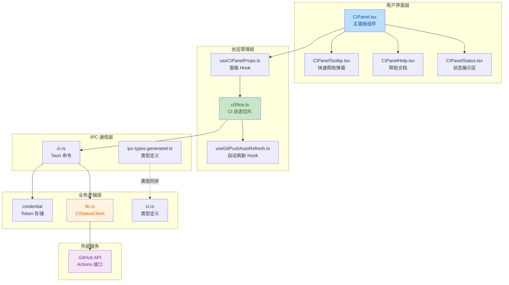

## 1. 高层摘要（TL;DR）

*   **影响范围：** 🟢 **高** - 新增完整的 CI 状态监控功能模块，涉及前后端多个组件
*   **核心变更：**
    *   ✨ 新增 GitHub Actions API 客户端（`crates/ci-status`）
    *   ✨ 新增 CI 面板 UI 组件（状态展示 + 帮助文档）
    *   ✨ 新增 CI 状态管理 Store（支持 Token 安全存储）
    *   ✨ 新增 Git Push 自动刷新功能
    *   ✨ 新增中英文国际化支持

---

## 2. 可视化概览（代码与逻辑映射）



**数据流向：**
```
用户输入配置 → ciSlice.setCiConfig() → localStorage 持久化
用户点击查询 → refreshCiStatus() → Tauri IPC → CiStatusClient.fetch_status() → GitHub API
GitHub API 响应 → CiStatusSnapshot → ciSlice 更新状态 → UI 重新渲染
Git Push 完成 → useGitPushAutoRefresh 检测 → notifyGitPushed() → 自动刷新
```

---

## 3. 详细变更分析

### 📦 后端核心模块

#### 3.1 新增 `crates/ci-status` - GitHub API 客户端

**文件：** `crates/ci-status/src/lib.rs`

**功能概述：**
- 实现完整的 GitHub Actions API 客户端
- 支持查询 Workflow Runs、Jobs、Steps 和 Logs
- 自动处理认证（Bearer Token）
- 30秒请求超时保护

**关键方法：**

| 方法 | 功能 | 返回类型 |
|------|------|----------|
| `fetch_status()` | 获取完整 CI 状态快照 | `Result<CiStatusSnapshot, AppError>` |
| `fetch_latest_run()` | 获取最新 Workflow Run | `Result<CiWorkflowRunSummary, AppError>` |
| `fetch_jobs()` | 获取指定 Run 的所有 Jobs | `Result<Vec<CiJobSummary>, AppError>` |
| `fetch_run_logs()` | 获取运行日志（预览） | `Result<String, AppError>` |

**安全特性：**
```rust
// Token 认证头构建
fn build_auth_header(&self, token: &Option<String>) -> Option<HeaderValue> {
    token.as_ref()
        .filter(|t| !t.is_empty())  // 过滤空 token
        .and_then(|t| {
            let value = format!("Bearer {t}");
            HeaderValue::from_str(&value).ok()
        })
}
```

#### 3.2 新增 CI 类型定义

**文件：** `crates/kernel/src/types/ci.rs`

| 类型 | 用途 |
|------|------|
| `CiRepoConfig` | 仓库配置（owner/repo/branch/workflow_id/token） |
| `CiWorkflowRunSummary` | Workflow Run 摘要（run_id/status/conclusion/head_sha 等） |
| `CiJobSummary` | Job 摘要（job_id/name/status/steps） |
| `CiStepSummary` | Step 摘要（name/status/conclusion） |
| `CiStatusSnapshot` | 完整状态快照（包含 latest_run/jobs/logs） |

**自动生成 TypeScript 类型：**
```rust
#[ts(export, export_to = "../../../frontend/src/shared/ipc-types.generated.ts")]
```

#### 3.3 新增 Tauri IPC 命令

**文件：** `src-tauri/src/commands/ci.rs`

| 命令 | 功能 | 参数 |
|------|------|------|
| `ci_get_status()` | 获取 CI 状态 | `CiRepoConfig` |
| `ci_get_status_without_token()` | 无 Token 查询 | `owner, repo, branch` |
| `ci_set_access_token()` | 保存 Token 到凭证存储 | `token: String` |
| `ci_clear_access_token()` | 清除 Token | - |
| `ci_has_access_token()` | 检查 Token 是否存在 | - |

**Token 安全策略：**
```rust
// 优先级：前端传入 > 凭证存储
let access_token = match &config.access_token {
    Some(t) if !t.trim().is_empty() => Some(t.clone()),
    _ => adl_credential::get_ci_access_token(),  // 系统钥匙串/加密文件
};
```

---

### 🎨 前端 UI 组件

#### 3.4 CI 面板主组件

**文件：** `frontend/src/app/regions/right-panel/panels/CIPanel.tsx`

**功能特性：**
- 双 Tab 设计：**状态** + **帮助**
- 快速帮助按钮（Tooltip）
- 手动刷新按钮（带加载动画）
- 响应式布局

```typescript
type CiTab = 'status' | 'help';
```

#### 3.5 状态展示组件

**文件：** `frontend/src/app/regions/right-panel/panels/CIPanelStatus.tsx`

**核心功能：**

| 区域 | 内容 |
|------|------|
| **配置区** | Owner/Repo/Branch 输入框 + Token 输入框（支持显示/隐藏） |
| **错误提示** | 红色错误横幅，显示 API 错误信息 |
| **Run 摘要** | Workflow 名称、状态、触发者、SHA、开始时间 |
| **Jobs 列表** | 可展开的 Job 列表，显示每个 Job 的 Steps |
| **空状态** | 引导用户配置仓库 |

**状态颜色映射：**
```typescript
function statusColor(conclusion: string | null, status: string): string {
  if (conclusion === 'success') return 'var(--success)';      // 🟢 绿色
  if (conclusion === 'failure' || conclusion === 'cancelled') return 'var(--danger)';  // 🔴 红色
  if (conclusion === 'skipped') return 'var(--text-tertiary)'; // ⬜ 灰色
  if (status === 'in_progress' || status === 'queued') return 'var(--warning)';  // 🟡 黄色
  return 'var(--text-secondary)';
}
```

#### 3.6 帮助文档组件

**文件：** `frontend/src/app/regions/right-panel/panels/CIPanelHelp.tsx`

**内容结构：**

| 章节 | 内容 |
|------|------|
| **基础使用** | 配置方法、状态颜色说明、日志查看 |
| **进阶概念** | Workflow/Job/Step/Run/Conclusion/Status 解释（含通俗类比） |
| **故障排查** | 4 种常见问题及解决方案 |
| **Token 配置** | 为什么需要、所需权限、创建步骤、安全说明 |

**交互设计：**
- 可折叠的概念卡片
- 可展开的故障排查项
- 可折叠的经典 Token 方法说明

#### 3.7 快速帮助弹窗

**文件：** `frontend/src/app/regions/right-panel/panels/CIPanelTooltip.tsx`

**内容：**
- 🚀 快速开始指南
- 🔄 自动刷新说明
- 🔘 手动刷新说明
- 状态图例（成功/失败/运行中/跳过）

---

### 🗄️ 状态管理

#### 3.8 CI 状态切片

**文件：** `frontend/src/app/stores/slices/ciSlice.ts`

**状态结构：**

| 字段 | 类型 | 说明 |
|------|------|------|
| `ciConfig` | `CiRepoConfig` | 仓库配置（持久化到 localStorage） |
| `ciAccessToken` | `string` | Access Token（Tauri 模式不持久化） |
| `ciLoading` | `boolean` | 加载状态 |
| `ciError` | `string \| null` | 错误信息 |
| `ciSnapshot` | `CiStatusSnapshot \| null` | CI 状态快照 |
| `ciJobs` | `CiJobSummary[]` | Jobs 列表 |
| `ciAutoRefreshOnPush` | `boolean` | Git Push 自动刷新开关 |

**关键方法：**

```typescript
// 刷新 CI 状态
refreshCiStatus: async () => {
  const bridge = getBridge();
  const accessToken = isTauriMode() ? null : token;  // Tauri 模式由后端注入
  const result = await bridge.ci.getStatus({ owner, repo, branch, accessToken });
  // 更新状态...
}

// Git Push 触发刷新
notifyGitPushed: () => {
  if (ciAutoRefreshOnPush && ciConfig.owner && ciConfig.repo) {
    void refreshCiStatus();
  }
}
```

**安全策略：**
- ✅ Tauri 模式：Token 不持久化到前端，通过系统钥匙串存储
- ✅ 浏览器模式：Token 保存在 localStorage（key: `adl-ui:ci-access-token`）
- ✅ 禁止将 Token 写入 console.log/error

#### 3.9 Git Push 自动刷新

**文件：** `frontend/src/app/features/terminal/useGitPushAutoRefresh.ts`

**检测模式：**
```typescript
const PUSH_SUCCESS_PATTERNS = [
  /Everything up-to-date/i,
  /\[(remote|master|main)\s+\]/,
  /push\s+.*to\s+`[^`]+`/i,
  /branch\s+.*set\s+up\s+to/i,
  /remote:\s+.*push/i,
  /writing\s+objects/i,
  /total\s+\d+/i,
];
```

**内存保护：**
- Buffer 最大容量：10KB
- 截断后保留：5KB（最近输出）
- 避免长时间运行的终端导致内存泄漏

---

### 🌐 国际化支持

#### 3.10 中英文翻译文件

**文件：**
- `frontend/src/app/i18n/zh-CN/ci.ts`
- `frontend/src/app/i18n/en-US/ci.ts`

**翻译条目数：** 133 条（中文） / 143 条（英文）

**主要分类：**
- 面板标题、配置区占位符
- 元数据标签（触发者、事件、SHA 等）
- Jobs 相关文本
- 空状态提示
- Tab 标签
- Tooltip 内容
- 帮助文档（4 个章节）
- 错误信息

---

### 🔧 依赖配置

#### 3.11 Cargo.toml 更新

**主工作区：**
```toml
# ai-digital-life/Cargo.toml
members = [
  # ... 其他 crates
  "crates/ci-status",  # 新增
  "crates/credential",  # 已存在
  "src-tauri",
]
```

**Tauri 应用：**
```toml
# ai-digital-life/src-tauri/Cargo.toml
dependencies = {
  # ... 其他依赖
  adl-ci-status = { path = "../crates/ci-status" },  # 新增
  adl-credential = { path = "../crates/credential" },  # 新增
}
```

---

## 4. 影响与风险评估

### ⚠️ 破坏性变更

**无破坏性变更** - 纯新增功能，不影响现有代码。

### 🔒 安全考虑

| 风险点 | 缓解措施 |
|--------|----------|
| Token 泄露 | Tauri 模式使用系统钥匙串存储；浏览器模式仅 localStorage |
| Token 日志泄露 | 代码注释明确禁止 console.log/error 输出 Token |
| API 限流 | 无 Token 限制 60 次/小时；有 Token 限制 5000 次/小时 |
| Token 权限过大 | 帮助文档建议最小权限（public_repo 或 repo） |

### 🧪 测试建议

#### 后端测试
- [ ] 测试无 Token 查询公开仓库
- [ ] 测试有 Token 查询私有仓库
- [ ] 测试 API 限流场景
- [ ] 测试无效 Token 处理
- [ ] 测试网络超时场景

#### 前端测试
- [ ] 测试配置输入验证（空 owner/repo）
- [ ] 测试 Token 显示/隐藏切换
- [ ] 测试 Job/Step 展开/折叠
- [ ] 测试手动刷新功能
- [ ] 测试 Git Push 自动刷新（需要终端集成）
- [ ] 测试错误状态显示
- [ ] 测试帮助文档交互
- [ ] 测试国际化切换

#### 集成测试
- [ ] 测试 Tauri 模式 Token 存储（系统钥匙串）
- [ ] 测试浏览器模式 Token 存储（localStorage）
- [ ] 测试跨平台兼容性（Windows/macOS/Linux）

---

## 5. 架构亮点

### ✨ 优秀设计

1. **分层清晰：** UI → State → IPC → Business Logic → External API
2. **类型安全：** Rust 类型自动生成 TypeScript 类型，避免类型不匹配
3. **安全优先：** Token 存储采用系统钥匙串，避免明文存储
4. **用户体验：**
   - Git Push 自动刷新，减少手动操作
   - 丰富的帮助文档，降低学习成本
   - 状态颜色直观，一目了然
5. **可扩展性：**
   - 支持多 Workflow（workflow_id 参数）
   - 支持自定义分支
   - 预留 Logs 接口（当前仅预览）

### 📊 性能优化

- **防抖写入：** localStorage 写入使用 50ms 防抖，避免频繁 I/O
- **Buffer 限制：** 终端输出 Buffer 限制 10KB，防止内存泄漏
- **请求超时：** HTTP 客户端 30 秒超时，避免长时间挂起

---

## 6. 后续优化建议

| 优先级 | 建议 | 说明 |
|--------|------|------|
| 🔴 高 | 完整日志查看 | 当前仅预览，可集成日志查看器 |
| 🟡 中 | 多仓库支持 | 当前单仓库配置，可扩展为多仓库列表 |
| 🟡 中 | 通知提醒 | CI 失败时发送桌面通知 |
| 🟢 低 | 自定义主题 | 允许用户自定义状态颜色 |
| 🟢 低 | 导出功能 | 导出 CI 报告为 PDF/Markdown |

---

## 7. 文件变更清单

### 新增文件（45 个）

**后端（Rust）：**
- `crates/ci-status/Cargo.toml`
- `crates/ci-status/src/lib.rs`
- `crates/kernel/src/types/ci.rs`
- `src-tauri/src/commands/ci.rs`

**前端（TypeScript/React）：**
- `frontend/src/app/regions/right-panel/panels/CIPanel.tsx`
- `frontend/src/app/regions/right-panel/panels/CIPanelStatus.tsx`
- `frontend/src/app/regions/right-panel/panels/CIPanelHelp.tsx`
- `frontend/src/app/regions/right-panel/panels/CIPanelTooltip.tsx`
- `frontend/src/app/regions/right-panel/hooks/useCIPanelProps.ts`
- `frontend/src/app/stores/slices/ciSlice.ts`
- `frontend/src/app/features/terminal/useGitPushAutoRefresh.ts`
- `frontend/src/app/i18n/zh-CN/ci.ts`
- `frontend/src/app/i18n/en-US/ci.ts`

**文档：**
- `docs/superpowers/specs/2026-06-09-ci-panel-help-design.md`

### 修改文件（15 个）

- `ai-digital-life/Cargo.toml`
- `ai-digital-life/src-tauri/Cargo.toml`
- `ai-digital-life/src-tauri/src/commands/mod.rs`
- `frontend/src/shared/ipc-types.generated.ts`
- `frontend/src/app/regions/right-panel/types.ts`
- `frontend/src/app/stores/slices.ts`
- `frontend/src/app/stores/types.ts`
- `frontend/src/app/stores/StoreState.ts`
- `frontend/src/app/stores/slicedStore.ts`
- `frontend/src/app/regions/RightPanel.tsx`
- `frontend/src/app/regions/right-panel/ToolSwitcher.tsx`
- `frontend/src/app/regions/right-panel/hooks/index.ts`
- `frontend/src/app/regions/right-panel/hooks/useRightPanelViewProps.ts`
- `frontend/src/app/regions/right-panel/panels/index.ts`
- `frontend/src/app/i18n/zh-CN/index.ts`
- `frontend/src/app/i18n/en-US/index.ts`

---

## 8. Bug 修复记录

> 本节记录 CI 模块在上线后通过代码质量检测和 dogfood 测试发现的修复。按时间倒序。

### Phase 1：Rust 后端修复

| # | 文件 | 问题 | 修复方案 |
|---|------|------|---------|
| B1 | `crates/credential/src/lib.rs` | `set_ci_access_token` 函数末尾缺少分号 | 添加分号，使用 `?` 和 `Ok(())` |
| B2 | `crates/credential/src/lib.rs` | `delete_ci_access_token` 函数末尾缺少分号 | 添加分号，使用 `?` 和 `Ok(())` |
| B3 | `crates/credential/src/lib.rs` | 文档注释末尾缺少右括号（`ci-access-token`。 → `ci-access-token`。） | 补全右括号 |
| B4 | `crates/ci-status/src/lib.rs` | GitHub jobs API 返回错误状态时返回空向量，隐藏认证/权限问题 | 改为传播错误，返回 `AppError::Network` |
| B5 | `crates/ci-status/src/lib.rs` | `fetch_latest_run` 忽略 `workflow_id` 参数，未在查询参数中添加过滤 | 添加 `workflow_id` 查询参数 |
| B6 | `crates/ci-status/src/lib.rs` | 日志内容为压缩二进制，但代码直接当作文本读取导致乱码 | 判断 `PK` 魔数和长度，改为显示 `(zipped log available)` |

### Phase 2：前端 Token 与存储修复

| # | 文件 | 问题 | 修复方案 |
|---|------|------|---------|
| B7 | `frontend/src/app/stores/slices/ciSlice.ts` | `ciConfig.workflowId` 被硬编码为 `null`，用户配置无法生效 | 改为 `config.workflowId` |
| B8 | `frontend/dev/previewWorkspaceService.ts` | 预览模式缺失 CI 令牌管理 API（`set-access-token`/`clear-access-token`/`has-access-token`） | 添加三个 API 端点，使用内存变量存储 token |
| B9 | `frontend/src/app/i18n/zh-CN/ci.ts` | `ciTokenPlaceholder` 行尾缺少右括号 | 补全右括号 `）` |

### Phase 3：UI/UX 与 React Hook 修复

| # | 文件 | 问题 | 修复方案 |
|---|------|------|---------|
| B10 | `frontend/src/app/regions/right-panel/panels/CIPanel.tsx` | 使用 emoji `?` 而非 SVG 图标，违反设计系统规范 | 替换为 SVG 图标 |
| B11 | `frontend/src/app/features/terminal/useGitPushAutoRefresh.ts` | `notifyGitPushed` 方法在 ciSlice 中未定义，但代码中调用了该方法 | 确认方法已在 ciSlice 中定义 |
| B12 | `frontend/src/app/features/terminal/useGitPushAutoRefresh.ts` | Buffer 无限累积，若 git push 匹配失败，内存持续增长 | 添加 10KB 最大长度限制，超出后截断保留最近 5KB |

### Phase 4：类型系统修复

| # | 文件 | 问题 | 修复方案 |
|---|------|------|---------|
| B13 | `frontend/src/shared/ipc.ts` | `CiJobSummary`/`CiStepSummary`/`CiStatusSnapshot` 接口有多余 2 空格缩进（与 `CiWorkflowRunSummary` 格式不一致） | 修正缩进，与其他 `export interface` 对齐 |
| B14 | `frontend/dev/previewWorkspaceService.ts` | 重复定义 CI 类型（`CiWorkflowRun`/内联对象类型），`kernel/index.ts` 已有完整定义 | 从 `kernel/index` 导入 CI 类型，仅保留 `CiWorkflowRunRaw` 用于 GitHub API 原始响应映射 |
| B15 | `frontend/src/app/regions/right-panel/hooks/useCIPanelProps.ts` | `useEffect` 依赖了 `ciConfig.owner`/`ciConfig.repo`/`refreshCiStatus`，但依赖数组为空 `[]`，且有 `eslint-disable` 压制警告 | 移除压制注释，添加完整依赖数组 |

---

**总结：** 这是一个设计完善、实现规范的新功能模块，涵盖了从后端 API 集成到前端 UI 展示的完整链路，注重安全性和用户体验，为开发者提供了便捷的 CI 状态监控能力。