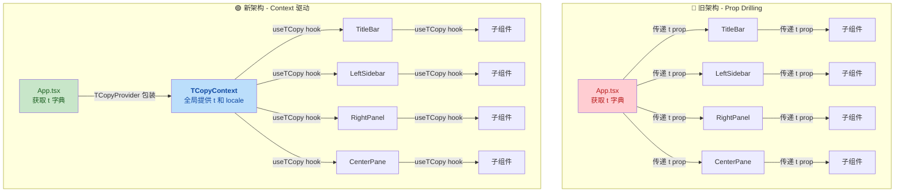
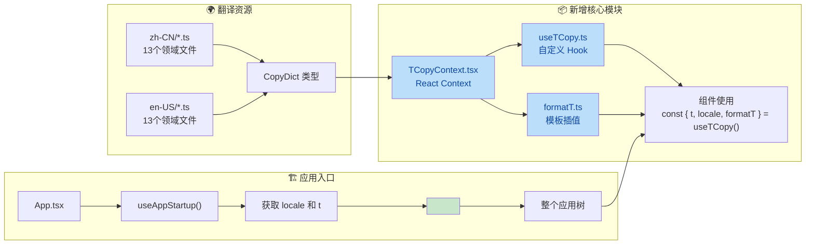
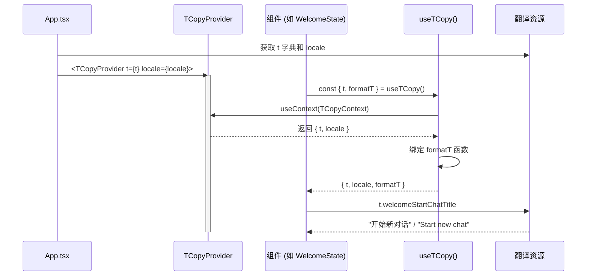

## 1. 高层摘要 (TL;DR)

*   **影响范围：** 🔴 **高** - 这是一个架构级别的重构，涉及整个前端应用的国际化系统
*   **核心变更：**
    *   ✨ 新增 **React Context + Provider** 架构，消除 prop drilling
    *   🌍 新增 **360+ 个翻译 key**（从 529 扩展到 889），覆盖 13 个领域
    *   🔄 迁移 **30+ 个组件** 从硬编码中文到 `t.xxx` 查找
    *   🛠️ 新增 `formatT` 模板插值工具函数
    *   📝 新增完整的国际化实施计划文档

---

## 2. 可视化架构图

### 2.1 国际化架构变更对比



### 2.2 核心模块关系图



### 2.3 组件迁移流程



---

## 3. 详细变更分析

### 3.1 🆕 新增基础设施文件

| 文件路径 | 职责 | 关键代码 |
|---------|------|---------|
| `frontend/src/app/i18n/TCopyContext.tsx` | React Context + Provider | `TCopyContext`, `TCopyProvider` |
| `frontend/src/app/i18n/useTCopy.ts` | 自定义 Hook | `useTCopy()` 返回 `{ t, locale, formatT }` |
| `frontend/src/app/i18n/formatT.ts` | 模板插值工具 | `formatT(t, key, vars)` 支持 `{var}` 替换 |

**核心实现：**

```typescript
// TCopyContext.tsx
export interface TCopyContextValue {
  t: CopyDict;
  locale: Locale;
}
export const TCopyContext = createContext<TCopyContextValue | null>(null);

// useTCopy.ts
export function useTCopy(): TCopyContextValue & { formatT: typeof formatT } {
  const ctx = useContext(TCopyContext);
  if (!ctx) {
    throw new Error('useTCopy must be used within a TCopyProvider');
  }
  return { ...ctx, formatT };
}

// formatT.ts
export function formatT(t: CopyDict, key: CopyKey, vars?: Record<string, string | number>): string {
  let str = t[key] ?? key;
  if (!vars) return str;
  for (const [k, v] of Object.entries(vars)) {
    str = str.replace(`{${k}}`, String(v));
  }
  return str;
}
```

---

### 3.2 🏗️ 核心架构变更

#### **App.tsx - 添加 TCopyProvider 包装**

**变更前：**
```tsx
export function App() {
  const { locale, t } = useAppStartup(appInfo);
  return (
    <main className="adl-shell adl-ide">
      <TitleBar t={t} appInfo={...} />
      <LeftSidebar t={t} collapsed={...} />
      <CenterPane t={t} />
      <RightPanel t={t} collapsed={...} />
      {/* ... */}
    </main>
  );
}
```

**变更后：**
```tsx
export function App() {
  const { locale, t } = useAppStartup(appInfo);
  return (
    <TCopyProvider t={t} locale={locale}>
      <main className="adl-shell adl-ide">
        <TitleBar appInfo={...} />  {/* ❌ 移除 t prop */}
        <LeftSidebar collapsed={...} />  {/* ❌ 移除 t prop */}
        <CenterPane />  {/* ❌ 移除 t prop */}
        <RightPanel collapsed={...} />  {/* ❌ 移除 t prop */}
        {/* ... */}
      </main>
    </TCopyProvider>
  );
}
```

**影响：**
- ✅ 消除了所有组件的 `t` prop 传递
- ✅ 简化了组件接口
- ✅ 提供了全局的翻译上下文

---

### 3.3 🌍 翻译资源扩展

#### **翻译 Key 数量统计**

| 领域 | 旧 Key 数 | 新 Key 数 | 增量 | 主要新增内容 |
|------|----------|----------|------|------------|
| **common** | ~45 | ~95 | +50 | 对话框、按钮、消息气泡、上下文构建器、环境控制 |
| **browser** | ~30 | ~60 | +30 | 浏览器上下文菜单、视图模式、标签操作 |
| **conversation** | ~20 | ~35 | +15 | 欢迎页面建议、搜索提示 |
| **communicate** | ~5 | ~20 | +15 | GitHub 面板、CI 操作、目录列表 |
| **ci** | ~10 | ~25 | +15 | CI 配置删除、恢复操作 |
| **changes** | ~15 | ~30 | +15 | 变更面板、文件树操作 |
| **file** | ~20 | ~35 | +15 | 文件操作、上下文菜单 |
| **terminal** | ~15 | ~30 | +15 | 终端面板、上下文菜单 |
| **workspace** | ~25 | ~40 | +15 | 工作区列表、会话管理 |
| **其他领域** | ~344 | ~519 | +175 | 设置、审批、补丁审查等 |
| **总计** | **529** | **889** | **+360** | **全面覆盖所有 UI 文本** |

#### **新增翻译 Key 示例**

**common.ts 新增 50+ 个 key：**

```typescript
// 对话框通用
confirm: '确认',
cancel: '取消',
rename: '重命名',
enterNewName: '输入新名称',
close: '关闭',
processing: '处理中...',
operationFailed: '操作失败，请重试',

// 错误边界
panelError: '该面板遇到意外错误，已降级保护。',
retry: '重试',

// 操作按钮
send: '发送',
sendMessage: '发送消息',
stopGenerating: '停止生成',
waiting: '等待中...',

// 消息气泡
aiAssistant: 'AI 助手',
messageActions: '消息操作',
copySuccess: '已复制',
copy: '复制',
copySuccessClipboard: '已复制到剪贴板',
copyMessageContent: '复制消息内容',
regenerate: '重新生成',
regenerateReply: '重新生成此回复',
editMessage: '编辑消息',
editThisMessage: '编辑此消息',

// 上下文构建器
contextPlanMode: '规划模式',
contextDebugMode: '调试模式',
contextQAMode: '问答模式',
contextModelSelect: '模型选择',
contextSkillLibrary: '技能库',
contextMCPService: 'MCP 服务',
contextReferenceFile: '引用文件',
contextReferenceDoc: '引用文档',
contextReferenceLink: '引用链接',
contextCodebaseContext: '代码库上下文',

// 环境控制
languageChinese: '中文',
languageEnglish: 'EN',
themeTooltip: 'Theme: {theme} (click to cycle)',
themeButtonAria: 'Current theme: {theme}. Click to change.',

// 树/列表通用操作
collapseAll: '全部折叠',
expandAll: '全部展开',
refresh: '刷新',
moreActions: '更多操作',
pin: '置顶',
unpin: '取消置顶',
deleteAll: '删除全部',
noContent: '暂无内容',
```

**browser.ts 新增 30+ 个 key：**

```typescript
browserViewModeTree: '文件树',
browserViewModeList: '文件列表',
browserViewModeAll: '全列表',
browserViewModeDefault: '已打开标签',
browserContextOpenCurrent: '在当前标签打开',
browserContextOpenNewTab: '在新标签打开',
browserContextUnpin: '取消置顶',
browserContextPin: '置顶标签',
browserContextRename: '重命名',
browserContextEdit: '编辑',
browserContextCut: '剪切',
browserContextCopyLink: '复制链接',
browserContextDelete: '删除',
browserContextMore: '更多操作',
browserContextCreateTab: '新建标签',
browserContextDeleteAllTabs: '删除所有子标签',
browserContextDeleteAllHistory: '删除全部历史记录 + 标签',
browserContextOpenAllNewTabs: '全部在新标签打开',
browserTabCount: '共 {count} 个标签',
browserNewTabPage: '新建标签页',
browserSearchBookmarkHistory: '输入关键词搜索书签和历史记录',
browserClearAllOpenTabs: '清空所有已打开标签',
browserDeleteAllTabDirs: '删除全部目录标签',
browserNoSearchResults: '没有找到匹配的结果',
browserBookmark: '收藏标签',
browserUnbookmark: '取消收藏',
```

**communicate.ts 新增 15+ 个 key：**

```typescript
communicateWechat: '微信',
communicateFeishu: '飞书',
communicateEmail: '邮箱',
communicateTabFeishu: '飞书',
communicateTabWechat: '微信',
communicateTabEmail: '邮箱',
communicateDirList: '目录列表',
communicateRefreshAll: '刷新全部',
communicateNewDir: '新建目录',
```

---

### 3.4 🔄 组件迁移示例

#### **WelcomeState.tsx - 完整迁移**

**变更前：**
```tsx
const SUGGESTIONS = [
  '帮我理解这个项目的架构',
  '修复登录页面的 bug',
  '为这个模块添加单元测试',
  '优化数据库查询性能',
  '解释这段代码的作用',
];

const TIPS = [
  { icon: 'folder-open', text: '将文件夹拖入窗口即可打开' },
  { icon: 'keyboard', text: '按 Ctrl+O 快速打开工作空间' },
  { icon: 'globe', text: '支持从 GitHub 克隆远程仓库' },
];

export function WelcomeState({ variant, ... }: WelcomeStateProps) {
  return (
    <div>
      <h2>开始新对话</h2>
      <p>向 AI 助手提问或下达任务</p>
      <h2>打开工作空间</h2>
      <p>选择一个项目目录开始</p>
      <button>打开工作空间</button>
      <p>最近打开的工作空间</p>
      <input placeholder="搜索工作空间..." aria-label="搜索最近工作空间" />
      <span>—— 或 ——</span>
      <span>快速提示</span>
    </div>
  );
}
```

**变更后：**
```tsx
export function WelcomeState({ variant, ... }: WelcomeStateProps) {
  const { t } = useTCopy();  // ✅ 使用 hook 获取翻译函数

  const SUGGESTIONS = [
    t.welcomeSuggestionArchitecture,  // ✅ 从翻译字典获取
    t.welcomeSuggestionBug,
    t.welcomeSuggestionTest,
    t.welcomeSuggestionPerformance,
    t.welcomeSuggestionExplain,
  ];

  const TIPS = [
    { icon: 'folder-open' as const, text: t.welcomeHintDrag },
    { icon: 'keyboard' as const, text: t.welcomeHintOpen },
    { icon: 'globe' as const, text: t.welcomeHintClone },
  ];

  return (
    <div>
      <h2>{t.welcomeStartChatTitle}</h2>  {/* ✅ 动态翻译 */}
      <p>{t.welcomeStartChatDescription}</p>
      <h2>{t.welcomeOpenWorkspace}</h2>
      <p>{t.welcomeOpenWorkspaceDescription}</p>
      <button>{t.welcomeOpenWorkspace}</button>
      <p>{t.welcomeRecentWorkspaces}</p>
      <input 
        placeholder={t.welcomeSearchPlaceholder} 
        aria-label={t.welcomeSearchAria} 
      />
      <span>{t.welcomeOr}</span>
      <span>{t.welcomeHints}</span>
    </div>
  );
}
```

---

#### **ConfirmDialog.tsx - 默认值迁移**

**变更前：**
```tsx
interface ConfirmDialogProps {
  title: string;
  message: string;
  confirmLabel?: string;  // 默认 '确认'
  cancelLabel?: string;   // 默认 '取消'
  danger?: boolean;
  onConfirm: () => void;
  onCancel: () => void;
}

export function ConfirmDialog({ 
  title, 
  message, 
  confirmLabel = '确认',  // ❌ 硬编码
  cancelLabel = '取消',   // ❌ 硬编码
  onConfirm, 
  onCancel 
}: ConfirmDialogProps) {
  return (
    <div>
      <button onClick={onCancel}>{cancelLabel}</button>
      <button onClick={onConfirm}>{confirmLabel}</button>
    </div>
  );
}
```

**变更后：**
```tsx
interface ConfirmDialogProps {
  title: string;
  message: string;
  confirmLabel?: string;  // 可选，默认从翻译字典获取
  cancelLabel?: string;   // 可选，默认从翻译字典获取
  danger?: boolean;
  onConfirm: () => void;
  onCancel: () => void;
}

export function ConfirmDialog({ 
  title, 
  message, 
  confirmLabel,  // ✅ 移除默认值
  cancelLabel,   // ✅ 移除默认值
  onConfirm, 
  onCancel 
}: ConfirmDialogProps) {
  const { t } = useTCopy();  // ✅ 使用 hook
  const resolvedConfirm = confirmLabel ?? t.confirm;  // ✅ 动态解析
  const resolvedCancel = cancelLabel ?? t.cancel;    // ✅ 动态解析

  return (
    <div>
      <button onClick={onCancel}>{resolvedCancel}</button>
      <button onClick={onConfirm}>{resolvedConfirm}</button>
    </div>
  );
}
```

---

#### **PromptInput.tsx - 模板插值使用**

**变更前：**
```tsx
export function PromptInput({ 
  value, 
  onChange, 
  onSubmit, 
  placeholder = '向 AI 助手提问...',  // ❌ 硬编码默认值
  attachments = [],
  onRemoveAttachment,
}: PromptInputProps) {
  return (
    <div>
      {attachments.map((attachment, index) => (
        <button 
          onClick={() => onRemoveAttachment(index)}
          aria-label={`移除 ${attachment.name}`}  // ❌ 硬编码 + 模板字符串
        >
          <Icon name="close" size="xs" />
        </button>
      ))}
      <textarea 
        aria-label="消息输入框"  // ❌ 硬编码
        placeholder={placeholder}
      />
      <span aria-label={`${charCount} 个字符`}>  {/* ❌ 硬编码 + 模板字符串 */}
        {charCount}
      </span>
    </div>
  );
}
```

**变更后：**
```tsx
export function PromptInput({ 
  value, 
  onChange, 
  onSubmit, 
  placeholder,  // ✅ 移除默认值，由调用方提供
  attachments = [],
  onRemoveAttachment,
}: PromptInputProps) {
  const { t, formatT } = useTCopy();  // ✅ 获取 formatT 函数

  return (
    <div>
      {attachments.map((attachment, index) => (
        <button 
          onClick={() => onRemoveAttachment(index)}
          aria-label={formatT(t, 'removeAttachment', { name: attachment.name })}  // ✅ 使用 formatT
        >
          <Icon name="close" size="xs" />
        </button>
      ))}
      <textarea 
        aria-label={t.inputAriaLabel}  // ✅ 从翻译字典获取
        placeholder={placeholder}
      />
      <span aria-label={formatT(t, 'charCountAria', { count: charCount })}>  {/* ✅ 使用 formatT */}
        {charCount}
      </span>
    </div>
  );
}
```

**对应的翻译 key：**
```typescript
// common.ts
removeAttachment: '移除 {name}',
inputAriaLabel: '消息输入框',
charCountAria: '{count} 个字符',  // 英文: '{count} characters'
```

---

#### **BrowserContextMenu.tsx - 上下文菜单迁移**

**变更前：**
```tsx
interface BrowserContextMenuProps {
  contextMenu: ContextMenuState;
  onClose: () => void;
  onOpenInCurrentTab: () => void;
  onOpenInNewTab: () => void;
  onTogglePin: () => void;
  onRename: () => void;
  onEdit: () => void;
  onCut: () => void;
  t: CopyDict;  // ❌ 通过 prop 传递
}

export const BrowserContextMenu = ({ 
  contextMenu, 
  onClose, 
  onOpenInCurrentTab, 
  onOpenInNewTab, 
  onTogglePin, 
  onRename, 
  onEdit, 
  onCut, 
  t: _t  // ❌ 未使用
}: BrowserContextMenuProps) {
  return (
    <div>
      <button onClick={onOpenInCurrentTab}>在当前标签打开</button>  {/* ❌ 硬编码 */}
      <button onClick={onOpenInNewTab}>在新标签打开</button>  {/* ❌ 硬编码 */}
      <button onClick={onTogglePin}>
        {contextMenu.isPinned ? '取消置顶' : '置顶标签'}  {/* ❌ 硬编码 */}
      </button>
      <button onClick={onRename}>重命名</button>  {/* ❌ 硬编码 */}
      <button onClick={onEdit}>编辑</button>  {/* ❌ 硬编码 */}
      <button onClick={onCut}>剪切</button>  {/* ❌ 硬编码 */}
      <button onClick={onCopyUrl}>复制链接</button>  {/* ❌ 硬编码 */}
      <button onClick={onDelete}>删除</button>  {/* ❌ 硬编码 */}
    </div>
  );
}
```

**变更后：**
```tsx
interface BrowserContextMenuProps {
  contextMenu: ContextMenuState;
  onClose: () => void;
  onOpenInCurrentTab: () => void;
  onOpenInNewTab: () => void;
  onTogglePin: () => void;
  onRename: () => void;
  onEdit: () => void;
  onCut: () => void;
  // ✅ 移除 t prop
}

export const BrowserContextMenu = ({ 
  contextMenu, 
  onClose, 
  onOpenInCurrentTab, 
  onOpenInNewTab, 
  onTogglePin, 
  onRename, 
  onEdit, 
  onCut 
}: BrowserContextMenuProps) {
  const { t } = useTCopy();  // ✅ 使用 hook

  return (
    <div>
      <button onClick={onOpenInCurrentTab}>{t.browserContextOpenCurrent}</button>  {/* ✅ 从翻译字典获取 */}
      <button onClick={onOpenInNewTab}>{t.browserContextOpenNewTab}</button>  {/* ✅ 从翻译字典获取 */}
      <button onClick={onTogglePin}>
        {contextMenu.isPinned ? t.browserContextUnpin : t.browserContextPin}  {/* ✅ 动态翻译 */}
      </button>
      <button onClick={onRename}>{t.browserContextRename}</button>  {/* ✅ 从翻译字典获取 */}
      <button onClick={onEdit}>{t.browserContextEdit}</button>  {/* ✅ 从翻译字典获取 */}
      <button onClick={onCut}>{t.browserContextCut}</button>  {/* ✅ 从翻译字典获取 */}
      <button onClick={onCopyUrl}>{t.browserContextCopyLink}</button>  {/* ✅ 从翻译字典获取 */}
      <button onClick={onDelete}>{t.browserContextDelete}</button>  {/* ✅ 从翻译字典获取 */}
    </div>
  );
}
```

---

#### **TitleBar.tsx - 语言切换迁移**

**变更前：**
```tsx
interface TitleBarProps {
  t: CopyDict;  // ❌ 通过 prop 传递
  appInfo?: AppInfo;
  onOpenSettings: () => void;
  // ...
}

const TitleBar = ({ t, appInfo, onOpenSettings, ... }: TitleBarProps) => {
  return (
    <button 
      onClick={() => onSelectLanguage(nextLanguage)}
      aria-label={`${t.language}: ${nextLanguage === 'zh-CN' ? '中文' : 'EN'}`}  // ❌ 硬编码语言名称
    >
      <LanguageIcon language={language} />
    </button>
  );
};
```

**变更后：**
```tsx
interface TitleBarProps {
  // ✅ 移除 t prop
  appInfo?: AppInfo;
  onOpenSettings: () => void;
  // ...
}

const TitleBar = ({ appInfo, onOpenSettings, ... }: TitleBarProps) => {
  const { t } = useTCopy();  // ✅ 使用 hook

  return (
    <button 
      onClick={() => onSelectLanguage(nextLanguage)}
      aria-label={`${t.language}: ${nextLanguage === 'zh-CN' ? t.languageChinese : t.languageEnglish}`}  {/* ✅ 从翻译字典获取 */}
    >
      <LanguageIcon language={language} />
    </button>
  );
};
```

---

#### **GitHubPanel.tsx - CI 面板迁移**

**变更前：**
```tsx
export function GitHubPanel() {
  return (
    <div>
      {gitHubViewMode === 'tree' ? '文件树' : '目录列表'}  {/* ❌ 硬编码 */}
      <TooltipSimple content="刷新全部" placement="top">  {/* ❌ 硬编码 */}
        <button aria-label="刷新全部">  {/* ❌ 硬编码 */}
          <IconRefreshCw size={14} decorative />
        </button>
      </TooltipSimple>
      <TooltipSimple content="文件树" placement="top">  {/* ❌ 硬编码 */}
        <button aria-label="文件树">  {/* ❌ 硬编码 */}
          <IconFiles size={14} decorative />
        </button>
      </TooltipSimple>
      <TooltipSimple content="目录列表" placement="top">  {/* ❌ 硬编码 */}
        <button aria-label="目录列表">  {/* ❌ 硬编码 */}
          <IconList size={14} decorative />
        </button>
      </TooltipSimple>
      <TooltipSimple content="新建目录" placement="top">  {/* ❌ 硬编码 */}
        <button aria-label="新建目录">  {/* ❌ 硬编码 */}
          <IconFolderPlus size={14} decorative />
        </button>
      </TooltipSimple>
    </div>
  );
}
```

**变更后：**
```tsx
export function GitHubPanel() {
  const { t } = useTCopy();  // ✅ 使用 hook

  return (
    <div>
      {gitHubViewMode === 'tree' ? t.changesFileTree : t.communicateDirList}  {/* ✅ 从翻译字典获取 */}
      <TooltipSimple content={t.communicateRefreshAll} placement="top">  {/* ✅ 从翻译字典获取 */}
        <button aria-label={t.communicateRefreshAll}>  {/* ✅ 从翻译字典获取 */}
          <IconRefreshCw size={14} decorative />
        </button>
      </TooltipSimple>
      <TooltipSimple content={t.changesFileTree} placement="top">  {/* ✅ 从翻译字典获取 */}
        <button aria-label={t.changesFileTree}>  {/* ✅ 从翻译字典获取 */}
          <IconFiles size={14} decorative />
        </button>
      </TooltipSimple>
      <TooltipSimple content={t.communicateDirList} placement="top">  {/* ✅ 从翻译字典获取 */}
        <button aria-label={t.communicateDirList}>  {/* ✅ 从翻译字典获取 */}
          <IconList size={14} decorative />
        </button>
      </TooltipSimple>
      <TooltipSimple content={t.communicateNewDir} placement="top">  {/* ✅ 从翻译字典获取 */}
        <button aria-label={t.communicateNewDir}>  {/* ✅ 从翻译字典获取 */}
          <IconFolderPlus size={14} decorative />
        </button>
      </TooltipSimple>
    </div>
  );
}
```

---

### 3.5 📋 组件迁移清单

#### **核心组件 (11 个文件)**

| 组件 | 迁移内容 | 新增 Key 数 |
|------|---------|------------|
| `WelcomeState.tsx` | 欢迎页面所有文本 | 10+ |
| `ConfirmDialog.tsx` | 对话框按钮默认值 | 2 |
| `RenameDialog.tsx` | 重命名对话框 | 5+ |
| `NewSessionDialog.tsx` | 新建会话对话框 | 5+ |
| `PromptModal.tsx` | 提示模态框 | 5+ |
| `PromptInput.tsx` | 输入框占位符、aria-label | 5+ |
| `MessageBubble.tsx` | 消息气泡操作按钮 | 8+ |
| `ActionButton.tsx` | 操作按钮文本 | 3+ |
| `ContextBuilder.tsx` | 上下文构建器 | 15+ |
| `EnvironmentControls.tsx` | 环境控制按钮 | 5+ |
| `ErrorBoundary.tsx` | 错误边界提示 | 3+ |

#### **功能组件 (15 个文件)**

| 组件 | 迁移内容 | 新增 Key 数 |
|------|---------|------------|
| `BrowserContextMenu.tsx` | 浏览器上下文菜单 | 10+ |
| `BrowserMenuDropdown.tsx` | 浏览器菜单下拉 | 5+ |
| `BrowserPanel.tsx` | 浏览器面板 | 10+ |
| `BrowserTreeEntry.tsx` | 浏览器树节点 | 15+ |
| `GitHubTreeEntry.tsx` | GitHub 树节点 | 20+ |
| `TerminalContextMenu.tsx` | 终端上下文菜单 | 8+ |
| `TerminalMenuDropdown.tsx` | 终端菜单下拉 | 5+ |
| `TerminalPanel.tsx` | 终端面板 | 5+ |
| `WorkspaceFileTreeEntry.tsx` | 工作区文件树节点 | 5+ |
| `WorkspaceChangesEntry.tsx` | 工作区变更节点 | 5+ |
| `WorkspaceTerminalEntry.tsx` | 工作区终端节点 | 5+ |
| `MultiWorkspaceBrowser.tsx` | 多工作区浏览器 | 5+ |
| `MultiWorkspaceTerminal.tsx` | 多工作区终端 | 5+ |
| `PatchFileCard.tsx` | 补丁文件卡片 | 5+ |
| `PatchHunkCard.tsx` | 补丁块卡片 | 5+ |

#### **区域组件 (10 个文件)**

| 组件 | 迁移内容 | 新增 Key 数 |
|------|---------|------------|
| `TitleBar.tsx` | 标题栏按钮 | 5+ |
| `LeftSidebar.tsx` | 左侧边栏 | 5+ |
| `RightPanel.tsx` | 右侧面板 | 5+ |
| `CenterPane.tsx` | 中央面板 | 5+ |
| `SessionList.tsx` | 会话列表 | 5+ |
| `WorkspaceList.tsx` | 工作区列表 | 5+ |
| `FilesPanel.tsx` | 文件面板 | 5+ |
| `ChangesPanel.tsx` | 变更面板 | 5+ |
| `CommunicationPanel.tsx` | 通信面板 | 10+ |
| `EditorSurfaceShell.tsx` | 编辑器表面 | 5+ |

#### **通信面板子组件 (5 个文件)**

| 组件 | 迁移内容 | 新增 Key 数 |
|------|---------|------------|
| `GitHubPanel.tsx` | GitHub 面板 | 15+ |
| `GitHubLogViewer.tsx` | GitHub 日志查看器 | 10+ |
| `WorkflowsView.tsx` | 工作流视图 | 5+ |
| `JobsView.tsx` | 任务视图 | 5+ |
| `OverviewView.tsx` | 概览视图 | 5+ |

---

### 3.6 📝 文档更新

#### **AGENTS.md - 项目特性更新**

**变更前：**
```markdown
- i18n 国际化（10 领域 / 529 keys，TypeScript satisfies 类型安全）
```

**变更后：**
```markdown
- i18n 国际化（13 领域 / 889 keys，TCopyContext + useTCopy 上下文驱动，TypeScript satisfies 类型安全）
```

---

#### **docs/design-system/README.md - 架构文档更新**

**变更前：**
```markdown
│   ├── i18n/              # 国际化拆分（25 文件 / 10 领域 / 504 keys）
```

**变更后：**
```markdown
│   ├── i18n/              # 国际化拆分（13 领域 / 889 keys，TCopyContext + useTCopy 驱动）
```

---

#### **docs/superpowers/plans/2026-06-12-i18n-full-localization.md - 新增实施计划**

这是一个全新的 1537 行详细实施计划文档，包含：

1. **目标与架构**
   - 实现完整的中英文本地化
   - 消除所有硬编码中文字符串
   - 使用 React Context + Provider 架构

2. **文件结构**
   - 3 个新文件：`TCopyContext.tsx`, `useTCopy.ts`, `formatT.ts`
   - 45 个修改文件
   - 13 个翻译领域文件

3. **子计划分解**
   - **Sub-plan A**: 基础设施（Context、formatT、useTCopy）
   - **Sub-plan B**: 核心组件迁移
   - **Sub-plan C**: 功能组件迁移
   - **Sub-plan D**: 区域组件迁移
   - **Sub-plan E**: Tooltip 迁移
   - **Sub-plan F**: 验证与测试

4. **详细任务清单**
   - 每个任务都有具体的代码示例
   - 使用 checkbox (`- [ ]`) 语法跟踪进度
   - 包含完整的实现指南

---

## 4. 影响与风险评估

### 4.1 ⚠️ 破坏性变更

| 变更类型 | 影响范围 | 风险等级 | 缓解措施 |
|---------|---------|---------|---------|
| **移除 `t` prop** | 所有组件接口 | 🟡 中 | 已在 `App.tsx` 中统一处理，组件内部改用 `useTCopy()` |
| **默认值变更** | `ConfirmDialog`, `PromptInput` 等 | 🟢 低 | 使用 `??` 运算符提供向后兼容的默认值 |
| **新增 Hook 依赖** | 所有迁移的组件 | 🟡 中 | 确保所有组件都在 `TCopyProvider` 内部使用 |

---

### 4.2 🧪 测试建议

#### **功能测试**

1. **语言切换测试**
   - ✅ 验证中英文切换正常工作
   - ✅ 验证所有 UI 文本正确翻译
   - ✅ 验证 aria-label 正确翻译（无障碍访问）

2. **组件行为测试**
   - ✅ 验证 `ConfirmDialog` 默认按钮文本正确
   - ✅ 验证 `PromptInput` 占位符正确
   - ✅ 验证 `WelcomeState` 建议文本正确
   - ✅ 验证上下文菜单文本正确

3. **模板插值测试**
   - ✅ 验证 `formatT` 正确替换变量
   - ✅ 验证 `{count}` 等占位符正确替换
   - ✅ 验证缺失 key 时的回退行为

4. **边界情况测试**
   - ✅ 验证在 `TCopyProvider` 外部使用 `useTCopy()` 抛出错误
   - ✅ 验证翻译 key 缺失时的回退行为
   - ✅ 验证空值和 undefined 的处理

#### **回归测试**

- ✅ 验证所有原有功能不受影响
- ✅ 验证性能无明显下降
- ✅ 验证 TypeScript 类型检查通过
- ✅ 验证 ESLint 检查通过

---

### 4.3 📊 性能影响

| 方面 | 影响 | 说明 |
|------|------|------|
| **包大小** | 🟢 轻微增加 | 新增 3 个小文件，约 1KB |
| **运行时性能** | 🟢 无影响 | React Context 性能开销可忽略 |
| **构建时间** | 🟢 无影响 | 翻译文件在编译时处理 |
| **内存占用** | 🟢 轻微增加 | Context 值在内存中保留一份副本 |

---

### 4.4 🔍 潜在问题

1. **Context 误用风险**
   - ⚠️ 如果在 `TCopyProvider` 外部使用 `useTCopy()`，会抛出错误
   - ✅ **缓解措施**：错误消息清晰明确，易于调试

2. **翻译 Key 冲突**
   - ⚠️ 不同领域可能使用相同的 key 名称
   - ✅ **缓解措施**：使用命名空间前缀（如 `browserContextOpenCurrent`）

3. **类型安全**
   - ⚠️ `formatT` 使用 `Record<string, string | number>`，类型不够严格
   - ✅ **缓解措施**：可以后续改进为泛型约束

---

## 5. 总结

### 5.1 🎯 核心成果

1. ✅ **架构升级**：从 prop drilling 升级到 Context + Provider 架构
2. ✅ **翻译覆盖**：从 529 个 key 扩展到 889 个 key（+68%）
3. ✅ **组件迁移**：30+ 个组件完成国际化迁移
4. ✅ **功能增强**：新增 `formatT` 模板插值功能
5. ✅ **文档完善**：新增详细的实施计划文档

### 5.2 🚀 后续优化建议

1. **自动化测试**
   - 添加翻译 key 覆盖率测试
   - 添加硬编码字符串检测工具

2. **类型安全增强**
   - 改进 `formatT` 的类型约束
   - 添加翻译 key 的自动补全

3. **性能优化**
   - 考虑使用 `useMemo` 优化翻译字典的访问
   - 考虑懒加载翻译资源

4. **开发体验**
   - 添加翻译 key 缺失时的开发时警告
   - 添加翻译 key 的自动提取工具

---

**变更统计：**
- 📁 **新增文件：** 3 个（`TCopyContext.tsx`, `useTCopy.ts`, `formatT.ts`）
- 📝 **修改文件：** 45+ 个组件文件
- 🌍 **新增翻译 key：** 360+ 个（从 529 扩展到 889）
- 📚 **新增文档：** 1 个（1537 行实施计划）
- 🔧 **架构变更：** 从 prop drilling 到 Context + Provider