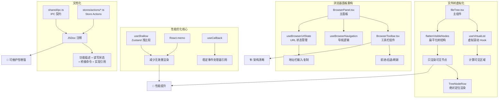
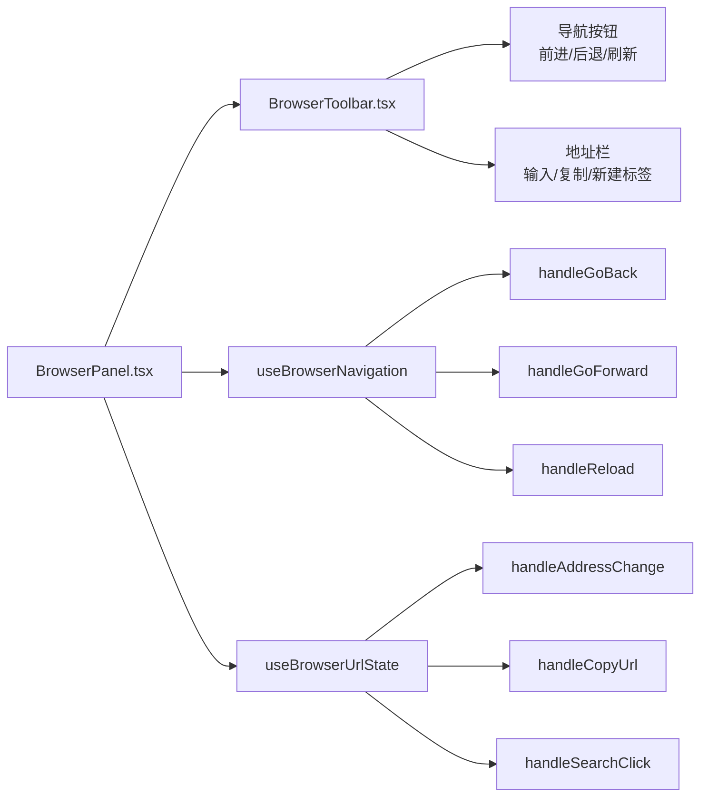

## 1. 高层摘要 (TL;DR)

**影响范围：** 🔴 **高** - 涉及核心性能优化、架构重构和文档化

**关键变更：**
- ✨ **文件树虚拟化渲染**：新增 `useVirtualList` hook，支持上万节点流畅滚动
- 🎯 **浏览器面板渐进式拆分**：将 `BrowserPanel` 拆分为 `BrowserToolbar`、`useBrowserNavigation`、`useBrowserUrlState`
- ⚡ **性能优化**：全面应用 `useShallow` 选择器和 `React.memo`，避免无效重渲染
- 📝 **IPC 契约文档化**：为所有 IPC 接口和 Store Actions 添加 JSDoc 注释
- 🐛 **Bug 修复**：修复 Toast 组件定时器清理问题

---

## 2. 可视化概览



---

## 3. 详细变更分析

### 🎯 组件 1：性能优化 - useShallow + React.memo

**变更文件：**
- `App.tsx`
- `SettingsPanel.tsx`
- `BrowserTreeEntry.tsx`
- `useBrowserPanel.ts`
- `useRightPanelLayout.ts`
- 以及其他多个组件

**变更内容：**

| 优化类型 | 实现方式 | 影响范围 |
|---------|---------|---------|
| **Zustand 选择器优化** | 使用 `useShallow` 包裹选择器，对对象/数组进行浅比较 | 所有 Store 订阅 |
| **组件记忆化** | 使用 `React.memo` 包裹组件，自定义比较函数 | 列表项组件 |
| **事件处理器稳定化** | 使用 `useCallback` 包裹事件处理器，避免引用变化 | 所有交互组件 |

**代码示例：**

```typescript
// 优化前：每次状态更新都会触发重渲染
const appInfo = useAppStore((s) => s.appInfo);
const leftCollapsed = useAppStore((state) => state.leftCollapsed);

// 优化后：使用 useShallow 进行浅比较
const { appInfo, leftCollapsed, rightCollapsed, rightPanelWidth } = useAppStore(
  useShallow((state) => ({
    appInfo: state.appInfo,
    leftCollapsed: state.leftCollapsed,
    rightCollapsed: state.rightCollapsed,
    rightPanelWidth: state.rightPanelWidth,
  }))
);
```

**React.memo 优化示例：**

```typescript
// BrowserTreeEntry.tsx
export const BrowserTreeEntry = React.memo(function BrowserTreeEntry({ ... }) {
  // 使用 useCallback 稳定事件处理器引用
  const handleExpandBtnClick = useCallback(
    (e: React.MouseEvent) => {
      e.stopPropagation();
      onTogglePath(node.path);
    },
    [onTogglePath, node.path]
  );
  // ...
});
```

---

### 🌳 组件 2：文件树虚拟化渲染

**变更文件：**
- `fileTree.tsx` - 主组件重构
- `fileTree.utils.ts` - 新增扁平化函数
- `hooks/useVirtualList.ts` - 新增虚拟滚动 Hook
- `TreeNodeRow.tsx` - 支持 style prop

**核心变更：**

| 文件 | 新增/修改 | 功能 |
|-----|----------|------|
| `useVirtualList.ts` | ✅ 新增 | 计算可见区域索引，支持 overscan |
| `fileTree.utils.ts` | ✅ 新增 | `flattenVisibleNodes` 扁平化树结构 |
| `fileTree.tsx` | 🔧 重构 | 使用虚拟滚动渲染，移除递归渲染 |
| `TreeNodeRow.tsx` | 🔧 修改 | 新增 `style` prop 支持绝对定位 |

**虚拟滚动实现：**

```typescript
// useVirtualList.ts
export function useVirtualList<T>(
  containerRef: RefObject<HTMLElement>,
  items: T[],
  itemHeight: number = 28,
  overscan: number = 5
): VirtualListResult {
  // 使用 requestAnimationFrame 优化滚动性能
  // 计算可见区域：startIndex, endIndex
  // 支持 ResizeObserver 响应容器变化
}
```

**扁平化树结构：**

```typescript
// fileTree.utils.ts
export function flattenVisibleNodes<T extends FileTreeRenderableNode>(
  nodes: T[],
  expandedPaths: Record<string, boolean>
): FlattenedTreeNode<T>[] {
  const result: FlattenedTreeNode<T>[] = [];
  const visit = (items: T[], depth: number) => {
    for (const item of items) {
      result.push({ node: item, depth });
      if (item.kind === 'directory' && expandedPaths[item.path] && item.children.length > 0) {
        visit(item.children as T[], depth + 1);
      }
    }
  };
  visit(nodes, 0);
  return result;
}
```

**渲染方式变更：**

```typescript
// 优化前：递归渲染所有节点
{nodes.map((node) => (
  <MemoizedFileTreeNode key={node.path} node={node} depth={0}>
    {/* 递归渲染子节点 */}
  </MemoizedFileTreeNode>
))}

// 优化后：只渲染可见节点
{visibleNodes.map((flatNode, localIndex) => {
  const absoluteIndex = startIndex + localIndex;
  return (
    <MemoizedVirtualNode
      key={flatNode.node.path}
      flatNode={flatNode}
      style={{
        position: 'absolute',
        top: absoluteIndex * VIRTUAL_ITEM_HEIGHT,
        height: VIRTUAL_ITEM_HEIGHT,
      }}
    />
  );
})}
```

---

### 🌐 组件 3：浏览器面板渐进式拆分

**变更文件：**
- `BrowserPanel.tsx` - 主面板，移除内联工具栏
- `BrowserToolbar.tsx` - ✅ 新增工具栏组件
- `useBrowserNavigation.ts` - ✅ 新增导航逻辑 Hook
- `useBrowserUrlState.ts` - ✅ 新增 URL 状态管理 Hook

**拆分架构：**



**新增 Hook 功能：**

| Hook | 功能 | 返回值 |
|-----|------|-------|
| `useBrowserNavigation` | 处理浏览器导航 | `{ handleGoBack, handleGoForward, handleReload }` |
| `useBrowserUrlState` | 管理 URL 输入框状态 | `{ address, handleAddressChange, handleCopyUrl, ... }` |

**代码示例：**

```typescript
// BrowserToolbar.tsx - 独立工具栏组件
export const BrowserToolbar = React.memo(function BrowserToolbar(props: BrowserToolbarProps) {
  return (
    <div className="adl-tool-context adl-tool-context--files">
      {/* 导航按钮 */}
      <button onClick={onGoBack}><IconArrowLeft /></button>
      <button onClick={onGoForward}><IconArrowRight /></button>
      <button onClick={onReload}><IconRefreshCw /></button>
      
      {/* 地址栏 */}
      <label onClick={onSearchClick}>
        <input value={address} onChange={onAddressChange} />
        <button onClick={(e) => { e.stopPropagation(); onCopyUrl(url); }}>
          <IconCopy />
        </button>
      </label>
    </div>
  );
});
```

---

### 📝 组件 4：IPC 契约文档化

**变更文件：**
- `shared/ipc.ts` - 为所有接口添加 JSDoc
- `stores/actions/*.ts` - 为所有 action 添加 JSDoc
- `ipc-types.generated.ts` - 类型定义简化

**文档化规范：**

```typescript
/**
 * 窗口控制相关桥接能力
 * 用于: 控制应用窗口最小化/最大化/关闭/标题更新
 * Tauri 命令: 直接使用 window API
 * 浏览器模式: 无操作 UI 模拟
 */
export interface WindowBridge {
  /**
   * 最小化窗口
   * @command 无独立命令 (通过 Tauri window API 直接调用)
   * @see tauri-bridge.ts → window.minimize
   * @see mock-bridge.ts → window.minimize
   * @see preview-bridge/index.ts → window.minimize
   */
  minimize: () => Promise<void>;
  // ...
}
```

**Store Actions 文档化：**

```typescript
/**
 * [openFile - 在编辑器中打开文件]
 * @reads workspaceSlice.appInfo
 * @writes editorSlice.openTabs, editorSlice.selectedFilePath, editorSlice.fileContent, editorSlice.fileLastModifiedAt, editorSlice.outline, editorSlice.dirtyEditorPaths
 * @see shared/ipc.ts → workspace.readFile
 * @see mock-bridge.ts → workspace.readFile
 * @see preview-bridge/index.ts → workspace.readFile
 */
openFile: async (relativePath: string) => {
  // ...
}
```

**文档化覆盖范围：**

| 文件 | 方法数 | 文档化状态 |
|-----|-------|-----------|
| `commandActions.ts` | 1 | ✅ 100% |
| `editorActions.ts` | 6 | ✅ 100% |
| `fetchActions.ts` | 7 | ✅ 100% |
| `generalActions.ts` | 2 | ✅ 100% |
| `gitActions.ts` | 8 | ✅ 100% |
| `ipc.ts` | 50+ | ✅ 100% |

---

### 🐛 组件 5：Bug 修复

**变更文件：** `Toast.tsx`

**问题描述：**
Toast 组件在卸载时只清理了主定时器，未清理动画延迟定时器，可能导致内存泄漏。

**修复方案：**

```typescript
// 修复前
const timer = setTimeout(() => {
  setIsVisible(false);
  setTimeout(onClose, 300); // 未保存引用，无法清理
}, duration);

return () => clearTimeout(timer);

// 修复后
let hideTimer: ReturnType<typeof setTimeout> | null = null;
const timer = setTimeout(() => {
  setIsVisible(false);
  hideTimer = setTimeout(onClose, 300); // 保存引用
}, duration);

return () => {
  clearTimeout(timer);
  if (hideTimer !== null) {
    clearTimeout(hideTimer); // 清理动画定时器
  }
};
```

---

## 4. 影响与风险评估

### ⚠️ 破坏性变更

| 变更类型 | 影响范围 | 风险等级 | 说明 |
|---------|---------|---------|------|
| **虚拟滚动重构** | 文件树渲染逻辑 | 🟡 中 | 改变了渲染方式，但 API 保持兼容 |
| **浏览器面板拆分** | BrowserPanel 内部实现 | 🟢 低 | 外部 API 未变，仅内部重构 |
| **类型生成文件** | `ipc-types.generated.ts` | 🟡 中 | 类型定义被大幅简化，需确认类型兼容性 |

### 🧪 测试建议

**性能测试：**
- [ ] 测试包含 10,000+ 节点的文件树滚动性能
- [ ] 使用 React DevTools Profiler 验证重渲染次数减少
- [ ] 测试浏览器面板频繁切换标签页的性能

**功能测试：**
- [ ] 验证文件树展开/折叠功能正常
- [ ] 验证浏览器前进/后退/刷新功能
- [ ] 验证地址栏输入、复制 URL 功能
- [ ] 验证 Toast 组件动画和清理逻辑

**回归测试：**
- [ ] 测试所有 Store Actions 的读写状态是否正确
- [ ] 验证 IPC 契约文档与实际实现一致

---

## 5. 总结

本次变更是一次全面的**性能优化与架构重构**，主要成果包括：

1. **性能提升**：通过虚拟化渲染和状态管理优化，大幅减少重渲染次数
2. **架构清晰**：浏览器面板拆分为多个职责单一的组件和 Hook
3. **可维护性**：全面的 JSDoc 文档化，提升代码可读性和可维护性
4. **代码质量**：修复内存泄漏问题，提升组件稳定性

**重构进度：** 从 42 轮更新至 55 轮，新增 13 轮重构，涵盖虚拟化、拆分、优化、文档化等多个维度。