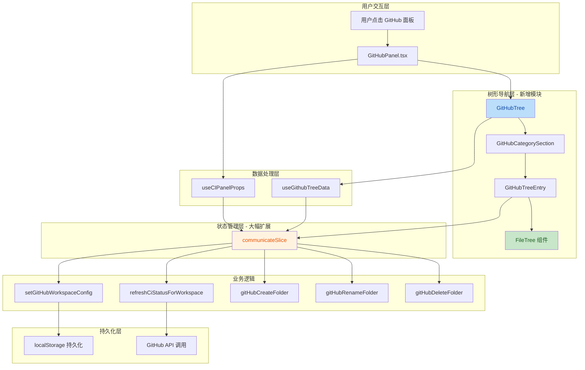
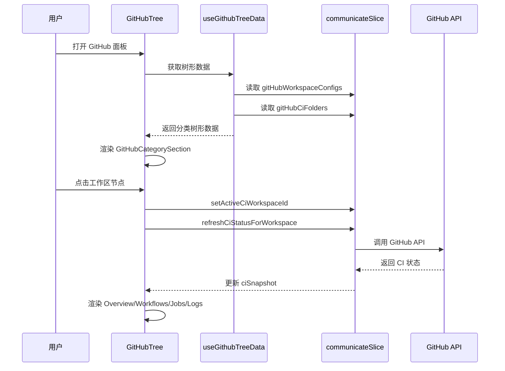
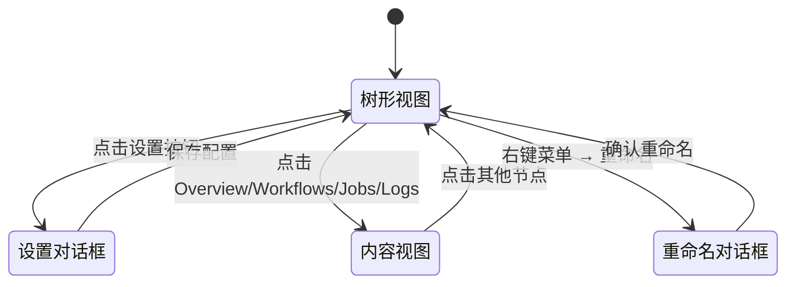

## 1. 高层摘要（TL;DR）

**影响范围：** 🔴 **高** - 重构 GitHub CI 面板，从单工作区配置升级为多工作区树形导航架构

**核心变更：**
- ✨ **新增 GitHub 树形导航器**：支持多工作区 CI 配置管理，采用分类树形结构展示
- 🏗️ **架构重构**：从单一工作区配置改为按工作区/用户文件夹分类的多层级树形结构
- 📦 **状态管理扩展**：新增 10+ 个状态字段和 10+ 个 action 支持多工作区管理
- 🎨 **UI/UX 增强**：新增自定义图标渲染、右键菜单、重命名对话框等交互功能
- 📚 **文档完善**：更新操作手册，新增树形导航器交互规范说明

---

## 2. 可视化概览（代码与逻辑映射）



**架构变更说明：**

| 层级 | 变更类型 | 说明 |
|------|----------|------|
| **组件层** | 新增模块 | 新建 `github-tree/` 目录，包含 5 个新组件文件 |
| **数据层** | Hook 重构 | `useCIPanelProps` 返回结构从单一配置改为多工作区配置映射 |
| **状态层** | Slice 扩展 | 新增 134 行代码，支持树形状态和文件夹管理 |
| **样式层** | CSS 扩展 | 新增 340+ 行样式，支持树形导航器和对话框 |

---

## 3. 详细变更分析

### 📁 组件 1：新增 GitHub 树形导航模块

**新增文件：** `ai-digital-life/frontend/src/app/features/github-tree/`

| 文件 | 行数 | 职责 |
|------|------|------|
| `GitHubTree.tsx` | 84 | 主树形容器，支持树形/列表视图切换 |
| `GitHubTreeEntry.tsx` | 483 | 树形条目组件，包含展开/折叠、右键菜单、操作按钮 |
| `GitHubCategorySection.tsx` | 59 | 分类区块（工作区目录/用户目录） |
| `useGithubTreeData.ts` | 118 | 数据处理 Hook，构建树形结构 |
| `types.ts` | 23 | TypeScript 类型定义 |
| `index.ts` | 11 | 统一导出 |

**核心类型定义：**

```typescript
// 新增类型 - 来源: types.ts
export type GitHubCategoryType = 'ci-workspace' | 'user-folder';
export type GitHubNodeType = 'workspace' | 'folder' | 'overview' | 'workflows' | 'jobs' | 'logs';

export interface GitHubTreeNode {
  path: string;
  name: string;
  kind: 'directory' | 'file';
  children: GitHubTreeNode[];
  nodeType: GitHubNodeType;
  workspaceId?: string;
  config?: GitWorkspaceCiConfig;
}
```

**数据流逻辑：**



---

### 📦 组件 2：FileTree 组件增强

**变更文件：** `ai-digital-life/frontend/src/app/features/file-tree/fileTree.tsx`

| 变更项 | 说明 |
|--------|------|
| **新增 Props** | `renderIconBefore?: (node: T) => React.ReactNode` |
| **渲染逻辑** | 优先使用自定义图标，否则使用默认文件图标 |
| **传递链路** | 从 `FileTree` → `FileTreeNodeComponent` → 递归传递 |

**代码变更：**

```typescript
// 新增属性 - 来源: fileTree.tsx:27
renderIconBefore?: (node: T) => React.ReactNode;

// 使用逻辑 - 来源: fileTree.tsx:112-114
iconBefore={
  isDirectory ? undefined : customIconBefore ? (
    customIconBefore
  ) : (
    // 默认图标渲染...
  )
}
```

**应用场景：** GitHub 树形导航器中的自定义 SVG 图标（Overview、Workflows、Jobs、Logs）

---

### 🗄️ 组件 3：状态管理大幅扩展

**变更文件：** `ai-digital-life/frontend/src/app/stores/slices/communicateSlice.ts`

**新增状态字段（10+ 个）：**

| 字段名 | 类型 | 说明 |
|--------|------|------|
| `gitHubWorkspaceConfigs` | `Record<string, GitWorkspaceCiConfig>` | 按工作区 ID 索引的 CI 配置 |
| `gitHubTreeExpanded` | `Record<string, boolean>` | 树形节点展开状态 |
| `gitHubAllTreeExpanded` | `boolean` | 是否全部展开 |
| `selectedGitHubTreePath` | `string \| null` | 当前选中的树形路径 |
| `activeCiWorkspaceId` | `string \| null` | 当前激活的工作区 ID |
| `activeWorkspaceSection` | `'overview' \| 'workflows' \| 'jobs' \| 'logs' \| 'help'` | 当前激活的子视图 |
| `gitHubCiFolders` | `GitHubCiFolderState[]` | 用户创建的文件夹列表 |

**新增 Action（10+ 个）：**

| Action | 参数 | 说明 |
|--------|------|------|
| `setGitHubWorkspaceConfig` | `(workspaceId, config)` | 设置工作区 CI 配置 |
| `removeGitHubWorkspaceConfig` | `(workspaceId)` | 删除工作区配置 |
| `clearAllGitHubWorkspaceConfigs` | `()` | 清空所有配置 |
| `toggleGitHubTreePath` | `(path)` | 切换节点展开/折叠 |
| `expandAllGitHubTree` | `()` | 展开所有节点 |
| `collapseAllGitHubTree` | `()` | 折叠所有节点 |
| `gitHubCreateFolder` | `(parentId?, parentType?)` | 创建文件夹 |
| `gitHubDeleteFolder` | `(folderId)` | 删除文件夹（级联删除子文件夹） |
| `gitHubRenameFolder` | `(folderId, name)` | 重命名文件夹 |
| `refreshCiStatusForWorkspace` | `(workspaceId)` | 刷新指定工作区 CI 状态 |

**关键业务逻辑：**

```typescript
// 级联删除逻辑 - 来源: communicateSlice.ts:554-569
gitHubDeleteFolder: (folderId) => {
  set((state) => {
    const idsToDelete = new Set<string>([folderId]);
    const findDescendants = (parentId: string) => {
      for (const f of state.gitHubCiFolders) {
        if (f.parentId === parentId && !idsToDelete.has(f.id)) {
          idsToDelete.add(f.id);
          findDescendants(f.id);
        }
      }
    };
    findDescendants(folderId);
    const nextFolders = state.gitHubCiFolders.filter((f) => !idsToDelete.has(f.id));
    return { gitHubCiFolders: nextFolders };
  });
}
```

---

### 🎨 组件 4：GitHubPanel 重构

**变更文件：** `ai-digital-life/frontend/src/app/regions/right-panel/panels/communicate/GitHubPanel.tsx`

**主要变更：**

| 变更类型 | 旧实现 | 新实现 |
|----------|--------|--------|
| **配置模式** | 单一全局配置 (`ciConfig`) | 多工作区配置 (`gitHubWorkspaceConfigs`) |
| **导航结构** | Tab 切换 | 树形导航器 |
| **设置界面** | 内联表单 | 弹窗对话框 (`GitHubSettingsDialog`) |
| **刷新逻辑** | 全局刷新 | 按工作区刷新 |
| **文件夹管理** | 不支持 | 支持创建/删除/重命名 |

**新增组件：**

```typescript
// 设置对话框 - 来源: GitHubPanel.tsx:560-689
function GitHubSettingsDialog({
  open,
  workspaceName,
  initialOwner,
  initialRepo,
  initialBranch,
  error,
  copy,
  onSave,
  onCancel,
}: { ... })
```

**交互流程：**



---

### 🔧 组件 5：Hook 重构

**变更文件：** `ai-digital-life/frontend/src/app/regions/right-panel/hooks/useCIPanelProps.ts`

**返回结构变更：**

| 旧返回 | 新返回 |
|--------|--------|
| `config: CiRepoConfig` | `gitHubWorkspaceConfigs: Record<string, GitWorkspaceCiConfig>` |
| `onConfigChange` | `onSaveWorkspaceConfig` |
| `onClearToken` | `onRemoveWorkspaceConfig` |
| - | `onRefreshWorkspace` |

**关键逻辑变更：**

```typescript
// 旧逻辑：全局配置
const onConfigChange = useCallback(
  (owner: string, repo: string, branch: string, token: string) => {
    setCiConfig({ owner, repo, branch, workflowId: null, accessToken: null });
    void setCiAccessToken(token);
    void refreshCiStatus();
  },
  [setCiConfig, setCiAccessToken, refreshCiStatus]
);

// 新逻辑：按工作区配置
const onSaveWorkspaceConfig = useCallback(
  (workspaceId: string, owner: string, repo: string, branch: string, token: string) => {
    const config: GitWorkspaceCiConfig = {
      owner,
      repo,
      branch: branch || 'main',
      workflowId: null,
      accessToken: token || null,
      configured: !!(owner && repo),
    };
    setGitHubWorkspaceConfig(workspaceId, config);
    void setCiAccessToken(token);
    void refreshCiStatusForWorkspace(workspaceId);
  },
  [setGitHubWorkspaceConfig, setCiAccessToken, refreshCiStatusForWorkspace]
);
```

---

### 📚 组件 6：文档更新

**变更文件：** `UIOperationManual/rightpanel/tools/communicate.md`

**新增章节：**

| 章节 | 内容 |
|------|------|
| **树形导航器** | DOM 结构说明、选择器定义 |
| **交互规则** | 点击、悬停、右键菜单行为 |
| **按钮顺序** | 操作按钮固定顺序规范 |

**新增规范：**

```markdown
5. **重命名规范**：禁止使用 `window.prompt`，必须使用 `RenameDialog` 组件
6. **FileTree 集成**：子条目必须通过 FileTree 渲染以获取连接线，禁止递归自渲染
```

---

### 🎨 组件 7：样式扩展

**变更文件：** 
- `ai-digital-life/frontend/src/styles/regions/rightpanel/browser-panel.css`
- `ai-digital-life/frontend/src/styles/regions/rightpanel/communication-panel.css`

**新增样式类（340+ 行）：**

| 样式类 | 用途 |
|--------|------|
| `.adl-github-category` | 分类区块容器 |
| `.adl-github-category__label` | 分类标签 |
| `.adl-browser-entry__header` | 顶级条目标题行 |
| `.adl-browser-entry__expand-btn` | 展开/折叠按钮 |
| `.adl-browser-entry__count` | 子条目计数 |
| `.adl-browser-entry__actions` | 操作按钮容器 |
| `.adl-github-entry__icon` | 自定义 SVG 图标 |
| `.adl-dialog-overlay` | 对话框遮罩 |
| `.adl-dialog` | 对话框容器 |

**交互效果：**

```css
/* 悬停显示操作按钮 - 来源: communication-panel.css:824-826 */
.adl-github-entry__header:hover .adl-github-entry__actions {
  display: flex;
}

/* 子节点操作按钮定位 - 来源: browser-panel.css:1130-1133 */
.adl-browser-entry__tree .adl-filetree__meta.adl-tree-node__meta--inline {
  position: absolute;
  right: var(--space-2);
  top: 50%;
  transform: translateY(-50%);
}
```

---

### 📦 组件 8：依赖更新

**变更文件：** `ai-digital-life/frontend/package.json`

| 依赖 | 旧版本 | 新版本 |
|------|--------|--------|
| `@vitejs/plugin-react` | `^4.3.0` | `^6.0.2` |
| `vite` | `^6.0.0` | `^8.0.16` |

**影响：** 构建工具链升级，可能影响构建速度和兼容性。

---

## 4. 影响与风险评估

### ⚠️ 破坏性变更

| 变更项 | 影响范围 | 迁移建议 |
|--------|----------|----------|
| **配置存储结构** | `ciConfig` → `gitHubWorkspaceConfigs` | 需要数据迁移脚本或清空旧配置 |
| **Hook 返回结构** | `useCIPanelProps` 返回字段变更 | 更新所有调用方 |
| **状态字段命名** | 部分字段重命名 | 更新所有引用 |

### 🧪 测试建议

| 测试场景 | 验证点 |
|----------|--------|
| **多工作区配置** | 为不同工作区配置不同的 GitHub 仓库，验证配置独立保存 |
| **树形导航** | 展开/折叠节点、选中节点、右键菜单 |
| **文件夹管理** | 创建文件夹、重命名、删除（含级联删除子文件夹） |
| **CI 状态刷新** | 按工作区刷新、自动刷新（Git push 后） |
| **视图切换** | 树形视图 ↔ 列表视图切换 |
| **持久化** | 刷新页面后配置和树形状态保持 |
| **边界情况** | 空工作区列表、网络错误、无效 Token |

### 🔒 安全考虑

| 风险点 | 缓解措施 |
|--------|----------|
| **Token 泄露** | Token 仅存储在 localStorage，不上传服务器 |
| **XSS 攻击** | 使用 React Portal 渲染对话框，避免直接 innerHTML |
| **CSRF 攻击** | GitHub API 调用通过后端 Bridge 代理 |

---

## 5. 关键代码片段

### 🌳 树形数据构建逻辑

```typescript
// 来源: useGithubTreeData.ts:72-88
const ciWorkspaceNodes = useMemo(
  () =>
    workspaces.map((ws) => {
      const config = gitHubWorkspaceConfigs[ws.id];
      const folderChildren = buildWorkspaceChildFolders(ws.id, gitHubCiFolders);
      return {
        path: `github-workspace:${ws.id}`,
        name: ws.name || ws.path,
        kind: 'directory' as const,
        children: [...folderChildren, ...buildSubEntryNodes(`github-workspace:${ws.id}`, ws.id)],
        nodeType: 'workspace' as const,
        workspaceId: ws.id,
        config,
      };
    }),
  [workspaces, gitHubWorkspaceConfigs, gitHubCiFolders]
);
```

### 🎯 自定义图标渲染

```typescript
// 来源: GitHubTreeEntry.tsx:183-198
const renderSubEntryIcon = useCallback((childNode: GitHubTreeNode) => {
  if (childNode.nodeType === 'folder') {
    return (
      <span className="adl-filetree__file-icon adl-filetree__file-icon--default">
        <span className="adl-filetree__file-badge">DIR</span>
      </span>
    );
  }
  const parts = childNode.path.split(':');
  const section = parts[parts.length - 1];
  const icon = section ? SUB_ENTRY_ICONS[section] : null;
  if (icon) {
    return <span className="adl-github-entry__icon">{icon}</span>;
  }
  return undefined;
}, []);
```

### 🔄 自动刷新逻辑

```typescript
// 来源: communicateSlice.ts:439-451
notifyGitPushed: () => {
  const state = _get();
  if (!state.ciAutoRefreshOnPush) return;
  for (const [wsId, config] of Object.entries(state.gitHubWorkspaceConfigs)) {
    if (config.configured) {
      void state.refreshCiStatusForWorkspace(wsId);
    }
  }
  // Also refresh legacy single-workspace config if present
  if (state.ciConfig.owner && state.ciConfig.repo) {
    void state.refreshCiStatus();
  }
}
```

---

## 6. 总结

本次重构实现了 GitHub CI 面板从**单工作区配置**到**多工作区树形导航**的重大升级：

✅ **新增功能：**
- 多工作区独立配置管理
- 树形导航器（支持展开/折叠、选中、右键菜单）
- 用户自定义文件夹（创建/删除/重命名）
- 自定义 SVG 图标渲染
- 设置对话框和重命名对话框

✅ **架构改进：**
- 模块化设计（独立的 `github-tree` 模块）
- 类型安全（完整的 TypeScript 类型定义）
- 状态管理扩展（支持树形状态和文件夹管理）
- 样式隔离（新增 340+ 行专用样式）

✅ **用户体验：**
- 更直观的树形导航
- 更丰富的交互（悬停显示操作按钮）
- 更好的视觉反馈（选中高亮、展开动画）

⚠️ **注意事项：**
- 需要测试旧配置的迁移或清空逻辑
- 需要验证多工作区场景下的性能表现
- 需要确保 Token 安全存储和传输