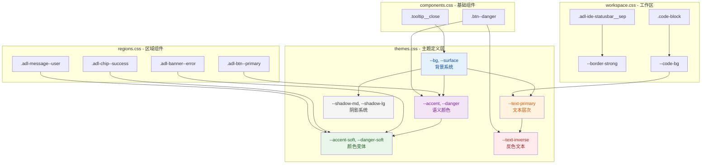

<markdown_report>

## 1. 高层摘要 (TL;DR)

*   **影响:** 🔴 **高** - 完全重构了桌面应用的CSS主题系统，涉及4个核心样式文件
*   **关键变更:**
    *   ✨ 新增完整的WCAG 2.1 AA合规颜色系统
    *   🎨 统一CSS变量命名，移除硬编码颜色值
    *   🌓 重新设计Light/Dark主题配色方案
    *   ♿ 添加主题切换动画和无障碍支持

---

## 2. 可视化概览 (代码与逻辑映射)



---

## 3. 详细变更分析

### 🎨 **主题系统重构 (themes.css)**

**变更说明:** 完全重写了主题定义，建立了符合WCAG 2.1 AA标准的颜色系统。

#### 新增全局主题过渡支持

```css
/* 新增：主题切换平滑过渡 */
html, *:not(script):not(style):not(link):not(meta) {
  transition-property: background-color, color, border-color, box-shadow, fill, stroke;
  transition-duration: 200ms;
  transition-timing-function: cubic-bezier(0.4, 0, 0.2, 1);
}

/* 无障碍：支持减弱动画偏好 */
@media (prefers-reduced-motion: reduce) {
  html, *:not(script):not(style):not(link):not(meta) {
    transition-duration: 0ms !important;
  }
}
```

#### Light主题颜色系统重构

| 变量类别 | 旧值 | 新值 | 说明 |
|---------|------|------|------|
| **背景色** | `#f6f7f9` | `#f3f3f3` | 主背景色调整为用户指定值 |
| **次要背景** | - | `#e6e6e6` | 新增二级背景变量 |
| **主文本** | `#101828` | `#222222` | 优化对比度至WCAG AA标准 |
| **次要文本** | `#344054` | `#767676` | 提升可读性 |
| **禁用文本** | `#98a2b3` | `#c0c0c0` | 统一禁用状态样式 |
| **反色文本** | `#f8fafc` | `#ffffff` | 纯白色背景上的文本 |

#### Dark主题颜色系统重构

| 变量类别 | 旧值 | 新值 | 说明 |
|---------|------|------|------|
| **背景色** | `#0b1224` | `#141414` | 深度炭黑，减少眼疲劳 |
| **次要背景** | - | `#212121` | 新增二级背景变量 |
| **主文本** | `#f5efea` | `#d8d8d8` | 优化对比度至WCAG AA标准 |
| **次要文本** | `#d6cfc7` | `#9a9a9a` | 提升可读性 |
| **禁用文本** | `#5a6885` | `#505050` | 统一禁用状态样式 |
| **反色文本** | `#0b1224` | `#141414` | 与背景色一致 |

#### 新增语义颜色变体系统

```css
/* 新增颜色变体层级 */
--accent-soft: rgba(37, 99, 235, 0.1);      /* 柔和强调色 */
--accent-subtle: rgba(37, 99, 235, 0.08);   /* 微妙强调色 */
--accent-strong: #1d4ed8;                    /* 强强调色 */

--success-soft: rgba(22, 163, 74, 0.12);
--success-subtle: rgba(22, 163, 74, 0.06);

--warning-soft: rgba(180, 83, 9, 0.12);
--warning-subtle: rgba(180, 83, 9, 0.06);

--danger-soft: rgba(220, 38, 38, 0.1);
--danger-subtle: rgba(220, 38, 38, 0.06);
```

#### 新增完整阴影系统

| 阴影级别 | Light主题 | Dark主题 | 用途 |
|---------|-----------|----------|------|
| `--shadow-sm` | `rgba(34,34,34,0.05)` | `rgba(0,0,0,0.2)` | 轻微悬浮 |
| `--shadow-md` | `rgba(34,34,34,0.1)` | `rgba(0,0,0,0.3)` | 卡片悬浮 |
| `--shadow-lg` | `rgba(34,34,34,0.1)` | `rgba(0,0,0,0.35)` | 弹窗悬浮 |
| `--shadow-xl` | `rgba(34,34,34,0.1)` | `rgba(0,0,0,0.4)` | 模态框 |
| `--shadow-2xl` | `rgba(34,34,34,0.25)` | `rgba(0,0,0,0.5)` | 强烈悬浮 |

---

### 🧩 **区域组件样式更新 (regions.css)**

**变更说明:** 移除所有硬编码颜色值和fallback值，统一使用新的CSS变量系统。

#### 组件样式变更映射

| 组件类名 | 旧样式 | 新样式 | 变更类型 |
|---------|--------|--------|----------|
| `.adl-banner--error` | `var(--danger-subtle, rgba(239,68,68,0.1))` | `var(--danger-soft)` | 移除fallback |
| `.adl-banner--warning` | `var(--warning-subtle, rgba(245,158,11,0.12))` | `var(--warning-soft)` | 移除fallback |
| `.adl-chip--success` | `var(--success-subtle, rgba(34,197,94,0.12))` | `var(--success-soft)` | 移除fallback |
| `.adl-btn--primary` | `color: #fff` | `color: var(--text-inverse)` | 使用变量 |
| `.adl-action-btn--danger` | `color: #fff` | `color: var(--text-inverse)` | 使用变量 |
| `.adl-window-btn--close:hover` | `color: #fff` | `color: var(--text-inverse)` | 使用变量 |

#### 表面系统变量使用

```css
/* 旧代码：带fallback的变量 */
background: var(--surface-elevated, var(--surface));
background: var(--surface-raised, var(--surface));

/* 新代码：纯变量引用 */
background: var(--surface-elevated);
background: var(--surface-raised);
```

---

### 🔧 **基础组件样式更新 (components.css)**

**变更说明:** 统一组件颜色变量引用。

| 组件 | 属性 | 旧值 | 新值 |
|------|------|------|------|
| `.btn--danger` | color | `#fff` | `var(--text-inverse)` |
| `.tooltip__close` | background | `rgba(255,255,255,0.15)` | `var(--bg-hover)` |
| `.tooltip__close:hover` | background | `rgba(255,255,255,0.25)` | `var(--bg-active)` |

---

### 💼 **工作区样式更新 (workspace.css)**

**变更说明:** 工作区特定组件颜色变量化。

| 组件 | 属性 | 旧值 | 新值 |
|------|------|------|------|
| `.adl-ide-statusbar__sep` | background | `rgba(255,255,255,0.2)` | `var(--border-strong)` |
| `.code-block` | background | `#1e1e1e` | `var(--code-bg)` |
| `.code-block` | color | `#d4d4d4` | `var(--text-primary)` |
| `.statusbar__section:hover` | background | `rgba(128,128,128,0.12)` | `var(--bg-hover)` |

---

## 4. 影响与风险评估

### ⚠️ **破坏性变更**

| 变更类型 | 影响范围 | 风险等级 |
|---------|---------|----------|
| **CSS变量移除fallback** | 所有组件样式 | 🟡 中等 - 如果新变量未定义，样式会失效 |
| **颜色值变更** | Light/Dark主题 | 🟡 中等 - 视觉风格会发生变化 |
| **新增过渡动画** | 全局元素 | 🟢 低 - 可通过 `prefers-reduced-motion` 禁用 |

### ✅ **测试建议**

#### 功能测试
- [ ] **主题切换**: 验证Light/Dark主题切换时所有组件颜色正确
- [ ] **过渡动画**: 确认主题切换有200ms平滑过渡
- [ ] **减弱动画**: 在系统设置中启用"减弱动态效果"，确认过渡动画被禁用

#### 视觉回归测试
- [ ] **Banner组件**: 检查error/warning/info状态的颜色对比度
- [ ] **按钮组件**: 验证primary/danger/warning按钮的hover/active状态
- [ ] **状态指示器**: 检查status-lamp和agent-status的颜色变体
- [ ] **工作区**: 确认代码块和状态栏在两种主题下可读性良好

#### 无障碍测试
- [ ] **对比度检查**: 使用工具验证所有文本/背景对比度 ≥ 4.5:1 (WCAG AA)
- [ ] **高对比度模式**: 测试 `prefers-contrast: more` 下的边框和焦点环
- [ ] **键盘导航**: 确认焦点环可见且符合设计规范

#### 浏览器兼容性
- [ ] **CSS变量支持**: 确认目标浏览器支持CSS自定义属性
- [ ] **过渡动画**: 验证 `transition` 属性在各浏览器表现一致

---

## 5. 总结

本次变更是一次**系统性的主题重构**，主要目标是：

1. **提升可访问性** - 所有颜色组合符合WCAG 2.1 AA标准
2. **统一设计语言** - 建立完整的语义化颜色变量系统
3. **改善用户体验** - 添加主题切换动画和减弱动画支持
4. **提高可维护性** - 移除硬编码颜色，统一使用CSS变量

**建议:** 在合并前进行全面的视觉回归测试，特别关注Light/Dark主题下的对比度和可读性。