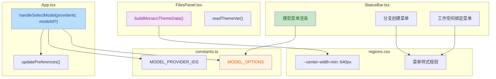

## 1. 高层摘要 (TL;DR)

**影响范围:** 中等 - 重构了 StatusBar 菜单系统,增强了模型选择功能,改进了布局响应式逻辑

**关键变更:**
- ✨ **模型选择增强:** 支持在 StatusBar 中选择具体的模型 ID,而不仅仅是提供商
- 🎨 **菜单样式重构:** 移除边框,改用背景色区分状态,统一菜单视觉风格
- 📐 **布局响应式改进:** 拖拽调整侧边栏宽度时,确保中心区域最小宽度(640px)
- 🌿 **分支创建UI优化:** 使用级联子菜单选择基础分支
- 🔧 **Monaco主题改进:** 从 CSS 变量动态读取编辑器主题颜色

---

## 2. 可视化概览 (代码与逻辑映射)



---

## 3. 详细变更分析

### 🎯 组件: 模型选择系统

**变更内容:** 将模型选择从提供商级别升级为具体模型级别,支持在同一提供商下切换不同模型。

**关键文件:** `App.tsx`, `StatusBar.tsx`, `constants.ts`

#### 模型选项配置

| 提供商 | 模型 ID | 显示标签 |
|--------|---------|----------|
| deepseek | deepseek-v4-pro | deepseek-v4-pro |
| deepseek | deepseek-chat | deepseek-Chat |
| deepseek | deepseek-reasoner | deepseek-reasoner |
| minimax | MiniMax-M2.7 | MiniMax-M2.7 |
| minimax | MiniMax-M2.5 | MiniMax-M2.5 |

**核心逻辑变更 (App.tsx):**
```typescript
// 旧实现: 只设置提供商优先级
const handleSelectModel = (providerId: string) => {
  void updatePreferences({
    modelPreferences: {
      [providerId as ModelProviderId]: { priority: 1, enabled: true }
    }
  });
};

// 新实现: 设置提供商优先级 + 具体模型ID
const handleSelectModel = (providerId: ModelProviderId, modelId?: string) => {
  const patch: Record<ModelProviderId, { priority?: number; enabled?: boolean; modelId?: string }> = {};
  
  for (const id of MODEL_PROVIDER_IDS) {
    if (id === providerId) {
      patch[id] = { priority: 1, enabled: true, ...(modelId ? { modelId } : {}) };
    } else {
      patch[id] = { priority: 2 }; // 确保其他提供商优先级较低,避免平局
    }
  }
  
  void updatePreferences({ modelPreferences: patch });
};
```

---

### 🎨 组件: StatusBar 菜单样式重构

**变更内容:** 统一菜单视觉风格,移除边框,使用背景色区分状态,提升一致性。

**关键文件:** `StatusBar.tsx`, `regions.css`, `docs/design-system/components.md`

#### 设计原则

| 规则 | 说明 |
|------|------|
| **无蓝色主题** | 避免使用 `adl-btn--primary`,改用 `ghost` + 中性背景 |
| **仅背景强调** | 激活/悬停状态只改变背景色,不显示边框 |
| **统一操作表面** | 按钮始终显示中性背景,禁用时也不变透明 |
| **柔和操作色调** | 操作按钮使用 `color: var(--text-secondary)` |

#### 菜单宽度配置

| 菜单类型 | 宽度 |
|----------|------|
| 工作空间菜单 | `min(380px, 100%)` |
| 分支菜单 | `min(280px, 100vw - var(--space-6))` |
| 模型菜单 | `min(168px, 100vw - var(--space-6))` |

---

### 🌿 组件: 分支创建 UI 优化

**变更内容:** 将基础分支选择从下拉框改为级联子菜单,提升交互体验。

**关键文件:** `StatusBar.tsx`, `regions.css`

**UI 结构变更:**
```
旧实现:
[新建分支名称输入框] [下拉框选择基础分支]

新实现:
[新建分支名称输入框] [基于当前分支 ▶] → [子菜单: 选择基础分支]
```

**关键代码片段 (StatusBar.tsx):**
```typescript
<div className="adl-statusbar__menu-row adl-statusbar__menu-row--branch-create">
  <input
    className="adl-statusbar__input"
    value={branchDraft}
    onChange={(event) => setBranchDraft(event.currentTarget.value)}
    placeholder={t.branchCreatePlaceholder}
  />
  <div className="adl-statusbar__submenu-wrap" ref={baseBranchMenuWrapRef}>
    <button
      type="button"
      className="adl-statusbar__submenu-trigger"
      aria-haspopup="menu"
      aria-expanded={baseBranchMenuOpen}
      onClick={() => setBaseBranchMenuOpen((current) => !current)}
    >
      <span className="adl-statusbar__submenu-label">{baseBranchLabel}</span>
      <IconChevronRight size={14} decorative />
    </button>
    {baseBranchMenuOpen ? (
      <div className="adl-statusbar__submenu" role="menu">
        {/* 子菜单选项 */}
      </div>
    ) : null}
  </div>
</div>
```

---

### 📐 组件: 布局响应式改进

**变更内容:** 拖拽调整侧边栏宽度时,确保中心区域保持最小宽度(640px)。

**关键文件:** `LeftSidebar.tsx`, `RightPanel.tsx`, `regions.css`

**CSS 变量定义:**
```css
:root {
  --center-width-min: 640px;
}
```

**Grid 布局更新:**
```css
/* 旧实现 */
.adl-shell__body {
  grid-template-columns: var(--leftbar-width) 1fr var(--rightpanel-width);
}

/* 新实现 */
.adl-shell__body {
  grid-template-columns: var(--leftbar-width) minmax(var(--center-width-min), 1fr) var(--rightpanel-width);
}
```

**拖拽逻辑改进 (LeftSidebar.tsx):**
```typescript
const onMouseMove = (moveEvent: MouseEvent) => {
  const delta = moveEvent.clientX - startX;
  const rightWidth = shellBody.classList.contains("is-right-collapsed")
    ? 0
    : (parseFloat(getComputedStyle(shellBody).getPropertyValue("--rightpanel-width")) || 0);
  const shellWidth = shellBody.getBoundingClientRect().width;
  const allowedMax = Math.max(minWidth, shellWidth - rightWidth - centerMinWidth);
  const newWidth = Math.min(Math.min(maxWidth, allowedMax), Math.max(minWidth, startWidth + delta));
  root.style.setProperty("--leftbar-width", `${newWidth}px`);
};
```

---

### 🔧 组件: Monaco 编辑器主题改进

**变更内容:** 从 CSS 变量动态读取编辑器主题颜色,支持主题切换。

**关键文件:** `FilesPanel.tsx`

**主题数据构建:**
```typescript
function readThemeVar(theme: "light" | "dark", name: string): string | undefined {
  const probe = document.createElement("div");
  probe.setAttribute("data-theme", theme);
  probe.style.position = "absolute";
  probe.style.opacity = "0";
  document.body.appendChild(probe);
  try {
    const value = getComputedStyle(probe).getPropertyValue(name).trim();
    return value ? value : undefined;
  } finally {
    document.body.removeChild(probe);
  }
}

function buildMonacoThemeData(theme: "light" | "dark") {
  const base = theme === "dark" ? "vs-dark" : "vs";
  const surface = readThemeVar(theme, "--surface") ?? readThemeVar(theme, "--bg");
  const colors: Record<string, string> = surface
    ? {
        "editor.background": surface,
        "editorGutter.background": surface,
        "minimap.background": surface
      }
    : {};
  return { base, inherit: true, rules: [], colors };
}
```

---

### 📝 组件: 文案更新

**变更内容:** 优化中文和英文文案,提升可读性。

**关键文件:** `copy.ts`

| 旧文案 | 新文案 | 位置 |
|--------|--------|------|
| "输入工作区路径" | "输入工作空间路径" | workspacePlaceholder |
| "工作区" | "当前工作空间路径" | workspaceLabel |
| "当前是仅对话模式,不绑定工作空间。" | "不用绑定工作空间" | workspaceStatusGlobalHint |
| "仅对话模式" | "对话模式" | workspaceGlobalMode |
| "发送时绑定" | "绑定该路径" | workspaceBindPending |

---

### 🛠️ 组件: 状态管理改进

**变更内容:** 避免直接修改状态对象,使用不可变更新模式。

**关键文件:** `mock-bridge.ts`, `preview-bridge.ts`

**改进前:**
```typescript
updatePreferences: async (patch) => {
  if (patch.language) {
    appInfo.config.language = patch.language; // 直接修改
  }
  // ...
}
```

**改进后:**
```typescript
updatePreferences: async (patch) => {
  const nextConfig = { ...appInfo.config }; // 创建副本
  if (patch.language) {
    nextConfig.language = patch.language; // 修改副本
  }
  // ...
  appInfo.config = nextConfig; // 一次性替换
}
```

---

## 4. 影响与风险评估

### ⚠️ 破坏性变更

| 变更类型 | 影响范围 | 说明 |
|----------|----------|------|
| API 签名变更 | `onSelectModel` | 从 `(providerId: string)` 变为 `(providerId: ModelProviderId, modelId?: string)` |
| CSS 类名变更 | StatusBar 菜单 | 新增多个修饰类,可能影响自定义样式 |
| 布局约束变更 | 主布局 | 中心区域新增最小宽度约束,可能影响小屏幕显示 |

### ✅ 测试建议

1. **模型选择功能**
   - [ ] 验证切换模型后,模型优先级正确更新
   - [ ] 验证切换提供商时,其他提供商优先级降为 2
   - [ ] 验证模型健康状态指示器正确显示

2. **菜单交互**
   - [ ] 验证分支创建子菜单正确打开/关闭
   - [ ] 验证点击外部区域关闭菜单
   - [ ] 验证键盘导航 (Escape 键关闭菜单)

3. **布局响应式**
   - [ ] 验证拖拽左/右侧边栏时,中心区域不小于 640px
   - [ ] 验证在小屏幕设备上的布局表现
   - [ ] 验证折叠/展开侧边栏时的布局过渡

4. **主题切换**
   - [ ] 验证切换明/暗主题时,Monaco 编辑器背景色正确更新
   - [ ] 验证 CSS 变量读取逻辑在所有浏览器中正常工作

5. **状态管理**
   - [ ] 验证 `updatePreferences` 正确更新配置
   - [ ] 验证配置持久化逻辑正常工作

---

## 5. 设计文档更新

新增了 StatusBar 菜单的设计文档 (`docs/design-system/components.md`),详细说明了:

- 菜单布局和容器样式
- 选项行的交互状态
- 输入框的最小化样式
- 操作按钮的统一规范
- 特殊行的样式规则 (全局模式、分支创建等)

---

验证问题的存在性并进行修复：

标题: 模型选择逻辑硬编码优先级
详情: 模型选择逻辑中硬编码了优先级值（1和2），这限制了灵活性。建议使用常量或配置来管理优先级，例如：
```typescript
const ACTIVE_PRIORITY = 1;
const INACTIVE_PRIORITY = 2;
```
这样可以更容易地调整优先级策略。
`ai-digital-life/frontend/src/app/App.tsx#L360-377`

验证问题的存在性并进行修复：

标题: baseBranchMenuOpen事件监听器缺少清理
详情: baseBranchMenuOpen的useEffect中只添加了事件监听器但没有返回清理函数。这可能导致内存泄漏。建议添加清理：
```typescript
useEffect(() => {
  if (!baseBranchMenuOpen) return;
  const onPointerDown = (event: MouseEvent) => {
    if (!baseBranchMenuWrapRef.current?.contains(event.target as Node)) {
      setBaseBranchMenuOpen(false);
    }
  };
  document.addEventListener('mousedown', onPointerDown);
  return () => document.removeEventListener('mousedown', onPointerDown);
}, [baseBranchMenuOpen]);
```
`ai-digital-life/frontend/src/app/regions/StatusBar.tsx#L227-236`