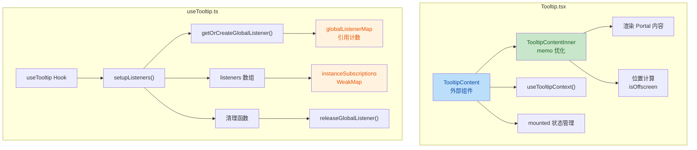
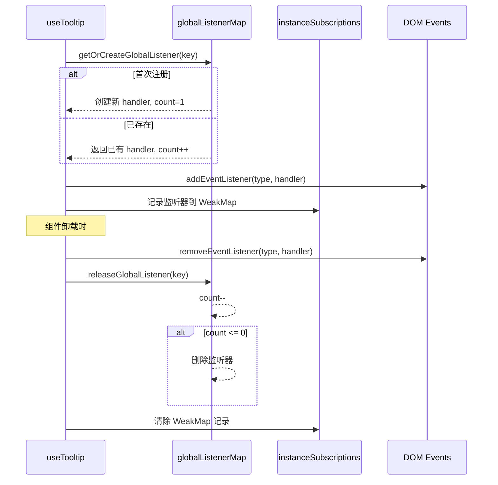

## 1. 高层摘要 (TL;DR)

- **影响**: **中等** - 重构了 Tooltip 组件的渲染逻辑和事件监听管理机制
- **核心变更**:
  - ✨ 使用 `React.memo` 优化 TooltipContent 组件，减少不必要的重新渲染
  - 🔧 引入全局事件监听器共享机制，避免重复注册 scroll/resize 监听器
  - 🐛 修复潜在的内存泄漏问题，改进事件监听器的清理逻辑
  - 📦 将组件拆分为内部和外部两层，提升代码可维护性

---

## 2. 可视化概览 (代码与逻辑映射)



### 事件监听器管理流程



---

## 3. 详细变更分析

### 📦 组件: Tooltip.tsx

#### **变更说明**: 重构 `TooltipContent` 组件以优化渲染性能

**主要逻辑变更**:
- 将 `TooltipContent` 拆分为两层结构：
  - **外层组件**: 负责从 Context 获取数据、管理 `mounted` 状态、控制组件挂载/卸载
  - **内层组件 (`TooltipContentInner`)**: 使用 `memo` 包装，纯展示组件，直接接收所有 props

**性能优化点**:
1. **memo 优化**: `TooltipContentInner` 使用 `memo` 包装，只有当 props 真正改变时才重新渲染
2. **简化位置计算**: 使用 `isOffscreen` 变量统一处理位置和可见性，避免重复的条件判断
3. **移除冗余逻辑**: 内层组件不再需要 `mounted` 状态管理

**代码对比**:

| 方面 | 旧实现 | 新实现 |
|------|--------|--------|
| 组件结构 | 单一组件 | 外层 + 内层 (memo) |
| props 来源 | 部分来自 props，部分来自 Context | 全部通过 props 传递 |
| 位置计算 | `position?.x ?? -9999` | `isOffscreen ? -9999 : position.x` |
| 可见性控制 | `visibility: position ? "visible" : "hidden"` | 通过 `left/top` 坐标控制 |

**关键代码片段**:
```typescript
// 新增的内层组件 - 使用 memo 优化
const TooltipContentInner = memo(function TooltipContentInner({
  children, side, placement, position, isOpen, tooltipRef,
  close, handleTooltipEnter, handleTooltipLeave, dismissible, showArrow,
  className, id
}: { /* ... */ }) {
  const effectiveSide = side ?? placement;
  const isOffscreen = !position || !isOpen;
  const left = isOffscreen ? -9999 : position.x;
  const top = isOffscreen ? -9999 : position.y;
  
  return (
    <div
      role="tooltip"
      style={{
        position: "fixed",
        left,
        top,
        pointerEvents: isOpen ? "auto" : "none"
      }}
      // ...
    >
      {children}
    </div>
  );
});
```

---

### 🔧 组件: useTooltip.ts

#### **变更说明**: 引入全局事件监听器共享机制，修复内存泄漏

**主要逻辑变更**:
1. **新增全局监听器管理**:
   - 使用 `globalListenerMap` 跟踪全局监听器的引用计数
   - 使用 `WeakMap` 跟踪每个实例的监听器订阅
   - 实现监听器复用，避免重复注册

2. **重构事件监听器注册**:
   - scroll 和 resize 事件共享同一个 handler (`handleScrollResize`)
   - 使用 `listeners` 数组统一管理所有监听器
   - 改进清理逻辑，确保所有监听器都被正确移除

3. **优化 Escape 键处理**:
   - 改为 focus 到 trigger 元素而不是 blur
   - 修复类型定义，使用 `EventListener` 类型

**数据结构变更**:

| 数据结构 | 类型 | 用途 |
|----------|------|------|
| `ListenerEntry` | `{ target, type, handler }` | 单个监听器记录 |
| `globalListenerMap` | `Map<string, { handler, count }>` | 全局监听器引用计数 |
| `instanceSubscriptions` | `WeakMap<object, ListenerEntry[]>` | 实例级别的监听器订阅 |

**关键代码片段**:
```typescript
// 全局监听器管理
const globalListenerMap = new Map<string, { handler: EventListenerOrEventListenerObject; count: number }>();

function getOrCreateGlobalListener(key: string, handler: EventListenerOrEventListenerObject) {
  const existing = globalListenerMap.get(key);
  if (existing) {
    existing.count++;
    return existing.handler;
  }
  globalListenerMap.set(key, { handler, count: 1 });
  return handler;
}

function releaseGlobalListener(key: string): void {
  const existing = globalListenerMap.get(key);
  if (existing) {
    existing.count--;
    if (existing.count <= 0) {
      globalListenerMap.delete(key);
    }
  }
}
```

**监听器注册对比**:

| 方面 | 旧实现 | 新实现 |
|------|--------|--------|
| scroll/resize handler | 独立创建 | 共享同一个 handler |
| 监听器管理 | 使用 `cleanupRef` | 使用 `listeners` 数组 + `WeakMap` |
| 清理逻辑 | 手动遍历 DOM 树 | 统一从数组移除 |
| 全局监听器 | 每个实例独立注册 | 引用计数 + 复用 |

---

## 4. 影响与风险评估

### ⚠️ 破坏性变更
**无** - 此次重构保持了 API 的向后兼容性，所有公开接口保持不变。

### 🧪 测试建议

#### **功能测试**
- ✅ 验证 Tooltip 在 hover/trigger 模式下的正常显示和隐藏
- ✅ 测试多个 Tooltip 实例同时存在时的行为
- ✅ 验证 Escape 键关闭功能，确保焦点正确返回到 trigger 元素
- ✅ 测试在滚动容器内的 Tooltip 定位是否正确

#### **性能测试**
- 📊 使用 React DevTools Profiler 验证 `memo` 优化效果
- 📊 测试大量 Tooltip 实例场景下的内存占用
- 📊 验证 scroll/resize 事件监听器数量是否正确（应该只有 1 个全局监听器）

#### **边界情况**
- 🧪 快速创建和销毁 Tooltip 实例，验证无内存泄漏
- 🧪 在 iframe 环境中测试 Tooltip 行为
- 🧪 测试 `position` 为 null 时的渲染行为（应该渲染到屏幕外）

### 🔍 潜在风险
1. **WeakMap 使用**: `instanceSubscriptions` 使用 WeakMap，如果实例对象被垃圾回收，订阅信息会丢失。这是预期行为，但需要确保清理逻辑正确执行。
2. **全局监听器共享**: 多个 Tooltip 实例共享同一个 scroll/resize handler，需要确保 handler 逻辑正确处理所有实例。

---

## 5. 总结

本次重构主要针对 **性能优化** 和 **内存泄漏修复**：

1. **性能提升**: 通过 `memo` 减少不必要的重新渲染，通过共享全局监听器减少事件监听器数量
2. **内存安全**: 改进事件监听器的清理机制，使用引用计数和 WeakMap 确保资源正确释放
3. **代码质量**: 组件拆分提升了可维护性，事件监听器管理更加规范和可追踪

建议在合并前进行充分的回归测试，特别是多实例场景和内存泄漏测试。