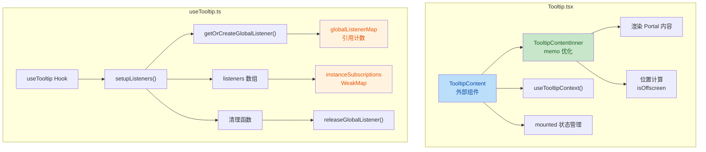
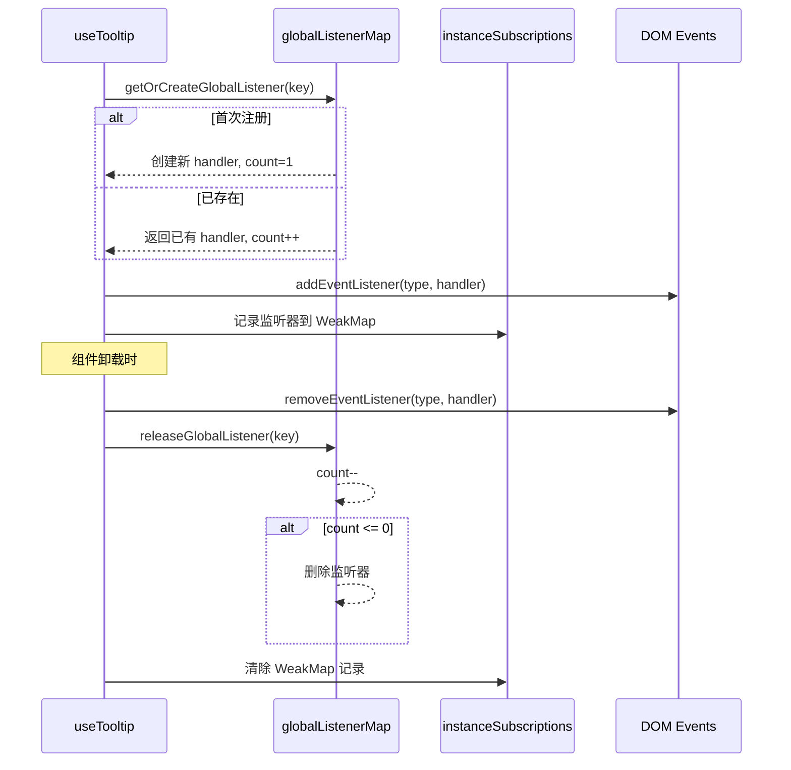

## 1. 高层摘要 (TL;DR)

- **影响**: **中等** - 重构了 Tooltip 组件的渲染逻辑和事件监听管理机制
- **核心变更**:
  - ✨ 使用 `React.memo` 优化 TooltipContent 组件，减少不必要的重新渲染
  - 🔧 引入全局事件监听器共享机制，避免重复注册 scroll/resize 监听器
  - 🐛 修复潜在的内存泄漏问题，改进事件监听器的清理逻辑
  - 📦 将组件拆分为内部和外部两层，提升代码可维护性

---

## 2. 可视化概览 (代码与逻辑映射)



### 事件监听器管理流程



---

## 3. 详细变更分析

### 📦 组件: Tooltip.tsx

#### **变更说明**: 重构 `TooltipContent` 组件以优化渲染性能

**主要逻辑变更**:
- 将 `TooltipContent` 拆分为两层结构：
  - **外层组件**: 负责从 Context 获取数据、管理 `mounted` 状态、控制组件挂载/卸载
  - **内层组件 (`TooltipContentInner`)**: 使用 `memo` 包装，纯展示组件，直接接收所有 props

**性能优化点**:
1. **memo 优化**: `TooltipContentInner` 使用 `memo` 包装，只有当 props 真正改变时才重新渲染
2. **简化位置计算**: 使用 `isOffscreen` 变量统一处理位置和可见性，避免重复的条件判断
3. **移除冗余逻辑**: 内层组件不再需要 `mounted` 状态管理

**代码对比**:

| 方面 | 旧实现 | 新实现 |
|------|--------|--------|
| 组件结构 | 单一组件 | 外层 + 内层 (memo) |
| props 来源 | 部分来自 props，部分来自 Context | 全部通过 props 传递 |
| 位置计算 | `position?.x ?? -9999` | `isOffscreen ? -9999 : position.x` |
| 可见性控制 | `visibility: position ? "visible" : "hidden"` | 通过 `left/top` 坐标控制 |

**关键代码片段**:
```typescript
// 新增的内层组件 - 使用 memo 优化
const TooltipContentInner = memo(function TooltipContentInner({
  children, side, placement, position, isOpen, tooltipRef,
  close, handleTooltipEnter, handleTooltipLeave, dismissible, showArrow,
  className, id
}: { /* ... */ }) {
  const effectiveSide = side ?? placement;
  const isOffscreen = !position || !isOpen;
  const left = isOffscreen ? -9999 : position.x;
  const top = isOffscreen ? -9999 : position.y;
  
  return (
    <div
      role="tooltip"
      style={{
        position: "fixed",
        left,
        top,
        pointerEvents: isOpen ? "auto" : "none"
      }}
      // ...
    >
      {children}
    </div>
  );
});
```

---

### 🔧 组件: useTooltip.ts

#### **变更说明**: 引入全局事件监听器共享机制，修复内存泄漏

**主要逻辑变更**:
1. **新增全局监听器管理**:
   - 使用 `globalListenerMap` 跟踪全局监听器的引用计数
   - 使用 `WeakMap` 跟踪每个实例的监听器订阅
   - 实现监听器复用，避免重复注册

2. **重构事件监听器注册**:
   - scroll 和 resize 事件共享同一个 handler (`handleScrollResize`)
   - 使用 `listeners` 数组统一管理所有监听器
   - 改进清理逻辑，确保所有监听器都被正确移除

3. **优化 Escape 键处理**:
   - 改为 focus 到 trigger 元素而不是 blur
   - 修复类型定义，使用 `EventListener` 类型

**数据结构变更**:

| 数据结构 | 类型 | 用途 |
|----------|------|------|
| `ListenerEntry` | `{ target, type, handler }` | 单个监听器记录 |
| `globalListenerMap` | `Map<string, { handler, count }>` | 全局监听器引用计数 |
| `instanceSubscriptions` | `WeakMap<object, ListenerEntry[]>` | 实例级别的监听器订阅 |

**关键代码片段**:
```typescript
// 全局监听器管理
const globalListenerMap = new Map<string, { handler: EventListenerOrEventListenerObject; count: number }>();

function getOrCreateGlobalListener(key: string, handler: EventListenerOrEventListenerObject) {
  const existing = globalListenerMap.get(key);
  if (existing) {
    existing.count++;
    return existing.handler;
  }
  globalListenerMap.set(key, { handler, count: 1 });
  return handler;
}

function releaseGlobalListener(key: string): void {
  const existing = globalListenerMap.get(key);
  if (existing) {
    existing.count--;
    if (existing.count <= 0) {
      globalListenerMap.delete(key);
    }
  }
}
```

**监听器注册对比**:

| 方面 | 旧实现 | 新实现 |
|------|--------|--------|
| scroll/resize handler | 独立创建 | 共享同一个 handler |
| 监听器管理 | 使用 `cleanupRef` | 使用 `listeners` 数组 + `WeakMap` |
| 清理逻辑 | 手动遍历 DOM 树 | 统一从数组移除 |
| 全局监听器 | 每个实例独立注册 | 引用计数 + 复用 |

---

## 4. 影响与风险评估

### ⚠️ 破坏性变更
**无** - 此次重构保持了 API 的向后兼容性，所有公开接口保持不变。

### 🧪 测试建议

#### **功能测试**
- ✅ 验证 Tooltip 在 hover/trigger 模式下的正常显示和隐藏
- ✅ 测试多个 Tooltip 实例同时存在时的行为
- ✅ 验证 Escape 键关闭功能，确保焦点正确返回到 trigger 元素
- ✅ 测试在滚动容器内的 Tooltip 定位是否正确

#### **性能测试**
- 📊 使用 React DevTools Profiler 验证 `memo` 优化效果
- 📊 测试大量 Tooltip 实例场景下的内存占用
- 📊 验证 scroll/resize 事件监听器数量是否正确（应该只有 1 个全局监听器）

#### **边界情况**
- 🧪 快速创建和销毁 Tooltip 实例，验证无内存泄漏
- 🧪 在 iframe 环境中测试 Tooltip 行为
- 🧪 测试 `position` 为 null 时的渲染行为（应该渲染到屏幕外）

### 🔍 潜在风险
1. **WeakMap 使用**: `instanceSubscriptions` 使用 WeakMap，如果实例对象被垃圾回收，订阅信息会丢失。这是预期行为，但需要确保清理逻辑正确执行。
2. **全局监听器共享**: 多个 Tooltip 实例共享同一个 scroll/resize handler，需要确保 handler 逻辑正确处理所有实例。

---

## 5. 总结

本次重构主要针对 **性能优化** 和 **内存泄漏修复**：

1. **性能提升**: 通过 `memo` 减少不必要的重新渲染，通过共享全局监听器减少事件监听器数量
2. **内存安全**: 改进事件监听器的清理机制，使用引用计数和 WeakMap 确保资源正确释放
3. **代码质量**: 组件拆分提升了可维护性，事件监听器管理更加规范和可追踪

建议在合并前进行充分的回归测试，特别是多实例场景和内存泄漏测试。

---

## 1. 高层摘要 (TL;DR)

- **影响范围**: 🟡 **中等** - 重构了 `useTooltip` Hook 的全局事件监听器管理机制
- **核心变更**:
  - ✅ 简化了全局 scroll/resize 监听器的管理逻辑
  - ✅ 移除了复杂的引用计数机制，改用 Set 存储回调
  - ✅ 减少了内存占用和代码复杂度
  - ✅ 保持了相同的功能行为，但实现更简洁

## 2. 可视化概览 (代码逻辑图)

```mermaid
graph TD
    subgraph "旧实现机制"
        A1["useTooltip 实例化"] --> B1["创建 instanceIdRef"]
        B1 --> C1["调用 getOrCreateGlobalListener"]
        C1 --> D1["globalListenerMap 引用计数+1"]
        D1 --> E1["添加 window 监听器"]
        E1 --> F1["instanceSubscriptions WeakMap 存储监听器"]
        F1 --> G1["清理时 releaseGlobalListener 引用计数-1"]
    end
    
    subgraph "新实现机制"
        A2["useTooltip 实例化"] --> B2["调用 registerScrollResizeCallback"]
        B2 --> C2["scrollResizeCallbacks Set 添加回调"]
        C2 --> D2{首次注册?}
        D2 -->|是| E2["window 添加全局监听器"]
        D2 -->|否| F2["复用已有监听器"]
        E2 --> G2["globalListenerAttached = true"]
        F2 --> H2["清理时 unregisterScrollResizeCallback"]
        G2 --> H2
        H2 --> I2{Set 为空?}
        I2 -->|是| J2["移除 window 监听器"]
        I2 -->|否| K2["保持监听器活跃"]
    end
    
    style A1 fill:#fff3e0,color:#e65100
    style A2 fill:#c8e6c9,color:#1a5e20
    style E2 fill:#bbdefb,color:#0d47a1
    style J2 fill:#bbdefb,color:#0d47a1
```



## 3. 详细变更分析

### 📦 组件: `useTooltip.ts` - 全局监听器管理重构

**变更原因**: 简化代码复杂度，提高性能，移除不必要的抽象层

#### 🔧 数据结构变更

| 数据结构 | 旧实现 | 新实现 | 说明 |
|---------|--------|--------|------|
| **全局监听器存储** | `Map<string, { handler, count }>` | `Set<() => void>` | 从引用计数改为直接存储回调 |
| **实例监听器存储** | `WeakMap<object, ListenerEntry[]>` | 本地数组 `instanceListeners[]` | 移除 WeakMap，使用局部变量 |
| **全局监听器标志** | 无 | `globalListenerAttached: boolean` | 新增标志避免重复添加监听器 |

#### 📝 核心函数变更

**移除的函数**:
- ❌ `getOrCreateGlobalListener(key, handler)` - 基于引用计数创建/获取全局监听器
- ❌ `releaseGlobalListener(key)` - 释放全局监听器（减少引用计数）

**新增的函数**:
- ✅ `globalScrollResizeHandler()` - 统一的 scroll/resize 处理器，遍历 Set 执行所有回调
- ✅ `registerScrollResizeCallback(callback)` - 注册回调到 Set，首次注册时添加全局监听器
- ✅ `unregisterScrollResizeCallback(callback)` - 从 Set 移除回调，Set 为空时移除全局监听器

#### 💡 逻辑变更详解

**1. 监听器注册流程** (源文件: `useTooltip.ts:251-254`)

```typescript
// ❌ 旧代码: 使用引用计数
const scrollResizeKey = "tooltip:scroll-resize";
const sharedHandler = getOrCreateGlobalListener(scrollResizeKey, handleScrollResize);
window.addEventListener("scroll", sharedHandler, { passive: true });
window.addEventListener("resize", sharedHandler, { passive: true });

// ✅ 新代码: 直接注册回调
registerScrollResizeCallback(handleScrollResize);
```

**2. 清理流程** (源文件: `useTooltip.ts:286-292`)

```typescript
// ❌ 旧代码: 需要管理引用计数和 WeakMap
listeners.forEach(({ target, type, handler }) => {
  target.removeEventListener(type, handler);
});
releaseGlobalListener(scrollResizeKey);
instanceSubscriptions.delete(instanceId);

// ✅ 新代码: 简化清理逻辑
unregisterScrollResizeCallback(handleScrollResize);
instanceListeners.forEach(({ target, type, handler }) => {
  target.removeEventListener(type, handler);
});
```

**3. 新增全局监听器管理逻辑** (源文件: `useTooltip.ts:40-63`)

```typescript
// 新增: 全局回调集合
const scrollResizeCallbacks = new Set<() => void>();
let globalListenerAttached = false;

// 新增: 统一处理器
function globalScrollResizeHandler() {
  scrollResizeCallbacks.forEach((cb) => cb());
}

// 新增: 注册回调
function registerScrollResizeCallback(callback: () => void): void {
  scrollResizeCallbacks.add(callback);
  if (!globalListenerAttached) {
    window.addEventListener("scroll", globalScrollResizeHandler, { passive: true });
    window.addEventListener("resize", globalScrollResizeHandler, { passive: true });
    globalListenerAttached = true;
  }
}

// 新增: 取消注册
function unregisterScrollResizeCallback(callback: () => void): void {
  scrollResizeCallbacks.delete(callback);
  if (scrollResizeCallbacks.size === 0 && globalListenerAttached) {
    window.removeEventListener("scroll", globalScrollResizeHandler);
    window.removeEventListener("resize", globalScrollResizeHandler);
    globalListenerAttached = false;
  }
}
```

## 4. 影响与风险评估

### ⚠️ 潜在风险

| 风险项 | 严重程度 | 说明 |
|--------|---------|------|
| **内存泄漏** | 🟢 低 | 新实现使用 Set，当所有 tooltip 实例销毁后会自动清理全局监听器 |
| **性能回归** | 🟢 低 | 新实现减少了 Map 查找和 WeakMap 操作，性能应该有所提升 |
| **行为变化** | 🟢 低 | 逻辑等价，只是实现方式不同 |

### ✅ 测试建议

1. **多 Tooltip 实例场景**:
   - 同时创建多个 tooltip，验证所有都能正确响应 scroll/resize
   - 逐个销毁 tooltip，验证监听器正确清理

2. **快速创建/销毁**:
   - 快速创建和销毁 tooltip 实例，验证没有内存泄漏
   - 使用 React DevTools Profiler 检查内存占用

3. **边界情况**:
   - 验证当最后一个 tooltip 销毁时，全局监听器被正确移除
   - 验证重新创建 tooltip 时，全局监听器被正确添加

4. **功能回归测试**:
   - Tooltip 在页面滚动时位置是否正确更新
   - Tooltip 在窗口缩放时位置是否正确更新
   - ESC 键关闭功能是否正常工作

### 📊 优势总结

- ✨ **代码简洁**: 减少了约 40 行代码
- 🚀 **性能提升**: 移除了 Map 查找和 WeakMap 操作
- 🔧 **易于维护**: 逻辑更直观，减少了抽象层
- 💾 **内存优化**: 移除了 WeakMap 和不必要的引用计数