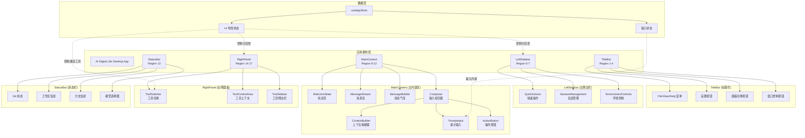

## 1. 高层摘要

**影响范围：** 🟢 **高** - 这是一个全新的UI架构实现，涉及16个新组件和5个样式文件的添加

**核心变更：**
- ✨ 实现了完整的桌面应用UI布局系统（12个区域）
- 🎨 建立了统一的组件库和设计系统
- 📱 支持响应式布局、主题切换、国际化
- 🔄 添加了状态管理支持（侧边栏、面板、模型选择）

---

## 2. 视觉概览（架构与组件映射）



---

## 3. 详细变更分析

### 📦 组件层变更

#### **核心布局组件**

| 组件名 | 文件路径 | 职责 | 关键方法/属性 |
|--------|----------|------|--------------|
| **TitleBar** | `TitleBar.tsx` | 应用标题栏（Regions 1-4） | `onMinimize()`, `onMaximize()`, `onClose()`, `onToggleLeftSidebar()`, `onToggleRightSidebar()` |
| **LeftSidebar** | `LeftSidebar.tsx` | 左侧导航面板（Regions 5-7） | 组合 `QuickActions`, `SessionManagement`, `EnvironmentControls` |
| **MainContent** | `MainContent.tsx` | 主内容区域（Regions 8-12） | 根据 `hasWorkspace` / `hasActiveSession` 渲染不同状态 |
| **RightPanel** | `RightPanel.tsx` | 右侧工具面板（Regions 14-17） | `activeTool: 'files'\|'changes'\|'browser'\|'terminal'` |
| **StatusBar** | `StatusBar.tsx` | 底部状态栏（Region 13） | `gitStatus`, `currentModel`, `onModelChange()` |

#### **消息交互组件**

| 组件名 | 职责 | 状态机 |
|--------|------|--------|
| **MessageStream** | 消息列表容器，自动滚动 | `isStreaming`, `streamingText` |
| **MessageBubble** | 单条消息展示 | `role: 'user'\|'assistant'`, 支持复制、编辑、重新生成 |
| **Composer** | 输入区域容器 | 组合 `ContextBuilder`, `PromptInput`, `ActionButton` |
| **ActionButton** | 发送/停止/重试按钮 | `state: 'idle'\|'generating'\|'error'\|'waiting'` |

#### **侧边栏组件**

| 组件名 | 职责 | 特性 |
|--------|------|------|
| **QuickActions** | 快速操作工具栏 | Skills、MCP、New Workspace 按钮，MCP 状态指示器 |
| **SessionManagement** | 工作区和会话管理 | 可折叠、状态点、时间戳格式化 |
| **EnvironmentControls** | 语言和主题切换 | 下拉菜单、主题循环切换 |

#### **右侧工具面板组件**

| 组件名 | 职责 | 工具类型 |
|--------|------|----------|
| **ToolSwitcher** | 工具标签页切换 | Files、Changes、Browser、Terminal |
| **ToolContextArea** | 工具特定上下文栏 | 根据工具类型渲染不同UI（面包屑、分支选择、地址栏等） |
| **ToolSidebar** | 工具操作按钮栏 | 每个工具独立的操作按钮集 |

#### **辅助组件**

| 组件名 | 职责 | 变体 |
|--------|------|------|
| **WelcomeState** | 空状态展示 | `no-workspace` / `no-session` |
| **ContextBuilder** | 上下文添加器（+按钮） | 模式、模型、引用类型选择 |
| **PromptInput** | 自动调整高度的文本框 | 支持拖拽附件、字符计数 |

---

### 🎨 样式层变更

#### **新增CSS文件**

| 文件 | 行数 | 主要内容 |
|------|------|----------|
| `main-content.css` | 1064 | 欢迎页、消息流、消息气泡、输入区域样式 |
| `sidebar.css` | 506 | 左侧边栏、快速操作、会话管理、环境控制样式 |
| `themes.css` | +16 | 新增语义颜色别名（`--color-primary`, `--color-danger` 等） |
| `tokens.css` | +10 | 新增布局令牌（侧边栏宽度、右侧面板宽度等） |
| `workspace.css` | +606 | 标题栏、右侧面板、工具切换、状态栏样式 |

#### **设计令牌更新**

| 令牌 | 旧值 | 新值 | 说明 |
|------|------|------|------|
| `--sidebar-width` | 248px | 260px | 左侧边栏宽度增加 |
| `--sidebar-width-collapsed` | 64px | 48px | 折叠状态宽度减小 |
| `--right-panel-width` | - | 30% | 右侧面板宽度（百分比） |
| `--right-panel-width-min` | - | 280px | 右侧面板最小宽度 |
| `--right-panel-width-max` | - | 50% | 右侧面板最大宽度 |

---

### 🗄️ 状态管理变更

**文件：** `store.ts`

**新增状态字段：**

```typescript
// UI 布局状态
leftSidebarVisible: boolean;
rightPanelVisible: boolean;
activeRightTool: 'files' | 'changes' | 'browser' | 'terminal';
currentModel: string;
composerMessage: string;

// 新增操作方法
setLeftSidebarVisible: (visible: boolean) => void;
setRightPanelVisible: (visible: boolean) => void;
setActiveRightTool: (tool: 'files' | 'changes' | 'browser' | 'terminal') => void;
setCurrentModel: (model: string) => void;
setComposerMessage: (message: string) => void;
toggleLeftSidebar: () => void;
toggleRightSidebar: () => void;
```

**默认值：**
- `leftSidebarVisible: true`
- `rightPanelVisible: true`
- `activeRightTool: 'files'`
- `currentModel: 'GPT-4o'`

---

### 🎯 图标系统扩展

**文件：** `icons.ts`

**新增图标类型（共约70个）：**

| 分类 | 图标示例 |
|------|----------|
| **导航** | `chevron-left`, `chevron-up`, `arrow-up`, `arrow-right` |
| **操作** | `minus`, `square`, `check-circle`, `plus`, `copy`, `download`, `upload` |
| **文件** | `file-text`, `file-plus`, `folder-open`, `folder-plus` |
| **编辑** | `pencil`, `trash-2`, `bookmark`, `at-sign` |
| **消息** | `send`, `message-square`, `mail`, `quote` |
| **AI/智能** | `sparkles`, `brain`, `cpu`, `zap` |
| **网络** | `plug`, `server`, `globe`, `link`, `shield` |
| **开发** | `terminal`, `git-fork`, `git-branch`, `code`, `diff` |
| **布局** | `columns`, `layout-grid`, `panel-left`, `panel-right` |
| **窗口** | `maximize-2`, `minimize-2`, `scale-3d`, `move` |
| **其他** | `lightbulb`, `history`, `command`, `log-out`, `rotate-ccw` |

**新增尺寸：**
- `"2xl"` - 超大图标尺寸

---

## 4. 影响与风险评估

### ⚠️ 破坏性变更

| 变更类型 | 影响 | 缓解措施 |
|----------|------|----------|
| **新增文件** | 无破坏性变更，纯新增 | 无需迁移 |
| **Store 扩展** | 新增字段，不影响现有状态 | 向后兼容 |
| **CSS 令牌** | 侧边栏宽度从 248px → 260px | 可能需要调整依赖固定宽度的布局 |

### 🧪 测试建议

#### **功能测试**
- [ ] **侧边栏切换**：验证 `toggleLeftSidebar()` 和 `toggleRightSidebar()` 正确显示/隐藏面板
- [ ] **工具切换**：测试右侧面板在 Files/Changes/Browser/Terminal 之间切换
- [ ] **消息流**：验证消息自动滚动、流式文本渲染
- [ ] **输入框**：测试自动调整高度、拖拽附件、Enter 发送
- [ ] **上下文构建器**：验证 + 按钮弹出菜单、键盘导航（↑↓Enter）
- [ ] **主题切换**：测试 Light/Dark/System 主题切换
- [ ] **模型选择**：验证状态栏模型下拉菜单

#### **视觉测试**
- [ ] **响应式布局**：在不同窗口尺寸下验证布局不崩坏
- [ ] **主题适配**：验证所有组件在明暗主题下的对比度
- [ ] **滚动条**：验证自定义滚动条样式正确显示
- [ ] **动画效果**：验证下拉菜单、按钮悬停动画流畅

#### **可访问性测试**
- [ ] **键盘导航**：验证所有交互元素可通过 Tab 键访问
- [ ] **屏幕阅读器**：验证 `aria-label`、`role` 属性正确
- [ ] **焦点管理**：验证焦点环样式清晰可见
- [ ] **颜色对比度**：验证文本与背景对比度符合 WCAG 标准

---

## 5. 关键设计亮点

### 🏗️ 组件化架构
- **单一职责**：每个组件职责明确，易于维护
- **组合模式**：`Composer` 组合 `ContextBuilder` + `PromptInput` + `ActionButton`
- **容器/展示分离**：布局组件（如 `LeftSidebar`）与业务组件（如 `SessionManagement`）分离

### 🎨 设计系统
- **CSS 变量驱动**：所有颜色、间距、圆角使用 CSS 变量
- **主题支持**：通过 `--color-*` 语义化变量实现主题切换
- **一致性**：统一的间距系统（`--space-*`）、圆角（`--radius-*`）、阴影（`--shadow-*`）

### ♿ 可访问性
- **语义化 HTML**：正确使用 `<header>`, `<main>`, `<aside>`, `<footer>`, `<nav>`, `<article>`
- **ARIA 属性**：`aria-label`, `aria-expanded`, `aria-selected`, `role` 等完整标注
- **键盘支持**：所有交互元素支持键盘操作

### 🚀 性能优化
- **React.memo**：使用 `useMemo` 和 `useCallback` 优化渲染
- **虚拟滚动**：`MessageStream` 支持大量消息场景
- **CSS 动画**：使用 GPU 加速的 transform 和 opacity 动画

---

## 6. 后续建议

### 📋 待办事项
1. **连接后端 API**：当前组件为纯前端，需要对接实际的 AI 对话、Git、文件系统 API
2. **实现拖拽功能**：`PromptInput` 的拖拽附件功能需要完整实现
3. **国际化**：组件中的中文文本需要提取到 i18n 系统
4. **单元测试**：为关键组件添加 Jest + React Testing Library 测试
5. **E2E 测试**：使用 Playwright 或 Cypress 添加端到端测试

### 🔧 技术债务
- `SessionManagement.tsx` 第 238 行：TODO 注释 "wire to onNewWorkspace via parent"
- 部分组件使用 `dangerouslySetInnerHTML` 渲染图标，可考虑封装为更安全的组件
- 部分硬编码的魔法数字（如 `EDIT_WINDOW_MS = 120_000`）可提取为配置