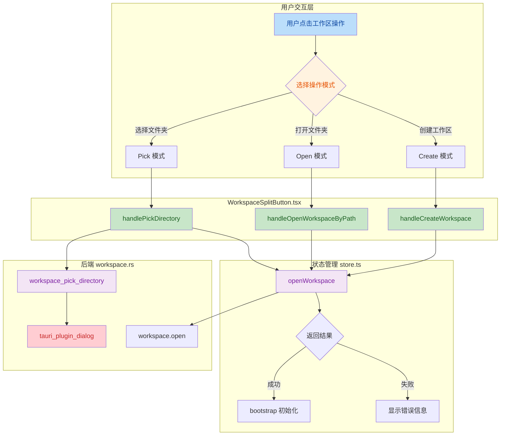

## 1. 高层摘要 (TL;DR)

**影响范围：** 🔴 **高** - 重大 UI/UX 重构，涉及工作区管理的核心交互流程

**核心变更：**
- ✨ **新增** `WorkspaceSplitButton` 组件：统一的工作区操作入口，支持选择、打开、创建三种模式
- 🔄 **重构** 后端文件夹选择逻辑：从平台特定实现迁移到 Tauri 官方插件
- 🗑️ **移除** `pendingWorkspacePath` 状态机制：简化状态管理逻辑
- 🎨 **新增** 三个模态对话框组件：创建工作区、新建会话、通用输入提示
- ⌨️ **调整** 键盘快捷键：`Ctrl+N` 创建工作区，`Ctrl+Shift+N` 新建会话

---

## 2. 可视化概览 (代码与逻辑映射)



---

## 3. 详细变更分析

### 📦 组件：WorkspaceSplitButton (新增)

**文件：** `ai-digital-life/frontend/src/app/components/WorkspaceSplitButton.tsx`

**变更说明：**
全新的工作区操作组件，提供统一的工作区管理入口。

**核心功能：**
- **三种操作模式**：
  - `pick`: 通过文件选择器选择文件夹
  - `open`: 直接输入路径打开文件夹
  - `create`: 创建新工作区（支持简单名称或完整路径）
- **模式持久化**：用户选择会保存到 `localStorage` (`adl_workspace_menu_mode`)
- **默认创建目录**：可设置默认创建目录，保存到 `localStorage` (`adl_workspace_default_create_dir`)
- **智能路径解析**：创建模式下，如果输入简单名称（不含路径分隔符），自动拼接默认目录

**关键方法：**
| 方法名 | 功能 |
|--------|------|
| `handlePickDirectory()` | 调用文件夹选择器并打开工作区 |
| `handleOpenWorkspaceByPath(path)` | 通过路径字符串打开工作区 |
| `handleCreateWorkspace(input)` | 创建新工作区，支持智能路径解析 |
| `handleActionModeChange(mode)` | 切换操作模式并持久化 |

---

### 🗑️ 状态管理重构

**文件：** `ai-digital-life/frontend/src/app/store.ts`

**移除的状态：**
- `pendingWorkspacePath?: string` - 待处理的工作区路径状态
- `setPendingWorkspacePath(workspacePath)` - 设置待处理路径的方法

**变更的方法：**

| 方法 | 旧签名 | 新签名 | 变更说明 |
|------|--------|--------|----------|
| `openWorkspace` | `Promise<void>` | `Promise<{ ok: boolean; error?: string }>` | 返回结构化结果，便于错误处理 |

**简化的逻辑：**
- 移除了发送消息时检查 `pendingWorkspacePath` 的复杂逻辑
- 移除了工作区切换时的待处理路径清理逻辑
- 删除工作区时自动清除当前工作区上下文（新增）

---

### 🔧 后端文件夹选择重构

**文件：** `ai-digital-life/src-tauri/src/commands/workspace.rs`

**移除的代码：**
- ❌ `pick_directory()` 的 Windows PowerShell 实现（~30 行）
- ❌ `pick_directory()` 的 macOS osascript 实现（~20 行）
- ❌ `pick_directory()` 的 Linux zenity/kdialog 实现（~15 行）

**新增实现：**
```rust
pub fn workspace_pick_directory(app: tauri::AppHandle) -> IpcResult<Option<String>> {
    let path = app.dialog().file().blocking_pick_folder();
    let result = path.and_then(|p| p.into_path().ok().map(|pp| pp.to_string_lossy().to_string()));
    IpcResult::ok(result)
}
```

**依赖变更：**

| 包名 | 操作 | 版本 |
|------|------|------|
| `tauri-plugin-dialog` | 新增 | workspace |

---

### 🎨 新增模态对话框组件

#### 1. CreateWorkspaceModal.tsx
- **用途**：创建工作区的模态对话框
- **特点**：内嵌 `WorkspaceSplitButton`，初始模式为 `create`
- **快捷键**：`Ctrl+N` 触发

#### 2. NewSessionDialog.tsx
- **用途**：新建会话的对话框
- **功能**：输入会话名称，支持默认名称（日期格式）
- **快捷键**：`Ctrl+Shift+N` 触发

#### 3. PromptModal.tsx
- **用途**：通用输入提示对话框
- **功能**：支持标题、占位符、初始值、错误提示等配置

---

### 🖥️ UI 组件更新

#### StatusBar.tsx
**移除内容：**
- `pendingWorkspacePath` 相关状态和逻辑
- `handleBindPendingWorkspace()` 方法
- `handlePickDirectory()` 方法
- 工作区绑定输入框区域

**新增内容：**
- 集成 `WorkspaceSplitButton` 组件替代原有的输入框+按钮组合

#### CenterPane.tsx
**移除内容：**
- `pendingWorkspacePath` prop 传递
- `onSetPendingWorkspacePath` 回调

**新增内容：**
- 欢迎页集成 `WorkspaceSplitButton`（点击"打开工作区"按钮弹出）
- 新增欢迎提示文本

#### TitleBar.tsx
**变更内容：**
- 文件菜单的"打开文件夹"操作从 `onTriggerCreateWorkspace` 改为 `onOpenFolder`

#### App.tsx
**键盘快捷键调整：**

| 快捷键 | 旧行为 | 新行为 |
|--------|--------|--------|
| `Ctrl+O` | 选择文件夹或输入路径 | 仅选择文件夹 |
| `Ctrl+N` | 无 | 打开创建工作区对话框 |
| `Ctrl+Shift+N` | 无 | 打开新建会话对话框 |

---

### 🎨 样式更新

**文件：** `ai-digital-life/frontend/src/styles/regions.css`

**新增样式类：**

| 样式类 | 用途 |
|--------|------|
| `.adl-prompt-modal` | 模态对话框容器 |
| `.adl-split-btn` | 分割按钮容器 |
| `.adl-split-btn__main` | 分割按钮主按钮 |
| `.adl-split-btn__drop` | 分割按钮下拉触发器 |
| `.adl-split-btn__menu` | 分割按钮下拉菜单 |
| `.adl-split-btn__input-area` | 输入区域 |
| `.adl-split-btn__settings` | 设置面板 |

**样式优化：**
- 移除所有输入框的 focus ring（全局样式）
- 优化代码编辑器折叠标记样式（使用 CSS 伪元素绘制箭头）
- 改进欢迎页布局（居中对齐）
- 调整状态栏菜单项 hover 样式

---

## 4. 影响与风险评估

### ⚠️ 破坏性变更

| 变更类型 | 影响范围 | 说明 |
|----------|----------|------|
| **状态移除** | Store API | `pendingWorkspacePath` 和 `setPendingWorkspacePath` 已移除 |
| **方法签名变更** | `openWorkspace` | 返回值从 `Promise<void>` 改为 `Promise<{ ok: boolean, error?: string }>` |
| **快捷键变更** | 键盘操作 | `Ctrl+O` 行为简化，新增 `Ctrl+N` 和 `Ctrl+Shift+N` |
| **后端依赖** | Cargo.toml | 新增 `tauri-plugin-dialog` 依赖 |

### 🧪 测试建议

#### 功能测试
1. **工作区选择**：
   - 测试 `Pick` 模式：验证文件选择器正常打开
   - 测试 `Open` 模式：验证路径输入和错误处理
   - 测试 `Create` 模式：验证简单名称和完整路径两种输入方式

2. **模式切换**：
   - 验证模式切换后状态正确保存到 localStorage
   - 验证刷新页面后模式保持

3. **默认创建目录**：
   - 测试设置默认目录功能
   - 测试简单名称自动拼接默认目录

4. **键盘快捷键**：
   - 测试 `Ctrl+N` 打开创建工作区对话框
   - 测试 `Ctrl+Shift+N` 打开新建会话对话框
   - 测试 `Ctrl+O` 打开文件夹选择器

5. **错误处理**：
   - 测试无效路径的错误提示
   - 测试网络错误时的用户反馈

#### 兼容性测试
- 验证 Tauri 插件在 Windows/macOS/Linux 上的文件选择器行为
- 测试 localStorage 读写在隐私模式下的行为

#### 回归测试
- 验证删除工作区后自动清除上下文
- 验证会话创建流程不受影响

---

## 5. 架构改进总结

### ✅ 优点
1. **代码复用**：`WorkspaceSplitButton` 组件可在多个场景复用（欢迎页、状态栏、模态框）
2. **依赖简化**：使用 Tauri 官方插件替代自定义平台实现，减少维护成本
3. **状态简化**：移除 `pendingWorkspacePath` 复杂状态机，降低代码复杂度
4. **用户体验**：统一的工作区操作入口，更直观的交互流程
5. **错误处理**：结构化的返回值便于前端展示错误信息

### ⚠️ 注意事项
1. **迁移成本**：如果其他组件依赖 `pendingWorkspacePath`，需要同步更新
2. **插件依赖**：新增 `tauri-plugin-dialog` 依赖，需要确保 Tauri 版本兼容
3. **键盘冲突**：新快捷键可能与用户习惯冲突，需要文档说明

---

## 1. 高层摘要 (TL;DR)

- **影响范围:** 🟡 **中等** - 改进了工作区目录选择功能的错误处理机制
- **核心变更:**
  - 将简单的链式调用替换为显式的 `match` 模式匹配
  - 新增对路径解析失败的错误处理逻辑
  - 统一使用 `ipc()` 函数返回结果，保持代码一致性

---

## 2. 可视化概览 (逻辑流程图)

```mermaid
flowchart TD
    subgraph "workspace.rs - workspace_pick_directory()"
        Start([用户选择目录]) --> Dialog[app.dialog().file().blocking_pick_folder]
        Dialog --> CheckPath{path 是否存在?}
        
        CheckPath -->|None| ReturnNone[返回 Ok_None]
        CheckPath -->|Some fp| ResolvePath[fp.into_path]
        
        ResolvePath --> CheckResolve{解析成功?}
        CheckResolve -->|Ok pb| ConvertPath[pb.to_string_lossy.to_string]
        CheckResolve -->|Err e| CreateError[创建 AppError::Workspace]
        
        ConvertPath --> ReturnOk[返回 Ok_Some_path]
        CreateError --> ReturnErr[返回 Err]
        
        ReturnNone --> IPC[ipc]
        ReturnOk --> IPC
        ReturnErr --> IPC
        
        IPC --> End([返回 IpcResult])
    end
    
    style Start fill:#e3f2fd,color:#0d47a1
    style End fill:#e3f2fd,color:#0d47a1
    style ReturnOk fill:#c8e6c9,color:#1a5e20
    style ReturnNone fill:#fff3e0,color:#e65100
    style ReturnErr fill:#ffcdd2,color:#b71c1c
    style IPC fill:#f3e5f5,color:#7b1fa2
```

---

## 3. 详细变更分析

### 📁 组件: `workspace.rs` - 目录选择命令

**变更位置:** `ai-digital-life/src-tauri/src/commands/workspace.rs` (第 223-236 行)

#### 🔍 变更说明

**原有逻辑:**
```rust
let result = path.and_then(|p| p.into_path().ok().map(|pp| pp.to_string_lossy().to_string()));
IpcResult::ok(result)
```
- 使用链式调用 (`and_then` → `ok` → `map`) 处理路径
- 如果 `into_path()` 失败，`ok()` 会将 `Err` 转换为 `None`，**静默丢失错误信息**
- 直接使用 `IpcResult::ok()` 包装结果

**新逻辑:**
```rust
let result = match path {
    Some(fp) => match fp.into_path() {
        Ok(pb) => Ok(Some(pb.to_string_lossy().to_string())),
        Err(e) => Err(AppError::Workspace(format!(
            "failed to resolve folder path: {e}"
        ))),
    },
    None => Ok(None),
};
ipc(result)
```
- 使用嵌套 `match` 显式处理所有可能的分支
- **捕获并保留** `into_path()` 的错误信息，转换为 `AppError::Workspace`
- 使用统一的 `ipc()` 函数返回结果

#### 📊 错误处理对比表

| 场景 | 原有行为 | 新行为 |
|------|---------|--------|
| 用户取消选择 | 返回 `Ok(None)` | 返回 `Ok(None)` ✅ |
| 路径解析成功 | 返回 `Ok(Some(path))` | 返回 `Ok(Some(path))` ✅ |
| 路径解析失败 | 返回 `Ok(None)` (静默失败) ❌ | 返回 `Err(AppError::Workspace)` (显式错误) ✅ |

#### 💡 代码改进点

1. **错误可见性提升** - 不再静默丢失路径解析错误
2. **代码可读性** - 显式的 `match` 模式比链式调用更清晰
3. **一致性** - 统一使用 `ipc()` 辅助函数，与其他命令保持一致
4. **调试友好** - 错误消息包含原始错误信息 `{e}`

---

## 4. 影响与风险评估

### ⚠️ 潜在影响

- **非破坏性变更** - API 签名未改变，前端调用方式不受影响
- **行为变化** - 当路径解析失败时，**从返回 `None` 变为返回错误**
  - 前端可能需要处理新的错误类型
  - 如果前端依赖 `None` 作为"解析失败"的信号，需要调整逻辑

### 🧪 测试建议

建议测试以下场景:

1. **正常流程:** 用户成功选择一个有效目录 → 应返回 `Ok(Some(path))`
2. **取消操作:** 用户取消目录选择对话框 → 应返回 `Ok(None)`
3. **边缘情况:** 选择特殊路径（如网络驱动器、符号链接等）导致解析失败 → 应返回 `Err(AppError::Workspace)` 并包含错误详情

### ✅ 优点

- ✅ 提升了错误处理的健壮性
- ✅ 提供了更好的调试信息
- ✅ 代码风格更符合 Rust 最佳实践

### 📝 建议

- 确认前端是否已处理 `AppError::Workspace` 类型的错误
- 考虑在错误消息中添加更多上下文信息（如用户选择的原始路径）


潜在影响验证完成，**前端已有完整的错误处理链，无需修改**。以下是完整的调用链分析：

### 调用链追踪

```
Rust workspace_pick_directory
    ↓ (返回 IpcResult<Option<String>>)
tauri-bridge.ts  pickDirectory
    ├─ result.ok → { ok: true, data: result.data ?? undefined }
    └─ !result.ok → 直接透传错误 { ok: false, error: ... }
          ↓
store.ts  pickWorkspaceDirectory
    ├─ result.ok → 返回路径字符串
    └─ !result.ok → set({ error: result.error.message }) + return undefined
          ↓
WorkspaceSplitButton  handlePickDirectory
    ├─ selectedPath 非空 → 打开工作空间
    └─ !selectedPath → 直接 return（取消/错误都走此路径）
```

### 关键发现

| 层级 | 处理方式 | 是否安全 |
|------|---------|---------|
| **Rust 命令** | 返回 `Err(AppError(...))` | ✅ |
| **tauri-bridge.ts** | `!result.ok` 时透传错误，不篡改 | ✅ |
| **store.ts** | 检查 `result.ok`，错误时写入 `error` 状态 + 返回 `undefined` | ✅ |
| **WorkspaceSplitButton** | `!selectedPath` 时提前 return（取消和错误都走到这里） | ✅ |

### 结论

该变更为 **无风险变更**：
- **API 签名不变**：仍是 `Promise<IpcResult<string | undefined>>`
- **前端已有完整防御**：`if (!result.ok)` 已覆盖所有调用点
- **错误有回退路径**：路径解析失败时，store 设置错误状态 + 返回 `undefined`，SplitButton 收到 `undefined` 后正常返回，不会卡死或崩溃
- **行为改进**：之前路径解析失败会静默返回 `None`（用户以为取消了），现在会显示错误提示
---