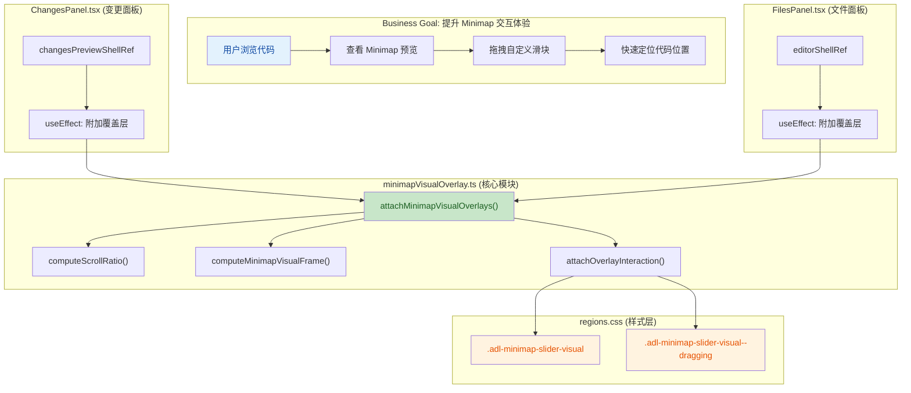
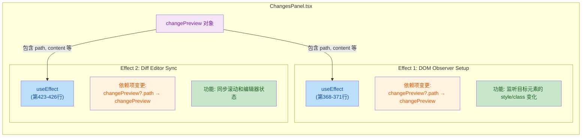

## 1. 高层摘要（TL;DR）

*   **影响范围：** 🟡 **中等** - 为 Monaco Editor 的 Minimap 组件实现了自定义视觉覆盖层交互系统，优化了代码浏览体验
*   **核心变更：**
    *   ✨ 新增 `minimapVisualOverlay.ts` 模块，实现了自定义滑块视觉覆盖层和拖拽交互
    *   🎨 统一优化 Minimap 配置：宽度从 36px/48px 增加到 84px，启用字符渲染，滑块始终显示
    *   🧪 新增完整的单元测试覆盖（`minimapVisualOverlay.test.ts`）
    *   📦 更新 `.gitignore` 排除 Cursor IDE 运行时缓存和 Tauri 生成文件

---

## 2. 可视化概览（代码与逻辑映射）



---

## 3. 详细变更分析

### 🆕 核心模块：minimapVisualOverlay.ts

**新增功能：** 实现了完整的自定义 Minimap 视觉覆盖层系统

**核心函数：**

| 函数名 | 功能描述 |
|--------|----------|
| `attachMinimapVisualOverlays()` | 主入口函数，初始化覆盖层系统并返回控制器 |
| `computeScrollRatio()` | 计算当前滚动位置的比例（0-1） |
| `computeMinimapVisualFrame()` | 根据滚动比例计算覆盖层的位置和尺寸 |
| `attachOverlayInteraction()` | 为覆盖层附加拖拽交互事件 |

**关键特性：**
- 🔄 **自动同步：** 使用 `MutationObserver` 和 `ResizeObserver` 监听 DOM 变化
- 🎯 **精确计算：** 支持边界值处理和滚动比例限制 [0, 1]
- 👆 **拖拽交互：** 支持指针事件（Pointer Events）实现流畅拖拽
- ♻️ **资源清理：** 提供完整的 `dispose()` 方法清理所有监听器和元素

### 🧪 测试模块：minimapVisualOverlay.test.ts

**新增测试文件：** 为核心计算函数提供完整的单元测试覆盖

**测试覆盖：**

| 测试场景 | 验证内容 |
|----------|----------|
| 滚动比例 0 | 覆盖层位于顶部 |
| 滚动比例 1 | 覆盖层位于底部 |
| 滚动比例 0.5 | 覆盖层居中 |
| Minimap 小于可视高度 | 覆盖层高度收缩 |
| 边界值处理 | 滚动比例限制在 [0, 1] |
| 零高度处理 | 返回零尺寸帧 |
| 无滚动内容 | 返回 0 比例 |
| 内容短于视口 | 返回 0 比例 |

### 🎨 样式优化：regions.css

**Minimap 配置变更表：**

| 配置项 | 旧值 | 新值 | 说明 |
|--------|------|------|------|
| `width` | 36px (Changes) / 48px (Files) | 84px | 统一增加宽度以提升可读性 |
| `size` | `fit` | `fill` | 填充容器高度 |
| `showSlider` | `mouseover` | `always` | 滑块始终可见 |
| `renderCharacters` | `false` | `true` | 启用字符渲染 |
| `maxColumn` | 48 | 80 | 增加显示列数 |
| `scale` | 1 | 1.5 | 提升缩放比例 |
| `position` | - | `absolute` | 绝对定位 |
| `overflow` | - | `hidden` | 隐藏溢出内容 |

**新增样式类：**

```css
.adl-minimap-slider-visual {
  position: absolute;
  left: 0;
  right: 0;
  z-index: 3;
  background: var(--surface-hover);
  cursor: grab;
}

.adl-minimap-slider-visual--dragging {
  cursor: grabbing !important;
}
```

### 📝 面板集成：ChangesPanel.tsx & FilesPanel.tsx

**集成方式：**

1. **导入新模块：**
   ```typescript
   import { attachMinimapVisualOverlays } from "./minimapVisualOverlay";
   ```

2. **添加容器引用：**
   - `ChangesPanel`: `changesPreviewShellRef`
   - `FilesPanel`: `editorShellRef`

3. **附加覆盖层逻辑：**
   ```typescript
   useEffect(() => {
     const root = editorShellRef.current;
     if (!root || !selectedFilePath) return;
     
     const controller = attachMinimapVisualOverlays(root, {
       getScrollState: () => ({
         scrollTop: ed.getScrollTop(),
         scrollHeight: ed.getScrollHeight(),
         clientHeight: ed.getLayoutInfo().height
       }),
       setScrollTop: (value) => ed.setScrollPosition({ scrollTop: value })
     });
     
     const scrollDisposable = ed.onDidScrollChange?.(() => controller.refresh());
     
     return () => {
       scrollDisposable?.dispose();
       controller.dispose();
     };
   }, [selectedFilePath]);
   ```

### 📦 配置更新：.gitignore

**新增忽略规则：**

| 路径 | 说明 |
|------|------|
| `.cursor/hooks/electron-profile/` | Cursor IDE 运行时缓存 |
| `.cursor/hooks/.restart-desktop-dev.state.json*` | Cursor 开发状态文件 |
| `/src-tauri/gen/` | Tauri 自动生成的 schema 文件 |
| `*.tsbuildinfo` | TypeScript 增量构建缓存 |

### 📋 文档更新：.trae/rules/phase-boundary.md

**更新内容：**
- 在 Monaco Minimap 优化描述中增加了"自定义视觉覆盖层交互系统"

---

## 4. 影响与风险评估

### ⚠️ 潜在风险

1. **性能影响：** 🟡 **中等**
   - 新增了 `MutationObserver` 和 `ResizeObserver`，可能增加少量内存占用
   - 建议：监控大量文件场景下的性能表现

2. **兼容性：** 🟢 **低**
   - 使用标准的 Pointer Events API，现代浏览器支持良好
   - Monaco Editor API 调用使用了类型安全的类型断言

3. **样式冲突：** 🟢 **低**
   - 使用了 `!important` 强制覆盖 Monaco 默认样式
   - 通过特定选择器（`.adl-tool-editor--changes`）限制作用域

### ✅ 测试建议

**功能测试：**
- [ ] 验证 Minimap 滑块始终可见
- [ ] 测试拖拽滑块能否正确滚动编辑器
- [ ] 验证滚动编辑器时滑块位置同步更新
- [ ] 测试切换文件时覆盖层正确重新附加
- [ ] 验证并排模式（side-by-side）下覆盖层不显示

**边界测试：**
- [ ] 空文件场景
- [ ] 超长文件（>10000 行）
- [ ] 短文件（<10 行）
- [ ] 快速连续滚动
- [ ] 窗口大小调整

**视觉测试：**
- [ ] 深色主题下滑块对比度
- [ ] 浅色主题下滑块对比度
- [ ] 拖拽时的光标状态（grab/grabbing）
- [ ] 滑块尺寸在不同内容长度下的表现

### 🎯 预期收益

- ✨ **提升用户体验：** 更大的 Minimap 和始终可见的滑块让代码定位更直观
- 🎯 **精准控制：** 自定义拖拽交互提供更流畅的滚动体验
- 📱 **响应式设计：** 自动适应窗口和内容变化
- 🧪 **可维护性：** 完整的单元测试确保代码质量

---

## 1. 高层摘要 (TL;DR)

- **影响级别：** 🟡 **中等** - 优化了 React 组件的依赖追踪，可能影响渲染频率
- **核心变更：**
  - ✅ 将 `useEffect` 依赖项从 `changePreview?.path` 改为完整的 `changePreview` 对象
  - ✅ 确保当变更预览的任何属性变化时，相关副作用都能正确触发
  - 🎯 提升数据同步的准确性，避免因路径未变但内容变化导致的视图不同步

---

## 2. 可视化概览 (代码与逻辑映射)



**逻辑流程说明：**

| 业务目标 | 模块/文件 | 关键方法/Effect | 变更影响 |
|---------|----------|----------------|---------|
| 监听 DOM 元素样式变化 | `ChangesPanel.tsx` | `useEffect` (第368行) | 当 `changePreview` 任何属性变化时重新设置观察器 |
| 同步 Diff 编辑器滚动 | `ChangesPanel.tsx` | `useEffect` (第423行) | 当 `changePreview` 任何属性变化时重新同步编辑器 |

---

## 3. 详细变更分析

### 组件：ChangesPanel (变更预览面板)

**📄 文件：** `ai-digital-life/frontend/src/app/regions/right-panel/ChangesPanel.tsx`

#### 🔧 变更说明

**问题背景：**
- 原代码仅依赖 `changePreview?.path`（变更路径）作为 `useEffect` 的触发条件
- 当 `changePreview` 对象的其他属性（如内容、状态、元数据）发生变化但路径保持不变时，effect 不会重新执行
- 这可能导致 DOM 观察器和编辑器同步逻辑与实际数据不同步

**解决方案：**
- 将依赖项从 `changePreview?.path` 改为完整的 `changePreview` 对象
- 确保对象引用或任何属性变化都能触发 effect 重新执行

#### 📊 依赖项变更对比表

| Effect 位置 | 原依赖项 | 新依赖项 | 影响范围 |
|------------|---------|---------|---------|
| **第371行** (DOM Observer) | `[changePreview?.path, applyMinimapToDiffEditor]` | `[changePreview, applyMinimapToDiffEditor]` | 监听目标元素的 style/class 变化 |
| **第426行** (Editor Sync) | `[changePreview?.path, props.diffSideBySide]` | `[changePreview, props.diffSideBySide]` | 同步滚动和编辑器状态 |

#### 💡 代码片段对比

```typescript
// ❌ 原代码 (仅监听路径变化)
}, [changePreview?.path, applyMinimapToDiffEditor]);

// ✅ 新代码 (监听整个对象变化)
}, [changePreview, applyMinimapToDiffEditor]);
```

---

## 4. 影响与风险评估

### ⚠️ 潜在影响

| 影响类型 | 描述 | 严重程度 |
|---------|------|---------|
| **性能影响** | 🟡 `changePreview` 对象的任何属性变化都会触发 effect 重新执行，可能略微增加渲染频率 | 中等 |
| **数据同步** | 🟢 提升了数据同步的准确性，避免视图与数据不一致 | 正面 |
| **行为变化** | 🟡 之前路径不变但内容变化时不会触发 effect，现在会触发 | 中等 |

### 🧪 测试建议

**建议测试场景：**

1. **🔍 路径不变，内容变化**
   - 选择一个文件，修改其内容但保持路径不变
   - 验证 DOM 观察器是否正确重新设置
   - 验证编辑器滚动同步是否正常工作

2. **🔄 快速切换不同文件**
   - 在多个文件之间快速切换
   - 验证是否出现内存泄漏（观察器是否正确断开）
   - 验证编辑器状态是否正确重置

3. **📝 侧边栏模式切换**
   - 切换 `diffSideBySide` 属性
   - 验证编辑器同步逻辑是否正确响应

4. **⚡ 性能验证**
   - 使用 React DevTools Profiler 检查 effect 的触发频率
   - 确认没有不必要的重复渲染

### ✅ 优点

- ✅ **更准确的数据追踪** - 捕获 `changePreview` 对象的所有变化
- ✅ **避免状态不同步** - 确保视图始终反映最新数据
- ✅ **代码意图更清晰** - 明确表示依赖整个预览对象

### ⚠️ 注意事项

- ⚠️ 确保 `changePreview` 对象引用稳定性，避免因父组件频繁创建新对象导致过度渲染
- ⚠️ 如果 `changePreview` 是深层嵌套对象，考虑使用 `useMemo` 或 `useCallback` 优化引用

---

## 5. 总结

这是一个**优化性变更**，通过扩展 `useEffect` 依赖项的范围，解决了潜在的数据同步问题。变更逻辑清晰，但需要关注性能影响和对象引用稳定性。建议在合并前进行充分的回归测试，特别是涉及快速切换和内容更新的场景。