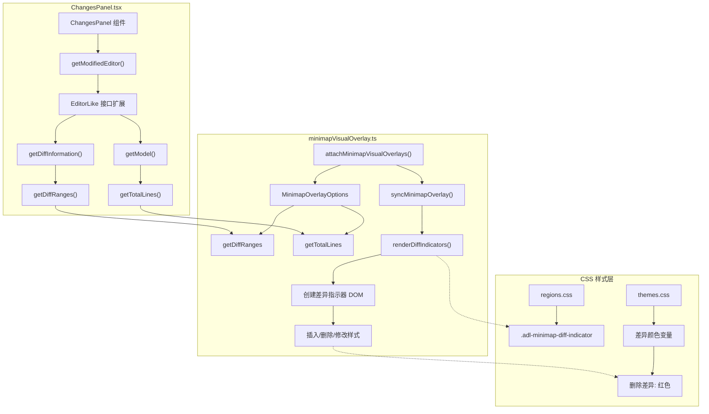
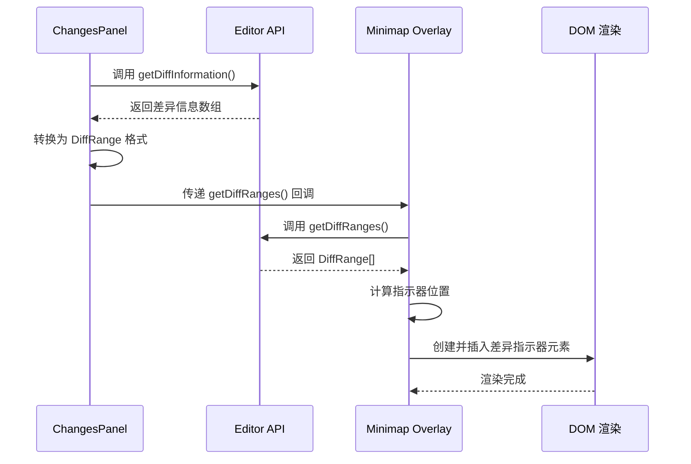

## 1. 高层摘要 (TL;DR)

*   **影响:** **中等** - 为代码差异编辑器的 Minimap 添加可视化差异指示器，提升代码审查体验
*   **核心变更:**
    *   ✨ 在 Minimap 上渲染差异指示器（插入/删除/修改）
    *   🔧 扩展编辑器接口以获取差异信息和总行数
    *   🎨 更新主题颜色，将删除差异从灰色改为红色
    *   🐛 修复非并排模式下修改编辑器的宽度显示问题

---

## 2. 可视化概览 (代码与逻辑映射)



**数据流向说明:**



---

## 3. 详细变更分析

### 📦 组件 1: ChangesPanel.tsx (右侧面板变更组件)

**变更内容:** 扩展编辑器接口以支持差异信息获取

| 方法/属性 | 类型 | 说明 |
|-----------|------|------|
| `getDiffInformation()` | 可选方法 | 获取差异信息（原始/修改行号范围） |
| `getModel()` | 可选方法 | 获取编辑器模型 |
| `getDiffRanges()` | 新增方法 | 转换差异信息为标准化格式 |
| `getTotalLines()` | 新增方法 | 获取编辑器总行数 |

**关键逻辑:**

```typescript
// 差异类型判断逻辑
const isInsert = change.originalStartLineNumber > change.originalEndLineNumber;
const isDelete = change.modifiedStartLineNumber > change.modifiedEndLineNumber;
const type = isInsert ? "insert" : isDelete ? "delete" : "modify";
```

---

### 📦 组件 2: minimapVisualOverlay.ts (Minimap 可视化覆盖层)

**变更内容:** 添加差异指示器渲染功能

**新增类型定义:**

| 类型 | 属性 | 说明 |
|------|------|------|
| `DiffRange` | `startLine`, `endLine`, `type` | 差异范围数据结构 |
| `MinimapOverlayOptions` | `getDiffRanges`, `getTotalLines` | 扩展配置选项 |

**核心函数 - `renderDiffIndicators()`:**

```typescript
// 位置计算逻辑
const startY = Math.max(0, (range.startLine - 1) / totalLines) * minimapHeight;
const endY = Math.min(minimapHeight, range.endLine / totalLines) * minimapHeight;
const height = Math.max(2, endY - startY); // 最小高度 2px
```

**功能特点:**
- 🎯 精确映射差异行到 Minimap 像素位置
- 🧹 自动清理旧的指示器元素
- ⚡ 边界保护（高度 <= 0 时跳过）

---

### 📦 组件 3: regions.css (区域样式)

**变更内容:** 修复编辑器宽度问题 + 添加差异指示器样式

**1. 非并排模式宽度修复:**

| 选择器 | 修复内容 |
|--------|----------|
| `.editor.modified .view-lines` | 强制宽度 100% |
| `.editor.modified .view-line` | 强制宽度 100% |
| `.editor.modified .cdr` | 右对齐到 0 |
| `.editor.modified .current-line` | 宽度 100% + 右对齐 |

**2. 差异指示器样式:**

| 类名 | 样式 | 颜色来源 |
|------|------|----------|
| `.adl-minimap-diff-indicator` | 绝对定位, 3px 宽, 无事件 | - |
| `--insert` 变体 | 背景色 | `--editor-diff-insert-bg` |
| `--delete` 变体 | 背景色 | `--editor-diff-remove-bg` |
| `--modify` 变体 | 背景色 | `--editor-diff-modify-bg` |

---

### 📦 组件 4: themes.css (主题颜色)

**变更内容:** 更新删除差异颜色以提升视觉识别度

| 主题 | 变量 | 旧值 | 新值 | 视觉效果 |
|------|------|------|------|----------|
| 亮色主题 | `--editor-diff-remove-bg` | 灰色 `rgba(92, 97, 104, 0.1)` | 红色 `rgba(239, 68, 68, 0.12)` | ⚠️ 更醒目 |
| 暗色主题 | `--editor-diff-remove-bg` | 灰色 `rgba(120, 127, 136, 0.14)` | 红色 `rgba(248, 113, 113, 0.14)` | ⚠️ 更醒目 |

**设计意图:** 将删除操作从中性灰色改为警示红色，与插入（绿色）形成更明显的对比。

---

## 4. 影响与风险评估

### ⚠️ 破坏性变更
无破坏性变更。所有新增功能均为可选接口扩展。

### 🧪 测试建议

| 测试场景 | 验证点 |
|----------|--------|
| **Minimap 差异指示器** | 在包含插入、删除、修改的代码差异文件中，Minimap 应显示对应的彩色指示器 |
| **颜色主题切换** | 切换亮色/暗色主题，删除差异指示器应显示为红色，插入为绿色 |
| **非并排模式** | 切换到非并排差异视图，修改编辑器应占满宽度，无右侧留白 |
| **空差异文件** | 无差异时，Minimap 不应显示任何指示器 |
| **大文件性能** | 测试包含数千行差异的文件，Minimap 渲染应流畅无卡顿 |
| **清理逻辑** | 关闭差异面板或切换文件时，旧的指示器元素应被正确移除 |

### 🎯 兼容性要求
- Monaco Editor 需要支持 `getDiffInformation()` 和 `getModel()` 接口
- 如果编辑器不支持这些方法，功能会优雅降级（不显示指示器）