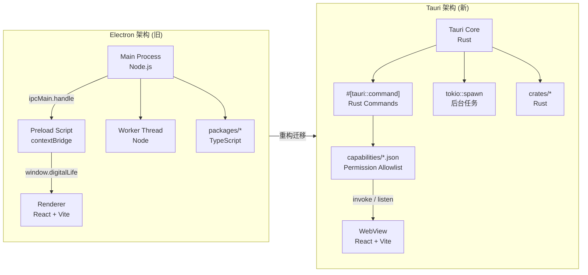
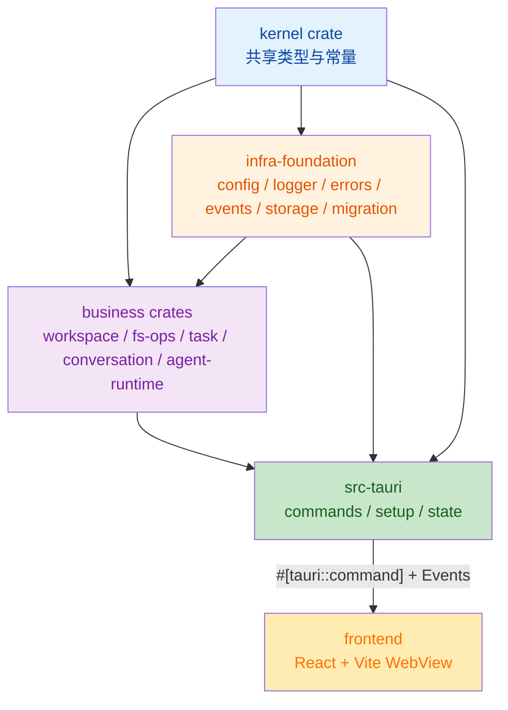
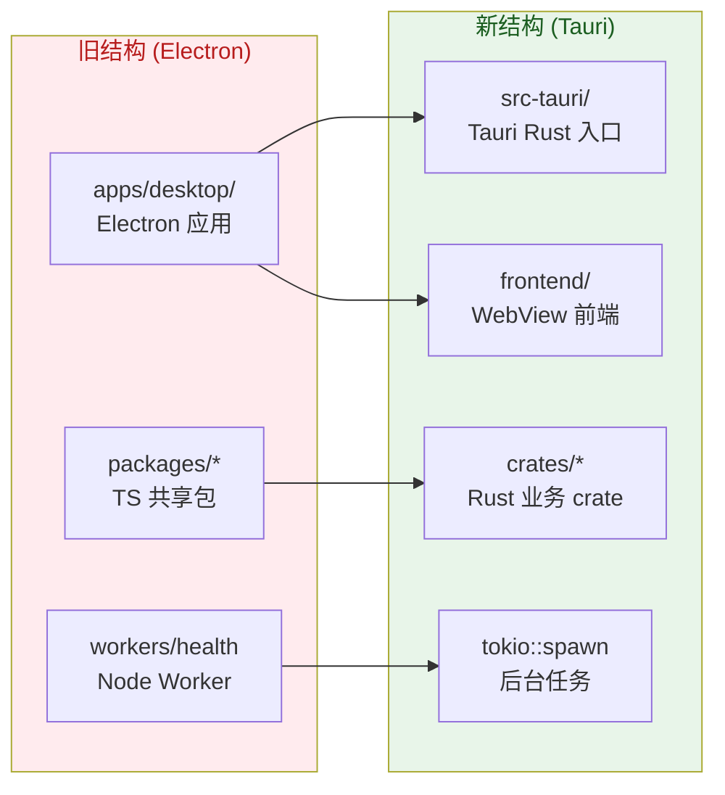

## 1. 高层摘要 (TL;DR)

**影响范围**：🔴 **极高** - 整个项目从 Electron + TypeScript 完全重构为 Rust + Tauri 2.x，涉及技术栈、目录结构、构建系统的全面变更。

**核心变更**：
- 🔄 **技术栈迁移**：Electron → Tauri 2.x + Rust (stable) + tokio
- 📁 **目录重组**：`apps/desktop/` → `frontend/` + `src-tauri/` + `crates/`
- 🏗️ **架构重构**：Main/Preload/Renderer/Worker → Tauri Backend + WebView + tokio::spawn
- 🔒 **安全模型升级**：IPC 白名单 → Tauri Capabilities + Permission 系统
- 📦 **包管理变更**：pnpm workspace → Cargo workspace + 前端独立 npm

---

## 2. 可视化概览 (架构映射)

### 2.1 技术栈迁移对比



### 2.2 依赖方向约束



### 2.3 目录结构变更映射



---

## 3. 详细变更分析

### 3.1 项目根目录配置变更

#### **README.md** - 项目定位更新

**变更说明**：
- 明确 `ai-digital-life/` 现为 **Rust + Tauri 2.x** 桌面应用
- `digitalLife/` 保留早期规格，部分文档仍为 Electron 时代方案
- 新增规划文档说明：以 Rust + Tauri 文档为准

**关键变更**：
```diff
- Electron 桌面应用
- `packages/` 共享包
- `workers/` 后台 worker
+ `src-tauri/` Tauri 2.x Rust 入口、commands 与 capabilities
+ `crates/` Cargo workspace 业务 crate
+ `frontend/` React 19 + Vite + Zustand WebView 前端
```

#### **AGENTS.md** - 治理文档重构

**变更说明**：
- 新增"技术栈基线"章节，明确不再使用 Electron
- 子 Agent 路由表更新：`desktop-shell` → `tauri-shell`
- 禁止项新增：禁止在 capability 中使用 `"all"` / `"**"` 通配

**技术栈基线**：
| 层 | 选型 |
|---|---|
| 后端 | Rust (stable) + Tauri 2.x + tokio + rusqlite + serde + tracing |
| 前端 | React 19 + Vite + Zustand (运行在 Tauri WebView 中) |
| 桥接 | `#[tauri::command]` + `@tauri-apps/api` 的 `invoke()` / `listen()` |
| 打包 | `cargo tauri build` (取代 electron-builder) |

#### **package.json** - 构建脚本完全重写

**变更说明**：
- 删除 pnpm workspace 配置
- 删除 Electron 相关依赖和脚本
- 新增 Cargo 相关命令

**脚本对比**：

| 旧命令 | 新命令 | 说明 |
|--------|--------|------|
| `npm run dev` | `cargo tauri dev` | 启动开发环境 |
| `npm run build` | `cargo tauri build` | 生产打包 |
| `npm run test` | `cargo test --workspace` | Rust 测试 |
| - | `npm --prefix frontend run dev` | 前端独立开发 |
| - | `npm run check:all` | 全量检查 (fmt + clippy + test + typecheck) |

---

### 3.2 Tauri 核心配置新增

#### **src-tauri/tauri.conf.json** - Tauri 应用配置

**新增文件**，关键配置：

```json
{
  "productName": "AI Digital Life",
  "identifier": "com.ai-digital-life.app",
  "build": {
    "frontendDist": "../frontend/dist",
    "devUrl": "http://localhost:5173",
    "beforeDevCommand": "npm --prefix ../frontend run dev",
    "beforeBuildCommand": "npm --prefix ../frontend run build"
  },
  "app": {
    "windows": [{
      "label": "main",
      "width": 1280,
      "height": 800,
      "minWidth": 640,
      "minHeight": 480
    }],
    "security": {
      "csp": "default-src 'self'; script-src 'self'; style-src 'self' 'unsafe-inline'"
    },
    "withGlobalTauri": false
  }
}
```

**安全特性**：
- ✅ 显式 CSP 策略
- ✅ `withGlobalTauri: false` (禁止全局 Tauri API)
- ✅ 最小窗口尺寸 640x480

#### **src-tauri/capabilities/default.json** - 权限白名单

**新增文件**，定义主窗口可调用的命令：

```json
{
  "identifier": "default",
  "windows": ["main"],
  "permissions": [
    "core:default",
    "core:window:default",
    "core:window:allow-close",
    "core:window:allow-minimize",
    "core:window:allow-set-size",
    "core:window:allow-set-title"
  ]
}
```

**安全约束**：
- 🔒 仅允许基础窗口操作
- 🔒 禁止文件系统、子进程等高风险权限
- 🔒 新增命令必须同步登记到此文件

---

### 3.3 Rust Crates 架构

#### **crates/kernel/src/lib.rs** - 共享类型层

**新增文件**，作为类型系统的核心：

```rust
pub mod types;
pub use types::*;
```

**职责**：
- 定义跨 crate 共享的 `serde` 类型
- 作为前后端类型契约的真源
- 前端通过 `@ai-digital-life/kernel` 路径别名引用

#### **crates/logger/src/lib.rs** - 日志系统

**新增文件**，基于 `tracing`：

```rust
use tracing_subscriber::{fmt, EnvFilter};

pub fn init(level: &str) {
    let filter = EnvFilter::try_from_default_env()
        .unwrap_or_else(|_| EnvFilter::new(level));
    
    fmt()
        .with_env_filter(filter)
        .with_target(true)
        .with_thread_ids(true)
        .init();
}

pub use tracing::{debug, error, info, trace, warn};
```

**特性**：
- 结构化日志
- 环境变量控制日志级别
- 线程 ID 追踪

#### **crates/migration/src/lib.rs** - 数据库迁移

**新增文件**，实现版本化迁移：

```rust
pub struct Migration {
    pub version: i64,
    pub description: &'static str,
    pub sql: &'static str,
}

pub fn current_version(db: &Database) -> Result<i64, AppError> {
    let conn = db.conn();
    let version: i64 = conn
        .query_row(
            "SELECT COALESCE(MAX(version), 0) FROM schema_version",
            [],
            |r| r.get(0),
        )
        .map_err(|e| AppError::Migration(e.to_string()))?;
    Ok(version)
}

pub fn run_pending(db: &Database) -> Result<(), AppError> {
    let current = current_version(db)?;
    for m in MIGRATIONS.iter().filter(|m| m.version > current) {
        if !m.sql.is_empty() {
            db.conn()
                .execute_batch(m.sql)
                .map_err(|e| AppError::Migration(format!("v{}: {e}", m.version)))?;
        }
        db.execute(
            "INSERT INTO schema_version (version) VALUES (?1)",
            &[&m.version as &dyn rusqlite::types::ToSql],
        )?;
        info!(
            version = m.version,
            desc = m.description,
            "migration applied"
        );
    }
    Ok(())
}
```

**迁移策略**：
- ✅ SQLite 文件格式与驱动无关，`rusqlite` 可直接打开 Electron 时代的 `app-state.db`
- ✅ 版本检测 + 增量迁移
- ✅ 结构化日志记录迁移过程

---

### 3.4 前端重构

#### **frontend/package.json** - 前端独立配置

**新增文件**，从 `apps/desktop/renderer/package.json` 迁移：

```json
{
  "name": "ai-digital-life-frontend",
  "scripts": {
    "dev": "vite",
    "build": "tsc -b && vite build",
    "typecheck": "tsc --noEmit",
    "test": "vitest run"
  },
  "dependencies": {
    "@monaco-editor/react": "^4.7.0",
    "@tauri-apps/api": "^2.0.0",
    "react": "^19.0.0",
    "react-dom": "^19.0.0",
    "zustand": "^5.0.0"
  }
}
```

**关键变更**：
- 新增 `@tauri-apps/api` 依赖
- 移除 Electron 相关依赖
- 独立的构建和测试脚本

#### **frontend/src/shared/ipc.ts** - IPC 契约保持兼容

**从 `apps/desktop/shared/ipc.ts` 迁移**，接口保持不变：

```typescript
export interface DigitalLifeBridge {
  app: {
    getInfo: () => Promise<IpcResult<AppInfo>>;
    getHealth: () => Promise<IpcResult<HealthSnapshot>>;
    // ...
  };
  workspace: {
    open: (path: string) => Promise<IpcResult<WorkspaceMeta>>;
    getRecentWorkspaces: () => Promise<IpcResult<RecentWorkspaceEntry[]>>;
    getGitStatus: () => Promise<IpcResult<GitSnapshot>>; // 新增
    // ...
  };
  retrieval: {
    getStatus: () => Promise<IpcResult<RetrievalSnapshot | undefined>>;
    getRepoMap: () => Promise<IpcResult<RepoMapNode[]>>; // 新增
    rebuildIndex: () => Promise<IpcResult<boolean>>; // 新增
    // ...
  };
  // ...
}
```

**设计原则**：
- 🎯 接口契约不变，便于前端代码平滑迁移
- 🎯 新增方法：`getGitStatus`, `getRepoMap`, `rebuildIndex`, `listAuditEntries`
- 🎯 开发态使用 `mock-bridge.ts`，生产态替换为 Tauri `invoke` 包装

#### **frontend/src/mock-bridge.ts** - 开发态 Mock 实现

**从 `apps/desktop/renderer/src/mock-bridge.ts` 迁移**，更新路径和描述：

```typescript
const appInfo: AppInfo = {
  version: "0.1.0-tauri",
  environment: "development",
  logs: [
    {
      timestamp: now,
      level: "info" as const,
      scope: "tauri",
      message: "Tauri desktop mock shell booted"
    }
  ]
};
```

**Mock 数据更新**：
- `apps/desktop/` → `frontend/`
- `packages/` → `crates/`
- `packages/kernel/src/index.ts` → `crates/kernel/src/lib.rs`
- 新增 `getGitStatus`, `getRepoMap`, `rebuildIndex`, `listAuditEntries` 的 mock 实现

---

### 3.5 Agent 角色与技能更新

#### **.agents/roles/desktop-shell.md** → **tauri-shell.md**

**角色重命名与职责更新**：

| 维度 | 旧 | 新 |
|------|----|----|
| 角色名 | `desktop-shell` | `tauri-shell` |
| 负责内容 | Main / Preload / Renderer / Worker<br/>IPC 白名单与桥接接口<br/>BrowserWindow 安全参数 | Rust Backend / WebView 边界<br/>`#[tauri::command]` 与 capability 白名单<br/>`tauri.conf.json` 安全参数与插件 scope |
| 默认技能 | `desktop-electron-security` | `desktop-tauri-security` |
| 约束 | Preload 只暴露最小桥接 | 仅通过 Tauri Command 暴露最小桥接 |

#### **.cursor/rules/ai-digital-life-tauri-shell.mdc** - 新增 Tauri 规则

**新增文件**，定义 Tauri 安全基线：

```markdown
## 安全基线（不可降级）
- `tauri.conf.json` 中 `app.security.csp` **必须**显式声明
- WebView **不得**直接访问文件系统、子进程、SQLite 或模型 `fetch`
- `withGlobalTauri` 默认关闭
- `tauri-plugin-shell` / `tauri-plugin-fs` 等插件**必须**启用 scope 限制，禁止 `"all"` / `"**"` 通配

## 契约真源
- **类型与命令形状**：`crates/kernel` 中导出的 `serde` 类型 + `src-tauri/src/commands/*`
- **能力白名单**：`src-tauri/capabilities/*.json`
- **前端调用层**：`frontend/src/shared/ipc.ts`

## 事件通道（版本化载荷）
- 模型流：`digital-life://model-stream`
- 终端流：`digital-life://terminal-stream`
- 工作区文件变更：`digital-life://workspace-file-changed`
```

---

### 3.6 架构文档新增

#### **docs/architecture/rust-migration-plan.md** - 迁移计划

**新增 381 行详细迁移计划**，包含：

**迁移驱动力对比表**：

| 维度 | Electron 现状 | Rust + Tauri 目标 |
|------|---------------|------------------|
| 安装包大小 | 数十至上百 MB | 个位数 MB |
| 内存占用 | Chromium 全量 | 仅 WebView + Rust 进程 |
| 启动速度 | 中等 | 显著更快 |
| 内存安全 | 依赖 TypeScript + Node | Rust 借用检查器静态保证 |
| 权限模型 | `contextIsolation` + 白名单 | Tauri 2.x Capability + Permission |
| 原生模块兼容 | `better-sqlite3` 需 `electron-rebuild` | Cargo crate 编译期解决 |
| 类型契约 | 手写 `shared/ipc.ts` | `kernel` crate `serde` 类型双端复用 |
| 并发模型 | EventEmitter + Promise | tokio + 通道 + 借用检查 |
| 打包 | `electron-builder`（未落地） | `cargo tauri build`（一等公民） |

**分阶段实施路线**：

| 阶段 | 目标 | 时间 |
|------|------|------|
| **Phase R0** | 基础设施搭建：空 Tauri 窗口、echo 命令、Cargo workspace 结构 | 1–2 周 |
| **Phase R1** | 核心服务迁移：工作区打开/恢复/文件读取/配置/SQLite 持久化 | 2–3 周 |
| **Phase R2** | 业务逻辑迁移：单 Agent 薄切片 + 模型路由 + 命令执行 + 终端流式 | 2–3 周 |
| **Phase R3** | 验证与打包：发布候选可打包、E2E 通过、文档与代码完全一致 | 1–2 周 |

**用户数据兼容性**：
- ✅ SQLite 文件格式与驱动无关，`rusqlite` 可直接打开 `app-state.db`
- ✅ `config/config.json` 字段名保持不变
- ✅ API Key 迁移到 `keyring`，清空原字段并记录审计

---

### 3.7 技术栈变更汇总表

#### **废弃的依赖**

| 旧依赖 | 用途 | 新替代 |
|--------|------|--------|
| `electron` | 桌面框架 | `tauri` 2.x |
| `@electron/rebuild` | 原生模块重建 | Cargo 编译期解决 |
| `better-sqlite3` | SQLite | `rusqlite` |
| `chokidar` | 文件监听 | `notify` |
| `pino` | 日志 | `tracing` + `tracing-subscriber` |
| `electron-builder` | 打包 | `cargo tauri build` |
| Node Worker Thread | 后台任务 | `tokio::spawn` |
| Preload 脚本 | 进程桥接 | Tauri 原生隔离 |

#### **新增的 Rust 依赖**

| Crate | 用途 |
|-------|------|
| `tokio` | 异步运行时 |
| `rusqlite` | SQLite 数据库 |
| `serde` / `serde_json` | 序列化 |
| `thiserror` | 错误处理（库 crate） |
| `anyhow` | 错误处理（应用层） |
| `notify` | 文件监听 |
| `reqwest` | HTTP 客户端 |
| `keyring` | 凭据存储 |
| `tracing` / `tracing-subscriber` | 结构化日志 |

---

## 4. 影响与风险评估

### 4.1 破坏性变更

| 变更类型 | 影响范围 | 缓解措施 |
|---------|---------|---------|
| **技术栈完全替换** | 所有代码 | 分阶段迁移，保留 React 前端降低改动面 |
| **目录结构重组** | 构建脚本、CI/CD、文档 | 更新所有路径引用 |
| **IPC 接口变更** | 前端与后端通信 | 保持 `DigitalLifeBridge` 接口契约不变 |
| **数据库驱动变更** | SQLite 访问 | `rusqlite` 兼容 Electron 时代的 `.db` 文件 |
| **打包工具变更** | 发布流程 | `cargo tauri build` 替代 `electron-builder` |

### 4.2 风险与缓解

| 风险 | 缓解措施 |
|------|---------|
| 团队 Rust 经验不足 | 已安装 8 个项目级 Rust 技能；保留 React 前端降低改动面 |
| Tauri 2.x 生态不成熟 | 关键依赖（rusqlite、tokio、reqwest、notify、keyring）均为 Rust 主流 crate；Tauri 2.x 已稳定 |
| `tauri-driver` E2E 工具链 Windows 兼容性 | Phase R3 优先验证 Windows；保留 Playwright 用于纯前端开发态 |
| 用户数据迁移 | SQLite 文件格式与驱动无关；`crates/migration` 实现版本检测与增量迁移 |

### 4.3 测试建议

#### **Phase R0 验收标准**
- [ ] `cargo tauri dev` 能拉起窗口
- [ ] 前端能 `invoke('app_get_info')` 拿到 Rust 端版本号
- [ ] `cargo fmt --check` + `cargo clippy -D warnings` + `cargo test` 全绿
- [ ] `npm --prefix frontend run typecheck` 通过

#### **Phase R1 验收标准**
- [ ] 前端能从工作区列表选择一个目录
- [ ] 能查看文件树与文件内容
- [ ] 能收到文件变更事件
- [ ] SQLite 状态正确持久化
- [ ] 迁移诊断可见

#### **Phase R2 验收标准**
- [ ] 完成一次「会话 → 单 Agent 请求 → 补丁预览 → 应用 → 验证 → 回滚」全链路
- [ ] 终端命令流式输出可见且可取消
- [ ] 模型流式输出正常工作

#### **Phase R3 验收标准**
- [ ] `cargo tauri build` 在 Windows 产出可分发 MSI
- [ ] `cargo test --workspace` 与 `tauri-driver` E2E 全绿
- [ ] 所有规则、AGENTS、技能、架构文档与代码同步

---

## 5. 关键约束与禁止项

### 5.1 安全约束

- ❌ **禁止** WebView 直接触达系统能力（必须通过 Tauri Command）
- ❌ **禁止** 低层 crate 依赖高层 crate
- ❌ **禁止** 凭据写入普通配置或日志（必须使用 OS keyring）
- ❌ **禁止** 在 `tauri.conf.json` 或 capability 文件中使用 `"all"` / `"**"` 通配权限
- ❌ **禁止** 使用原生 HTML `title` 属性作为 Tooltip（必须使用 `TooltipSimple` 组件）

### 5.2 架构约束

- ✅ **必须** 所有 `#[tauri::command]` 返回 `Result<T, AppError>`
- ✅ **必须** 新增 Tauri Command 必须登记到 `capabilities/*.json`
- ✅ **必须** SQLite schema 变化必须附带迁移脚本和测试
- ✅ **必须** UI/UX 或功能变更后执行全量红绿测试（`cargo test --workspace` + 前端 `vitest`）

---

## 6. 文档同步清单

| 文档路径 | 变更状态 |
|---------|---------|
| `README.md` | ✅ 已更新 |
| `AGENTS.md` | ✅ 已更新 |
| `ai-digital-life/README.md` | ✅ 已更新 |
| `ai-digital-life/AGENTS.md` | ✅ 已更新 |
| `docs/architecture/rust-migration-plan.md` | ✅ 新增 |
| `.agents/roles/desktop-shell.md` | ✅ 重命名为 `tauri-shell.md` |
| `.cursor/rules/ai-digital-life-tauri-shell.mdc` | ✅ 新增 |
| `.cursor/rules/ai-digital-life-electron-shell.mdc` | ⚠️ 待归档 |

---

## 7. 下一步行动

### 立即执行
1. ✅ 备份当前 `apps/` `packages/` `workers/` 到 `legacy-electron/` 标签或归档分支
2. ✅ 初始化 `Cargo.toml`（workspace 根）、`src-tauri/`、`tauri.conf.json`
3. ✅ 建立 `crates/{kernel, errors, logger, config, events, storage, migration}` 基础 crate
4. ✅ 落地 `frontend/` 目录，独立 `package.json`、`vite.config.ts`

### 短期目标（1-2 周）
- 实现 `crates/storage`：rusqlite 连接管理 + 仓储接口
- 实现 `crates/migration`：版本表 + 注册式迁移
- 在 `src-tauri/src/commands/` 暴露相应 Tauri Command
- 前端 `bridge.ts` 全面替换 `window.digitalLife.*` -> `invoke('snake_case_cmd')`

### 中期目标（2-3 周）
- 实现 `crates/task`、`crates/conversation`、`crates/model-gateway`
- 实现 `crates/terminal`：`tokio::process::Command` + 流式输出
- 模型 API Key 改用 `keyring` 存取

### 长期目标（1-2 周）
- 引入 `tauri-driver` + WebDriver E2E
- `cargo tauri build` 产出可分发安装包
- 文档收口：删除 / 归档 `legacy-electron/`

---

**总结**：这是一次从 Electron 到 Rust + Tauri 的全面架构重构，涉及技术栈、目录结构、构建系统、安全模型的彻底变更。迁移计划详细且分阶段，风险可控，建议按照 Phase R0 → R1 → R2 → R3 的顺序逐步推进。

---

验证问题的存在性并进行修复：

标题: 未使用的参数_opts
详情: 添加了_opts参数但未使用，建议要么移除未使用的参数，要么实现相应的功能逻辑。
`ai-digital-life/frontend/src/app/App.tsx#L415-415`