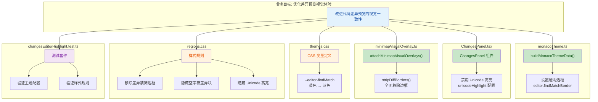

## 1. 高层摘要 (TL;DR)

*   **影响:** 🟡 **中等** - 专注于代码差异预览编辑器的视觉优化和样式改进
*   **核心变更:**
    *   🔧 将查找匹配颜色从警告黄色改为主题蓝色，提升视觉一致性
    *   🚫 移除所有查找匹配和差异装饰的边框，避免黄色边框回退
    *   ⚙️ 禁用 Unicode 高亮警告，减少视觉干扰
    *   ✅ 新增全面的测试套件，验证编辑器高亮主题配置

---

## 2. 视觉概览 (代码与逻辑映射)



---

## 3. 详细变更分析

### 🎨 主题与颜色配置

#### **themes.css** - 查找匹配颜色主题化

**变更内容:** 将查找匹配的高亮颜色从警告黄色改为与主题一致的蓝色

| 主题 | CSS 变量 | 旧值 (黄色警告) | 新值 (蓝色主题) |
|------|----------|----------------|----------------|
| Light | `--editor-findMatch` | `rgba(217, 119, 6, 0.22)` | `rgba(37, 99, 235, 0.18)` |
| Light | `--editor-findMatch-highlight` | `rgba(217, 119, 6, 0.14)` | `rgba(37, 99, 235, 0.1)` |
| Dark | `--editor-findMatch` | `rgba(251, 191, 36, 0.24)` | `rgba(96, 165, 250, 0.2)` |
| Dark | `--editor-findMatch-highlight` | `rgba(251, 191, 36, 0.14)` | `rgba(96, 165, 250, 0.12)` |

**原因:** 统一视觉语言，避免黄色警告色在差异预览中产生误导

---

#### **monacoTheme.ts** - 移除查找匹配边框

**变更内容:** 在 `buildMonacoThemeData()` 函数中添加透明边框配置

```typescript
colors["editor.findMatchBorder"] = "#00000000";
colors["editor.findMatchHighlightBorder"] = "#00000000";
colors["editor.findRangeHighlightBorder"] = "#00000000";
```

**原因:** 防止内联差异高亮回退到黄色边框显示

---

### 🖼️ 编辑器配置优化

#### **ChangesPanel.tsx** - 禁用 Unicode 高亮

**变更内容:** 在 Monaco 编辑器选项中添加 `unicodeHighlight` 配置

```typescript
unicodeHighlight: {
  ambiguousCharacters: false,
  invisibleCharacters: false,
  nonBasicASCII: false
}
```

**原因:** 在代码差异预览中，Unicode 高亮警告框会干扰视觉焦点，禁用后可提供更清洁的阅读体验

---

#### **minimapVisualOverlay.ts** - 增强边框移除逻辑

**变更内容:** 改进 `stripDiffBorders()` 函数，更全面地移除差异装饰的边框

| 变更类型 | 旧实现 | 新实现 |
|---------|--------|--------|
| 边框属性 | 仅 `border` | `border`, `border-top`, `border-right`, `border-bottom`, `border-left` |
| 边框颜色 | 未设置 | 显式设置为 `transparent` |
| 轮廓颜色 | 未设置 | 显式设置为 `transparent` |

**改进点:**
- 逐个移除所有方向的边框属性
- 显式设置边框和轮廓颜色为透明，确保完全移除视觉边框

---

### 🎯 样式规则优化

#### **regions.css** - 多处样式调整

**1. 精确化 CDR 选择器**
```css
/* 旧选择器 */
.adl-tool-editor--changes .monaco-diff-editor:not(.side-by-side) .editor.modified .cdr

/* 新选择器 - 更精确 */
.adl-tool-editor--changes .monaco-diff-editor:not(.side-by-side) .editor.modified .cdr.line-insert,
.adl-tool-editor--changes .monaco-diff-editor:not(.side-by-side) .editor.modified .cdr.line-delete
```

**2. 移除差异装饰边框**
```css
.monaco-editor .char-insert,
.monaco-editor .char-delete,
.monaco-editor .line-insert,
.monaco-editor .line-delete {
  border: none !important;
  border-color: transparent !important;
  outline: none !important;
  outline-color: transparent !important;
  box-shadow: none !important;
}
```

**3. 隐藏空字符差异块**
```css
.adl-tool-editor--changes .monaco-diff-editor:not(.side-by-side) .editor.modified .char-insert,
.adl-tool-editor--changes .monaco-diff-editor:not(.side-by-side) .editor.modified .char-delete,
.adl-tool-editor--changes .monaco-diff-editor:not(.side-by-side) .editor.modified .char-insert.diff-range-empty,
.adl-tool-editor--changes .monaco-diff-editor:not(.side-by-side) .editor.modified .char-delete.diff-range-empty {
  background-color: transparent !important;
  display: none !important;
}
```

**4. 隐藏 Unicode 高亮**
```css
.adl-tool-editor--changes .monaco-diff-editor .unicode-highlight {
  background-color: transparent !important;
  border: none !important;
  outline: none !important;
  box-shadow: none !important;
}
```

**5. 移除查找匹配边框和阴影**
```css
.monaco-editor .findMatch,
.monaco-editor .currentFindMatch,
.monaco-editor .findScope {
  border: none !important;
  outline: none !important;
  box-shadow: none !important;
}
```

---

### ✅ 测试覆盖

#### **changesEditorHighlight.test.ts** - 新增测试套件

**测试覆盖范围:**

| 测试用例 | 验证内容 | 涉及文件 |
|---------|---------|---------|
| Monaco 查找匹配边框移除 | 验证三个边框颜色设置为透明 | `monacoTheme.ts` |
| 查找匹配颜色主题化 | 验证使用蓝色而非黄色 | `themes.css` |
| 运行时查找匹配类清理 | 验证边框、轮廓、阴影移除 | `regions.css` |
| 内联差异字符装饰宽度 | 验证保持 Monaco 计算宽度 | `regions.css` |
| 空字符差异块隐藏 | 验证透明背景和隐藏显示 | `regions.css` |
| Unicode 高亮禁用 | 验证配置和 CSS 规则 | `ChangesPanel.tsx`, `regions.css` |
| 异步差异装饰边框移除 | 验证四个方向边框移除 | `minimapVisualOverlay.ts` |

---

## 4. 影响与风险评估

### ✅ 积极影响

- **视觉一致性提升:** 查找匹配颜色与主题色保持一致，避免黄色警告色的视觉干扰
- **更清洁的界面:** 移除所有不必要的边框和阴影，提供更专注的代码阅读体验
- **减少视觉噪音:** 禁用 Unicode 高亮警告，避免在差异预览中产生误导

### ⚠️ 潜在风险

| 风险项 | 描述 | 缓解措施 |
|-------|------|---------|
| **可访问性降低** | 移除边框可能影响依赖边框识别差异的用户 | 已通过背景色和内联差异高亮保持足够的视觉区分 |
| **Unicode 字符问题** | 禁用 Unicode 高亮可能导致不可见字符被忽略 | 用户仍可通过其他方式检查，且差异预览场景下通常不需要此功能 |

### 🧪 测试建议

1. **验证查找匹配功能:** 确保在差异预览中使用查找功能时，高亮显示正常且无黄色边框
2. **检查内联差异:** 验证字符级和行级差异的高亮显示清晰可见
3. **测试 Unicode 字符:** 确保包含特殊 Unicode 字符的代码差异显示正常
4. **主题切换测试:** 在明暗主题间切换，验证颜色一致性
5. **边框回归测试:** 确保所有差异装饰的边框已完全移除，无残留视觉边框

---

## 5. 总结

本次变更专注于优化代码差异预览编辑器的视觉体验，通过统一颜色主题、移除不必要的边框和阴影、禁用干扰性高亮等方式，提供了更清洁、更一致的代码审查界面。新增的测试套件确保了这些视觉优化能够持续保持。