## 1. 高层摘要 (TL;DR)

*   **影响:** 🟡 **中等** - 优化了Minimap的显示逻辑,修复了Diff编辑器中装饰丢失的问题
*   **核心变更:**
    *   ✅ 新增Minimap滑块的"鼠标悬停"显示模式
    *   🐛 修复了Diff编辑器设置变更后装饰丢失的问题
    *   🔧 改进了FilesPanel对Diff编辑器的Minimap设置支持

---

## 2. 可视化概览 (代码与逻辑图)

```mermaid
graph TD
    subgraph "ChangesPanel.tsx"
        A["applyMinimapSettings()"] --> B["更新Monaco编辑器选项"]
        B --> C["reapplyDiffDecorations()"]
        C --> D["获取CSS变量颜色"]
        D --> E["创建Diff装饰"]
        E --> F["应用装饰到编辑器"]
    end
    
    subgraph "FilesPanel.tsx"
        G["onSettingsChange()"] --> H{Monaco选项是否变化?}
        H -->|是| I["applyMinimapSettings()"]
        H -->|否| J["仅保存设置"]
        I --> K{当前是Diff编辑器?}
        K -->|是| L["更新Diff编辑器"]
        K -->|否| M["更新标准编辑器"]
    end
    
    subgraph "minimapVisualOverlay.ts"
        N["syncMinimapOverlay()"] --> O{showSlider模式?}
        O -->|mouseover| P["默认隐藏overlay"]
        O -->|always| Q["始终显示overlay"]
        P --> R["hover时显示滑块"]
    end
    
    style A fill:#bbdefb,color:#0d47a1
    style C fill:#c8e6c9,color:#1a5e20
    style I fill:#fff3e0,color:#e65100
    style P fill:#f3e5f5,color:#7b1fa2
```



---

## 3. 详细变更分析

### 🎨 **Minimap滑块显示模式优化**

#### **minimapVisualOverlay.ts** & **regions.css**
*   **变更内容:** 新增"鼠标悬停"显示模式,允许用户只在鼠标悬停时显示Minimap滑块
*   **实现逻辑:**
    *   检测`showSlider`设置为`"mouseover"`时,默认隐藏overlay
    *   添加CSS过渡动画(0.15s ease)
    *   Hover时通过`:hover`伪类显示滑块
*   **CSS类:**
    ```css
    .adl-minimap--slider-hover .adl-minimap-slider-visual {
      opacity: 0;
      transition: opacity 0.15s ease;
    }
    ```

---

### 🐛 **Diff编辑器装饰丢失修复**

#### **ChangesPanel.tsx**
*   **变更内容:** 修复了Minimap设置变更后Diff装饰丢失的问题
*   **关键变更:**
    1. **移除依赖项:** 从`useCallback`依赖数组中移除`minimapSettings`相关项,避免不必要的重新渲染
    2. **新增函数:** `reapplyDiffDecorations()` - 在Minimap重建后重新应用装饰
    
*   **核心逻辑:**
    ```typescript
    const reapplyDiffDecorations = useCallback(() => {
      // 1. 获取编辑器和Monaco实例
      // 2. 从CSS变量读取颜色(--minimap-diff-insert-bg, --minimap-diff-remove-bg)
      // 3. 过滤并映射diff范围
      // 4. 创建装饰并应用
      currentModifiedEditor.deltaDecorations(previewDecorationIdsRef.current, decorations);
    }, 200); // 延迟200ms执行
    ```

*   **触发时机:** 在`applyMinimapSettings`中更新Minimap选项后立即调用

---

### 🔧 **FilesPanel编辑器支持增强**

#### **FilesPanel.tsx**
*   **变更内容:** 改进对Diff编辑器的Minimap设置支持
*   **接口扩展:**
    ```typescript
    interface EditorLike {
      updateOptions(options: unknown): void; // 新增
    }
    ```

*   **函数重构:**
    | 函数 | 变更 |
    |------|------|
    | `getEditor()` | 支持返回Diff编辑器的modified editor |
    | `applyMinimapSettings()` | 新增,同时支持Diff和标准编辑器 |

*   **设置变更检测:**
    ```typescript
    const monacoOptionsChanged =
      prev.size !== settings.size ||
      prev.showSlider !== settings.showSlider ||
      prev.renderCharacters !== settings.renderCharacters ||
      prev.scale !== settings.scale;
    ```

---

## 4. 影响与风险评估

### ⚠️ **潜在风险**
| 风险项 | 描述 | 缓解措施 |
|--------|------|----------|
| **性能影响** | `reapplyDiffDecorations`使用200ms延迟,可能影响响应速度 | 延迟时间较短,影响可控 |
| **CSS变量依赖** | 装饰颜色依赖CSS变量,变量缺失时使用硬编码值 | 已提供默认值兜底 |
| **编辑器状态** | 在编辑器已销毁时调用`updateOptions`可能抛出异常 | 已使用try-catch包裹 |

### ✅ **测试建议**
1. **Minimap滑块模式:**
   - 测试"始终显示"和"鼠标悬停"两种模式
   - 验证hover时的过渡动画流畅性

2. **Diff编辑器装饰:**
   - 修改Minimap设置(大小、缩放等),验证装饰是否正确重新应用
   - 检查插入/删除标记的颜色是否正确

3. **FilesPanel切换:**
   - 在标准编辑器和Diff编辑器之间切换
   - 验证Minimap设置在两种编辑器中都能正确应用

---

## 5. 变更文件清单

| 文件路径 | 变更类型 | 关键函数/类 |
|----------|----------|-------------|
| `ChangesPanel.tsx` | 🐛 修复 + ✨ 增强 | `reapplyDiffDecorations()`, `applyMinimapSettings()` |
| `FilesPanel.tsx` | ✨ 增强 | `getEditor()`, `applyMinimapSettings()` |
| `minimapVisualOverlay.ts` | ✨ 增强 | `syncMinimapOverlay()` |
| `regions.css` | ✨ 新增 | `.adl-minimap--slider-hover` 相关样式 |