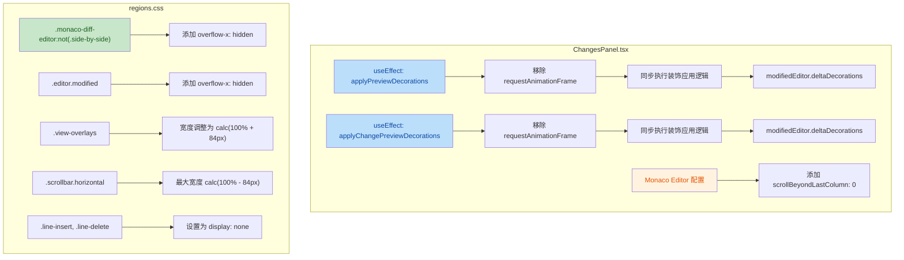
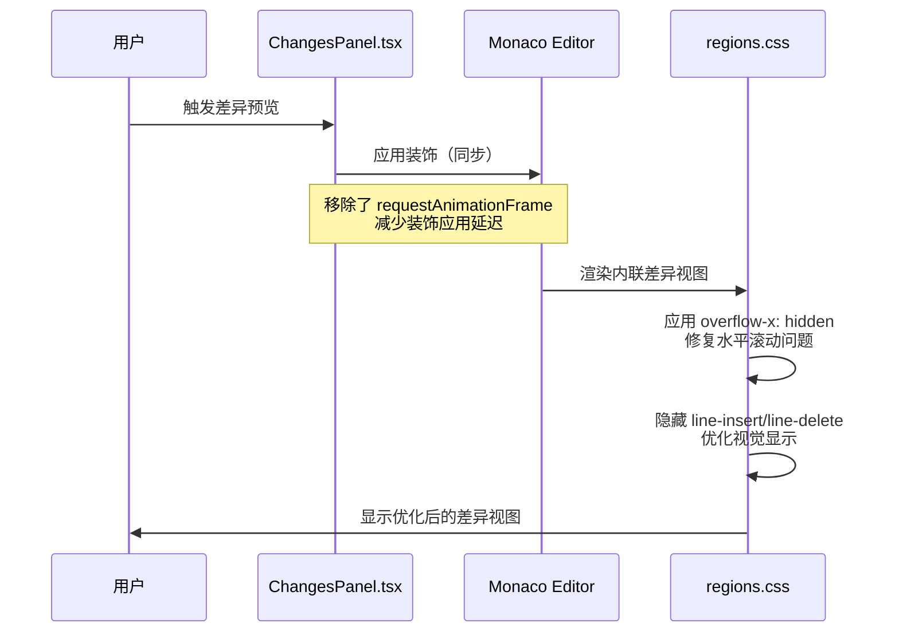

## 1. 高层摘要 (TL;DR)

*   **影响范围:** 🟡 中等 - 优化了 Monaco Diff Editor 的装饰应用逻辑和内联差异视图的样式布局
*   **核心变更:**
    *   ✨ 移除 `requestAnimationFrame` 包装，改为同步应用装饰，减少延迟
    *   🎨 重构内联差异编辑器的 CSS 样式，修复水平滚动和内容溢出问题
    *   ⚙️ 添加 `scrollBeyondLastColumn: 0` 配置，优化编辑器滚动行为

---

## 2. 可视化概览 (代码与逻辑映射)



**业务逻辑流程:**



---

## 3. 详细变更分析

### 📁 组件 1: `ChangesPanel.tsx`

**变更类型:** 性能优化 + 代码简化

#### 🔧 主要变更点

| 变更项 | 修改前 | 修改后 | 影响 |
|--------|--------|--------|------|
| 装饰应用时机 | 使用 `requestAnimationFrame` 包装 | 同步执行 | 减少延迟，立即应用装饰 |
| 编辑器引用 | 通过 `diffEditorRef.current` 动态获取 | 直接使用 `modifiedEditor` 变量 | 简化代码逻辑 |
| Monaco 配置 | 无 `scrollBeyondLastColumn` | 添加 `scrollBeyondLastColumn: 0` | 优化滚动行为 |

#### 📝 代码逻辑变更

**变更 1: 移除 requestAnimationFrame 包装 (行 392-444)**

```typescript
// ❌ 修改前：异步执行装饰应用
const applyTimer = requestAnimationFrame(() => {
  const currentDiffEditor = diffEditorRef.current;
  const currentModifiedEditor = isDiffEditor(currentDiffEditor) ? currentDiffEditor?.getModifiedEditor() : null;
  if (!currentModifiedEditor) return;
  
  // ... 装饰逻辑 ...
  previewDecorationIdsRef.current = currentModifiedEditor.deltaDecorations(previewDecorationIdsRef.current, decorations);
});

// ✅ 修改后：同步执行
const minimapPosition = getMinimapPosition(monaco);
const root = document.documentElement;
const computedStyle = getComputedStyle(root);

// ... 装饰逻辑 ...
previewDecorationIdsRef.current = modifiedEditor.deltaDecorations(previewDecorationIdsRef.current, decorations);
```

**变更 2: 移除清理函数中的 cancelAnimationFrame (行 446-447)**

```typescript
// ❌ 修改前
return () => {
  cancelAnimationFrame(applyTimer);
  // ... 其他清理逻辑 ...
};

// ✅ 修改后
return () => {
  // ... 其他清理逻辑 ...
};
```

**变更 3: 添加 Monaco Editor 配置 (行 368)**

```typescript
// ✅ 新增配置
scrollBeyondLastColumn: 0,
```

**变更 4: 第二个 useEffect 同样优化 (行 507-560)**

第二个 `useEffect` (处理 `changePreview` 变化) 也进行了相同的优化，移除了 `requestAnimationFrame` 包装。

---

### 📁 组件 2: `regions.css`

**变更类型:** 样式修复 + 布局优化

#### 🎨 样式变更表

| 选择器 | 修改前 | 修改后 | 目的 |
|--------|--------|--------|------|
| `.monaco-diff-editor:not(.side-by-side)` | 无样式 | `overflow-x: hidden !important` | 防止整体水平滚动 |
| `.editor` | 无样式 | `overflow-x: hidden !important` | 防止编辑器容器水平滚动 |
| `.editor.modified` | 无样式 | `overflow-x: hidden !important` | 防止修改编辑器水平滚动 |
| `.editor.modified .monaco-editor` | 无样式 | `overflow-x: hidden !important` | 防止 Monaco 编辑器实例水平滚动 |
| `.monaco-scrollable-element` | `width: 100%` | 添加 `overflow-x: hidden` 和 `max-width: 100%` | 限制滚动元素宽度 |
| `.view-overlays` | `width: 100%` | `width: calc(100% + 84px)` | 扩展覆盖层宽度以容纳行号 |
| `.scrollbar.horizontal` | 无样式 | `max-width: calc(100% - 84px)` | 限制水平滚动条宽度 |
| `.view-lines` | `width: 100%` | `max-width: 100%` | 限制视图行最大宽度 |
| `.line-numbers` | 无样式 | `max-width: 100%` | 限制行号最大宽度 |
| `.line-insert, .line-delete` | 无样式 | `display: none !important` | 隐藏内联差异标记 |
| `.adl-inline-diff-line` | 包含 `overflow: visible` | 移除 `overflow: visible` | 修复溢出问题 |

#### 🔍 关键样式变更详解

**变更 1: 内联差异编辑器容器溢出控制**

```css
/* ✅ 新增：防止整体水平滚动 */
.adl-tool-editor--changes .monaco-diff-editor:not(.side-by-side) {
  overflow-x: hidden !important;
}

/* ✅ 新增：防止编辑器容器水平滚动 */
.adl-tool-editor--changes .monaco-diff-editor:not(.side-by-side) .editor {
  overflow-x: hidden !important;
}

/* ✅ 新增：防止修改编辑器水平滚动 */
.adl-tool-editor--changes .monaco-diff-editor:not(.side-by-side) .editor.modified {
  overflow-x: hidden !important;
}

/* ✅ 新增：防止 Monaco 编辑器实例水平滚动 */
.adl-tool-editor--changes .monaco-diff-editor:not(.side-by-side) .editor.modified .monaco-editor {
  overflow-x: hidden !important;
}
```

**变更 2: 调整视图覆盖层宽度**

```css
/* ❌ 修改前 */
.adl-tool-editor--changes .monaco-diff-editor:not(.side-by-side) .editor.modified .view-overlays {
  width: 100% !important;
  right: 0 !important;
  left: 0 !important;
}

/* ✅ 修改后：扩展宽度以容纳行号（84px） */
.adl-tool-editor--changes .monaco-diff-editor:not(.side-by-side) .editor.modified .view-overlays {
  width: calc(100% + 84px) !important;
  right: 0 !important;
  left: 0 !important;
}
```

**变更 3: 限制水平滚动条宽度**

```css
/* ✅ 新增：确保滚动条不超出内容区域 */
.adl-tool-editor--changes .monaco-diff-editor:not(.side-by-side) .editor.modified .scrollbar.horizontal {
  max-width: calc(100% - 84px) !important;
}
```

**变更 4: 隐藏内联差异标记**

```css
/* ✅ 新增：隐藏默认的 line-insert 和 line-delete 元素 */
.adl-tool-editor--changes .monaco-diff-editor:not(.side-by-side) .editor.modified .view-overlays > div.line-insert,
.adl-tool-editor--changes .monaco-diff-editor:not(.side-by-side) .editor.modified .view-overlays > div.line-delete {
  display: none !important;
}
```

---

## 4. 影响与风险评估

### ⚠️ 破坏性变更

| 影响项 | 风险等级 | 说明 |
|--------|----------|------|
| 装饰应用时机 | 🟢 低 | 从异步改为同步，理论上更快，但需确保编辑器已完全初始化 |
| CSS 溢出控制 | 🟡 中 | 大量添加 `overflow-x: hidden`，可能影响某些特殊内容的显示 |
| 隐藏差异标记 | 🟡 中 | 隐藏了默认的 `line-insert` 和 `line-delete`，依赖自定义装饰 |

### 🧪 测试建议

#### 功能测试
1. **装饰应用测试**
   - ✅ 验证差异预览装饰是否正确显示
   - ✅ 测试快速切换不同差异内容时装饰是否正常更新
   - ✅ 检查装饰颜色和位置是否正确

2. **滚动行为测试**
   - ✅ 测试内联差异视图的水平滚动是否正常工作
   - ✅ 验证 `scrollBeyondLastColumn: 0` 是否按预期工作
   - ✅ 检查长行内容是否正确显示（无水平滚动条异常）

3. **布局测试**
   - ✅ 测试不同屏幕尺寸下的布局表现
   - ✅ 验证行号区域与内容区域的对齐
   - ✅ 检查 `.view-overlays` 的扩展宽度是否正确覆盖内容

#### 边界情况测试
- 📋 空差异内容
- 📋 单行差异
- 📋 大量差异（数百行）
- 📋 超长行内容（超过容器宽度）
- 📋 同时包含插入和删除的同一行

#### 性能测试
- ⚡ 测试装饰应用的性能（移除 requestAnimationFrame 后）
- ⚡ 验证频繁更新差异时的渲染性能

---

## 5. 总结

本次变更主要针对 **Monaco Diff Editor 的内联差异视图** 进行了优化：

1. **性能优化**: 移除了 `requestAnimationFrame` 包装，改为同步执行装饰应用，减少了装饰显示的延迟
2. **布局修复**: 通过添加多层级的 `overflow-x: hidden` 和调整宽度计算，修复了内联差异视图的水平滚动和内容溢出问题
3. **视觉优化**: 隐藏了默认的差异标记，依赖自定义装饰来提供更好的视觉体验

这些变更应该能显著改善内联差异视图的用户体验，特别是在处理大量差异和长行内容时。建议重点关注装饰显示的正确性和水平滚动行为的兼容性。