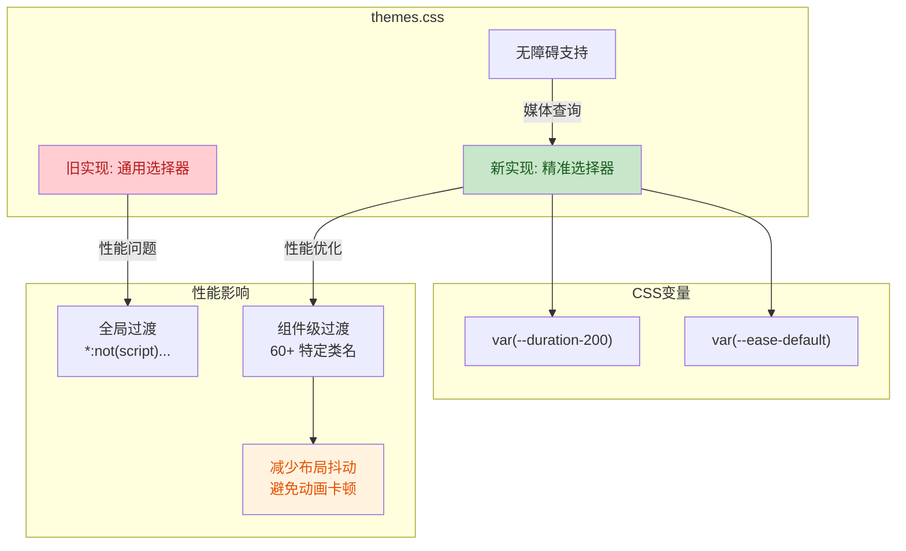

## 1. 高层摘要 (TL;DR)

*   **影响范围:** 🟡 **中等** - 优化桌面应用的主题切换动画性能
*   **核心变更:**
    *   移除全局通配符选择器,避免在所有DOM节点上应用过渡效果
    *   改为针对约60个特定组件类名应用过渡动画
    *   使用CSS变量替代硬编码的动画时长和缓动函数
    *   保持对无障碍用户的支持(尊重 `prefers-reduced-motion` 设置)

---

## 2. 可视化概览 (代码与逻辑映射)



---

## 3. 详细变更分析

### 🎨 主题过渡支持优化

**文件:** `ai-digital-life/apps/desktop/renderer/src/styles/themes.css`

#### 📝 变更说明

**问题根源:**
- 旧实现使用 `*:not(script):not(style):not(link):not(meta)` 通用选择器
- 这会强制在**每个DOM节点**上计算过渡效果
- 导致布局抖动(layout thrash)和动画卡顿(animation jank)

**优化方案:**
- 将过渡效果**仅限于结构容器和交互元素**
- 明确列出约60个需要过渡效果的组件类名
- 使用CSS变量提高可维护性

#### 📊 CSS选择器变更对比

| 选择器类型 | 旧实现 | 新实现 | 影响 |
|-----------|--------|--------|------|
| **全局选择器** | `*:not(script):not(style):not(link):not(meta)` | ❌ 已移除 | 消除全节点计算 |
| **根元素** | `html` | `html, body, [data-theme]` | ✅ 保留并扩展 |
| **组件选择器** | ❌ 无 | 60+ 特定类名 | ✅ 精准应用 |
| **动画时长** | `200ms` (硬编码) | `var(--duration-200)` | ✅ 可配置 |
| **缓动函数** | `cubic-bezier(0.4, 0, 0.2, 1)` | `var(--ease-default)` | ✅ 可配置 |

#### 🏗️ 新增过渡效果的组件类别

| 类别 | 组件类名示例 |
|------|-------------|
| **布局容器** | `.adl-shell`, `.adl-ide`, `.adl-center`, `.adl-leftbar`, `.adl-rightpanel` |
| **标题栏/状态栏** | `.adl-titlebar`, `.adl-statusbar`, `.adl-statusbar__item` |
| **输入控件** | `.input`, `.textarea`, `.select`, `.adl-select` |
| **按钮组件** | `.btn`, `.adl-btn`, `.adl-icon-btn`, `.adl-quick-btn`, `.adl-chip` |
| **菜单项** | `.adl-menu__item`, `.adl-menu__trigger`, `.adl-titlebar-menu__item` |
| **会话/工作区** | `.adl-session-item`, `.adl-workspace-row`, `.adl-workspace-row__disclosure` |
| **编辑器相关** | `.adl-editor-tabs button`, `.adl-diagnostic-list button` |
| **终端相关** | `.adl-terminal-runner input`, `.adl-terminal-panel__output`, `.adl-terminal-output` |
| **卡片/模态框** | `.card`, `.modal`, `.modal-backdrop`, `.toast`, `.banner` |
| **状态指示** | `.adl-status-lamp`, `.adl-agent-status`, `.adl-badge` |
| **其他UI元素** | `.tooltip`, `.skeleton`, `.color-scheme__btn`, `.color-scheme__swatch` |

#### 💻 代码对比

**旧实现 (性能问题):**
```css
html,
*:not(script):not(style):not(link):not(meta) {
  transition-property: background-color, color, border-color, box-shadow, fill, stroke;
  transition-duration: 200ms;
  transition-timing-function: cubic-bezier(0.4, 0, 0.2, 1);
}
```

**新实现 (性能优化):**
```css
html,
body,
[data-theme] {
  transition:
    background-color var(--duration-200) var(--ease-default),
    color var(--duration-200) var(--ease-default);
}

.adl-shell,
.adl-ide,
/* ... 60+ 特定组件类名 ... */
.skeleton {
  transition-property: background-color, color, border-color, box-shadow, fill, stroke, opacity;
  transition-duration: var(--duration-200);
  transition-timing-function: var(--ease-default);
}
```

#### ♿ 无障碍支持保持

**媒体查询 `@media (prefers-reduced-motion: reduce)` 保持不变:**
- 在用户系统设置偏好减少动画时,禁用所有过渡效果
- 使用 `transition-property: none !important` 确保无动画
- 覆盖所有60+组件类名,确保一致性

---

## 4. 影响与风险评估

### ✅ 积极影响

| 方面 | 说明 |
|------|------|
| **性能提升** | 消除全局选择器导致的布局抖动,减少主题切换时的CPU/GPU开销 |
| **动画流畅度** | 避免在非必要元素上计算过渡,提升动画帧率 |
| **可维护性** | 使用CSS变量,便于统一调整动画参数 |
| **代码可读性** | 明确列出需要过渡的组件,便于理解和维护 |

### ⚠️ 潜在风险

| 风险项 | 严重程度 | 缓解措施 |
|--------|----------|----------|
| **遗漏组件** | 🟡 低 | 如果新增组件需要过渡效果,需手动添加到选择器列表 |
| **样式冲突** | 🟢 极低 | 使用特定类名,不太可能与其他样式冲突 |
| **回归测试** | 🟡 中 | 需测试主题切换时的过渡效果是否正常 |

### 🧪 测试建议

**功能测试:**
- [ ] 切换明暗主题,验证过渡动画是否流畅
- [ ] 检查所有60+组件类名在主题切换时的视觉效果
- [ ] 验证新增组件是否需要添加过渡效果

**性能测试:**
- [ ] 使用Chrome DevTools Performance面板对比优化前后的主题切换性能
- [ ] 检查是否有布局抖动(layout thrash)或强制同步布局(forced reflow)

**无障碍测试:**
- [ ] 在系统设置中启用"减少动画"选项,验证过渡效果是否被禁用
- [ ] 确保在减少动画模式下,主题切换仍然正常工作

---

## 5. 总结

这是一次**性能优化**性质的变更,通过将主题过渡效果从全局通用选择器改为精准的组件级选择器,显著提升了桌面应用的主题切换性能。变更保持了良好的可维护性和无障碍支持,风险较低,建议合并。