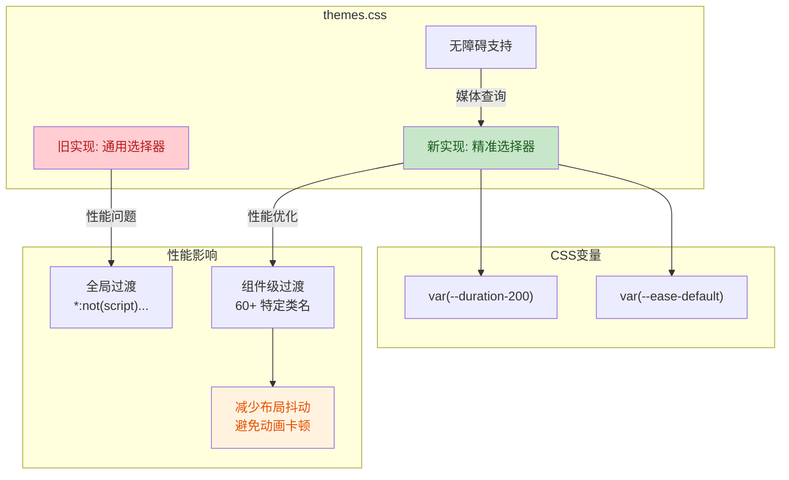
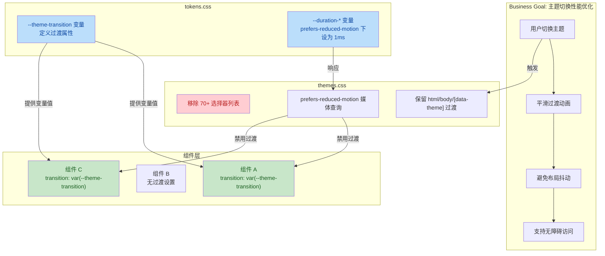

## 1. 高层摘要 (TL;DR)

*   **影响范围:** 🟡 **中等** - 优化桌面应用的主题切换动画性能
*   **核心变更:**
    *   移除全局通配符选择器,避免在所有DOM节点上应用过渡效果
    *   改为针对约60个特定组件类名应用过渡动画
    *   使用CSS变量替代硬编码的动画时长和缓动函数
    *   保持对无障碍用户的支持(尊重 `prefers-reduced-motion` 设置)

---

## 2. 可视化概览 (代码与逻辑映射)



---

## 3. 详细变更分析

### 🎨 主题过渡支持优化

**文件:** `ai-digital-life/apps/desktop/renderer/src/styles/themes.css`

#### 📝 变更说明

**问题根源:**
- 旧实现使用 `*:not(script):not(style):not(link):not(meta)` 通用选择器
- 这会强制在**每个DOM节点**上计算过渡效果
- 导致布局抖动(layout thrash)和动画卡顿(animation jank)

**优化方案:**
- 将过渡效果**仅限于结构容器和交互元素**
- 明确列出约60个需要过渡效果的组件类名
- 使用CSS变量提高可维护性

#### 📊 CSS选择器变更对比

| 选择器类型 | 旧实现 | 新实现 | 影响 |
|-----------|--------|--------|------|
| **全局选择器** | `*:not(script):not(style):not(link):not(meta)` | ❌ 已移除 | 消除全节点计算 |
| **根元素** | `html` | `html, body, [data-theme]` | ✅ 保留并扩展 |
| **组件选择器** | ❌ 无 | 60+ 特定类名 | ✅ 精准应用 |
| **动画时长** | `200ms` (硬编码) | `var(--duration-200)` | ✅ 可配置 |
| **缓动函数** | `cubic-bezier(0.4, 0, 0.2, 1)` | `var(--ease-default)` | ✅ 可配置 |

#### 🏗️ 新增过渡效果的组件类别

| 类别 | 组件类名示例 |
|------|-------------|
| **布局容器** | `.adl-shell`, `.adl-ide`, `.adl-center`, `.adl-leftbar`, `.adl-rightpanel` |
| **标题栏/状态栏** | `.adl-titlebar`, `.adl-statusbar`, `.adl-statusbar__item` |
| **输入控件** | `.input`, `.textarea`, `.select`, `.adl-select` |
| **按钮组件** | `.btn`, `.adl-btn`, `.adl-icon-btn`, `.adl-quick-btn`, `.adl-chip` |
| **菜单项** | `.adl-menu__item`, `.adl-menu__trigger`, `.adl-titlebar-menu__item` |
| **会话/工作区** | `.adl-session-item`, `.adl-workspace-row`, `.adl-workspace-row__disclosure` |
| **编辑器相关** | `.adl-editor-tabs button`, `.adl-diagnostic-list button` |
| **终端相关** | `.adl-terminal-runner input`, `.adl-terminal-panel__output`, `.adl-terminal-output` |
| **卡片/模态框** | `.card`, `.modal`, `.modal-backdrop`, `.toast`, `.banner` |
| **状态指示** | `.adl-status-lamp`, `.adl-agent-status`, `.adl-badge` |
| **其他UI元素** | `.tooltip`, `.skeleton`, `.color-scheme__btn`, `.color-scheme__swatch` |

#### 💻 代码对比

**旧实现 (性能问题):**
```css
html,
*:not(script):not(style):not(link):not(meta) {
  transition-property: background-color, color, border-color, box-shadow, fill, stroke;
  transition-duration: 200ms;
  transition-timing-function: cubic-bezier(0.4, 0, 0.2, 1);
}
```

**新实现 (性能优化):**
```css
html,
body,
[data-theme] {
  transition:
    background-color var(--duration-200) var(--ease-default),
    color var(--duration-200) var(--ease-default);
}

.adl-shell,
.adl-ide,
/* ... 60+ 特定组件类名 ... */
.skeleton {
  transition-property: background-color, color, border-color, box-shadow, fill, stroke, opacity;
  transition-duration: var(--duration-200);
  transition-timing-function: var(--ease-default);
}
```

#### ♿ 无障碍支持保持

**媒体查询 `@media (prefers-reduced-motion: reduce)` 保持不变:**
- 在用户系统设置偏好减少动画时,禁用所有过渡效果
- 使用 `transition-property: none !important` 确保无动画
- 覆盖所有60+组件类名,确保一致性

---

## 4. 影响与风险评估

### ✅ 积极影响

| 方面 | 说明 |
|------|------|
| **性能提升** | 消除全局选择器导致的布局抖动,减少主题切换时的CPU/GPU开销 |
| **动画流畅度** | 避免在非必要元素上计算过渡,提升动画帧率 |
| **可维护性** | 使用CSS变量,便于统一调整动画参数 |
| **代码可读性** | 明确列出需要过渡的组件,便于理解和维护 |

### ⚠️ 潜在风险

| 风险项 | 严重程度 | 缓解措施 |
|--------|----------|----------|
| **遗漏组件** | 🟡 低 | 如果新增组件需要过渡效果,需手动添加到选择器列表 |
| **样式冲突** | 🟢 极低 | 使用特定类名,不太可能与其他样式冲突 |
| **回归测试** | 🟡 中 | 需测试主题切换时的过渡效果是否正常 |

### 🧪 测试建议

**功能测试:**
- [ ] 切换明暗主题,验证过渡动画是否流畅
- [ ] 检查所有60+组件类名在主题切换时的视觉效果
- [ ] 验证新增组件是否需要添加过渡效果

**性能测试:**
- [ ] 使用Chrome DevTools Performance面板对比优化前后的主题切换性能
- [ ] 检查是否有布局抖动(layout thrash)或强制同步布局(forced reflow)

**无障碍测试:**
- [ ] 在系统设置中启用"减少动画"选项,验证过渡效果是否被禁用
- [ ] 确保在减少动画模式下,主题切换仍然正常工作

---

## 5. 总结

这是一次**性能优化**性质的变更,通过将主题过渡效果从全局通用选择器改为精准的组件级选择器,显著提升了桌面应用的主题切换性能。变更保持了良好的可维护性和无障碍支持,风险较低,建议合并。

---

## 1. 高层摘要 (TL;DR)

*   **影响:** **中等** - 重构了主题切换过渡机制，从硬编码选择器列表改为可配置的 CSS 变量模式
*   **关键变更:**
    *   ✨ 移除了 **70+ 个硬编码 CSS 选择器**，改用 `--theme-transition` CSS 变量实现 opt-in 模式
    *   🎨 在 `tokens.css` 中新增 `--theme-transition` 变量，组件可通过 `transition: var(--theme-transition)` 主动启用主题过渡
    *   🧪 新增 **173 行测试代码**，覆盖主题切换回归测试和 CSS 结构验证
    *   ♿ 优化 `prefers-reduced-motion` 支持，通过 tokens.css 自动处理无障碍需求

---

## 2. 可视化概览 (代码与逻辑图)



**架构变更对比:**

| 维度 | 旧模式 (选择器列表) | 新模式 (Opt-in 变量) |
|------|---------------------|---------------------|
| **扩展性** | 需手动添加新组件到列表 | 新组件自动支持 |
| **维护成本** | 高 (70+ 选择器需同步) | 低 (单一定义) |
| **性能** | 强制所有元素计算过渡 | 按需启用，减少计算 |
| **样式冲突** | 可能覆盖组件特定过渡 | 无冲突，组件可控 |
| **可访问性** | 手动维护媒体查询 | 自动响应 reduced-motion |

---

## 3. 详细变更分析

### 📁 **tokens.css** - 新增主题过渡变量

**变更内容:**
在 CSS 变量定义区域新增 `--theme-transition` 变量，封装所有主题切换时需要过渡的属性。

**新增代码:**
```css
--theme-transition:
  background-color var(--duration-200) var(--ease-default),
  color var(--duration-200) var(--ease-default),
  border-color var(--duration-200) var(--ease-default),
  box-shadow var(--duration-200) var(--ease-default),
  fill var(--duration-200) var(--ease-default),
  stroke var(--duration-200) var(--ease-default),
  opacity var(--duration-200) var(--ease-default);
```

**设计优势:**
- 组件通过 `transition: var(--theme-transition)` 即可启用平滑主题切换
- `prefers-reduced-motion` 下，`--duration-*` 自动变为 `1ms`，无需额外处理

---

### 📁 **themes.css** - 移除选择器列表，简化媒体查询

**变更内容:**

1. **删除硬编码选择器列表** (移除约 70 行代码):
   - 删除了 `.adl-shell`, `.adl-ide`, `.card`, `.btn`, `.modal` 等 70+ 个选择器的过渡定义
   - 这些选择器之前都硬编码了相同的过渡属性

2. **更新注释说明:**
   ```css
   /* 旧注释:
      Scoped to structural containers and interactive elements only.
      Avoids the universal * selector which forces transition computation
      on every DOM node (layout thrash, animation jank).
   
   /* 新注释:
      Opt-in model: components use `transition: var(--theme-transition)` to
      adopt smooth theme-switch transitions. No global selector list needed.
   
      Benefits over selector-list approach:
      - New components opt in automatically by using the variable
      - No risk of missing components when the list grows
      - No style-conflict with component-specific transitions
      - Reduced-motion handled by tokens.css (--duration-* → 1ms)
   ```

3. **简化 `prefers-reduced-motion` 媒体查询:**
   ```css
   /* 旧代码: 包含 70+ 选择器 */
   @media (prefers-reduced-motion: reduce) {
     html, body, [data-theme], .adl-shell, .adl-ide, ... {
       transition-property: none !important;
     }
   }
   
   /* 新代码: 仅保留核心选择器 */
   @media (prefers-reduced-motion: reduce) {
     html, body, [data-theme] {
       transition-property: none;
     }
   }
   ```

---

### 📁 **theme.test.ts** - 新增测试套件

**变更内容:**
新增 **173 行测试代码**，分为两个测试套件：

#### **测试套件 1: theme switching transition regression**

| 测试用例 | 验证内容 |
|---------|---------|
| `toggles data-theme between light and dark without errors` | 验证主题切换不抛出错误，`data-theme` 属性正确更新 |
| `notifies subscribers on every theme change` | 验证每次主题切换都会通知订阅者，且参数正确 |
| `preserves theme state after rapid consecutive switches` | 验证快速连续切换 20 次后状态仍正确 |

#### **测试套件 2: design-system/theme CSS structure**

| 测试用例 | 验证内容 |
|---------|---------|
| `light and dark themes define the same CSS variable set` | 验证 light 和 dark 主题定义的变量完全一致 |
| `both themes define required core color variables` | 验证 40+ 个核心颜色变量在两个主题中都存在 |
| `tokens.css defines --theme-transition variable` | 验证新变量已定义 |
| `themes.css uses no hardcoded hex colors in selector lists` | 验证过渡块中无硬编码颜色 |
| `themes.css has no universal * selector for transitions` | 验证无通用选择器 |
| `themes.css provides prefers-reduced-motion override` | 验证无障碍支持存在 |
| `tokens.css provides prefers-reduced-motion duration override` | 验证 reduced-motion 下时长为 1ms |

**核心变量验证列表:**
```typescript
const requiredVars = [
  "--bg", "--bg-secondary", "--bg-card", "--bg-input", "--bg-hover", "--bg-active",
  "--surface", "--surface-elevated", "--surface-raised",
  "--text-primary", "--text-secondary", "--text-muted", "--text-hint",
  "--text-inverse", "--text-on-accent",
  "--border", "--border-subtle", "--border-default", "--border-strong",
  "--accent", "--accent-soft", "--accent-strong", "--accent-subtle",
  "--danger", "--danger-soft", "--danger-subtle",
  "--warning", "--warning-soft", "--warning-subtle",
  "--success", "--success-soft", "--success-subtle",
  "--info", "--info-soft", "--info-subtle",
  "--code-bg", "--focus-ring"
];
```

---

## 4. 影响与风险评估

### ⚠️ **破坏性变更**

| 变更类型 | 影响范围 | 迁移建议 |
|---------|---------|---------|
| **CSS 类移除** | 之前依赖自动过渡的组件 | 组件需显式添加 `transition: var(--theme-transition)` |
| **媒体查询简化** | 依赖 `!important` 的组件 | 移除 `!important`，改用变量控制 |

### ✅ **测试建议**

1. **功能测试:**
   - 在设置中快速切换明暗主题，验证视觉过渡是否平滑
   - 在 `prefers-reduced-motion` 模式下切换主题，验证无动画

2. **回归测试:**
   - 检查所有 UI 组件（按钮、卡片、模态框等）是否正常显示
   - 验证组件特定的过渡效果未被覆盖

3. **性能测试:**
   - 使用 Chrome DevTools Performance 面板检查主题切换时的布局重排
   - 对比切换前后的 FPS，确认无性能下降

### 🎯 **优势总结**

- ✅ **可维护性提升:** 新组件无需修改全局 CSS，只需使用变量
- ✅ **性能优化:** 减少不必要的过渡计算，降低布局抖动
- ✅ **无障碍增强:** 自动响应 `prefers-reduced-motion` 设置
- ✅ **样式隔离:** 避免全局选择器覆盖组件特定样式

---

## 1. 高层摘要 (TL;DR)

*   **影响范围:** 🟡 **中等** - 为桌面应用的主题切换添加平滑过渡动画，提升用户体验
*   **核心变更:**
    *   ✨ 为 18 个 UI 组件添加主题切换过渡效果
    *   📝 在 `themes.css` 中添加详细的迁移指南文档
    *   🎨 统一使用 `var(--theme-transition)` 实现一致的主题切换动画

## 2. 可视化概览 (代码与逻辑映射)

```mermaid
graph TD
    subgraph "主题切换流程"
        A[用户切换主题<br/>data-theme 属性变更] --> B{组件是否有过渡效果?}
        
        B -->|有过渡| C[平滑动画过渡<br/>var(--theme-transition)]
        B -->|无过渡| D[瞬间切换<br/>可能视觉突兀]
        
        C --> E[提升用户体验]
        D --> F[视觉不连贯]
    end
    
    subgraph "已迁移组件 (components.css)"
        C1[.card]
        C2[.pill]
        C3[.eyebrow]
        C4[.banner]
        C5[.stat]
    end
    
    subgraph "已迁移组件 (regions.css)"
        R1[.adl-shell]
        R2[.adl-titlebar]
        R3[.adl-chip]
        R4[.adl-leftbar]
        R5[.adl-center]
        R6[.adl-agent-status]
        R7[.adl-message]
        R8[.adl-composer__footer]
        R9[.adl-rightpanel]
        R10[.adl-patch-card]
        R11[.adl-run-card]
        R12[.adl-statusbar__item]
    end
    
    subgraph "已迁移组件 (workspace.css)"
        W1[.adl-ide]
    end
    
    C --> C1
    C --> C2
    C --> C3
    C --> C4
    C --> C5
    C --> R1
    C --> R2
    C --> R3
    C --> R4
    C --> R5
    C --> R6
    C --> R7
    C --> R8
    C --> R9
    C --> R10
    C --> R11
    C --> R12
    C --> W1
    
    style C fill:#c8e6c9,color:#1a5e20
    style E fill:#bbdefb,color:#0d47a1
    style F fill:#ffcdd2,color:#c62828
```

## 3. 详细变更分析

### 🎨 3.1 主题切换过渡系统

#### **变更目标**
为桌面应用的主题切换功能添加平滑过渡动画，避免视觉突兀的瞬间切换，提升用户体验。

#### **实现方式**
统一使用 CSS 变量 `var(--theme-transition)` 为所有受主题影响的组件添加过渡效果。

---

### 📄 3.2 文件级别变更

#### **📋 components.css**
为 5 个通用组件添加主题过渡：

| 组件类名 | 行号 | 说明 |
|---------|------|------|
| `.card` | 280 | 卡片容器，包含背景、边框等主题属性 |
| `.pill` | 377 | 标签/徽章组件，显示状态信息 |
| `.eyebrow` | 432 | 小标题/标签文本 |
| `.banner` | 447 | 横幅/内联提示框 |
| `.stat` | 764 | 统计数据展示卡片 |

**代码示例:**
```css
.card {
  padding: var(--space-5);
  display: grid;
  gap: var(--space-3);
  transition: var(--theme-transition);  /* 新增 */
}
```

---

#### **🏗️ regions.css**
为 12 个布局区域组件添加主题过渡：

| 组件类名 | 行号 | 说明 |
|---------|------|------|
| `.adl-shell` | 31 | 应用主容器 |
| `.adl-titlebar` | 107 | 顶部标题栏 |
| `.adl-chip` | 400 | 芯片/标签组件 |
| `.adl-leftbar` | 430 | 左侧边栏 |
| `.adl-center` | 791 | 中央内容区域 |
| `.adl-agent-status` | 826 | AI 代理状态指示器 |
| `.adl-message` | 1000 | 消息气泡 |
| `.adl-composer__footer` | 1039 | 消息编辑器底部 |
| `.adl-rightpanel` | 1211 | 右侧面板 |
| `.adl-patch-card` | 1527 | 补丁卡片 |
| `.adl-run-card` | 1583 | 运行卡片 |
| `.adl-statusbar__item` | 1748 | 状态栏项目 |

---

#### **💻 workspace.css**
为 IDE 工作区添加主题过渡：

| 组件类名 | 行号 | 说明 |
|---------|------|------|
| `.adl-ide` | 14 | IDE 主容器 |

---

#### **📖 themes.css**
添加了**详细的迁移指南文档**，包含以下关键内容：

**✅ 已覆盖的组件 (无需额外操作):**
- 使用 `var(--transition-colors)` 或 `var(--transition-shadow)` 的组件
- 包括按钮、输入框、菜单、工具栏等 20+ 个交互组件

**📋 已迁移的组件:**
- 结构性容器和视觉元素
- 包括 shell、titlebar、card、message 等 18 个组件

**🎯 添加规则:**
- ✅ **添加时:** 元素使用主题 CSS 变量、无现有过渡、视觉显著
- ❌ **不添加时:** 已有 `var(--transition-colors)`、纯装饰元素、使用 `animation:` 的元素

**♿ 无障碍支持:**
- `tokens.css` 在 `prefers-reduced-motion` 下将所有 `--duration-*` 设为 1ms
- `var(--theme-transition)` 自动适配为近瞬时切换

---

### 📊 3.3 变更统计

| 文件 | 新增组件数 | 新增代码行数 |
|------|-----------|-------------|
| `components.css` | 5 | 5 |
| `regions.css` | 12 | 12 |
| `workspace.css` | 1 | 1 |
| `themes.css` | 0 (仅文档) | 48 |
| **总计** | **18** | **66** |

## 4. 影响与风险评估

### ⚠️ 4.1 潜在风险

| 风险项 | 影响 | 缓解措施 |
|--------|------|----------|
| **性能影响** | 🟡 低 | 过渡动画由 CSS 变量控制，已考虑 reduced-motion |
| **样式冲突** | 🟢 极低 | 新增的 `transition` 属性不会覆盖现有过渡 |
| **浏览器兼容** | 🟢 极低 | CSS 变量和 transition 支持广泛 |

### ✅ 4.2 测试建议

**必须测试的场景:**
1. 🔀 **主题切换测试**
   - 在浅色/深色主题间快速切换
   - 验证所有 18 个组件是否平滑过渡
   - 检查是否有组件闪烁或突兀变化

2. ♿ **无障碍测试**
   - 在系统设置中启用"减弱动态效果"
   - 验证主题切换是否变为瞬时完成
   - 确认不会引起眩晕或不适

3. 🎨 **视觉一致性测试**
   - 检查所有已迁移组件的过渡时长是否一致
   - 验证未迁移组件（已有 `transition-colors`）的行为是否正常

4. 🐛 **边缘情况测试**
   - 在主题切换过程中快速滚动页面
   - 在组件动画过程中切换主题
   - 验证嵌套组件的过渡效果

### 📌 4.3 后续工作

根据迁移指南，以下组件可能需要进一步审查：
- 📋 检查是否有遗漏的主题相关组件
- 🔍 审查纯装饰元素是否需要过渡效果
- 📊 监控用户反馈，优化过渡时长

---

**总结:** 本次变更是一个系统性的用户体验优化，通过为 18 个核心 UI 组件添加主题切换过渡动画，显著提升了应用的视觉流畅度。变更风险低，文档完善，建议合并。