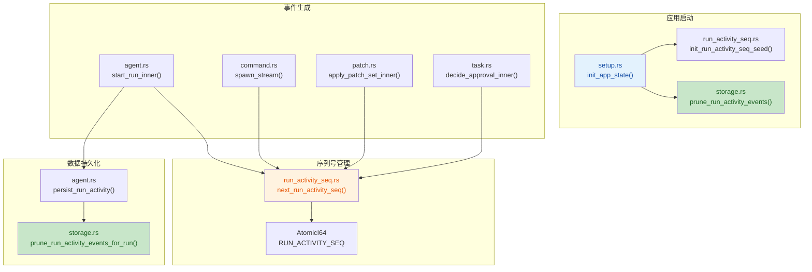
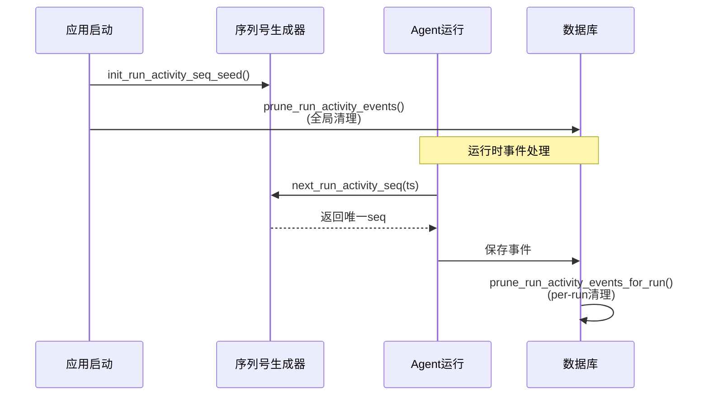

## 1. 高层摘要 (TL;DR)

**影响范围:** 🟡 **中等** - 优化了运行活动事件系统的数据一致性和存储管理

**核心变更:**
- ✨ 引入全局单调递增序列号生成器，解决同一毫秒内事件冲突问题
- 🧹 新增数据库清理机制，防止 `run_activity_events` 表无限增长
- 📝 完善架构文档，说明性能防护措施
- 🎨 大量代码格式化调整，提升可读性

---

## 2. 可视化概览 (代码与逻辑映射)



**业务逻辑流程:**



---

## 3. 详细变更分析

### 📦 组件一: 全局序列号生成器 (新增)

**文件:** `src-tauri/src/run_activity_seq.rs` (新文件)

**变更内容:**
- 新增全局原子计数器 `RUN_ACTIVITY_SEQ`，类型为 `AtomicI64`
- 实现 `next_run_activity_seq(ts: i64) -> i64` 函数：
  - 使用时间戳 `ts * 1000` 作为基础值，保持大致时间顺序
  - 通过 CAS (Compare-And-Swap) 操作确保单调递增
  - 即使同一毫秒内多个事件也能获得唯一序列号
- 实现 `init_run_activity_seq_seed()` 函数，在应用启动时初始化种子值

**设计理由:**
> Run activity events can be emitted from multiple command entrypoints (agent/task/patch/command streams). A single global sequence guarantees uniqueness and monotonic ordering even when multiple events happen within the same millisecond across different call sites/threads.

---

### 🧹 组件二: 数据库清理机制

**文件:** `crates/storage/src/lib.rs`

#### 2.1 全局清理函数

**新增函数:** `prune_run_activity_events()`

| 参数 | 类型 | 说明 |
|------|------|------|
| `retention_ms` | `Option<i64>` | 保留时间（毫秒），默认30天 |
| `max_total_rows` | `Option<i64>` | 最大行数限制，默认200,000 |

**清理逻辑:**
1. **基于时间的清理:** 删除 `updated_at < cutoff` 的记录
2. **基于总量的清理:** 如果超过 `max_total_rows`，删除最旧的记录

#### 2.2 Per-Run 清理函数

**新增函数:** `prune_run_activity_events_for_run()`

| 参数 | 类型 | 说明 |
|------|------|------|
| `run_id` | `&str` | 运行ID |
| `keep_last` | `i64` | 保留最新事件数量，默认5,000 |

**清理逻辑:**
- 删除指定 `run_id` 下的旧事件，仅保留最新的 `keep_last` 条

**文件:** `src-tauri/src/commands/agent.rs`

在 `persist_run_activity()` 函数中添加 per-run 清理调用：
```rust
let _ = state.db.prune_run_activity_events_for_run(run_id, 5_000);
```

---

### 🚀 组件三: 应用启动初始化

**文件:** `src-tauri/src/setup.rs`

**变更内容:**
在 `init_app_state()` 函数中添加清理逻辑：

```rust
// Run-activity housekeeping (best-effort).
// Defaults (can be elevated to config later):
// - retain ~30 days by insertion time
// - cap total rows to avoid unbounded growth in long-running dev sessions
crate::run_activity_seq::init_run_activity_seq_seed();
let _ = db.prune_run_activity_events(Some(30_i64 * 24 * 60 * 60 * 1_000), Some(200_000));
```

**配置说明:**

| 配置项 | 默认值 | 说明 |
|--------|--------|------|
| 保留时间 | 30天 | 基于插入时间 `updated_at` |
| 总行数上限 | 200,000 | 防止长时间运行会话导致数据库膨胀 |
| Per-Run 保留数 | 5,000 | 每个运行保留的最新事件数量 |

---

### 🔄 组件四: 事件序列号统一替换

**涉及文件:**
- `src-tauri/src/commands/agent.rs`
- `src-tauri/src/commands/command.rs`
- `src-tauri/src/commands/patch.rs`
- `src-tauri/src/commands/task.rs`

**变更模式:**

**变更前:**
```rust
let ts = now_ms();
let event = DigitalLifeRunActivityEventV1::Command {
    seq: ts as i64,  // ❌ 可能冲突
    ts,
    // ...
};
```

**变更后:**
```rust
let ts = now_ms();
let seq = crate::run_activity_seq::next_run_activity_seq(ts);
let event = DigitalLifeRunActivityEventV1::Command {
    seq,  // ✅ 全局唯一且单调递增
    ts,
    // ...
};
```

**影响的事件类型:**
- ✅ `RunStart`
- ✅ `ContextAdded`
- ✅ `Approval` (requested/decided)
- ✅ `Command` (start/done)
- ✅ `Patch` (applied/rolled-back)
- ✅ `Error`

---

### 📝 组件五: 架构文档更新

**文件:** `docs/architecture/run-activity-and-run-summary.md`

**新增章节:** Guardrails (Perf / Growth)

```markdown
## Guardrails (Perf / Growth)

- **Event ordering / collision**: `seq` is generated by a **process-global monotonic counter** (not `now_ms()`), so multiple events emitted within the same millisecond will not collide and replay ordering stays stable.
- **In-memory cap**: the WebView keeps a bounded per-run window (UI cache).
- **DB retention**:
  - On startup, the app prunes `run_activity_events` by `updated_at` (insertion time) and enforces a total-row cap.
  - Additionally, a per-run guardrail keeps only the newest ~5,000 events per run (best-effort).
```

---

### 🎨 组件六: 代码格式化调整

**涉及文件:** 所有变更文件

**变更类型:** 主要是长行拆分，提升代码可读性

**示例:**

**变更前:**
```rust
detail.run.summary = Some("Patch preview is ready for review; apply from the changes panel when satisfied.".into());
```

**变更后:**
```rust
detail.run.summary = Some(
    "Patch preview is ready for review; apply from the changes panel when satisfied."
        .into(),
);
```

---

## 4. 影响与风险评估

### ⚠️ 破坏性变更

| 变更项 | 影响范围 | 风险等级 |
|--------|----------|----------|
| 序列号生成逻辑变更 | 所有 `run_activity_events` 表中的 `seq` 字段 | 🟢 低 - 仅影响新事件，旧事件保持不变 |
| 数据库清理逻辑 | `run_activity_events` 表数据 | 🟢 低 - 采用 best-effort 策略，失败不影响主流程 |

### ✅ 测试建议

1. **序列号唯一性测试:**
   - 验证同一毫秒内生成多个事件时，`seq` 值不重复
   - 验证 `seq` 值单调递增

2. **数据库清理测试:**
   - 验证启动时旧事件被正确清理
   - 验证 per-run 清理保留最新的 5,000 条事件
   - 验证清理失败不影响应用启动

3. **事件回放测试:**
   - 验证使用新 `seq` 值的事件能正确排序
   - 验证混合新旧 `seq` 值的事件能正确排序

4. **并发测试:**
   - 验证多线程环境下 `next_run_activity_seq()` 的正确性
   - 验证高并发场景下序列号不冲突

### 🔍 注意事项

- **清理策略是 best-effort:** 清理失败不会中断主流程，但可能导致数据库增长
- **序列号范围:** 使用 `ts * 1000` 作为基础，理论上可支持每毫秒 1000 个事件
- **向后兼容:** 旧事件的 `seq` 值仍为时间戳，新事件使用全局序列号，两者可共存

---

## 5. 总结

本次变更主要解决了两个核心问题：

1. **数据一致性:** 通过全局单调序列号生成器，彻底解决了同一毫秒内事件冲突的问题，确保事件回放的顺序稳定性。

2. **存储管理:** 通过三层清理机制（启动时全局清理、运行时 per-run 清理、总量上限控制），防止 `run_activity_events` 表无限增长，保障长期运行的性能。

这些改进为系统的稳定性和可维护性奠定了坚实基础，特别是在高并发和长时间运行场景下。