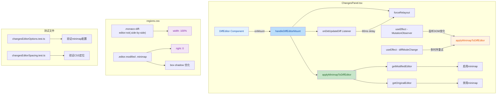
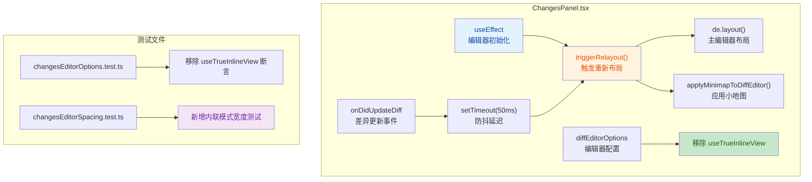

## 1. 高层摘要 (TL;DR)

*   **影响范围:** 中等 - 优化了变更面板中内联diff编辑器的minimap显示和布局
*   **核心变更:**
    *   ✨ 添加了动态minimap配置逻辑，通过 `onMount` 回调和 `MutationObserver` 确保minimap正确显示
    *   🎨 优化了minimap的CSS定位，从 `right: 12px` 改为 `right: 0`，并移除了 `filter` 属性改用 `box-shadow`
    *   🧪 新增测试用例验证minimap配置和diff编辑器宽度约束
    *   📦 将内联编辑器选项提取为 `diffEditorOptions` useMemo，提升性能

---

## 2. 可视化概览 (代码与逻辑图)



---

## 3. 详细变更分析

### 📁 组件层 (ChangesPanel.tsx)

**变更内容:**
在 `ChangesPanel` 组件中实现了动态minimap配置机制，解决了内联diff视图下minimap可能不显示或显示异常的问题。

**关键实现:**

| 函数/变量 | 作用 | 关键逻辑 |
|---------|------|---------|
| `diffEditorRef` | 存储diff编辑器实例引用 | 用于后续动态配置 |
| `minimapTimerRef` | 防抖定时器引用 | 避免频繁重布局 |
| `applyMinimapToDiffEditor()` | 应用minimap配置 | 修改编辑器启用minimap，原始编辑器禁用 |
| `handleDiffEditorMount()` | 编辑器挂载回调 | 初始化配置、监听更新事件、强制重布局 |
| `diffEditorOptions` | 编辑器配置选项 | useMemo缓存，根据 `diffSideBySide` 动态配置 |

**代码片段 - Minimap配置逻辑:**
```typescript
const minimapOpts = {
  enabled: true,
  side: "right" as const,
  size: "fill" as const,
  showSlider: "mouseover" as const,
  renderCharacters: true,
  maxColumn: 80,
  scale: 1.5
};
// 修改后的编辑器启用minimap
diffInst.updateOptions({ minimap: minimapOpts });
// 原始编辑器禁用minimap
originalEditor.updateOptions({ minimap: { enabled: false } });
```

**新增的useEffect钩子:**

1.  **MutationObserver监听** (行355-372): 监听minimap DOM变化，当检测到minimap被隐藏时重新应用配置
2.  **diff模式切换重试** (行374-383): 当切换到内联模式时，在100ms、300ms、600ms、1000ms时多次尝试应用minimap配置

---

### 🎨 样式层 (regions.css)

**变更内容:**
优化了minimap的定位和阴影效果，确保在内联diff视图下minimap正确显示在编辑器右侧边缘。

**CSS规则变更表:**

| 选择器 | 属性 | 旧值 | 新值 | 说明 |
|--------|------|------|------|------|
| `.monaco-diff-editor:not(.side-by-side)` | 新增 | - | `width: 100% !important` | 约束diff编辑器宽度 |
| `.editor.modified .minimap` | `right` | `12px` | `0` | 紧贴右边缘 |
| `.editor.modified .minimap` | `filter` | `drop-shadow(...)` | (移除) | 改用box-shadow |
| `.editor.modified .minimap` | `box-shadow` | 部分阴影 | 完整阴影链 | 合并所有阴影效果 |
| `.editor.modified .overflow-guard` | 新增 | - | `width: 100% !important` | 修复溢出容器宽度 |
| `.editor.modified .monaco-scrollable-element` | 新增 | - | `width: 100% !important` | 修复滚动容器宽度 |
| `.minimap-slider` | `left` | - | `0 !important` | 滑块左对齐 |

**阴影优化对比:**
```css
/* 旧方案 - 使用filter */
filter: drop-shadow(-2px 2px 6px rgba(0, 0, 0, 0.08))
        drop-shadow(-6px 4px 14px rgba(0, 0, 0, 0.04));

/* 新方案 - 纯box-shadow */
box-shadow:
  inset -1px 0 0 rgba(0, 0, 0, 0.18),
  -2px 0 4px rgba(0, 0, 0, 0.06),
  -2px 2px 6px rgba(0, 0, 0, 0.08),
  -6px 4px 14px rgba(0, 0, 0, 0.04) !important;
```

---

### 🧪 测试层

#### changesEditorOptions.test.ts

**新增测试用例:**
```typescript
it("configures minimap on modified editor via onMount handler", () => {
  expect(changesPanelSource).toContain("handleDiffEditorMount");
  expect(changesPanelSource).toContain("getModifiedEditor");
  expect(changesPanelSource).toContain("getOriginalEditor");
  expect(changesPanelSource).toContain("diffEditorOptions");
  expect(changesPanelSource).toContain("useTrueInlineView");
  expect(changesPanelSource).toContain('enabled: true');
  expect(changesPanelSource).toContain('side: "right"');
  expect(changesPanelSource).toContain("renderCharacters: true");
  expect(changesPanelSource).toContain("maxColumn: 80");
  expect(changesPanelSource).toContain("scale: 1.5");
});
```

**现有测试更新:**
- 移除了断言中的尾随逗号，使测试更灵活匹配代码格式

#### changesEditorSpacing.test.ts

**断言更新:**
- `right: 12px` → `right: 0` (minimap定位)
- 移除 `filter:` 属性检查
- 新增 `left: auto` 检查 (scrollbar)
- 新增 `left: 0` 检查 (minimap-slider)

**新增测试用例:**
```typescript
it("constrains diff editor width in changes panel", () => {
  const diffEditorRule = getRuleBody(".adl-tool-editor--changes .monaco-diff-editor:not(.side-by-side)");
  expect(diffEditorRule).toContain("width: 100%");
});
```

---

## 4. 影响与风险评估

### ⚠️ 潜在风险

| 风险项 | 描述 | 缓解措施 |
|--------|------|---------|
| **性能影响** | MutationObserver和多时序setTimeout可能增加CPU使用 | 已使用防抖(80ms)和清理机制 |
| **类型安全** | 使用了 `as` 类型断言绕过类型检查 | 已有try-catch保护 |
| **CSS优先级** | 使用了 `!important` 可能影响其他样式 | 仅针对特定选择器，影响范围可控 |

### ✅ 测试建议

1.  **功能测试:**
    *   在内联diff视图下验证minimap是否正确显示
    *   切换并排/内联模式，验证minimap状态是否正确切换
    *   测试不同窗口尺寸下minimap的响应式行为

2.  **性能测试:**
    *   监控频繁切换diff模式时的CPU和内存使用情况
    *   验证MutationObserver是否正确清理，避免内存泄漏

3.  **视觉回归测试:**
    *   对比新旧版本的minimap显示效果
    *   验证深色/浅色主题下的阴影效果

### 🔍 关键检查点

- [ ] 内联diff视图下minimap显示在右侧边缘
- [ ] 并排视图下minimap被正确禁用
- [ ] 切换模式时minimap状态正确更新
- [ ] 没有控制台错误或警告
- [ ] 滚动条和minimap滑块样式正常

---

## 5. 总结

本次变更通过**动态配置**和**CSS优化**相结合的方式，解决了内联diff编辑器中minimap显示的问题。主要改进包括：

1.  **更可靠的minimap配置**: 通过 `onMount` 回调、`MutationObserver` 和多时序重试机制，确保minimap在各种情况下都能正确显示
2.  **更精确的定位**: 将minimap从 `right: 12px` 调整为 `right: 0`，紧贴编辑器右边缘
3.  **更好的性能**: 移除 `filter` 属性改用 `box-shadow`，减少渲染开销
4.  **更完善的测试**: 新增测试用例覆盖minimap配置和布局约束

这些改进提升了用户体验，使变更面板的diff预览更加直观和可靠。

---

## 1. 高层摘要 (TL;DR)

*   **影响范围:** 🟡 **中等** - 优化差异编辑器的布局机制和配置，简化代码逻辑
*   **核心变更:**
    *   移除实验性 `useTrueInlineView` 配置，简化编辑器选项
    *   重构布局触发逻辑，移除对 `modified` 编辑器的单独布局调用
    *   优化布局时机，减少延迟（从 150ms → 50ms）
    *   新增内联模式样式测试用例

---

## 2. 可视化概览 (代码与逻辑映射)



---

## 3. 详细变更分析

### 📦 组件 1: ChangesPanel.tsx (主文件)

**变更类型:** 代码重构与优化

**主要逻辑变更:**

| 变更项 | 旧实现 | 新实现 | 影响 |
|--------|--------|--------|------|
| **函数重命名** | `forceRelayout()` | `triggerRelayout()` | 更准确的语义命名 |
| **布局调用** | 主编辑器 + `modified` 编辑器双重布局 | 仅主编辑器布局 | 简化逻辑，减少冗余 |
| **延迟策略** | `requestAnimationFrame` + `setTimeout(150ms)` | 仅 `requestAnimationFrame` | 减少不必要的延迟 |
| **防抖延迟** | 80ms | 50ms | 更快的响应速度 |
| **实验性配置** | `experimental: { useTrueInlineView: true }` | 已移除 | 移除不稳定配置 |

**关键代码变更:**

```typescript
// 旧代码 - 双重布局 + 延迟
const forceRelayout = () => {
  // ... 获取尺寸
  de.layout(dim);
  try {
    const modified = de.getModifiedEditor();
    modified?.layout(dim);  // ❌ 移除
  } catch (_e) { /* ignore */ }
  applyMinimapToDiffEditor(diffEditorRef.current, "forceRelayout");
};

requestAnimationFrame(() => {
  forceRelayout();
  setTimeout(forceRelayout, 150);  // ❌ 移除额外延迟
});

// 新代码 - 简化布局
const triggerRelayout = () => {
  // ... 获取尺寸
  de.layout({ width: Math.floor(rect.width), height: Math.floor(rect.height) });
  applyMinimapToDiffEditor(diffEditorRef.current, "relayout");
};

requestAnimationFrame(triggerRelayout);  // ✅ 单次触发
```

**配置变更:**

```typescript
// 移除的配置
experimental: {
  useTrueInlineView: true  // ❌ 实验性功能已移除
}
```

---

### 🧪 组件 2: changesEditorOptions.test.ts (测试文件)

**变更类型:** 测试更新

**变更说明:**
- 移除对 `useTrueInlineView` 配置的断言检查
- 与主文件配置移除保持一致

```typescript
// 移除的断言
expect(changesPanelSource).toContain("useTrueInlineView");  // ❌ 已删除
```

---

### 🧪 组件 3: changesEditorSpacing.test.ts (测试文件)

**变更类型:** 新增测试用例

**变更说明:**
- 新增内联模式下修改编辑器内部元素的宽度样式验证
- 确保 `.overflow-guard` 和 `.monaco-scrollable-element` 元素占满 100% 宽度

```typescript
it("fills inline modified editor internal elements to full width", () => {
  const overflowGuardRule = getRuleBody(
    ".adl-tool-editor--changes .monaco-diff-editor:not(.side-by-side) .editor.modified .overflow-guard"
  );
  const scrollableElementRule = getRuleBody(
    ".adl-tool-editor--changes .monaco-diff-editor:not(.side-by-side) .editor.modified .monaco-scrollable-element"
  );

  expect(overflowGuardRule).toContain("width: 100% !important;");
  expect(scrollableElementRule).toContain("width: 100% !important;");
});
```

---

## 4. 影响与风险评估

### ⚠️ 潜在风险

| 风险项 | 描述 | 缓解措施 |
|--------|------|----------|
| **布局渲染变化** | 移除 `modified` 编辑器的单独布局可能影响某些边缘情况 | 新增内联模式样式测试确保宽度正确 |
| **实验性功能移除** | `useTrueInlineView` 移除可能影响内联视图行为 | 已有测试覆盖内联模式样式 |
| **响应速度变化** | 防抖延迟从 80ms → 50ms 可能增加布局频率 | 需监控性能指标 |

### ✅ 测试建议

1. **功能测试:**
   - 验证并排模式（side-by-side）下的差异显示正常
   - 验证内联模式下的差异显示正常
   - 测试编辑器窗口大小调整时的布局响应

2. **性能测试:**
   - 监控布局触发频率，确保 50ms 延迟不会导致性能问题
   - 验证大型文件差异编辑的渲染性能

3. **视觉回归测试:**
   - 对比移除 `useTrueInlineView` 前后的内联视图渲染效果
   - 确认内联模式下修改编辑器元素宽度正确填充

---

## 5. 总结

本次变更主要是对差异编辑器的**布局机制进行优化和简化**：

✨ **优点:**
- 代码逻辑更清晰，移除了冗余的布局调用
- 响应速度提升（延迟从 150ms + 80ms → 50ms）
- 移除不稳定的实验性配置

🔍 **关注点:**
- 需要验证内联模式在移除 `useTrueInlineView` 后的表现
- 新增的样式测试有助于确保布局正确性

整体而言，这是一次**低风险的代码优化**，通过简化逻辑和移除实验性配置来提升代码的可维护性和稳定性。