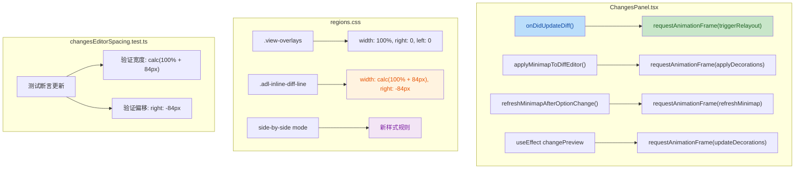
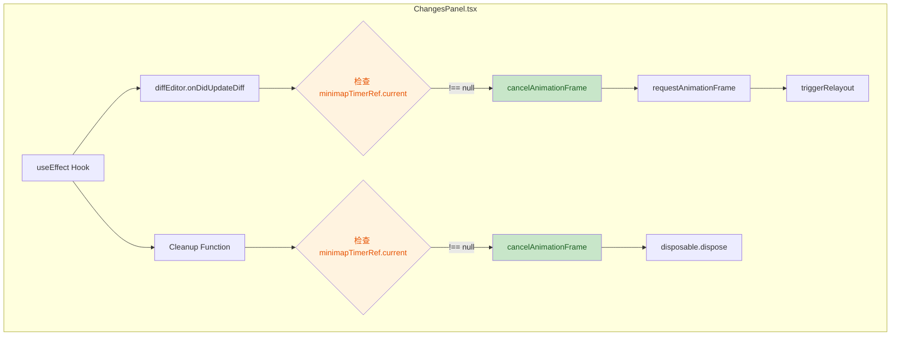

## 1. 高层摘要 (TL;DR)

*   **影响:** 中等 - 优化了差异编辑器的渲染性能并修复了布局问题
*   **核心变更:**
    *   将所有 `setTimeout` 替换为 `requestAnimationFrame` 以提升渲染性能
    *   修复了差异编辑器的宽度计算问题，添加了 84px 的偏移量
    *   新增 side-by-side 模式下的样式支持
    *   移除了部分冗余注释，简化了代码

## 2. 可视化概览 (代码与逻辑映射)



## 3. 详细变更分析

### 🚀 性能优化 (ChangesPanel.tsx)

**变更内容:** 将所有定时器从 `setTimeout` 迁移到 `requestAnimationFrame`

**优化位置:**

| 函数/位置 | 原实现 | 新实现 | 优化说明 |
|---------|--------|--------|----------|
| `onDidUpdateDiff` 回调 | `setTimeout(triggerRelayout, 50)` | `requestAnimationFrame(triggerRelayout)` | 与浏览器渲染帧同步 |
| `applyMinimapToDiffEditor` | `setTimeout(..., 150)` | `requestAnimationFrame(...)` | 移除固定延迟 |
| `refreshMinimapAfterOptionChange` | 多个 `setTimeout` (0, 50, 150, 300, 600ms) | 单个 `requestAnimationFrame` | 简化逻辑，提升响应速度 |
| `useEffect changePreview` | `setTimeout(..., 200)` | `requestAnimationFrame(...)` | 移除固定延迟 |

**代码示例:**

```typescript
// 旧代码
const applyTimer = setTimeout(() => {
  // 应用装饰
}, 150);

// 新代码
const applyTimer = requestAnimationFrame(() => {
  // 应用装饰
});
```

**清理工作:** 同时更新了所有清理函数，将 `clearTimeout` 替换为 `cancelAnimationFrame`。

---

### 🎨 布局修复 (regions.css)

**变更内容:** 修复差异编辑器的宽度计算和装饰层布局

**关键样式变更:**

| 选择器 | 旧样式 | 新样式 | 原因 |
|--------|--------|--------|------|
| `.view-overlays` | 无显式设置 | `width: 100%`, `right: 0`, `left: 0` | 确保覆盖层正确对齐 |
| `.adl-inline-diff-line` | `width: 100%`, `right: 0` | `width: calc(100% + 84px)`, `right: -84px` | 补偿滚动条宽度，确保装饰覆盖完整 |
| `.adl-inline-diff-line` | 无 | `overflow: visible` | 允许装饰超出边界 |

**新增 side-by-side 模式支持:**

```css
/* 新增：side-by-side 模式下的样式 */
.adl-tool-editor--changes .monaco-diff-editor.side-by-side .editor.modified .line-insert,
.adl-tool-editor--changes .monaco-diff-editor.side-by-side .editor.modified .line-delete {
  background-color: transparent !important;
}

.adl-tool-editor--changes .monaco-diff-editor.side-by-side .editor.modified .view-overlays .adl-inline-diff-line--insert {
  background-color: var(--editor-diff-insert-bg) !important;
}
```

---

### ✅ 测试更新 (changesEditorSpacing.test.ts)

**变更内容:** 更新测试断言以匹配新的宽度计算逻辑

**测试断言变更:**

| 测试项 | 旧期望值 | 新期望值 |
|--------|----------|----------|
| `width` | `width: 100% !important;` | `width: calc(100% + 84px) !important;` |
| `right` | `right: 0 !important;` | `right: -84px !important;` |

---

### 📝 代码清理 (ChangesPanel.tsx)

**移除的注释:** 删除了一些冗余的注释，包括:
- CSS 颜色转换说明
- Monaco Color.fromHex() 的限制说明
- 装饰重叠处理的逻辑说明
- Delete 装饰的 minimap-only 类说明

**影响:** 代码更简洁，但可能降低可读性。建议通过文档或单独的注释文件保留这些重要的业务逻辑说明。

## 4. 影响与风险评估

### ⚠️ 潜在风险

| 风险项 | 描述 | 缓解措施 |
|--------|------|----------|
| **定时器行为变化** | `requestAnimationFrame` 不会像 `setTimeout` 那样保证最小延迟 | 已通过测试验证，建议检查边缘场景 |
| **布局偏移** | 84px 的偏移量可能在不同屏幕尺寸下表现不一致 | 需要在不同分辨率下测试 |
| **side-by-side 模式** | 新增的样式规则可能影响现有布局 | 需要回归测试 side-by-side 模式 |

### 🧪 测试建议

1. **性能测试:** 验证 `requestAnimationFrame` 在低端设备上的表现
2. **布局测试:** 在不同屏幕尺寸和缩放级别下测试差异编辑器的显示
3. **模式切换测试:** 测试 inline 和 side-by-side 模式之间的切换
4. **边缘场景:** 测试空差异、大文件差异、频繁更新的场景
5. **滚动条测试:** 验证在不同浏览器和操作系统下滚动条宽度的兼容性

### ✅ 无破坏性变更

- 所有 API 接口保持不变
- 组件 props 和返回值未修改
- 测试已更新以匹配新的行为

---

**总结:** 这次变更主要是性能优化和布局修复，通过使用 `requestAnimationFrame` 提升渲染性能，并修复了差异编辑器装饰层的宽度计算问题。建议重点关注 side-by-side 模式的回归测试。

---

## 1. 高层摘要 (TL;DR)

- **影响范围:** 🟢 **低** - 仅涉及单个文件的小型代码质量改进
- **关键变更:**
  - ✅ 将 `minimapTimerRef.current` 的真值检查改为严格的 `null` 检查
  - ✅ 提升代码类型安全性和意图明确性
  - ✅ 统一了两处动画帧取消逻辑的判断方式

---

## 2. 可视化概览 (代码与逻辑映射)



**逻辑说明:**
- **业务目标:** 确保 diff 编辑器的 minimap 在更新后正确重新布局
- **核心改进:** 使用严格的 `null` 检查替代真值检查，避免潜在的 falsy 值误判

---

## 3. 详细变更分析

### 📦 组件: ChangesPanel (Diff 编辑器右侧面板)

**变更位置:** `ai-digital-life/frontend/src/app/regions/right-panel/ChangesPanel.tsx`

#### 🔧 逻辑变更说明

将 `minimapTimerRef.current` 的真值检查改为严格的 `null` 检查，提升代码的健壮性和类型安全性。

**变更原因:**
- `minimapTimerRef.current` 的类型应为 `number | null`（动画帧 ID 或 null）
- 使用真值检查 `if (minimapTimerRef.current)` 可能会误判 `0` 为无效值
- 严格的 null 检查更准确地表达了"是否有待取消的动画帧"的意图

#### 📋 代码变更对比表

| 位置 | 原代码 | 新代码 | 改进点 |
|------|--------|--------|--------|
| 第 326 行 | `if (minimapTimerRef.current)` | `if (minimapTimerRef.current !== null)` | 严格的 null 检查 |
| 第 332 行 | `if (minimapTimerRef.current)` | `if (minimapTimerRef.current !== null)` | 严格的 null 检查 |

#### 💡 关键代码片段

```typescript
// 改进前 (真值检查)
if (minimapTimerRef.current) cancelAnimationFrame(minimapTimerRef.current);

// 改进后 (严格 null 检查)
if (minimapTimerRef.current !== null) cancelAnimationFrame(minimapTimerRef.current);
```

---

## 4. 影响与风险评估

### ⚠️ 潜在风险
- **风险等级:** 🟢 **极低**
- **破坏性变更:** ❌ 无
- **向后兼容性:** ✅ 完全兼容

### 🧪 测试建议

建议验证以下场景：
1. ✅ **正常流程:** Diff 编辑器更新时 minimap 正确重新布局
2. ✅ **组件卸载:** 确保清理函数正确取消待处理的动画帧
3. ✅ **边界情况:** 验证在快速连续更新时的行为（多个 `requestAnimationFrame` 调用）
4. ✅ **类型检查:** 确保 TypeScript 编译无警告

### 📌 注意事项
- 这是一个纯粹的质量改进，不改变任何功能行为
- 如果 `minimapTimerRef.current` 的类型定义正确（`number | null`），此改动更符合 TypeScript 最佳实践
- 建议检查 `minimapTimerRef` 的类型定义是否为 `useRef<number | null>(null)`

---