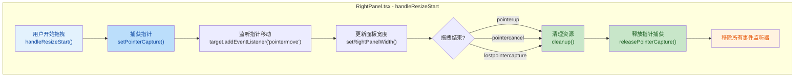
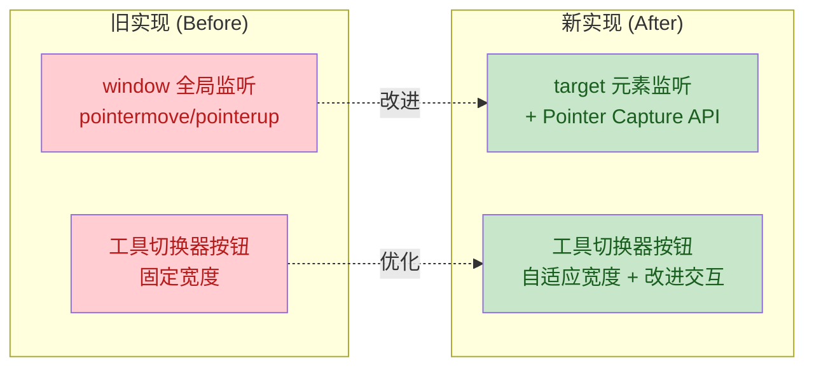
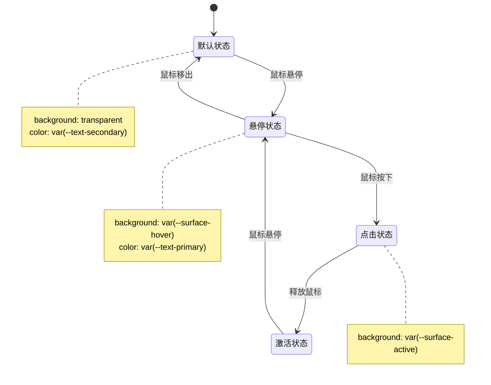

## 1. 高层摘要 (TL;DR)

*   **影响:** 🟡 **中等** - 改进了面板调整大小的指针事件处理机制,并优化了工具切换器的视觉样式
*   **关键变更:**
    *   ✨ 使用 Pointer Capture API 替代全局 window 事件监听,提升拖拽操作的可靠性
    *   🎨 重构工具切换器展开按钮的样式,增强视觉反馈和交互体验
    *   🛠️ 添加 `pointercancel` 和 `lostpointercapture` 事件处理,完善边界情况处理

---

## 2. 可视化概述 (代码与逻辑映射)

### 面板调整大小 - 指针事件处理流程



### 样式变更对比



---

## 3. 详细变更分析

### 📦 组件 1: RightPanel 面板调整大小逻辑

**文件:** `ai-digital-life/frontend/src/app/regions/RightPanel.tsx`

#### 变更说明:
重构了面板调整大小的指针事件处理机制,从全局 `window` 事件监听改为基于 **Pointer Capture API** 的目标元素监听。

#### 核心改进:

| 方面 | 旧实现 | 新实现 | 优势 |
|------|--------|--------|------|
| **事件监听目标** | `window` 对象 | `target` 元素 | 更精确的事件范围,避免全局污染 |
| **指针捕获** | ❌ 未使用 | ✅ `setPointerCapture()` | 确保拖拽期间事件不会丢失 |
| **事件清理** | 仅 `pointerup` | `pointerup` + `pointercancel` + `lostpointercapture` | 处理更多边界情况 |
| **函数命名** | `handleUp` | `cleanup` | 语义更清晰 |

#### 关键代码变更:

```typescript
// 新增: 捕获指针事件
const target = event.currentTarget;
target.setPointerCapture(event.pointerId);

// 改进: 更全面的事件监听
target.addEventListener("pointermove", handleMove);
target.addEventListener("pointerup", cleanup);
target.addEventListener("pointercancel", cleanup);      // 新增
target.addEventListener("lostpointercapture", cleanup);  // 新增

// 改进: 清理时释放指针捕获
target.releasePointerCapture(event.pointerId);
target.removeEventListener("pointermove", handleMove);
target.removeEventListener("pointerup", cleanup);
target.removeEventListener("pointercancel", cleanup);
target.removeEventListener("lostpointercapture", cleanup);
```

---

### 🎨 组件 2: 工具切换器样式优化

**文件:** `ai-digital-life/frontend/src/styles/regions.css`

#### 变更说明:
优化了工具切换器的布局和展开按钮的视觉样式,提供更好的用户体验。

#### CSS 属性变更表:

| 选择器 | 属性 | 旧值 | 新值 | 说明 |
|--------|------|------|------|------|
| `.adl-toolswitcher__tabs` | flex | `1 1 auto` | `0 1 auto` | 防止标签过度拉伸 |
| `.adl-toolswitcher__actions` | border-left | `1px solid var(--border-subtle)` | `none` | 移除左边框,视觉更简洁 |
| `.adl-toolswitcher__actions` | min-width | 未设置 | `0` | 允许收缩 |
| `.adl-toolswitcher__actions` | padding-right | 未设置 | `0` | 移除右侧内边距 |

#### 新增样式规则:

| 选择器 | 用途 |
|--------|------|
| `.adl-toolswitcher__actions .tooltip-trigger` | 强制显示 flex 布局 |
| `.adl-toolswitcher__expand.adl-iconstrip__button` | 展开按钮自适应宽度 |
| `.adl-toolswitcher__expand.adl-iconstrip__button.is-active` | 激活状态透明背景 |
| `.adl-toolswitcher__expand.adl-iconstrip__button:hover` | 悬停状态背景色反馈 |
| `.adl-toolswitcher__expand.adl-iconstrip__button:active` | 点击状态背景色反馈 |

#### 视觉状态流转:



---

## 4. 影响与风险评估

### ⚠️ 潜在风险

| 风险项 | 严重性 | 说明 | 缓解措施 |
|--------|--------|------|----------|
| **Pointer Capture 兼容性** | 🟢 低 | Pointer Events API 在现代浏览器中支持良好 | 已广泛支持,无需额外处理 |
| **样式回归** | 🟡 中 | flex 属性变更可能影响布局 | 需要测试不同屏幕尺寸下的显示效果 |

### ✅ 测试建议

1.  **面板拖拽测试:**
    *   验证在拖拽过程中快速移动鼠标时,调整大小是否流畅
    *   测试拖拽时鼠标移出窗口区域的行为
    *   验证拖拽过程中切换标签页或失去焦点时的清理逻辑

2.  **样式测试:**
    *   验证工具切换器在不同宽度下的自适应表现
    *   测试展开按钮的悬停、点击、激活状态视觉反馈
    *   检查深色/浅色主题下的颜色对比度

3.  **边界情况:**
    *   测试在触摸设备上的指针事件处理
    *   验证拖拽时触发 `pointercancel` 事件的情况

### 🎯 改进收益

*   **更可靠的拖拽体验:** Pointer Capture API 确保拖拽事件不会意外丢失
*   **更好的代码组织:** 事件监听器绑定到目标元素,而非全局 window
*   **增强的视觉反馈:** 工具切换器按钮提供更清晰的状态指示
*   **更灵活的布局:** flex 属性调整使布局更适应不同内容宽度

---

