## 1. 高层摘要（TL;DR）

*   **影响范围**：🟡 **中等** - 修复文件树右键上下文菜单的定位问题，涉及 UI 交互逻辑变更
*   **核心变更**：
    *   使用 `createPortal` 将菜单渲染到 `document.body`，避免被父容器裁切
    *   将菜单定位从 `absolute` 改为 `fixed`，基于视口坐标定位
    *   移除边界钳制逻辑，允许菜单显示在任何区域
    *   精确定位到鼠标点击位置，移除不必要的偏移和坐标换算

---

## 2. 可视化概览（代码与逻辑映射）

```mermaid
graph TD
    subgraph "用户交互"
        A[用户右键点击文件节点] -->|触发事件| B["handleShowContextMenu()"]
    end

    subgraph "fileTree.tsx (旧实现)"
        B1["获取 rootRect<br/>计算 offsetX/Y<br/>+10 偏移"] --> C1["setContextMenuState()"]
        C1 --> D1["useLayoutEffect<br/>边界钳制"]
        D1 --> E1["渲染菜单<br/>position: absolute<br/>在容器内"]
    end

    subgraph "fileTree.tsx (新实现)"
        B2["直接使用<br/>event.clientX/Y"] --> C2["setContextMenuState()"]
        C2 --> D2["createPortal<br/>渲染到 document.body"]
        D2 --> E2["渲染菜单<br/>position: fixed<br/>基于视口"]
    end

    subgraph "regions.css"
        F1[".adl-sidebar-menu<br/>position: absolute"] -.->|已删除| G
        F2[".adl-sidebar-menu<br/>position: fixed"] --> G[菜单始终在最上层]
    end

    style B2 fill:#bbdefb,color:#0d47a1
    style D2 fill:#c8e6c9,color:#1a5e20
    style E2 fill:#c8e6c9,color:#1a5e20
    style F2 fill:#fff3e0,color:#e65100
```



### 业务逻辑流程对比

| 阶段 | 旧实现 | 新实现 |
|------|--------|--------|
| **坐标计算** | `event.clientX - rootRect.left + scrollLeft + 10` | 直接使用 `event.clientX/Y` |
| **定位方式** | `absolute` 相对于 `.adl-filetree-shell` | `fixed` 相对于视口 |
| **边界限制** | `useLayoutEffect` 钳制在容器可视区域内 | 无限制，可溢出容器 |
| **渲染位置** | 在组件 DOM 树内 | 通过 Portal 渲染到 `document.body` |

---

## 3. 详细变更分析

### 📁 组件：FileTree 组件（`fileTree.tsx`）

#### **变更说明**：重构上下文菜单的定位和渲染逻辑

**关键修改点**：

1.  **导入变更**
    ```typescript
    // 移除 useLayoutEffect，新增 createPortal
    - import React, { useEffect, useLayoutEffect, useRef, useState } from "react";
    + import React, { useEffect, useRef, useState } from "react";
    + import { createPortal } from "react-dom";
    ```

2.  **删除边界钳制逻辑**（第 173-194 行）
    *   完全移除 `useLayoutEffect` 块，该逻辑用于将菜单坐标钳制在容器可视区域内
    *   原因：菜单不再受容器约束，无需边界限制

3.  **简化坐标计算**（`handleShowContextMenu` 函数）
    ```typescript
    // 旧逻辑：复杂的坐标换算 + 偏移
    - const rootRect = rootRef.current?.getBoundingClientRect();
    - const offsetX = rootRect ? event.clientX - rootRect.left + rootRef.current!.scrollLeft : event.clientX;
    - const offsetY = rootRect ? event.clientY - rootRect.top + rootRef.current!.scrollTop : event.clientY;
    - setContextMenuState({
    -     x: offsetX + 10,
    -     y: offsetY + 10,
    -     ...
    -   });

    // 新逻辑：直接使用视口坐标
    + setContextMenuState({
    +     x: event.clientX,
    +     y: event.clientY,
    +     ...
    +   });
    ```

4.  **使用 Portal 渲染**
    ```typescript
    // 旧渲染：在组件内部渲染
    - {contextMenuState ? (
    -     <div ref={contextMenuRef} className="adl-sidebar-menu" ...>
    -       ...
    -     </div>
    -   ) : null}

    // 新渲染：通过 Portal 渲染到 document.body
    + {contextMenuState
    +   ? createPortal(
    +       <div ref={contextMenuRef} className="adl-sidebar-menu" ...>
    +         ...
    +       </div>,
    +       document.body
    +     )
    +   : null}
    ```

---

### 🎨 样式：侧边栏菜单样式（`regions.css`）

#### **变更说明**：修改菜单定位方式以配合 Portal 渲染

| 属性 | 旧值 | 新值 | 说明 |
|------|------|------|------|
| `position` | `absolute` | `fixed` | 改为基于视口定位，配合 Portal 使用 |

```css
.adl-sidebar-menu {
- position: absolute;
+ position: fixed;
  min-width: 132px;
  padding: 4px;
  border: 1px solid var(--border-subtle);
  /* ... 其他样式保持不变 */
}
```

**技术细节**：
*   `position: fixed` 使菜单基于视口（viewport）定位，而非最近的定位祖先元素
*   配合 `z-index: calc(var(--z-popover) + 10)` 确保菜单始终显示在最上层
*   Portal 渲染到 `document.body` 避免被任何父级的 `overflow: hidden` 裁切

---

### 📄 文档：修复说明文档（新增）

**文件**：`.trae/documents/fix-context-menu-position.md`

*   详细记录了问题的根因分析
*   提供了完整的修改步骤和代码对比
*   包含影响评估和回归风险分析

---

## 4. 影响与风险评估

### ⚠️ 破坏性变更
*   **无** - 仅修改内部实现，不改变公共 API 或用户交互行为

### ✅ 功能影响
| 方面 | 影响 | 说明 |
|------|------|------|
| 菜单定位 | ✅ 改进 | 精确定位到鼠标点击位置，无偏移 |
| 菜单显示 | ✅ 改进 | 可显示在任何区域，不受容器限制 |
| 菜单内容 | ➖ 无变化 | 菜单项、图标、交互逻辑保持不变 |
| 关闭行为 | ➖ 无变化 | Escape 键、点击外部关闭逻辑不变 |

### 🧪 测试建议

**必测场景**：
1.  **基本定位测试**
    *   在文件树不同位置（顶部、中部、底部）右键点击
    *   验证菜单左上角精确出现在鼠标点击位置

2.  **边界场景测试**
    *   在视口边缘（屏幕右下角、左上角）右键点击
    *   验证菜单可以部分溢出视口显示（不被裁切）

3.  **滚动场景测试**
    *   滚动文件树后右键点击
    *   验证菜单位置不受滚动影响

4.  **交互功能测试**
    *   点击菜单项验证功能正常
    *   按 Escape 键验证菜单关闭
    *   点击菜单外部验证菜单关闭

5.  **样式层级测试**
    *   验证菜单始终显示在其他元素之上
    *   验证菜单不被父容器的 `overflow` 裁切

### 📊 回归风险：**低**

*   菜单的显示/隐藏逻辑未变
*   事件监听器仍绑定在 `window` 上，关闭行为不受影响
*   Portal 是 React 标准模式，稳定性高
*   `position: fixed` 是成熟的 CSS 特性

---

## 5. 技术要点总结

### 🔑 核心技术模式

**Portal 模式**：
```typescript
createPortal(
  <Component />,
  document.body  // 渲染目标容器
)
```
*   将组件渲染到 DOM 树的任意位置
*   保持 React 事件系统和上下文的完整性
*   常用于模态框、下拉菜单、提示框等需要突破容器限制的场景

**定位策略对比**：

| 定位方式 | 参考系 | 适用场景 | Portal 需求 |
|----------|--------|----------|-------------|
| `absolute` | 最近定位祖先 | 组件内部定位 | ❌ 不需要 |
| `fixed` | 视口 | 全局悬浮元素 | ✅ 推荐（避免裁切） |
| `static` | 正常文档流 | 默认布局 | ❌ 不适用 |

### 💡 设计决策

1.  **为什么移除 `+10` 偏移？**
    *   用户期望菜单精确出现在鼠标位置
    *   偏移量会导致视觉不一致

2.  **为什么删除边界钳制？**
    *   用户期望菜单可以显示在任何位置
    *   现代浏览器支持部分元素溢出视口
    *   简化代码逻辑，减少不必要的计算

3.  **为什么选择 `fixed` 而非 `absolute` + Portal？**
    *   `fixed` 基于视口定位，坐标直接使用 `event.clientX/Y`
    *   `absolute` 需要考虑滚动偏移，计算复杂
    *   配合 Portal 使用，`fixed` 是最佳实践