## 📋 高层摘要 (TL;DR)

*   **影响范围:** **高** — 彻底删除了代码编辑器的 Minimap（缩略图）滑动条功能，涉及核心组件、样式、测试和文档的全面清理
*   **关键变更:**
    *   删除 `cmMinimap.ts` 及其测试文件（共 ~1800 行代码）
    *   从 `ChangesPanel.tsx`、`FilesPanel.tsx`、`DiffViewer.tsx` 中移除所有 minimap 相关逻辑
    *   提取 `estimateWrapColumn` 函数到独立文件 `cmWrapColumn.ts`
    *   清理 `regions.css` 中所有 minimap 相关样式规则
    *   更新文档和测试以反映功能移除

---

## 🗺️ 可视化概览 (代码与逻辑映射)

```mermaid
graph TD
    subgraph "删除前 - Minimap 依赖关系"
        A["cmMinimap.ts<br/>Minimap核心实现"]
        B["estimateWrapColumn()"]
        C["getMinimapExtension()"]
        D["computePreviewDiffMinimapModel()"]
        
        E["ChangesPanel.tsx"]
        F["FilesPanel.tsx"]
        G["DiffViewer.tsx"]
        
        H["changePreviewDiffRanges.ts"]
        
        A -->|提供| B
        A -->|提供| C
        H -->|提供| D
        
        E -->|使用| B
        E -->|使用| C
        E -->|使用| D
        
        F -->|使用| B
        F -->|使用| C
        F -->|使用| D
        
        G -->|使用| C
        G -->|使用| D
    end
    
    subgraph "删除后 - 简化架构"
        A2["cmWrapColumn.ts<br/>仅包含 estimateWrapColumn()"]
        
        E2["ChangesPanel.tsx<br/>移除 minimap 状态和扩展"]
        F2["FilesPanel.tsx<br/>移除 minimap 状态和扩展"]
        G2["DiffViewer.tsx<br/>移除 minimap props"]
        
        H2["changePreviewDiffRanges.ts<br/>保留 computePreviewDiffVisualRanges()"]
        
        A2 -->|提供| B
        E2 -->|使用| B
        F2 -->|使用| B
        H2 -->|保留| D2["computePreviewDiffVisualRanges()"]
        E2 -->|使用| D2
    end
    
    style A fill:#ffcdd2,color:#b71c1c
    style A2 fill:#c8e6c9,color:#1a5e20
    style E fill:#fff3e0,color:#e65100
    style E2 fill:#c8e6c9,color:#1a5e20
    style F fill:#fff3e0,color:#e65100
    style F2 fill:#c8e6c9,color:#1a5e20
    style G fill:#fff3e0,color:#e65100
    style G2 fill:#c8e6c9,color:#1a5e20
```

---

## 📝 详细变更分析

### 🗑️ 组件 1: 核心实现文件删除

#### **删除文件:**
| 文件路径 | 行数 | 说明 |
|---------|------|------|
| `cmMinimap.ts` | 1,394 | Minimap 核心实现（插件、渲染、滚动、菜单等） |
| `cmMinimap.test.ts` | 425 | Minimap 单元测试 |
| `minimap-diff-debug.spec.ts` | 133 | E2E 调试测试 |

#### **新增文件:**
| 文件路径 | 说明 |
|---------|------|
| `cmWrapColumn.ts` | 从 `cmMinimap.ts` 提取的 `estimateWrapColumn()` 函数 |

---

### 🔄 组件 2: `changePreviewDiffRanges.ts` - 清理 Minimap 专用代码

**删除内容:**
- 类型: `PreviewDiffMinimapModel`, `PreviewDiffMinimapOptions`
- 函数: `computePreviewDiffMinimapModel()`, `computeFallbackMinimapModel()`, `appendVisualLineRanges()`, `appendVisualLineColumns()`, `isLineHidden()`

**保留内容:**
- ✅ `PreviewDiffVisualRange` 类型（被 sticky context 使用）
- ✅ `computePreviewDiffVisualRanges()` 函数（被 ChangesPanel 使用）
- ✅ `PreviewDiffCollapsedRange` 类型
- ✅ `computePreviewDiffRanges()` 函数

---

### 🧩 组件 3: 消费组件清理

#### **3.1 DiffViewer.tsx**

| 变更类型 | 具体内容 |
|---------|---------|
| **删除 Props** | `minimapModel`, `minimapScopeId`, `onMinimapDragStart` |
| **删除导入** | `getMinimapExtension`, `updateMinimapDiffModel`, `CmMinimapDiffModel`, `computePreviewDiffMinimapModel` |
| **删除逻辑** | `mergedMinimapModel` 计算、`updateMinimapDiffModel` effect、minimap 扩展注入 |
| **新增功能** | `syncHorizontalScroll()` 函数（用于并排模式水平滚动同步） |
| **优化** | 调整 resizer 宽度从 4px → 6px |

#### **3.2 FilesPanel.tsx**

| 变更类型 | 具体内容 |
|---------|---------|
| **更新导入** | `estimateWrapColumn` 从 `./cmMinimap` → `./cmWrapColumn` |
| **删除导入** | `getMinimapExtension`, `updateMinimapDiffHunks`, `computePreviewDiffMinimapModel` |
| **删除状态** | `fileDiffMinimapExpandedUnchanged`, `fileEditorMinimapScopeId`, `fileDiffMinimapScopeId` |
| **删除逻辑** | `fileDiffMinimapModel` 计算、`handleFileDiffMinimapDragStart` 回调 |
| **修改行为** | `collapseUnchanged` 固定为 `false`（原由 minimap 拖动控制） |

#### **3.3 ChangesPanel.tsx**

| 变更类型 | 具体内容 |
|---------|---------|
| **更新导入** | `estimateWrapColumn` 从 `./cmMinimap` → `./cmWrapColumn` |
| **删除导入** | `getMinimapExtension`, `computePreviewDiffMinimapModel` |
| **删除状态** | `changePreviewEditorMinimapScopeId`, `changePreviewDiffMinimapScopeId` |
| **删除逻辑** | `changePreviewMinimapModel` 计算、`previewEditorExtensions` |
| **保留** | ✅ `computePreviewDiffVisualRanges`（用于 sticky context） |
| **优化** | `expandedOutlineIds` 更新逻辑（避免不必要的状态更新） |

---

### 🎨 组件 4: CSS 样式清理 (`regions.css`)

| 删除内容 | 说明 |
|---------|------|
| `--adl-editor-minimap-width` | CSS 自定义属性 |
| `.adl-cm-minimap*` 选择器 | 所有 minimap 容器、画布、滑块样式 |
| `.adl-cm-minimap-context-menu*` | 上下文菜单样式 |
| `.adl-cm-scroller--minimap-scrollbar*` | 滚动条隐藏规则 |

| 修改内容 | 旧值 | 新值 |
|---------|------|------|
| `.adl-sticky-context` 的 `right` | `var(--adl-editor-minimap-width, 84px)` | `0px` |
| `.adl-cm-scroller` 的 `padding-right` | `var(--adl-editor-minimap-width, 84px)` | 删除 |
| `.adl-cm-no-word-wrap` 布局 | wrapper padding-right | `.cm-line` padding-right: 24px |

---

### ⚙️ 组件 5: 辅助功能优化

#### **5.1 cmScrollLeftSync.ts - 水平滚动同步增强**

| 变更类型 | 说明 |
|---------|------|
| **事件统一** | 从 `mousedown/mousemove/mouseup` 迁移到 `pointerdown/pointermove/pointerup` |
| **边缘滚动** | 新增边缘自动滚动功能（拖动到编辑器边缘时自动滚动） |
| **并排同步** | 拖动水平滚动条时同步并排视图的另一个编辑器 |

#### **5.2 FoldTooltipOverlay.tsx**

| 变更类型 | 说明 |
|---------|------|
| **删除事件** | 移除 `view.scrollDOM` 的 `scroll` 事件监听 |

---

### 📚 组件 6: 文档与测试更新

#### **6.1 文档更新**

| 文件 | 变更内容 |
|------|---------|
| `UIOperationManual/rightpanel/tools/changes.md` | 删除 Minimap 模式切换、渲染字符、缩放、宽度等菜单项说明 |
| `.trae/rules/codebase-map.md` | 更新 `app/regions/right-panel/` 组件列表（移除 `cmMinimap`，添加 `cmWrapColumn`） |

#### **6.2 测试文件更新**

| 文件 | 删除内容 |
|------|---------|
| `changePreviewDiffRanges.test.ts` | 删除 `computePreviewDiffMinimapModel` 相关测试（5 个测试用例） |
| `changesEditorOptions.test.ts` | 删除 minimap 扩展、scope、model 相关断言（4 个测试用例） |
| `filesEditorOptions.test.ts` | 删除 minimap 相关断言（3 个测试用例） |
| `cmPreviewStyling.test.ts` | 删除 minimap 样式相关测试（3 个测试用例） |

---

## ⚠️ 影响与风险评估

### 🔴 破坏性变更

| 影响范围 | 说明 |
|---------|------|
| **UI 变化** | 右侧面板不再显示 Minimap 缩略图和滑动条 |
| **交互变化** | 右键菜单不再包含 Minimap 模式切换选项 |
| **布局变化** | 编辑器右侧不再预留 Minimap 宽度（84px），内容区域变宽 |
| **滚动行为** | 恢复使用原生浏览器滚动条（而非自定义 Minimap 滑动条） |

### ✅ 保留功能

| 功能 | 状态 | 说明 |
|------|------|------|
| Sticky Context | ✅ 保留 | 仍使用 `computePreviewDiffVisualRanges()` |
| 折叠未变更代码 | ✅ 保留 | `collapseUnchanged` 功能独立于 minimap |
| 水平滚动同步 | ✅ 增强 | 新增边缘自动滚动和并排视图同步 |
| 自动换行计算 | ✅ 保留 | 提取到 `cmWrapColumn.ts` |

### 🧪 测试建议

| 测试场景 | 验证内容 |
|---------|---------|
| **基本编辑** | 打开文件面板和变更面板，确认编辑器正常显示和编辑 |
| **Diff 查看** | 确认并排模式和内联模式的 diff 正常显示 |
| **折叠功能** | 验证"折叠未变更代码"功能仍正常工作 |
| **水平滚动** | 测试长行内容的水平滚动（包括边缘自动滚动） |
| **Sticky Context** | 验证 diff 高亮上下文仍正确显示 |
| **自动换行** | 验证自动换行开关和计算逻辑正常 |
| **并排同步** | 测试并排视图的水平滚动同步 |

---

## 📊 变更统计

| 指标 | 数量 |
|------|------|
| 删除文件 | 3 |
| 新增文件 | 1 |
| 修改文件 | 13 |
| 删除代码行 | ~2,500+ |
| 新增代码行 | ~200 |
| 删除测试用例 | 15+ |
| 修改测试断言 | 10+ |

---

## 🎯 总结

本次变更是一次**功能移除型重构**，彻底删除了 Minimap 滑动条功能及其所有相关代码。重构过程遵循了良好的工程实践：

1. ✅ **先提取依赖** — 将 `estimateWrapColumn` 提取到独立文件
2. ✅ **逐步清理** — 按组件逐步移除 minimap 引用
3. ✅ **保留关键功能** — 确保 sticky context 和折叠功能不受影响
4. ✅ **全面测试** - 更新所有相关测试，确保零类型错误
5. ✅ **文档同步** - 更新操作手册和代码映射

重构后代码更简洁，维护成本降低，同时保留了所有核心编辑和 diff 查看功能。