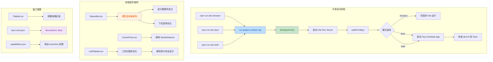

## 1. 高层摘要 (TL;DR)

*   **影响范围：** 中高 - 涉及开发流程、UI组件重构、窗口管理和主题系统
*   **核心变更：**
    *   ✨ 新增动态端口选择机制，支持灵活的开发模式切换
    *   🎨 重构状态栏模型选择器，移除中间面板的模型选择组件
    *   🖼️ 优化窗口拖拽区域和装饰设置，启用无边框窗口
    *   📝 完善主题设计规范，强调低饱和度视觉风格

---

## 2. 可视化概览 (代码与逻辑映射)



---

## 3. 详细变更分析

### 🚀 开发流程优化

#### 新增启动脚本 (`run-project-surface.mjs`)
**变更说明：**
- 新增统一的启动包装脚本，支持三种运行模式：`browser`（仅浏览器预览）、`tauri`（仅桌面应用）、`both`（两者同时运行）
- 实现动态端口选择机制，从 5173 开始自动查找可用端口（最多尝试 20 次）
- 先启动 Vite 开发服务器，等待 HTTP 就绪后再启动 Tauri
- 支持通过环境变量 `ADL_PORT` 或 `PORT` 指定端口

**关键方法：**
| 方法名 | 功能 |
|--------|------|
| `findOpenPort()` | 查找可用端口 |
| `isPortOpen()` | 检测端口是否被占用 |
| `waitForHttp()` | 等待 HTTP 服务就绪 |
| `spawnChecked()` | 安全启动子进程 |

#### NPM Scripts 更新 (`package.json`)

| 命令 | 旧值 | 新值 | 说明 |
|------|------|------|------|
| `dev` | `cargo tauri dev` | `node ./scripts/run-project-surface.mjs tauri` | 使用新脚本启动 Tauri |
| `dev:browser` | - | `node ./scripts/run-project-surface.mjs browser` | 新增：仅浏览器模式 |
| `dev:tauri` | - | `node ./scripts/run-project-surface.mjs tauri` | 新增：仅桌面应用模式 |
| `dev:both` | - | `node ./scripts/run-project-surface.mjs both` | 新增：双模式 |

#### Vite 配置更新 (`vite.config.ts`)
```typescript
// 旧配置
server: {
  port: 5173,
  strictPort: true,
}

// 新配置
server: {
  host: "127.0.0.1",
  port: Number.parseInt(process.env.ADL_PORT ?? process.env.PORT ?? "5173", 10),
  strictPort: false,
}
```

#### Tauri 配置调整 (`tauri.conf.json`)

| 配置项 | 旧值 | 新值 | 说明 |
|--------|------|------|------|
| `devUrl` | `http://localhost:5173` | `http://127.0.0.1:5173` | 使用 IP 地址 |
| `beforeDevCommand` | `npm --prefix ../frontend run dev` | - | 移除（由新脚本管理） |
| `decorations` | - | `false` | 启用无边框窗口 |

#### 窗口权限扩展 (`capabilities/default.json`)

```json
// 新增权限
"core:window:allow-maximize",
"core:window:allow-toggle-maximize"
```

---

### 🎨 UI 组件重构

#### 状态栏模型选择器重构 (`StatusBar.tsx`)

**变更说明：**
- 将模型选择器从中间面板 (`CenterPane`) 移至状态栏
- 添加模型健康状态可视化指示器（绿点/黄点）
- 优化下拉菜单布局，使用点状指示器替代文本标签
- 实现点击外部自动关闭菜单的功能

**新增辅助函数：**
```typescript
function modelHealthLabel(t: CopyDict, healthy?: boolean): string
function modelHealthTone(healthy?: boolean): "healthy" | "degraded"
```

**UI 变更对比：**

| 元素 | 旧实现 | 新实现 |
|------|--------|--------|
| 模型名称 | 文本显示 | Tooltip + 截断文本 |
| 健康状态 | 文本标签 | 彩色圆点指示器 |
| 菜单项 | 文本 + Chip | 文本 + 圆点 |
| 当前选中 | 无视觉反馈 | 高亮背景 + 边框 |

#### 左侧边栏优化 (`LeftSidebar.tsx`)

**变更说明：**
- 新增 `WorkspaceDirectoryIcon` 组件，统一展开/折叠状态的图标显示
- 移除当前工作区的索引状态显示（`indexingStatus`）
- 优化工作区图标的交互反馈（悬停、聚焦、激活态）

**移除的代码：**
```tsx
// 已移除：索引状态显示
{item.isCurrent && indexingStatus && (
  <span className={`adl-chip adl-chip--xs adl-chip--${
    indexingStatus.state === "indexed" ? "success" : 
    indexingStatus.state === "indexing" ? "info" : 
    indexingStatus.state === "error" ? "danger" : "muted"
  }`}>
    {indexingStatus.state === "indexed" ? t.indexingCompleted : 
     indexingStatus.state === "indexing" ? t.indexingInProgress : 
     indexingStatus.state === "error" ? t.indexingError : 
     t.indexingIdle}
  </span>
)}
```

#### 标题栏调整 (`TitleBar.tsx`)

**变更说明：**
- 更新 Logo 资源：`/logo.png` → `/logo-chatgpt.png`
- 为品牌区域添加 `data-tauri-drag-region` 属性，优化拖拽体验
- 调整右侧拖拽区域的属性

#### 中间面板简化 (`CenterPane.tsx`)

**变更说明：**
- 移除 `ModelSelector` 组件的导入和使用
- 模型选择功能完全迁移至状态栏

---

### 🎨 样式系统更新 (`regions.css`)

#### 新增样式类

| 类名 | 用途 |
|------|------|
| `.adl-workspace-row__kind--collapsed` | 折叠状态的工作区图标 |
| `.adl-workspace-row__kind--processing` | 处理中状态（呼吸动画） |
| `.adl-workspace-row__kind--pending-approval` | 待审批状态（呼吸动画） |
| `.adl-workspace-row__kind--abnormal` | 异常状态（呼吸动画） |
| `.adl-workspace-row__kind--completed` | 完成状态（淡出动画） |
| `.adl-workspace-row__kind--read` | 已读状态（低透明度） |
| `.adl-statusbar__model-trigger` | 模型选择器触发按钮 |
| `.adl-statusbar__model-name` | 模型名称文本 |
| `.adl-statusbar__model-dot` | 健康状态指示点 |
| `.adl-statusbar__model-option` | 模型选项菜单项 |
| `.adl-statusbar__model-option.is-active` | 当前选中项样式 |

#### 关键样式调整

```css
/* 标题栏拖拽区域优化 */
.adl-titlebar {
  padding: 0 0 0 var(--space-3);  /* 移除右侧内边距 */
}

.adl-titlebar [data-tauri-drag-region] {
  -webkit-app-region: drag;
}

/* 模型选择器菜单定位 */
.adl-statusbar__model-menu {
  width: 220px;
  min-width: 220px;
  max-width: 220px;
}

.adl-statusbar--inline .adl-statusbar__model-menu {
  bottom: calc(100% + var(--space-1));
  right: -34px;  /* 调整对齐 */
  left: auto;
}
```

---

### 🔧 技术债务修复

#### Tauri 环境检测优化 (`tauri-bridge.ts`)

**变更说明：**
- 改进 `isTauriShell()` 函数的检测逻辑
- 直接检查 `window.__TAURI__` 或 `window.__TAURI_INTERNALS__` 对象
- 添加 `window` 对象存在性检查，避免 SSR 环境报错

```typescript
// 旧实现
return typeof import.meta !== "undefined" && Boolean(import.meta.env?.TAURI_ENV_PLATFORM);

// 新实现
const candidate = window as typeof window & {
  __TAURI__?: unknown;
  __TAURI_INTERNALS__?: unknown;
};
return Boolean(candidate.__TAURI_INTERNALS__ ?? candidate.__TAURI__);
```

---

### 📚 文档更新

#### 主题设计规范 (`theming.md`)

**新增约束：**
- 默认视觉基调采用淡色、低饱和度 token
- 常规文本、背景、边框、悬停态优先使用 `text-secondary` / `text-muted`、`surface-*`、`*-soft`、`*-subtle` 变量
- 饱和度高的语义色（`--accent`、`--success`、`--warning`、`--danger`）仅用于焦点环、破坏性确认、硬错误等需要强对比的场景

#### 工程约束文档 (`project-engineering-constraints.md`)

**新增约束：**
- 明确要求默认视觉基调采用淡色、低饱和度 token
- 强调大多数状态提示应使用柔和的语义变体

#### Agent 技能定义 (`SKILL.md`)

**新增技能：** `run-project-surfaces`
- 用于启动 AI Digital Life 的不同运行时表面
- 支持动态端口选择
- 提供三种启动模式的触发映射

---

## 4. 影响与风险评估

### ⚠️ 破坏性变更

| 变更项 | 影响范围 | 缓解措施 |
|--------|----------|----------|
| 移除 `beforeDevCommand` | 开发流程 | 使用新的 `run-project-surface.mjs` 脚本 |
| 端口配置变更 | 开发环境 | 支持环境变量覆盖，默认行为保持兼容 |
| 无边框窗口 | 用户体验 | 标题栏自定义拖拽区域已配置 |
| 移除索引状态显示 | UI 信息 | 该信息可能已迁移至其他位置 |

### 🧪 测试建议

**功能测试：**
1. ✅ 验证 `npm run dev:browser` 能正常启动浏览器预览
2. ✅ 验证 `npm run dev:tauri` 能正常启动桌面应用
3. ✅ 验证 `npm run dev:both` 能同时启动两者
4. ✅ 测试端口冲突时自动切换到可用端口
5. ✅ 验证状态栏模型选择器的交互（展开、选择、健康状态显示）
6. ✅ 测试点击菜单外部区域自动关闭菜单
7. ✅ 验证窗口拖拽区域是否正常工作
8. ✅ 测试窗口最大化/还原功能

**回归测试：**
- 验证模型切换功能是否正常
- 确认工作区列表的交互无异常
- 检查主题切换在不同区域的渲染效果

**兼容性测试：**
- 验证在 Windows/macOS/Linux 上的启动脚本行为
- 测试不同端口占用情况下的启动流程

---

## 5. 关键代码片段

### 动态端口查找逻辑
```javascript
async function findOpenPort(hostname) {
  const preferredBase = 5173;
  for (let offset = 0; offset < 20; offset += 1) {
    const candidate = preferredBase + offset;
    if (await isPortOpen(hostname, candidate)) {
      continue;
    }
    return candidate;
  }
  // 回退到系统分配的临时端口
  return await new Promise((resolve, reject) => {
    const server = net.createServer();
    server.unref();
    server.on("error", reject);
    server.listen(0, hostname, () => {
      const address = server.address();
      const { port } = address;
      server.close((closeError) => {
        if (closeError) {
          reject(closeError);
          return;
        }
        resolve(port);
      });
    });
  });
}
```

### 健康状态指示器样式
```css
.adl-statusbar__model-dot {
  width: 6px;
  height: 6px;
  border-radius: 999px;
  background: currentColor;
  box-shadow: 0 0 0 1px color-mix(in srgb, currentColor 28%, transparent);
  flex-shrink: 0;
}

.adl-statusbar__model-dot--healthy {
  color: color-mix(in srgb, var(--success) 70%, var(--text-muted));
}

.adl-statusbar__model-dot--degraded {
  color: color-mix(in srgb, var(--warning) 70%, var(--text-muted));
}
```

---

**总结：** 本次变更重构了开发启动流程，引入了灵活的动态端口选择机制，同时优化了 UI 组件的布局和交互体验。整体提升了开发效率和用户体验，但需要注意新的启动脚本的使用方式和窗口行为的变化。

---

验证问题的存在性并进行修复：

标题: WorkspaceDirectoryIcon组件类型定义
详情: WorkspaceDirectoryIcon组件的props类型应该使用TypeScript接口定义以提高类型安全：
interface WorkspaceDirectoryIconProps {
  expanded: boolean;
  status: SessionVisualStatus;
  title: string;
}
`ai-digital-life/frontend/src/app/regions/LeftSidebar.tsx#L273-299`

验证问题的存在性并进行修复：

标题: 点击外部关闭菜单事件处理优化
详情: 当前点击外部关闭菜单的实现可能重复添加事件监听器。建议使用useCallback包装事件处理函数：
const handleClickOutside = useCallback((event: MouseEvent) => {
  if (!modelRef.current?.contains(event.target as Node)) {
    setMenuOpen(false);
  }
}, []);
`ai-digital-life/frontend/src/app/regions/StatusBar.tsx#L109-118`