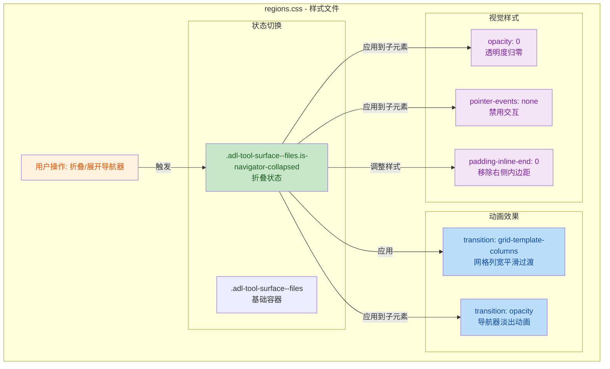
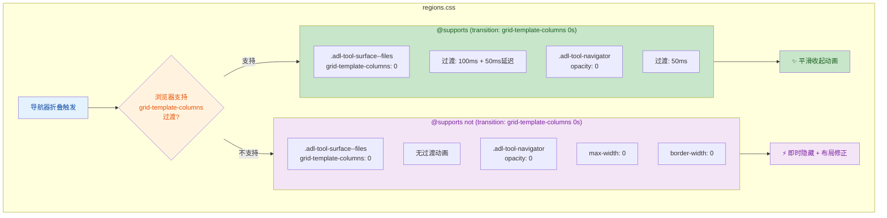

## 1. 高层摘要 (TL;DR)

*   **影响范围:** 🟡 **中等** - 优化了文件工具面板中导航器的折叠/展开动画效果
*   **核心变更:**
    *   ✨ 为导航器折叠状态添加平滑的网格列宽过渡动画
    *   ✨ 新增导航器淡出效果（opacity + pointer-events）
    *   🎨 调整了导航器上下文组的内边距样式

---

## 2. 可视化概述 (代码与逻辑映射)



---

## 3. 详细变更分析

### 📦 组件: 文件工具面板导航器 (`.adl-tool-surface--files`)

#### **变更内容:**

1.  **网格列宽过渡动画** (行 2903)
    *   **位置:** `.adl-tool-surface--files.is-navigator-collapsed`
    *   **新增属性:** `transition: grid-template-columns var(--duration-200) var(--ease-default);`
    *   **作用:** 当导航器折叠时，网格列宽从 `0 minmax(0, 1fr)` 的变化会有 200ms 的平滑过渡效果

2.  **导航器淡出效果** (行 2906-2910)
    *   **位置:** 新增选择器 `.adl-tool-surface--files.is-navigator-collapsed .adl-tool-navigator`
    *   **新增样式:**
        ```css
        opacity: 0;
        overflow: hidden;
        pointer-events: none;
        transition: opacity calc(var(--duration-200) * 0.5) var(--ease-default);
        ```
    *   **作用:** 
        *   `opacity: 0` - 导航器完全透明
        *   `overflow: hidden` - 隐藏溢出内容
        *   `pointer-events: none` - 禁用鼠标交互，防止用户点击隐藏的导航器
        *   `transition` - 透明度过渡时间为 100ms（200ms × 0.5），比列宽过渡更快

3.  **上下文内边距调整** (行 2917-2919)
    *   **位置:** 新增选择器 `.adl-tool-surface--files .adl-tool-navigator__context`
    *   **新增属性:** `padding-inline-end: var(--space-1);`
    *   **作用:** 为导航器上下文区域添加右侧内边距

4.  **工具组内边距优化** (行 3082)
    *   **位置:** `.adl-tool-navigator__context-group--utility`
    *   **修改:** `padding-inline-end: 2px` → `padding-inline-end: 0`
    *   **作用:** 移除工具组右侧的 2px 内边距，可能为了与新增的上下文内边距协调

#### **样式变更汇总表:**

| 选择器 | 属性 | 旧值 | 新值 | 说明 |
|--------|------|------|------|------|
| `.adl-tool-surface--files.is-navigator-collapsed` | transition | 无 | `grid-template-columns var(--duration-200) var(--ease-default)` | 添加列宽过渡动画 |
| `.adl-tool-surface--files.is-navigator-collapsed .adl-tool-navigator` | opacity | 无 | `0` | 新增：导航器透明 |
| `.adl-tool-surface--files.is-navigator-collapsed .adl-tool-navigator` | overflow | 无 | `hidden` | 新增：隐藏溢出 |
| `.adl-tool-surface--files.is-navigator-collapsed .adl-tool-navigator` | pointer-events | 无 | `none` | 新增：禁用交互 |
| `.adl-tool-surface--files.is-navigator-collapsed .adl-tool-navigator` | transition | 无 | `opacity calc(var(--duration-200) * 0.5) var(--ease-default)` | 新增：淡出动画 |
| `.adl-tool-surface--files .adl-tool-navigator__context` | padding-inline-end | 无 | `var(--space-1)` | 新增：上下文右侧内边距 |
| `.adl-tool-navigator__context-group--utility` | padding-inline-end | `2px` | `0` | 移除工具组右侧内边距 |

---

## 4. 影响与风险评估

### ⚠️ 潜在风险

*   **浏览器兼容性:** 
    *   `grid-template-columns` 的 transition 支持需要现代浏览器（Chrome 111+, Firefox 115+, Safari 16.4+）
    *   如果项目需要支持旧版浏览器，可能需要添加降级方案

*   **动画时序差异:**
    *   列宽过渡（200ms）和透明度过渡（100ms）时间不同步
    *   可能会在折叠过程中出现短暂的视觉不一致

### ✅ 测试建议

1.  **功能测试:**
    *   验证导航器折叠/展开按钮是否正常工作
    *   确认折叠后导航器区域不可点击（`pointer-events: none` 生效）

2.  **视觉测试:**
    *   检查折叠动画是否流畅，无卡顿
    *   确认透明度过渡和列宽过渡的视觉效果协调
    *   验证折叠状态下导航器完全隐藏，无残留内容

3.  **回归测试:**
    *   检查其他工具面板（如 `.adl-tool-panel--browser`）是否受影响
    *   确认工具组的内边距调整不会破坏布局

### 🎯 预期效果

- **用户体验提升:** 导航器折叠/展开时会有平滑的动画效果，避免突兀的布局跳变
- **交互优化:** 折叠状态下禁用导航器交互，防止误操作
- **视觉一致性:** 通过调整内边距，使导航器区域的间距更加协调

---

## 1. 高层摘要 (TL;DR)

*   **影响范围:** 🟡 **中等** - 优化了文件导航器折叠动画的跨浏览器兼容性
*   **核心变更:**
    *   使用 CSS `@supports` 特性检测区分浏览器能力
    *   为支持网格列过渡的浏览器提供平滑动画
    *   为不支持的浏览器提供即时隐藏方案，确保布局正确

---

## 2. 可视化概览 (逻辑流程图)



---

## 3. 详细变更分析

### 🎨 **CSS 样式层 - 导航器折叠动画优化**

**变更文件:** `ai-digital-life/frontend/src/styles/regions.css`

#### 📝 **变更说明**

原代码统一使用过渡动画，但在不支持 `grid-template-columns` 过渡的浏览器中可能导致动画不流畅或布局异常。新代码采用**渐进增强**策略，根据浏览器能力提供不同实现：

| 特性 | 原实现 | 新实现 (支持过渡) | 新实现 (不支持过渡) |
|------|--------|-------------------|-------------------|
| **特性检测** | 无 | `@supports (transition: grid-template-columns 0s)` | `@supports not (...)` |
| **网格列过渡** | `var(--duration-200)` | `100ms` + `50ms` 延迟 | 无过渡 |
| **透明度过渡** | `calc(var(--duration-200) * 0.5)` | `50ms` | 无过渡 |
| **布局修正** | 无 | 无 | `max-width: 0` + `border-width: 0` |

#### 🔍 **关键代码差异**

**❌ 原代码 (统一处理):**
```css
.adl-tool-surface--files.is-navigator-collapsed {
  grid-template-columns: 0 minmax(0, 1fr);
  transition: grid-template-columns var(--duration-200) var(--ease-default);
}

.adl-tool-surface--files.is-navigator-collapsed .adl-tool-navigator {
  opacity: 0;
  overflow: hidden;
  pointer-events: none;
  transition: opacity calc(var(--duration-200) * 0.5) var(--ease-default);
}
```

**✅ 新代码 (分支处理):**

**分支 1 - 支持网格过渡的浏览器:**
```css
@supports (transition: grid-template-columns 0s) {
  .adl-tool-surface--files.is-navigator-collapsed {
    grid-template-columns: 0 minmax(0, 1fr);
    transition: grid-template-columns 100ms var(--ease-default) 50ms;
  }

  .adl-tool-surface--files.is-navigator-collapsed .adl-tool-navigator {
    opacity: 0;
    overflow: hidden;
    pointer-events: none;
    transition: opacity 50ms var(--ease-exit);
  }
}
```

**分支 2 - 不支持网格过渡的浏览器:**
```css
@supports not (transition: grid-template-columns 0s) {
  .adl-tool-surface--files.is-navigator-collapsed {
    grid-template-columns: 0 minmax(0, 1fr);
  }

  .adl-tool-surface--files.is-navigator-collapsed .adl-tool-navigator {
    opacity: 0;
    overflow: hidden;
    pointer-events: none;
    max-width: 0;        /* 新增：确保完全隐藏 */
    border-width: 0;     /* 新增：移除边框 */
  }
}
```

---

## 4. 影响与风险评估

### ⚠️ **潜在影响**

| 影响类型 | 描述 | 风险等级 |
|---------|------|---------|
| **用户体验** | 在不支持网格过渡的浏览器中，导航器折叠将变为即时隐藏而非动画 | 🟢 低 |
| **兼容性** | 提升了跨浏览器兼容性，特别是旧版浏览器 | 🟢 正面 |
| **性能** | 不支持的浏览器移除了不必要的过渡计算，可能略微提升性能 | 🟢 正面 |

### 🧪 **测试建议**

1. **✅ 浏览器兼容性测试**
   - Chrome/Edge (支持网格过渡): 验证平滑动画是否正常
   - Firefox/Safari (可能不支持): 验证即时隐藏是否正常工作
   - 旧版浏览器: 确保布局不崩坏

2. **✅ 功能回归测试**
   - 点击导航器折叠按钮，验证导航器正确收起
   - 点击展开按钮，验证导航器正确展开
   - 在折叠状态下，验证内容区域是否正确占满空间

3. **✅ 边界情况测试**
   - 快速连续点击折叠/展开按钮
   - 在不同屏幕尺寸下测试折叠效果
   - 验证 `max-width: 0` 和 `border-width: 0` 是否完全隐藏了导航器

---

## 5. 总结

这是一个**高质量的渐进增强优化**，通过 CSS 特性检测优雅地处理了浏览器兼容性问题。变更逻辑清晰，风险可控，建议合并。

**优点:**
- ✅ 提升了跨浏览器兼容性
- ✅ 在支持的浏览器中保持流畅动画
- ✅ 在不支持的浏览器中提供降级方案
- ✅ 代码结构清晰，易于维护

---

