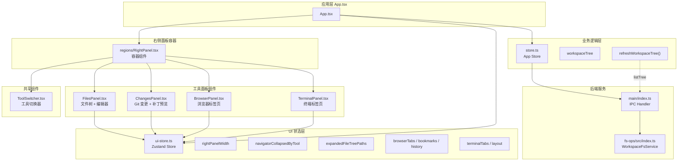
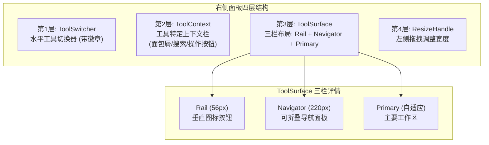
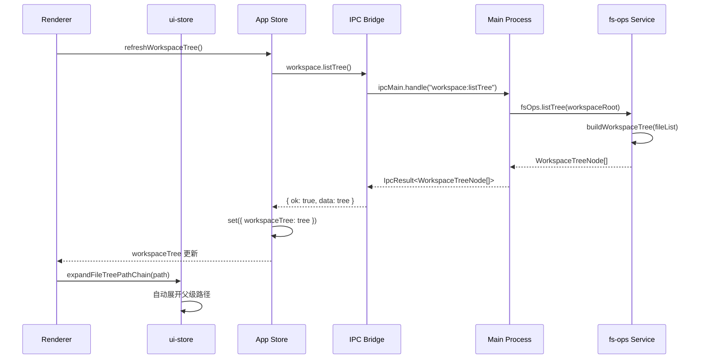

## 1. 高层摘要 (TL;DR)

*   **影响范围:** 🔴 **高** - 桌面应用渲染器核心架构重构
*   **关键变更:**
    *   🏗️ **模块化重构**: 将右侧面板从单体组件拆分为4个独立的面板组件
    *   🌳 **工作区树**: 新增完整的文件树导航功能,支持展开/折叠、脏文件标记
    *   💾 **UI状态持久化**: 新增 `ui-store` 管理面板宽度、导航器状态、浏览器/终端标签页等
    *   📐 **可调整面板**: 支持拖拽调整右侧面板宽度,状态持久化到 localStorage

---

## 2. 可视化架构图

### 2.1 新架构组件关系图



### 2.2 右侧面板布局结构



---

## 3. 详细变更分析

### 3.1 组件模块化重构

#### 📦 删除的旧组件
| 文件 | 说明 |
|------|------|
| `components/RightPanel.tsx` | 旧版右侧面板容器 (45行) |
| `components/ToolContextArea.tsx` | 旧版工具上下文区 (264行) |
| `components/ToolSidebar.tsx` | 旧版工具侧边栏 (93行) |
| `components/ToolSwitcher.tsx` | 旧版工具切换器 (61行) |

#### ✨ 新增的模块化组件

| 文件 | 功能 | 关键特性 |
|------|------|----------|
| `regions/right-panel/FilesPanel.tsx` | 文件工具面板 | 树形导航、Monaco编辑器、搜索、大纲视图 |
| `regions/right-panel/ChangesPanel.tsx` | 变更工具面板 | Git状态、补丁预览、模型健康检查 |
| `regions/right-panel/BrowserPanel.tsx` | 浏览器面板 | 标签页、书签、历史记录 (高保真UI壳) |
| `regions/right-panel/TerminalPanel.tsx` | 终端面板 | 多标签、布局切换 (单/垂直/水平) |
| `regions/right-panel/ToolSwitcher.tsx` | 工具切换器 | 水平布局、徽章显示 |
| `regions/right-panel/types.ts` | 类型定义 | `RightPanelViewProps`, `countGitChanges()` |

**代码示例 - FilesPanel 文件树渲染:**
```tsx
// regions/right-panel/FilesPanel.tsx
function TreeNode({ node, depth, expandedPaths, dirtyPaths, ... }) {
  const isDirectory = node.kind === "directory";
  const isExpanded = expandedPaths[node.path] ?? false;
  const isDirty = dirtyPaths.has(node.path);
  
  return (
    <li className="adl-filetree__item">
      <button 
        style={{ paddingLeft: `${12 + depth * 14}px` }}
        onClick={() => isDirectory ? onToggle(node.path) : onOpenFile(node.path)}
      >
        {/* 显示文件夹/文件图标、脏文件标记 */}
      </button>
    </li>
  );
}
```

---

### 3.2 UI Store 状态管理增强

#### 📊 新增状态类型

```typescript
// ui-store.ts 新增接口
export interface BrowserTabState {
  id: string;
  title: string;
  url: string;
  pinned?: boolean;
}

export interface TerminalTabState {
  id: string;
  title: string;
  profile: "powershell" | "bash" | "cmd";
  commandBinary: string;
  commandArgs: string;
  live: boolean; // 是否为实时标签
}

export type TerminalLayout = "single" | "vertical" | "horizontal";
```

#### 💾 持久化配置表

| 配置项 | 键名 | 默认值 | 说明 |
|--------|------|--------|------|
| 右侧面板宽度 | `adl-ui:right-panel-width` | 620px | 范围: 520-920px |
| 导航器折叠状态 | `adl-ui:navigator-collapsed` | `{ files, changes, browser, terminal }` | 按工具独立存储 |
| 文件树展开路径 | `adl-ui:file-tree-expanded` | `{}` | 记录所有展开的路径 |
| 浏览器标签页 | `adl-ui:browser-tabs` | `[Start Page]` | 标签页列表 |
| 浏览器书签 | `adl-ui:browser-bookmarks` | `[]` | 书签列表 |
| 浏览器历史 | `adl-ui:browser-history` | `[]` | 最多24条 |
| 终端标签页 | `adl-ui:terminal-tabs` | `[PowerShell]` | 终端标签页列表 |
| 终端布局 | `adl-ui:terminal-layout` | `"single"` | 单栏/垂直/水平 |

---

### 3.3 工作区树功能实现

#### 🔄 数据流



#### 🌳 WorkspaceTreeNode 类型定义

```typescript
// packages/kernel/src/index.ts
export interface WorkspaceTreeNode {
  path: string;        // 工作区相对路径
  name: string;        // 文件/文件夹名
  kind: "file" | "directory";
  children: WorkspaceTreeNode[];
}
```

#### 🛠️ 树构建算法

```typescript
// packages/fs-ops/src/index.ts
export function buildWorkspaceTree(paths: string[]): WorkspaceTreeNode[] {
  const roots = new Map<string, MutableWorkspaceTreeNode>();

  for (const rawPath of paths) {
    const segments = rawPath.split("/").filter(Boolean);
    let currentLevel = roots;
    let currentPath = "";

    segments.forEach((segment, index) => {
      currentPath = currentPath ? `${currentPath}/${segment}` : segment;
      const isLeaf = index === segments.length - 1;
      // 递归构建树结构
    });
  }

  return finalize(roots); // 排序: 目录优先, 然后按名称排序
}
```

---

### 3.4 IPC 通信扩展

#### 📡 新增 IPC 通道

| 通道名 | 方向 | 参数 | 返回值 | 说明 |
|--------|------|------|--------|------|
| `workspace:listTree` | Renderer → Main | - | `WorkspaceTreeNode[]` | 获取工作区文件树 |

**Main 端实现:**
```typescript
// main/index.ts
ipcMain.handle("workspace:listTree", async (): Promise<IpcResult<WorkspaceTreeNode[]>> => {
  try {
    const runtimeState = requireRuntime();
    const { workspaceRoot } = requireCurrentWorkspaceState();
    return ok(await runtimeState.fsOps.listTree(workspaceRoot));
  } catch (error) {
    return err(toUserMessage(error).code, toUserMessage(error).message);
  }
});
```

**Preload 端暴露:**
```typescript
// preload/index.ts
const api: DigitalLifeBridge = {
  workspace: {
    // ...
    listTree: () => ipcRenderer.invoke("workspace:listTree"),
  }
};
```

---

### 3.5 样式系统重构

#### 🎨 新增 CSS 类结构

```css
/* regions.css 新增结构 */

/* 右侧面板容器 */
.adl-rightpanel {
  position: relative;
}

/* 拖拽手柄 */
.adl-rightpanel__resize-handle {
  position: absolute;
  width: 6px;
  cursor: col-resize;
}

/* 工具面板 */
.adl-tool-panel {
  display: flex;
  flex-direction: column;
  height: 100%;
}

/* 上下文栏 */
.adl-tool-context {
  display: flex;
  justify-content: space-between;
  border-bottom: 1px solid var(--border-subtle);
}

/* 工具表面 (Rail + Navigator + Primary) */
.adl-tool-surface {
  display: grid;
  grid-template-columns: 56px 220px minmax(0, 1fr);
}

/* 文件树 */
.adl-filetree__node {
  padding-left: 12px; /* 基础缩进 */
}
```

#### 📐 响应式布局

| 断点 | 面板宽度 | 说明 |
|------|----------|------|
| 最小 | 520px | `RIGHT_PANEL_WIDTH_MIN` |
| 默认 | 620px | `DEFAULT_RIGHT_PANEL_WIDTH` |
| 最大 | 920px | `RIGHT_PANEL_WIDTH_MAX` |

---

### 3.6 国际化扩展

#### 🌐 新增翻译键 (中英文)

| 类别 | 新增键 | 示例值 |
|------|--------|--------|
| 工具切换 | `toolSwitcher` | "工具切换" / "Tool Switcher" |
| 文件工具 | `currentFilePath` | "当前文件路径" / "Current file path" |
| 变更工具 | `changesStaged`, `changesModified`, `changesUntracked`, `changesConflicts` | Git 状态分类 |
| 变更工具 | `changesSummaryBranch`, `changesSummaryCount`, `changesSummaryPatchFiles` | 变更摘要 |
| 变更工具 | `changesRolledBack`, `changesApplied` | 操作结果 |
| 变更工具 | `statusHealthy`, `statusDegraded` | 模型健康状态 |
| 浏览器 | `browserBack`, `browserForward`, `browserRefresh`, `browserHome` | 导航按钮 |
| 浏览器 | `browserNewTab`, `browserBookmarks`, `browserHistory` | 标签页/书签/历史 |
| 浏览器 | `browserLocalPreview`, `browserOpenGithub` | 快速操作 |
| 终端 | `terminalSessions`, `terminalRecentCommands`, `terminalLayout` | 导航模式 |
| 终端 | `terminalLayoutSingle`, `terminalLayoutVertical`, `terminalLayoutHorizontal` | 布局选项 |
| 终端 | `terminalLiveShell`, `terminalPlaceholderShell` | 标签类型 |

---

## 4. 影响与风险评估

### ⚠️ 破坏性变更

| 变更类型 | 影响 | 缓解措施 |
|----------|------|----------|
| **组件路径变更** | `components/RightPanel` → `regions/right-panel/*` | 更新导入路径 |
| **CSS 类名变更** | `.right-panel` → `.adl-rightpanel`, `.tool-body` → `.adl-tool-panel` | 更新样式选择器 |
| **Store 状态结构** | 新增 `workspaceTree`, `dirtyEditorPaths` 等 | 更新状态访问逻辑 |
| **IPC 接口** | 新增 `workspace.listTree()` | 更新 mock bridge |

### 🧪 测试建议

#### 单元测试
- ✅ `fs-ops-tree.test.ts` - 测试树构建逻辑 (目录排序、路径规范化)
- ✅ `ui-store.test.ts` - 测试状态持久化 (localStorage 读写)

#### 集成测试
```typescript
// renderer-shell.test.ts 新增断言
expect(document.querySelector(".adl-toolswitcher")).not.toBeNull();
expect(document.querySelector(".adl-tool-context")).not.toBeNull();
expect(document.querySelector(".adl-filetree")).not.toBeNull();
```

#### 手动测试场景
1. **文件树功能:**
   - 展开/折叠文件夹
   - 打开文件查看编辑器
   - 搜索文件并切换到搜索视图
   - 刷新文件树
   - 验证脏文件标记 (修改文件后)

2. **右侧面板调整:**
   - 拖拽调整宽度
   - 切换工具查看不同面板
   - 折叠/展开导航器
   - 刷新页面验证状态持久化

3. **浏览器面板 (UI 壳):**
   - 新建/关闭标签页
   - 添加/移除书签
   - 查看历史记录
   - 切换导航模式 (书签/历史/起始页)

4. **终端面板:**
   - 创建多个标签页
   - 切换布局 (单/垂直/水平)
   - 切换 Shell 类型 (PowerShell/Bash/CMD)

---

## 5. 技术亮点

### 🎯 架构优势
- **关注点分离:** 每个工具面板独立维护,降低耦合度
- **状态持久化:** 所有 UI 状态自动保存,提升用户体验
- **类型安全:** 完整的 TypeScript 类型定义
- **可扩展性:** 新增工具只需创建新的 Panel 组件

### 🚀 性能优化
- **懒加载:** 工具面板按需渲染
- **虚拟化准备:** 文件树结构支持虚拟滚动
- **本地存储:** UI 状态不经过 IPC,减少跨进程通信

### 📚 文档完整性
- 架构文档更新 (`renderer-shell-redesign.md`)
- 代码注释清晰
- 测试覆盖充分

---

## 6. 总结

这次重构是桌面应用渲染器的一次重大升级,主要成果包括:

1. ✅ **模块化架构**: 将 690 行的单体组件拆分为多个职责清晰的模块
2. ✅ **工作区树**: 实现完整的文件树导航功能,支持展开/折叠、脏文件标记
3. ✅ **UI 状态管理**: 新增 `ui-store` 统一管理所有 UI 状态,支持 localStorage 持久化
4. ✅ **可调整面板**: 支持拖拽调整宽度,提升用户体验
5. ✅ **高保真 UI 壳**: 浏览器和终端面板提供完整的 UI 交互,为后续功能接入做好准备
6. ✅ **测试覆盖**: 新增单元测试和集成测试,保证代码质量

**建议:** 在合并前进行全面的手动测试,特别关注文件树的展开/折叠逻辑和右侧面板的拖拽调整功能。

---

验证问题的存在性并进行修复：

标题: 文件树节点缺少键盘导航支持
详情: TreeNode组件仅支持鼠标点击，缺少键盘导航（如Enter键选择、方向键导航）。建议添加键盘事件处理：
```tsx
onKeyDown={(event) => {
  if (event.key === 'Enter') {
    isDirectory ? onToggle(node.path) : onOpenFile(node.path);
  }
}}
tabIndex={0}
```
`ai-digital-life/apps/desktop/renderer/src/app/regions/right-panel/FilesPanel.tsx#L53-53`