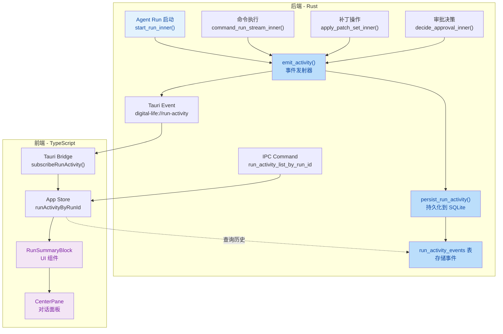
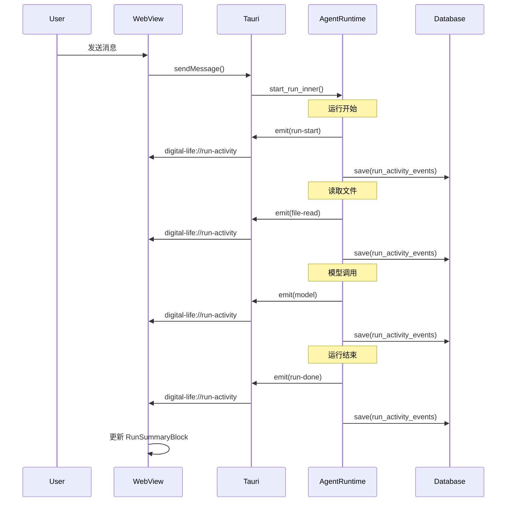

## 1. 高层摘要 (TL;DR)

**影响:** 高 - 这是一个跨层的重大功能实现，为 AI 代理的运行过程提供了完整的透明度追踪系统。

**核心变更:**
- ✨ 新增 **Run Activity 事件流系统**，用于追踪代理运行期间的各类活动（文件读取、搜索、命令执行、补丁操作、审批等）
- 🗄️ 新增 `run_activity_events` 数据库表，支持持久化存储和历史回放
- 🎨 新增 `RunSummaryBlock` UI 组件，在对话流中展示运行摘要和活动时间线
- 🔌 新增 Tauri IPC 命令 `run_activity_list_by_run_id`，支持按 runId 查询历史活动
- 📝 新增架构文档，详细说明设计目标和实现细节

---

## 2. 可视化概览 (代码与逻辑图)





---

## 3. 详细变更分析

### 3.1 后端核心类型 (Rust Kernel)

**文件:** `ai-digital-life/crates/kernel/src/types.rs`

**变更内容:**
- 新增枚举 `DigitalLifeRunActivityEventV1`，包含 11 种事件类型：
  - `RunStart` - 运行开始
  - `ContextAdded` - 上下文添加
  - `FileRead` - 文件读取
  - `Search` - 搜索操作
  - `Command` - 命令执行
  - `Patch` - 补丁操作
  - `Approval` - 审批流程
  - `Model` - 模型调用
  - `Error` - 错误事件
  - `RunDone` - 运行结束

- 新增结构体 `RunActivityEventRecord`，用于数据库存储
- 在 `ApprovalRecord` 中添加 `run_id: Option<String>` 字段，关联审批与运行

**代码示例:**
```rust
#[derive(Debug, Clone, Serialize, Deserialize)]
#[serde(tag = "type", rename_all = "kebab-case")]
pub enum DigitalLifeRunActivityEventV1 {
    #[serde(rename_all = "camelCase")]
    RunStart {
        v: i32,
        run_id: String,
        seq: i64,
        ts: TimestampMs,
        scenario: ConversationScenario,
    },
    // ... 其他事件类型
}
```

---

### 3.2 数据库存储层

**文件:** `ai-digital-life/crates/storage/src/lib.rs`

**变更内容:**
- 新建表 `run_activity_events`，包含字段：
  - `id` (TEXT PRIMARY KEY)
  - `workspace_id` (TEXT)
  - `session_id` (TEXT)
  - `status` (TEXT) - 用于存储 run_id 作为过滤条件
  - `updated_at` (INTEGER)
  - `json` (TEXT) - 存储事件 JSON 数据

- 新增索引 `idx_run_activity_run`，优化按 run_id 查询性能
- 在 `EntityTable` 枚举中添加 `RunActivityEvents` 变体

**数据库表结构:**

| 表名 | 用途 | 关键字段 |
|------|------|----------|
| `run_activity_events` | 存储运行活动事件 | id, workspace_id, session_id, status(run_id), json |

---

### 3.3 后端命令处理 (Tauri Commands)

#### 3.3.1 新增模块: `run_activity.rs`

**文件:** `ai-digital-life/src-tauri/src/commands/run_activity.rs` (新建)

**功能:**
- 实现 `run_activity_list_by_run_id` 命令
- 按事件序列号 `seq` 排序
- 支持可选的 `limit` 参数限制返回数量

#### 3.3.2 代理运行增强

**文件:** `ai-digital-life/src-tauri/src/commands/agent.rs`

**变更内容:**
- 新增 `emit_run_activity()` 函数，通过 Tauri 事件总线发送事件
- 新增 `persist_run_activity()` 函数，将事件持久化到数据库
- 在 `start_run_inner()` 中集成活动追踪：
  - 运行开始时发送 `run-start` 事件
  - 读取文件时发送 `file-read` 和 `context-added` 事件
  - 搜索时发送 `search` 事件
  - 模型调用时发送 `model` 事件
  - 补丁生成时发送 `patch` 事件
  - 运行结束时发送 `run-done` 事件

#### 3.3.3 命令执行追踪

**文件:** `ai-digital-life/src-tauri/src/commands/command.rs`

**变更内容:**
- 在 `approval_for_command()` 中为审批请求发送 `approval` 事件
- 在 `spawn_stream()` 中为命令执行发送 `command` 事件（start/done）
- 在命令失败时发送 `error` 事件
- 所有事件都持久化到数据库并通过 Tauri 事件总线发送

#### 3.3.4 补丁操作追踪

**文件:** `ai-digital-life/src-tauri/src/commands/patch.rs`

**变更内容:**
- 在 `apply_patch_set_inner()` 中发送 `patch` 事件（phase: "applied"）
- 在 `patch_rollback_patch_set()` 中发送 `patch` 事件（phase: "rolled-back"）
- 事件包含补丁集 ID、文件数量、hunk 数量等元数据

#### 3.3.5 审批决策追踪

**文件:** `ai-digital-life/src-tauri/src/commands/task.rs`

**变更内容:**
- 在 `decide_approval_inner()` 中发送 `approval` 事件（phase: "decided"）
- 在 `maybe_execute_approved_command()` 中发送 `command` 事件（start/done）
- 记录审批决策（approved/rejected/timeout）

---

### 3.4 前端类型定义

**文件:** `ai-digital-life/frontend/src/kernel/index.ts`

**变更内容:**
- 新增 TypeScript 类型 `DigitalLifeRunActivityEventV1`，与 Rust 后端类型对应
- 新增接口 `RunActivityEventRecord`
- 在 `ApprovalRecord` 接口中添加 `runId?: string` 字段

---

### 3.5 前端状态管理

**文件:** `ai-digital-life/frontend/src/app/store.ts`

**变更内容:**
- 新增状态字段：
  - `runActivityByRunId: Record<string, DigitalLifeRunActivityEventV1[]>` - 按 runId 索引的事件数组
  - `runUsageByRunId: Record<string, ModelTokenUsage | undefined>` - 按 runId 索引的 Token 使用量

- 新增方法 `fetchRunActivityByRunId(runId, limit?)`，从后端获取历史活动

- 在 `sendMessage()` 中：
  - 订阅 `digital-life://run-activity` 事件流
  - 实时更新 `runActivityByRunId` 和 `runUsageByRunId`
  - 内存中保留最近 500 条事件（超过时保留最新 400 条）

- 在 `fetchAuditEntries()` 中：
  - 从审计条目解析 `runId`（正则匹配 `runId=([A-Za-z0-9_-]+)`）
  - 将历史审计记录转换为 `DigitalLifeRunActivityEventV1` 事件
  - 支持向后兼容旧数据

---

### 3.6 前端 UI 组件

#### 3.6.1 新增组件: `RunSummaryBlock`

**文件:** `ai-digital-life/frontend/src/app/components/conversation/RunSummaryBlock.tsx` (新建)

**功能特性:**
- 📊 显示运行摘要（场景、状态、持续时间）
- 🔍 支持按类型过滤事件（all/context/files/search/model/commands/patch/approvals/errors）
- 📋 支持复制单个事件 JSON 或整个摘要 JSON
- ⏱️ 显示事件时间戳
- 🎯 自动折叠连续相同类型的事件（类似 Cursor）
- 📈 显示 Token 使用量（通过 `TokenUsage` 组件）

**事件分组:**

| 分组 | 事件类型 |
|------|----------|
| context | context-added |
| files | file-read |
| search | search |
| model | model |
| commands | command |
| patch | patch |
| approvals | approval |
| errors | error |

#### 3.6.2 集成到对话面板

**文件:** `ai-digital-life/frontend/src/app/regions/CenterPane.tsx`

**变更内容:**
- 在每个助手消息后渲染 `RunSummaryBlock`（如果消息有 `runId`）
- 在流式传输期间渲染实时摘要（`defaultExpanded=true`）
- 使用 `useEffect` 预取历史运行的活动数据（最多 500 条）

#### 3.6.3 应用级集成

**文件:** `ai-digital-life/frontend/src/app/App.tsx`

**变更内容:**
- 从 store 获取 `runActivityByRunId` 和 `runUsageByRunId`
- 传递给 `CenterPane` 组件
- 新增 `useEffect` 设置窗口标题

---

### 3.7 前端桥接层

#### 3.7.1 IPC 接口定义

**文件:** `ai-digital-life/frontend/src/shared/ipc.ts`

**变更内容:**
- 新增接口方法 `subscribeRunActivity(listener)`
- 新增窗口方法 `setTitle(title)`
- 新增命名空间 `runActivity`，包含 `listByRunId(runId, limit?)`

#### 3.7.2 Tauri 桥接实现

**文件:** `ai-digital-life/frontend/src/tauri-bridge.ts`

**变更内容:**
- 实现 `subscribeRunActivity`，订阅 `digital-life://run-activity` 频道
- 实现 `window.setTitle`，调用 Tauri 的 `win().setTitle()`
- 实现 `runActivity.listByRunId`，调用 IPC 命令 `run_activity_list_by_run_id`

#### 3.7.3 Mock 桥接实现

**文件:** `ai-digital-life/frontend/src/mock-bridge.ts`

**变更内容:**
- 添加 `subscribeRunActivity` 的空实现
- 添加 `window.setTitle` 的实现（设置 `document.title`）
- 添加 `runActivity.listByRunId` 的 mock 实现（返回空数组）

---

### 3.8 样式更新

**文件:** `ai-digital-life/frontend/src/styles/components.css`

**变更内容:**
- 新增 `.adl-run-summary` 及相关样式类（约 100 行）
- 样式包括：
  - 可折叠的摘要头部
  - 过滤器工具栏
  - 事件分组展示
  - 事件列表项（时间、类型、详情、复制按钮）
- 修复部分组件的 `backdrop-filter` 和 `user-select` 兼容性（添加 `-webkit-` 前缀）

---

### 3.9 主程序注册

**文件:** `ai-digital-life/src-tauri/src/main.rs`

**变更内容:**
- 注册新的 Tauri 命令 `commands::run_activity::run_activity_list_by_run_id`

---

### 3.10 文档更新

| 文件 | 变更内容 |
|------|----------|
| `README.md` | 添加新文档链接 "Run Activity and Run Summary" |
| `docs/architecture/run-activity-and-run-summary.md` | 新建文档，详细说明设计目标、表面、持久化、UI 行为和安全注意事项 |
| `docs/architecture/system-overview.md` | 添加 `digital-life://run-activity` 事件说明和 `run_activity_events` 表说明 |
| `docs/architecture/task-governance.md` | 添加运行活动事件持久化说明 |

---

## 4. 影响与风险评估

### 4.1 破坏性变更

| 变更类型 | 影响范围 | 说明 |
|----------|----------|------|
| 数据库 Schema | ✅ 新增表 | 新增 `run_activity_events` 表，不影响现有数据 |
| API 接口 | ✅ 新增接口 | 新增 IPC 命令，向后兼容 |
| 类型定义 | ✅ 扩展类型 | 在 `ApprovalRecord` 中添加可选字段 `run_id`，向后兼容 |

### 4.2 潜在风险

⚠️ **性能风险:**
- 每次运行会产生大量事件（文件读取、搜索、模型调用等）
- 内存中保留 500 条事件，可能导致内存占用增加
- 建议：监控长时间运行会话的内存使用情况

⚠️ **数据库增长:**
- `run_activity_events` 表会快速增长
- 建议：考虑添加定期清理策略（如保留最近 30 天的数据）

⚠️ **事件序列号冲突:**
- 使用 `now_ms() as i64` 作为序列号，在同一毫秒内可能冲突
- 建议：使用原子计数器或更精确的序列号生成策略

### 4.3 测试建议

| 测试场景 | 验证内容 |
|----------|----------|
| 基本运行 | 发送消息后，助手消息后显示运行摘要 |
| 事件过滤 | 切换过滤器（context/files/search/model 等），验证事件正确分组 |
| 历史回放 | 重启应用后，查看历史消息的运行摘要是否正确显示 |
| Token 使用量 | 验证模型调用后，Token 使用量是否正确显示 |
| 复制功能 | 验证复制单个事件和整个摘要的功能 |
| 预取功能 | 滚动到历史消息时，验证活动数据是否自动加载 |
| 审批流程 | 验证审批请求和决策是否正确记录为事件 |
| 命令执行 | 验证命令执行的 start/done 事件是否正确发送 |
| 补丁操作 | 验证补丁的 proposed/applied/rolled-back 事件是否正确发送 |
| 错误处理 | 验证错误事件是否正确显示在摘要中 |

---

## 5. 总结

这是一个**完整的跨层功能实现**，从后端类型定义、数据库存储、事件发射，到前端状态管理、UI 组件和桥接层，都进行了全面的更新。该功能为 AI 代理的运行过程提供了**完整的透明度**，用户可以实时查看代理的每一步操作，也可以在应用重启后回放历史运行记录。

**设计亮点:**
- 🎯 事件流与持久化分离，支持实时和历史回放
- 🔒 只发送元数据，不暴露敏感内容（如文件内容、stdout/stderr）
- 📦 版本化事件格式（v=1），便于未来扩展
- 🔄 向后兼容旧审计记录，平滑迁移
- 🎨 类似 Cursor 的用户体验，自动折叠重复事件

**后续优化建议:**
1. 添加事件数据的定期清理机制
2. 考虑使用更可靠的序列号生成策略
3. 添加性能监控，评估事件流对系统性能的影响
4. 考虑添加事件搜索和过滤的高级功能