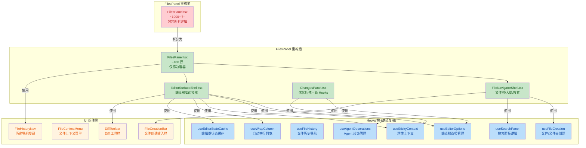

## 1. 高层摘要 (TL;DR)

*   **影响范围**：🔴 **高** - 对右侧面板组件进行了大规模架构重构，涉及多个核心组件的拆分和逻辑提取
*   **核心变更**：
    *   🏗️ 将 `FilesPanel` 组件拆分为 **3 个 Shell 组件**（`EditorSurfaceShell`、`FileNavigatorShell`、`ChangesPanel` 优化）
    *   🪝 提取 **8 个自定义 Hooks** 到 `hooks/` 目录，实现逻辑复用
    *   🎨 新增 **4 个独立 UI 组件**（`DiffToolbar`、`FileContextMenu`、`FileCreationBar`、`FileHistoryNav`）
    *   🔧 导出 `getCachedLru` 和 `setCachedLru` 函数，新增剪贴板工具函数

---

## 2. 可视化概览 (代码与逻辑映射)



---

## 3. 详细变更分析

### 📦 组件架构重构

#### **FilesPanel.tsx** (源文件)
**变更内容**：
*   从 **~1000+ 行**精简至 **~100 行**
*   移除了所有内联逻辑（文件创建、搜索、编辑器选项、历史导航等）
*   转为容器组件，委托给 `FileNavigatorShell` 和 `EditorSurfaceShell`

**关键代码片段**：
```typescript
// 重构后：简洁的容器组件
export function FilesPanel(props: RightPanelViewProps) {
  const editorOptions = useEditorOptions();
  const fileHistory = useFileHistory(selectedFilePath, onOpenFile);
  
  return (
    <FileNavigatorShell {...navigatorProps} />
    <EditorSurfaceShell {...editorProps} editorOptions={editorOptions} />
  );
}
```

#### **EditorSurfaceShell.tsx** (新建)
**职责**：管理编辑器表面、Diff 查看器和文件预览
*   集成 `useStickyContext`、`useWrapColumn`、`useAgentDecorations`、`useEditorStateCache`
*   处理 Markdown 预览、DOCX/PDF 占位符、二进制文件提示
*   管理 Diff 工具栏和 Hunk 条带显示

#### **FileNavigatorShell.tsx** (新建)
**职责**：管理文件树、大纲和搜索面板
*   集成 `useFileCreation`、`useSearchPanel`
*   支持三种导航模式：`tree`（文件树）、`outline`（大纲）、`search`（搜索）
*   处理文件树展开/折叠、目录刷新

---

### 🪝 自定义 Hooks 提取

#### **hooks/index.ts** (新建)
统一导出所有 Hooks：

| Hook | 功能 | 输入类型 | 输出类型 |
|------|------|----------|----------|
| `useEditorOptions` | 编辑器选项管理 | - | `UseEditorOptionsResult` |
| `useFileCreation` | 文件/文件夹创建 | `UseFileCreationInput` | `UseFileCreationResult` |
| `useFileHistory` | 文件历史导航 | `currentFilePath`, `onOpenFile` | `FileHistoryState` |
| `useAgentDecorations` | Agent 装饰管理 | `UseAgentDecorationsInput` | - |
| `useStickyContext` | 粘性上下文 | `UseStickyContextInput` | `StickyContextModel \| null` |
| `useWrapColumn` | 自动换行列宽 | `UseWrapColumnInput` | `number \| null` |
| `useEditorStateCache` | 编辑器状态缓存 | `cmViewRef`, `selectedFilePath` | - |
| `useSearchPanel` | 搜索面板逻辑 | `UseSearchPanelInput` | `UseSearchPanelResult` |

#### **useEditorOptions.ts** (新建)
管理编辑器配置状态：
```typescript
interface UseEditorOptionsResult {
  wordWrapEnabled: boolean;
  lineNumbersEnabled: boolean;
  agentAnnotationsEnabled: boolean;
  standardOptions: { readOnly, lineNumbers, wordWrap };
  diffOptions: { readOnly, lineNumbers, wordWrap };
}
```

#### **useFileCreation.ts** (新建)
处理文件/文件夹创建流程：
*   `normalizeCreationPath()`: 验证并规范化路径（拒绝绝对路径、`./`、`../`）
*   `buildDefaultCreationPath()`: 根据当前选中文件生成默认路径
*   支持键盘快捷键（Enter 提交、Escape 取消）

#### **useFileHistory.ts** (新建)
实现浏览器式的前进/后退导航：
```typescript
interface FileHistoryState {
  canGoBack: boolean;
  canGoForward: boolean;
  navigateBack: () => void;
  navigateForward: () => void;
}
```

#### **useStickyContext.ts** (新建)
管理编辑器顶部的粘性上下文显示：
*   监听编辑器滚动、布局变化、窗口调整大小
*   使用 `requestAnimationFrame` 优化性能
*   根据可见行和 Diff 范围构建上下文条目

#### **useWrapColumn.ts** (新建)
动态计算自动换行的列宽：
*   监听编辑器布局变化和窗口调整大小
*   仅在 `wordWrapEnabled` 为 true 时计算

---

### 🎨 新增 UI 组件

#### **DiffToolbar.tsx** (新建)
Diff 查看器的工具栏：
*   布局切换（内联/并排）
*   行号、自动换行、Agent 注解开关
*   Hunk 导航（上一个/下一个）
*   全部折叠/展开

#### **FileContextMenu.tsx** (新建)
文件操作的上下文菜单：
*   支持菜单项和分隔符
*   复选框状态显示（用于开关选项）
*   点击外部自动关闭

#### **FileCreationBar.tsx** (新建)
文件/文件夹创建输入栏：
*   自动聚焦并选中文本
*   路径验证反馈
*   键盘快捷键支持

#### **FileHistoryNav.tsx** (新建)
历史导航按钮组：
*   前进/后退按钮
*   根据历史状态禁用按钮

---

### 🔧 工具函数更新

#### **store.ts** (修改)
导出 LRU 缓存函数：
```typescript
// 之前：私有函数
function getCachedLru<T>(cache: Map<string, T>, key: string): T | undefined

// 之后：导出函数
export function getCachedLru<T>(cache: Map<string, T>, key: string): T | undefined
export function setCachedLru<T>(cache: Map<string, T>, key: string, value: T, limit: number): void
```

#### **copy.ts** (新增)
新增剪贴板工具函数：
```typescript
// 单次复制
export async function copyToClipboard(text: string): Promise<{ ok: true } | { ok: false; error: string }>

// 批量复制
export async function copyMultiple(items: string[]): Promise<{ ok: true } | { ok: false; error: string }>
```

---

### 📝 文档更新

#### **codebase-map.md** (修改)
更新右侧面板组件描述：
```markdown
| `app/regions/right-panel/` | 右侧面板组件（FilesPanel/FileNavigatorShell/EditorSurfaceShell 分层架构，含 hooks/、DiffToolbar、FileContextMenu、FileCreationBar、FileHistoryNav、stickyContextView、...） |
```

---

## 4. 影响与风险评估

### ⚠️ 破坏性变更

| 变更类型 | 影响范围 | 说明 |
|----------|----------|------|
| **组件拆分** | FilesPanel 内部实现 | 外部 API 保持不变，但内部结构完全重构 |
| **Hooks 导出** | hooks/index.ts | 新增导出，不影响现有代码 |
| **函数导出** | store.ts | `getCachedLru` 和 `setCachedLru` 现在可被外部模块使用 |

### ✅ 测试建议

1.  **功能测试**：
    *   验证文件树导航、大纲导航、搜索功能正常
    *   测试文件/文件夹创建流程（包括路径验证）
    *   验证编辑器选项切换（行号、自动换行、Agent 注解）
    *   测试历史导航（前进/后退）

2.  **UI 测试**：
    *   检查 Diff 工具栏按钮状态和功能
    *   验证上下文菜单的显示和关闭
    *   测试粘性上下文在不同滚动位置的显示

3.  **性能测试**：
    *   验证 `useStickyContext` 和 `useWrapColumn` 的 `requestAnimationFrame` 优化效果
    *   检查编辑器状态缓存的正确性

4.  **边界情况**：
    *   空文件列表时的显示
    *   无效路径输入的处理
    *   剪贴板权限被拒绝时的错误处理

---

## 5. 总结

这次重构是一次**高质量的架构优化**，主要成果包括：

✅ **代码可维护性大幅提升**：将 1000+ 行的巨型组件拆分为多个职责单一的子组件和 Hooks  
✅ **逻辑复用性增强**：8 个自定义 Hooks 可在多个组件间共享  
✅ **类型安全性提高**：为每个 Hook 和组件定义了清晰的 TypeScript 接口  
✅ **性能优化**：使用 `requestAnimationFrame` 优化粘性上下文和自动换行列宽计算  
✅ **用户体验改善**：新增历史导航、优化的文件创建流程、统一的 Diff 工具栏

**风险较低**：外部 API 保持兼容，主要是内部实现重构，建议进行全面的功能测试以确保行为一致性。