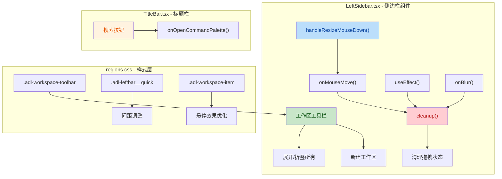
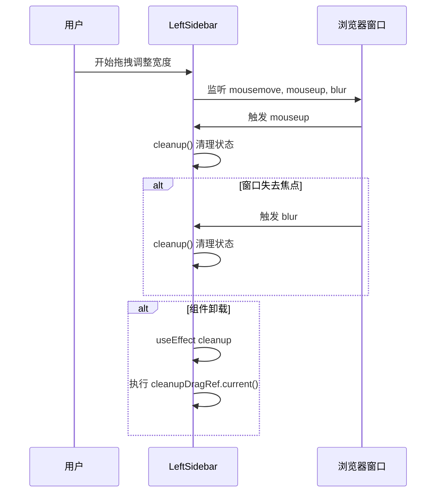

## 1. 高层摘要 (TL;DR)

*   **影响范围:** 🟡 **中等** - 重构左侧边栏工作区UI并优化拖拽交互
*   **核心变更:**
    *   ✨ **UI重构:** 将工作区搜索框移除，改为工具栏模式，新增展开/折叠所有工作区功能
    *   🐛 **拖拽修复:** 添加窗口失焦清理逻辑，防止拖拽状态卡死
    *   🎨 **样式优化:** 调整间距和悬停效果，提升视觉一致性
    *   🔍 **新增入口:** 标题栏添加命令面板快捷按钮

---

## 2. 可视化概览 (代码与逻辑映射)



**拖拽清理流程图:**


---

## 3. 详细变更分析

### 📦 组件 1: LeftSidebar.tsx (侧边栏核心组件)

#### 🐛 拖拽交互优化
**变更说明:** 修复了拖拽调整宽度时可能的状态残留问题

| 变更项 | 修改前 | 修改后 | 影响 |
|--------|--------|--------|------|
| 清理函数 | 仅在 `onMouseUp` 时调用 | 统一为 `cleanup()` 函数，支持多场景调用 | 提高代码复用性 |
| 失焦处理 | 无 | 新增 `window.addEventListener("blur", onBlur)` | 防止窗口切换时拖拽卡死 |
| 组件卸载清理 | 无 | 新增 `useEffect` 清理 `cleanupDragRef` | 防止内存泄漏 |

**关键代码逻辑:**
```typescript
// 新增: 组件卸载时清理拖拽状态
useEffect(() => {
  return () => {
    if (cleanupDragRef.current) { 
      cleanupDragRef.current(); 
      cleanupDragRef.current = null; 
    }
  };
}, []);

// 重构: 统一清理逻辑
const cleanup = () => {
  draggingRef.current = false;
  shellBody.classList.remove("is-resizing");
  if (rafRef.current) { cancelAnimationFrame(rafRef.current); rafRef.current = 0; }
  window.removeEventListener("mousemove", onMouseMove);
  window.removeEventListener("mouseup", onMouseUp);
  window.removeEventListener("blur", onBlur);  // 新增
  document.body.style.cursor = "";
  document.body.style.userSelect = "";
  cleanupDragRef.current = null;
};
```

#### ✨ UI 结构重构
**变更说明:** 工作区区域从"标题+搜索框"模式改为"工具栏"模式

| UI 元素 | 修改前 | 修改后 | 位置变化 |
|---------|--------|--------|----------|
| 工作区标题 | 文本标签 "Workspaces" | 图标按钮（可展开/折叠） | 工具栏左侧 |
| 搜索框 | 输入框（可过滤工作区） | ❌ 已移除 | - |
| 新建工作区按钮 | 文本按钮（带标签） | 图标按钮（仅加号） | 工具栏右侧 |

**新增功能逻辑:**
```typescript
// 展开/折叠所有工作区
onClick={() => {
  const allExpanded = workspaceEntries.every(
    (w) => expandedSessionWorkspaces[w.path] ?? (currentWorkspace?.path === w.path)
  );
  workspaceEntries.forEach((w) => {
    const shouldBeExpanded = !allExpanded;
    if (shouldBeExpanded !== (expandedSessionWorkspaces[w.path] ?? (currentWorkspace?.path === w.path))) {
      toggleSessionWorkspace(w.path);
    }
  });
}}
```

---

### 📦 组件 2: TitleBar.tsx (标题栏)

#### 🔍 新增命令面板入口
**变更说明:** 在标题栏导航区添加搜索图标按钮

| 属性 | 值 |
|------|-----|
| 图标 | `IconSearch` (16px) |
| 功能 | 调用 `onOpenCommandPalette()` |
| 提示文本 | `t.menuCommandPalette` |
| 样式类 | `adl-icon-btn` |

---

### 📦 组件 3: regions.css (样式文件)

#### 🎨 样式调整汇总表

| 选择器 | 属性 | 旧值 | 新值 | 说明 |
|--------|------|------|------|------|
| `.adl-leftbar__quick` | `gap` | `var(--space-1)` | `var(--space-0-5)` | 快速按钮区域间距缩小 |
| `.adl-workspace-row` | `border-radius` | `var(--radius-sm)` | `0` | 移除圆角，更扁平化 |
| `.adl-workspace-item.is-current > .adl-workspace-row` | 背景显示 | 始终显示 | **仅 hover 时显示** | 优化当前工作区视觉反馈 |
| `.adl-session-item` | `border-radius` | `var(--radius-sm)` | `0` | 会话项移除圆角 |
| `.adl-session-item.is-active` | 背景显示 | 始终显示 + 加粗 | **仅 hover 时显示** | 优化活跃会话视觉反馈 |

#### 🗑️ 删除的样式类
- ❌ `.adl-leftbar__nav-header` (工作区标题样式)
- ❌ `.adl-leftbar__search` (搜索框容器样式)
- ❌ `.adl-leftbar__search input` (搜索输入框样式)
- ❌ `.adl-leftbar__search--nested` (嵌套搜索样式)

#### ➕ 新增的样式类
- ✅ `.adl-workspace-toolbar` (工作区工具栏，替代原 nav-header)

---

## 4. 影响与风险评估

### ⚠️ 破坏性变更
| 变更类型 | 影响范围 | 用户影响 |
|----------|----------|----------|
| **功能移除** | 工作区搜索框 | 用户无法通过搜索框过滤工作区列表 |
| **UI 布局** | 工作区区域 | 工作区标题从文本改为可交互按钮 |

### 🧪 测试建议

#### 功能测试
- [ ] **拖拽调整宽度:**
  - 正常拖拽释放，验证宽度调整正确
  - 拖拽过程中切换窗口（Alt+Tab），验证拖拽状态正确清理
  - 拖拽过程中切换应用，验证不会卡死
- [ ] **展开/折叠工作区:**
  - 点击工具栏左侧箭头，验证所有工作区展开/折叠
  - 验证箭头图标状态正确切换（向下/向右）
- [ ] **新建工作区:**
  - 点击工具栏右侧加号，验证新建功能正常
- [ ] **命令面板:**
  - 点击标题栏搜索图标，验证命令面板打开

#### 视觉回归测试
- [ ] 验证快速按钮区域间距是否合理
- [ ] 验证工作区和会话项的悬停效果是否自然
- [ ] 验证当前工作区和活跃会话的视觉反馈是否清晰

#### 兼容性测试
- [ ] 验证在大量工作区场景下，展开/折叠功能性能正常
- [ ] 验证组件卸载时无内存泄漏（打开开发者工具 Memory 面板检查）

---

## 5. 总结

本次变更主要聚焦于 **UI 体验优化** 和 **交互健壮性提升**：

1. **拖拽交互** 从单一事件处理升级为多场景清理机制，有效解决了窗口失焦导致的拖拽卡死问题
2. **工作区区域** 从传统的"标题+搜索"布局重构为更紧凑的"工具栏"布局，新增批量展开/折叠功能，提升操作效率
3. **视觉风格** 更加扁平化，悬停反馈更精准，整体界面更清爽

**风险提示:** 工作区搜索框的移除可能影响部分用户的使用习惯，建议在发布说明中明确说明，或考虑未来通过命令面板提供类似功能。