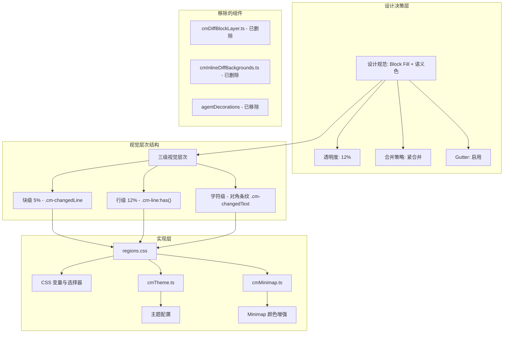
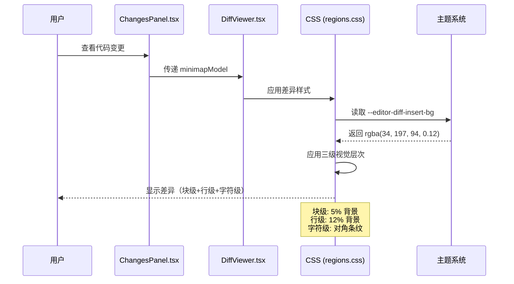

## 1. 高层摘要 (TL;DR)

**影响级别:** 🔴 高 - 彻底重构了代码差异显示的视觉系统和实现方式

**核心变更:**
- 🎨 **重新设计差异视觉系统** - 从复杂的装饰层改为基于 CSS 的三级视觉层次（块级 5% + 行级 12% + 字符级对角条纹）
- 🧹 **大幅简化代码** - 删除了 `cmDiffBlockLayer.ts` 和 `cmInlineDiffBackgrounds.ts` 两个文件，移除了所有代理装饰相关代码
- 🎯 **统一设计规范** - 采用 Block Fill（整行半透明背景）+ 语义色（绿/红/蓝）+ 适配模式，透明度统一为 12%
- 📝 **更新设计文档** - 新增了详细的设计决策文档和设计系统规范

---

## 2. 视觉概览（代码与逻辑映射）





---

## 3. 详细变更分析

### 🎨 组件 1: 设计文档与规范

#### 新增文件
| 文件路径 | 说明 |
|---------|------|
| `.superpowers/brainstorm/*/content/design-overview.html` | 设计概览，讨论视觉指示方式（Gutter Only/Left Rail/Block Fill/Underline） |
| `.superpowers/brainstorm/*/content/style-details.html` | 样式细节，定义透明度级别和色彩精确值 |
| `.superpowers/brainstorm/*/content/design-summary.html` | 设计决策汇总，包含右键菜单透明度调节概念 |

#### 设计决策汇总

| 决策维度 | 选择方案 | 具体参数 |
|---------|---------|---------|
| **视觉指示方式** | Block Fill | 整行半透明背景色块 |
| **色彩体系** | 标准语义色 | Insert: #22c55e (绿) · Delete: #ef4444 (红) · Modify: #3b82f6 (蓝) |
| **透明度级别** | 可见系 | Insert: 12% · Delete: 12% · Modify: 10% |
| **合并策略** | 紧合并 | 间隔 ≤ 1 行合并 |
| **Sticky Context** | 保持独立 | 不绑定编辑器颜色 |

---

### 🧩 组件 2: 主题系统

#### 文件: `themes.css`

**变更内容:** 简化差异颜色变量，移除多层级变体

| 变量类型 | 旧值 | 新值 |
|---------|------|------|
| 插入背景 (亮色) | `rgba(22, 163, 74, 0.12)` | `rgba(34, 197, 94, 0.12)` |
| 删除背景 (亮色) | `rgba(239, 68, 68, 0.12)` | `rgba(239, 68, 68, 0.12)` |
| 插入背景 (暗色) | `rgba(74, 222, 128, 0.14)` | `rgba(74, 222, 128, 0.12)` |
| 删除背景 (暗色) | `rgba(248, 113, 113, 0.14)` | `rgba(248, 113, 113, 0.12)` |

**移除的变量:**
- `--editor-diff-insert-border`
- `--editor-diff-remove-border`
- `--editor-diff-insert-bg-strong`
- `--editor-diff-remove-bg-strong`
- `--editor-diff-insert-bg-block`
- `--editor-diff-remove-bg-block`
- `--minimap-diff-insert-bg-*` (所有变体)
- `--minimap-diff-remove-bg-*` (所有变体)

#### 文件: `cmTheme.ts`

**变更内容:**
- 移除了 `DIFF_INSERT_CLASS`, `DIFF_DELETE_CLASS`, `DIFF_INSERT_BLOCK_CLASS`, `DIFF_DELETE_BLOCK_CLASS` 常量
- 将 `diffInsertBg` 和 `diffRemoveBg` 从通用颜色组移至语法颜色组
- 更新默认透明度从 8-10% 提升至 12%
- 将 `.cm-insertedLine` 和 `.cm-deletedLine` 背景设置为 `transparent`
- 更新 gutter 元素样式，添加背景色并提升透明度至 0.85

```typescript
// 旧代码（已删除）
[".cm-insertedLine"]: {
  backgroundColor: c.diffInsertBg,
},

// 新代码
".cm-insertedLine": {
  backgroundColor: "transparent",
},
```

---

### 🎯 组件 3: 样式实现

#### 文件: `regions.css`

**核心变更:** 实现三级视觉层次系统

##### 第一级：块级背景（5%）
```css
/* 并排模式 - A 侧红色，B 侧绿色 */
.adl-cm-diff-viewer--side-by-side .cm-merge-a .cm-changedLine {
  background-color: rgba(239, 68, 68, 0.05) !important;
}
.adl-cm-diff-viewer--side-by-side .cm-merge-b .cm-changedLine {
  background-color: rgba(34, 197, 94, 0.05) !important;
}

/* 内联模式 - 删除块使用中性灰 */
.adl-cm-diff-viewer--inline .cm-deletedChunk {
  background-color: rgba(128, 128, 128, 0.05) !important;
}
```

##### 第二级：行级背景（12%）- 使用 `:has()` 伪类
```css
/* 抑制内联元素的背景 */
.adl-cm-diff-viewer .cm-insertedLine,
.adl-cm-diff-viewer .cm-deletedLine {
  background: transparent !important;
}

/* 通过 :has() 在行级应用背景 */
.adl-cm-diff-viewer .cm-line:has(.cm-insertedLine) {
  background-color: var(--editor-diff-insert-bg) !important;
}

.adl-cm-diff-viewer .cm-line:has(.cm-deletedLine) {
  background-color: var(--editor-diff-remove-bg) !important;
}
```

##### 第三级：字符级纹理 - 对角条纹图案
```css
/* 并排模式 A 侧（红色条纹） */
.adl-cm-diff-viewer--side-by-side .cm-merge-a .cm-changedText {
  background: repeating-linear-gradient(
    -45deg,
    transparent,
    transparent 3px,
    rgba(239, 68, 68, 0.1) 3px,
    rgba(239, 68, 68, 0.1) 5px
  ) !important;
}

/* 并排模式 B 侧（绿色条纹） */
.adl-cm-diff-viewer--side-by-side .cm-merge-b .cm-changedText {
  background: repeating-linear-gradient(
    -45deg,
    transparent,
    transparent 3px,
    rgba(34, 197, 94, 0.1) 3px,
    rgba(34, 197, 94, 0.1) 5px
  ) !important;
}
```

**移除的样式:**
- 所有 `.adl-cm-diff-block-layer-*` 相关样式（约 100 行）
- 所有 `.adl-cm-agent-block-*` 相关样式
- 旧的差异块填充和垂直填充样式

---

### 🔧 组件 4: 代码编辑器组件

#### 文件: `ChangesPanel.tsx`

**移除的导入:**
```typescript
// 已删除
import { getAgentDecorationExtensions, applyAgentDecorations, type AgentHunkDecoration } from "./agentDecorations";
import { updateMinimapDiffModel } from "./cmMinimap";
import { getInlineDiffBackgroundExtension, applyInlineDiffChunks, type DiffChunkInfo } from "./cmInlineDiffBackgrounds";
```

**移除的函数:**
- `getRenderablePreviewDiffRanges()` - 过滤可渲染的差异范围
- `previewDiffRangesToAgentHunks()` - 转换为代理装饰
- `previewDiffRangesToChunks()` - 转换为差异块

**移除的 useEffect:**
```typescript
// 已删除 - 应用代理装饰和差异块
useEffect(() => {
  const modifiedEditor = getModifiedEditor();
  const view = getEditorView(modifiedEditor);
  if (!view || !changePreview) return;

  const hunks = previewDiffRangesToAgentHunks(changePreviewDiffRanges);
  applyAgentDecorations(view, hunks);
  updateMinimapDiffModel(view, changePreviewMinimapModel ?? null);

  const chunks = previewDiffRangesToChunks(changePreviewDiffRanges, view);
  applyInlineDiffChunks(view, chunks);
}, [changePreview, changePreviewDiffRanges, changePreviewMinimapModel, editorReady, getModifiedEditor, props.diffSideBySide]);
```

**简化的扩展配置:**
```typescript
// 旧代码
const diffExtensions = useMemo(() => [
  ...getAgentDecorationExtensions(),
  getInlineDiffBackgroundExtension(),
  getFoldingTooltipExtension(),
], []);

// 新代码
const diffExtensions = useMemo(() => [
  getFoldingTooltipExtension(),
], []);
```

#### 文件: `DiffViewer.tsx`

**移除的导入:**
```typescript
import { minimapHunksToDiffModel } from "./cmMinimap";
import type { AgentHunkDecoration } from "./agentDecorations";
import { getDiffBlockLayerExtension } from "./cmDiffBlockLayer";
```

**移除的属性:**
```typescript
// 从 DiffViewerProps 中删除
hunks?: AgentHunkDecoration[];
```

**关键配置变更:**
```typescript
// SideBySideDiffViewer 和 InlineDiffViewer
// 旧配置
gutter: false,

// 新配置
gutter: true,
```

**简化 Minimap 更新逻辑:**
```typescript
// 旧代码
updateMinimapDiffModel(
  mv.b,
  mergedMinimapModel ?? (hunks ? minimapHunksToDiffModel(hunks, mv.b.state.doc.lines) : null)
);

// 新代码
updateMinimapDiffModel(
  mv.b,
  mergedMinimapModel ?? null
);
```

#### 文件: `FilesPanel.tsx`

**变更:**
```typescript
// 移除了 hunks 属性传递
<DiffViewer
  // ...其他属性
  hunks={agentHunkDecorations} // 已删除
/>
```

---

### 🗑️ 组件 5: 已删除的文件

| 文件 | 说明 | 替代方案 |
|------|------|---------|
| `cmDiffBlockLayer.ts` | 差异块层插件（139 行） | 使用 CSS `.cm-changedLine` 样式 |
| `cmInlineDiffBackgrounds.ts` | 内联差异背景插件（73 行） | 使用 CSS `:has()` 选择器 |

---

### ⚙️ 组件 6: Minimap 增强

#### 文件: `cmMinimap.ts`

**新增函数:**
```typescript
/**
 * 解析 rgba(r, g, b, alpha) 字符串，增强 alpha 通道用于 minimap
 * 可见性（约 3.5 倍编辑器 alpha，上限 0.5），返回新的 rgba 字符串。
 */
function minimapBoostRgbaAlpha(rgbaStr: string, fallback: string): string {
  const match = rgbaStr.match(
    /rgba?\s*\(\s*(\d+)\s*,\s*(\d+)\s*,\s*(\d+)\s*,\s*(\d*\.?\d+)\s*\)/,
  );
  if (!match) return fallback;
  const [, r, g, b, alphaStr] = match;
  const alpha = parseFloat(alphaStr);
  if (!Number.isFinite(alpha)) return fallback;
  const minimapAlpha = Math.min(0.5, alpha * 3.5);
  return `rgba(${r}, ${g}, ${b}, ${minimapAlpha.toFixed(2)})`;
}
```

**简化的颜色获取逻辑:**
```typescript
// 旧代码（使用多个 CSS 变量）
const suffix = segment.tone === "strong"
  ? "-strong"
  : segment.tone === "block"
    ? "-block"
    : "";
const baseName = segment.type === "insert"
  ? `--minimap-diff-insert-bg${suffix}`
  : `--minimap-diff-remove-bg${suffix}`;

// 新代码（统一使用编辑器变量）
const cssVarName =
  segment.type === "insert"
    ? "--editor-diff-insert-bg"
    : "--editor-diff-remove-bg";
const raw = getComputedStyle(document.documentElement)
  .getPropertyValue(cssVarName)
  .trim();
return minimapBoostRgbaAlpha(raw, fallback);
```

---

### 🧪 组件 7: 测试更新

#### 文件: `changesEditorHighlight.test.ts`

**移除的测试用例:**
- `preserves line-level diff backgrounds after border cleanup`
- `uses CodeMirror agent decorations for diff range highlighting`
- `uses CodeMirror inline diff backgrounds for visual diff emphasis`
- `separates full-width diff block fills from content-width line fills`
- `keeps diff rows visually calm by avoiding active-line and selected-hunk overlay bands`

**保留的测试:**
- `does not contain any Monaco imports or references`

#### 文件: `changesEditorOptions.test.ts`

**更新的测试:**
```typescript
// 旧测试
it("passes CodeMirror extensions for agent decorations, minimap, inline diff, and folding", () => {
  expect(changesPanelSource).toContain("getAgentDecorationExtensions");
  expect(changesPanelSource).toContain("getMinimapExtension");
  expect(changesPanelSource).toContain("getInlineDiffBackgroundExtension");
  expect(changesPanelSource).toContain("getFoldingTooltipExtension");
});

// 新测试
it("passes CodeMirror extensions for minimap and folding", () => {
  expect(changesPanelSource).toContain("getMinimapExtension");
  expect(changesPanelSource).toContain("getFoldingTooltipExtension");
});
```

#### 文件: `cmPreviewStyling.test.ts`

**更新的断言:**
```typescript
// 旧断言
expect(diffViewerSource).toContain("gutter: false");
expect(diffViewerSource).not.toContain("gutter: true");

// 新断言
expect(diffViewerSource).toContain("gutter: true");
expect(diffViewerSource).not.toContain("gutter: false");
```

---

## 4. 影响与风险评估

### ⚠️ 破坏性变更

| 变更类型 | 影响范围 | 说明 |
|---------|---------|------|
| **API 变更** | `DiffViewerProps` | 移除了 `hunks?: AgentHunkDecoration[]` 属性 |
| **导入变更** | `ChangesPanel.tsx`, `DiffViewer.tsx` | 移除了多个已删除模块的导入 |
| **CSS 类移除** | 全局样式 | 移除了 `.adl-cm-diff-block-layer-*` 等多个 CSS 类 |

### ✅ 兼容性说明

- **向后兼容:** ✅ 主题系统使用 CSS 变量，旧值会回退到默认值
- **浏览器兼容:** ⚠️ 使用了 `:has()` 伪类，需要 Chrome 105+ / Safari 15.4+ / Firefox 121+
- **功能对等:** ✅ 新的三级视觉层次提供了与旧系统相同的视觉信息

### 🧪 测试建议

#### 必测场景
1. **基础差异显示**
   - [ ] 验证插入行显示绿色背景（12% 透明度）
   - [ ] 验证删除行显示红色背景（12% 透明度）
   - [ ] 验证修改行显示蓝色/条纹纹理

2. **视觉层次验证**
   - [ ] 块级背景（5%）在连续变更行中正确显示
   - [ ] 行级背景（12%）通过 `:has()` 正确应用
   - [ ] 字符级条纹纹理在变更文本上正确显示

3. **不同视图模式**
   - [ ] 内联模式（Inline）差异显示正常
   - [ ] 并排模式（Side-by-Side）差异显示正常
   - [ ] Gutter 显示 +/- 符号和背景色

4. **主题切换**
   - [ ] 亮色主题下差异颜色正确
   - [ ] 暗色主题下差异颜色正确
   - [ ] 主题切换时差异样式正确更新

5. **Minimap 显示**
   - [ ] Minimap 差异指示器颜色正确（3.5 倍透明度增强）
   - [ ] Minimap 差异指示器宽度与内容宽度匹配

6. **边界情况**
   - [ ] 空文档不报错
   - [ ] 单行变更正确显示
   - [ ] 大量变更行性能正常

#### 回归测试
- [ ] 验证所有旧的测试用例通过
- [ ] 验证没有引入新的控制台错误
- [ ] 验证内存使用没有显著增加

---

## 5. 总结

这次重构是一次**彻底的架构简化**，通过以下方式提升了代码质量：

### 🎯 核心改进
1. **代码减少** - 删除了约 200+ 行复杂的 JavaScript/TypeScript 代码
2. **CSS 驱动** - 将视觉逻辑从 JavaScript 迁移到 CSS，利用现代 CSS 特性（`:has()`）
3. **统一设计** - 建立了清晰的三级视觉层次系统
4. **简化维护** - 减少了状态管理和插件依赖

### 📊 技术债务清理
- ✅ 移除了复杂的装饰层系统
- ✅ 统一了差异颜色变量
- ✅ 简化了 Minimap 颜色计算
- ✅ 清理了未使用的 CSS 类和样式

### 🚀 未来扩展性
新的架构为以下功能提供了良好基础：
- 右键菜单透明度调节（设计文档中已规划）
- 更灵活的主题定制
- 性能优化（CSS 渲染比 JavaScript 更高效）

这是一次**高质量的重构**，在保持功能完整性的同时，显著提升了代码的可维护性和可扩展性。