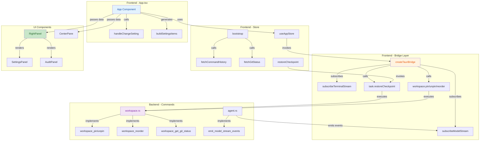

## 1. 高层摘要 (TL;DR)

**影响范围**: 🟡 **中高** - 涉及前后端通信架构重构、新增多个核心功能模块

**核心变更**:
- ✨ **新增 Tauri 桥接层** (`tauri-bridge.ts`): 统一前端与后端 IPC 通信接口
- 📁 **增强工作区管理**: 新增固定、排序、隐藏/显示工作区功能
- 🎛️ **新增设置面板**: 实现语言、主题、模型配置的动态设置
- 📊 **新增审计面板**: 展示系统操作审计记录
- 🔄 **优化模型流式输出**: 改进 AI 响应的流式传输机制
- 📈 **新增 Git 状态监控**: 实时显示工作区 Git 变更状态

---

## 2. 可视化概览 (代码与逻辑映射)



---

## 3. 详细变更分析

### 🌉 3.1 新增 Tauri 桥接层

**文件**: `ai-digital-life/frontend/src/tauri-bridge.ts` (新建)

**变更说明**:
- 创建了统一的 IPC 通信桥接层，替代原有的直接调用方式
- 实现了 `createTauriBridge()` 函数，返回 `DigitalLifeBridge` 接口
- 封装了所有后端命令调用，包括应用、工作区、检索、对话、代理、补丁、命令和任务模块
- 实现了事件订阅机制，支持模型流和终端流事件

**关键功能**:
```typescript
// 桥接层核心结构
export function createTauriBridge(): DigitalLifeBridge {
  return {
    subscribeModelStream,      // 订阅模型流式输出
    subscribeTerminalStream,    // 订阅终端流式输出
    window: { minimize, maximize, close, isMaximized },
    app: { getInfo, getHealth, updatePreferences },
    workspace: { listRecent, open, pin, unpin, reorder, ... },
    // ... 其他模块
  };
}
```

---

### 📁 3.2 工作区管理增强

**文件**: `ai-digital-life/src-tauri/src/commands/workspace.rs`

**新增功能**:

| 功能 | 命令名称 | 说明 |
|------|---------|------|
| 固定工作区 | `workspace_pin` | 将工作区固定到侧边栏顶部 |
| 取消固定 | `workspace_unpin` | 取消工作区固定状态 |
| 重新排序 | `workspace_reorder` | 拖拽调整工作区显示顺序 |
| 从侧边栏移除 | `workspace_remove_from_sidebar` | 隐藏工作区（不删除） |
| 恢复到侧边栏 | `workspace_restore_to_sidebar` | 重新显示已隐藏的工作区 |
| 在文件管理器中打开 | `workspace_reveal_in_file_manager` | 跨平台打开文件夹 |
| 获取 Git 状态 | `workspace_get_git_status` | 获取当前工作区 Git 变更信息 |

**数据结构变更**:
```rust
// 新增侧边栏状态持久化
const RECENT_SIDEBAR_KEY: &str = "recent_workspaces_sidebar_v1";

// 工作区条目新增字段
pub struct RecentWorkspaceEntry {
    pub is_pinned: bool,           // 是否固定
    pub pinned_order: i32,         // 固定顺序
    pub unpinned_order: i32,       // 未固定顺序
    pub removed_from_sidebar: bool,// 是否从侧边栏移除
    pub available: bool,           // 是否可用
    // ... 其他字段
}
```

**排序逻辑**:
- 固定的工作区按 `pinned_order` 排序
- 未固定的工作区按 `unpinned_order` 排序
- 固定工作区始终显示在未固定工作区之前

---

### 🎛️ 3.3 设置面板实现

**文件**: `ai-digital-life/frontend/src/app/settingsViewModel.ts` (新建)

**变更说明**:
- 实现了设置项的动态构建逻辑
- 支持语言、主题、模型配置的实时更新
- 提供设置变更到偏好补丁的转换

**设置项结构**:

| 设置 ID | 分组 | 类型 | 说明 |
|---------|------|------|------|
| `language` | general | select | 应用语言 (zh-CN/en-US) |
| `themeMode` | general | select | 主题模式 (system/light/dark) |
| `approvalMode` | agent | readonly | 审批模式 (当前固定为 manual) |
| `workspacePath` | workspace | readonly | 当前工作区路径 |
| `model:{provider}:enabled` | model | toggle | 模型提供商启用状态 |
| `model:{provider}:priority` | model | input | 模型优先级 |
| `model:{provider}:modelId` | model | input | 模型 ID |

**核心函数**:
```typescript
// 构建设置项列表
export function buildSettingsItems(t: CopyDict, appInfo?: AppInfo): SettingItem[]

// 将设置变更转换为偏好补丁
export function preferencePatchFromSettingChange(
  id: string, 
  value: string | boolean | number
): AppPreferencePatch | undefined
```

---

### 📊 3.4 审计面板与数据流

**文件**: `ai-digital-life/frontend/src/app/store.ts`

**新增状态管理**:
```typescript
// 新增 Store 状态
indexingStatus: IndexingStatus | undefined
repoMap: RepoMapNode[]
auditEntries: AuditEntry[]
commandHistory: CommandRequest[]
gitSnapshot: GitSnapshot | undefined
```

**数据获取流程**:
```typescript
// Bootstrap 时并行获取数据
await Promise.allSettled([
  get().fetchIndexStatus(),
  get().fetchRepoMap(),
  get().fetchAuditEntries(40),
  get().fetchCommandHistory(),
  get().fetchGitStatus()
]);
```

**Git 状态同步**:
```typescript
// fetchGitStatus 现在会更新 appInfo 中的 gitSnapshot
fetchGitStatus: async () => {
  const result = await window.digitalLife.workspace.getGitStatus();
  if (result.ok) {
    set((state) => ({
      gitSnapshot: result.data,
      appInfo: state.appInfo && state.appInfo.currentWorkspace
        ? {
            ...state.appInfo,
            currentWorkspace: {
              ...state.appInfo.currentWorkspace,
              gitSnapshot: result.data
            }
          }
        : state.appInfo
    }));
  }
}
```

---

### 🔄 3.5 模型流式输出优化

**文件**: `ai-digital-life/src-tauri/src/commands/agent.rs`

**变更说明**:
- 新增 `emit_model_stream_events` 函数，实现精细化的流式输出控制
- 支持按字符分块输出（每 120 字符一块）
- 新增路由信息事件，显示模型选择原因

**事件类型**:

| 事件类型 | 说明 | 字段 |
|---------|------|------|
| `route` | 模型路由信息 | providerId, modelId, reason |
| `delta` | 内容增量 | text (最多 120 字符) |
| `done` | 流式输出完成 | - |

**代码示例**:
```rust
fn emit_model_stream_events(app: &tauri::AppHandle, run_id: &str, response: &ModelResponse) {
    // 1. 发送路由事件
    app.emit("digital-life://model-stream", json!({
        "v": 1,
        "runId": run_id,
        "seq": 0,
        "type": "route",
        "providerId": response.provider_id,
        "modelId": response.model_id,
        "reason": reason,
    }));
    
    // 2. 分块发送内容 (每 120 字符)
    let mut buf = String::new();
    for ch in content.chars() {
        buf.push(ch);
        if char_count >= MODEL_STREAM_CHARS {
            app.emit("digital-life://model-stream", json!({
                "type": "delta",
                "text": &buf,
            }));
            buf.clear();
        }
    }
    
    // 3. 发送完成事件
    app.emit("digital-life://model-stream", json!({
        "type": "done"
    }));
}
```

---

### 🧩 3.6 UI 组件更新

**文件**: `ai-digital-life/frontend/src/app/App.tsx`

**Props 传递变更**:

| 组件 | 新增 Props |
|------|-----------|
| `LeftSidebar` | `indexingStatus`, `repoMap` |
| `CenterPane` | `indexingStatus`, `activeRun` |
| `RightPanel` | `auditEntries`, `settings`, `gitSnapshot`, `commandHistory`, `onChangeSetting` |

**设置处理**:
```typescript
// 新增设置变更处理函数
const handleChangeSetting = useCallback(
  (id: string, value: string | boolean | number) => {
    const patch = preferencePatchFromSettingChange(id, value);
    if (patch) {
      void updatePreferences(patch);
    }
  },
  [updatePreferences]
);
```

**移除 Mock 数据**:
- `LeftSidebar` 不再使用模拟会话数据
- 直接使用真实的会话列表
- 新增空状态提示 (`t.sessionEmpty`)

---

### 🔄 3.7 检查点恢复功能

**文件**: `ai-digital-life/frontend/src/app/store.ts`

**变更说明**:
- 实现了 `restoreCheckpoint` 功能
- 恢复后自动刷新任务中心和审计记录
- 重新执行 bootstrap 流程

```typescript
restoreCheckpoint: async (checkpointId: string) => {
  const result = await window.digitalLife.task.restoreCheckpoint(checkpointId);
  if (!result.ok) {
    set({ error: result.error.message });
    return;
  }
  set({ taskCenter: result.data });
  await get().fetchAuditEntries(40);
  await get().bootstrap(); // 重新初始化
}
```

---

## 4. 影响与风险评估

### ⚠️ 4.1 破坏性变更

| 变更类型 | 影响范围 | 说明 |
|---------|---------|------|
| IPC 接口重构 | 前端所有模块 | 原有直接调用 `invoke` 的代码需要迁移到 `tauri-bridge.ts` |
| 工作区数据结构 | 工作区模块 | `RecentWorkspaceEntry` 新增多个字段，需要确保数据迁移兼容 |
| 移除 Mock 数据 | 左侧边栏 | 依赖模拟数据的测试或演示场景可能失效 |

### 🧪 4.2 测试建议

**功能测试**:
- ✅ 验证工作区固定/取消固定功能
- ✅ 测试工作区拖拽排序
- ✅ 验证工作区隐藏/恢复功能
- ✅ 测试设置面板的实时更新（语言、主题、模型配置）
- ✅ 验证审计面板的数据展示
- ✅ 测试 Git 状态的实时更新
- ✅ 验证模型流式输出的分块显示

**兼容性测试**:
- ✅ 验证跨平台文件管理器打开功能 (Windows/macOS/Linux)
- ✅ 测试旧版本工作区数据的迁移
- ✅ 验证侧边栏状态持久化

**性能测试**:
- ✅ 测试大量工作区时的排序性能
- ✅ 验证并行数据获取的响应时间
- ✅ 测试模型流式输出的内存占用

### 📋 4.3 依赖变更

**新增依赖** (从导入推断):
- `@tauri-apps/api/core` - Tauri 核心 API
- `@tauri-apps/api/event` - Tauri 事件 API
- `@tauri-apps/api/window` - Tauri 窗口 API

**类型依赖**:
- `@ai-digital-life/kernel` - 新增多个类型导入

---

## 5. 总结

本次更新是一次**架构级别的重构**，主要完成了以下目标：

1. **统一通信层**: 通过 Tauri Bridge 统一前后端通信，降低耦合度
2. **增强工作区管理**: 提供更灵活的工作区组织方式
3. **完善功能面板**: 实现设置和审计面板，提升用户体验
4. **优化实时反馈**: 改进模型流式输出和 Git 状态监控
5. **移除临时代码**: 清理 Mock 数据，准备生产环境

**建议优先级**:
- 🔴 **高优先级**: 验证 Tauri Bridge 的所有 IPC 调用是否正常工作
- 🟡 **中优先级**: 测试工作区管理功能的边界情况
- 🟢 **低优先级**: 优化流式输出的分块大小和性能

---

验证问题的存在性并进行修复：

标题: 模型配置项硬编码问题
详情: 模型提供者列表硬编码为['deepseek', 'minimax']，应改为从配置动态获取。建议修改为：
```typescript
const modelProviders = Object.keys(appInfo?.config.modelPreferences.providers ?? {}) as ModelProviderId[];
for (const providerId of modelProviders) {
  // ...
}
```
`ai-digital-life/frontend/src/app/settingsViewModel.ts#L56-90`