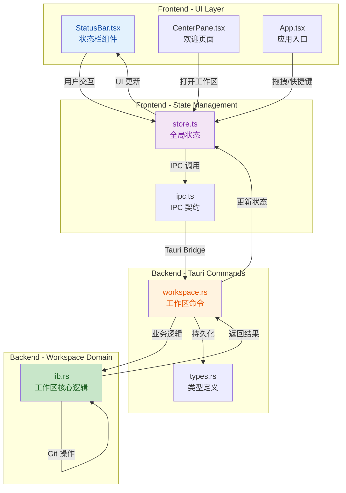
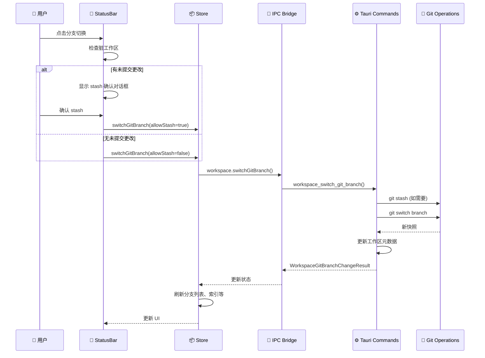

## 1. 高层摘要（TL;DR）

*   **影响范围：** 🟢 **高** - 新增完整的 Git 分支管理功能，重构工作区上下文管理，改进用户交互体验
*   **核心变更：**
    *   ✨ 新增 Git 分支列表、切换、创建功能，支持脏工作区自动 stash
    *   🔄 新增全局工作区模式（`__global__`），支持无工作区时的对话
    *   🎨 状态栏重构，新增工作区和分支管理的下拉菜单 UI
    *   📁 新增跨平台目录选择器，支持拖拽打开工作区和 Ctrl+O 快捷键
    *   🔐 更新 Tauri 权限配置和 IPC 契约

---

## 2. 可视化概览（代码与逻辑映射）





---

## 3. 详细变更分析

### 3.1 后端核心层（Rust）

#### 📦 **类型定义** (`crates/kernel/src/types.rs`)

**变更内容：**
- 新增全局工作区 ID 常量：`GLOBAL_WORKSPACE_ID = "__global__"`
- 新增 Git 分支相关类型：

| 类型 | 用途 |
|------|------|
| `GitBranchSummary` | 分支摘要（名称、是否当前分支） |
| `WorkspaceGitBranchSwitchInput` | 分支切换输入（分支名、是否允许 stash） |
| `WorkspaceGitBranchCreateInput` | 分支创建输入（分支名、基础分支、是否允许 stash） |
| `WorkspaceGitBranchChangeResult` | 分支变更结果（工作区、快照、前后分支、是否 stash） |

#### ⚙️ **工作区领域逻辑** (`crates/workspace/src/lib.rs`)

**新增核心函数：**

| 函数 | 功能 | 关键逻辑 |
|------|------|----------|
| `git_has_local_changes()` | 检查是否有本地更改 | 检查 staged/unstaged/untracked |
| `list_git_branches()` | 列出所有分支 | 使用 `git branch --format=%(refname:short)`，当前分支排序在前 |
| `switch_git_branch()` | 切换分支 | 脏工作区需显式确认 stash，执行 `git switch` |
| `create_git_branch()` | 创建分支 | 支持指定基础分支，跨分支切换时需 stash |
| `stash_workspace_changes()` | 自动 stash | 使用时间戳生成 stash 消息 |
| `run_git_required()` | Git 命令执行器 | 失败时返回结构化错误 |

**代码改进：**
- 修复 `open_workspace` 中的路径处理：使用 `to_string_lossy()` 替代 `unwrap_or()`

#### 🔌 **Tauri 命令层** (`src-tauri/src/commands/workspace.rs`)

**新增命令：**

| 命令 | 参数 | 返回值 | 说明 |
|------|------|--------|------|
| `workspace_clear_current` | - | `bool` | 清除当前工作区，进入全局模式 |
| `workspace_pick_directory` | - | `Option<String>` | 跨平台目录选择器 |
| `workspace_list_git_branches` | - | `Vec<GitBranchSummary>` | 列出分支 |
| `workspace_switch_git_branch` | `WorkspaceGitBranchSwitchInput` | `WorkspaceGitBranchChangeResult` | 切换分支 |
| `workspace_create_git_branch` | `WorkspaceGitBranchCreateInput` | `WorkspaceGitBranchChangeResult` | 创建分支 |

**跨平台目录选择器实现：**

| 平台 | 实现方式 |
|------|----------|
| Windows | PowerShell `FolderBrowserDialog` |
| macOS | AppleScript `choose folder` |
| Linux | `zenity` 或 `kdialog` |

**辅助函数：**
- `persist_workspace_meta()` - 统一的工作区持久化逻辑
- `update_workspace_after_git_change()` - Git 变更后更新工作区元数据
- `virtual_global_workspace()` - 创建虚拟全局工作区对象

---

### 3.2 前端状态管理（TypeScript）

#### 📦 **全局状态** (`frontend/src/app/store.ts`)

**新增状态字段：**

| 字段 | 类型 | 说明 |
|------|------|------|
| `gitBranches` | `GitBranchSummary[]` | 分支列表 |
| `workspaceContextMode` | `"workspace" \| "global"` | 工作区上下文模式 |
| `pendingWorkspacePath` | `string \| undefined` | 待绑定工作区路径 |

**新增方法：**

| 方法 | 功能 |
|------|------|
| `clearWorkspaceContext()` | 清除工作区上下文，进入全局模式 |
| `setPendingWorkspacePath()` | 设置待绑定工作区路径 |
| `pickWorkspaceDirectory()` | 调用目录选择器 |
| `fetchGitBranches()` | 获取分支列表 |
| `switchGitBranch()` | 切换分支 |
| `createGitBranch()` | 创建分支 |

**关键逻辑改进：**

1. **智能会话管理** - 发送消息时自动处理待绑定工作区：
   - 如果有 `pendingWorkspacePath`，先打开工作区
   - 如果当前是全局模式且会话为空，删除空会话
   - 自动创建新会话

2. **状态同步优化** - 分支变更后自动刷新：
   - 工作区树
   - 索引状态
   - Repo Map
   - Git 状态
   - 分支列表

#### 🔌 **IPC 契约** (`frontend/src/shared/ipc.ts`)

**新增接口：**

```typescript
workspace: {
  clearCurrent: () => Promise<IpcResult<boolean>>;
  pickDirectory: () => Promise<IpcResult<string | undefined>>;
  listGitBranches: () => Promise<IpcResult<GitBranchSummary[]>>;
  switchGitBranch: (input: WorkspaceGitBranchSwitchInput) => Promise<IpcResult<WorkspaceGitBranchChangeResult>>;
  createGitBranch: (input: WorkspaceGitBranchCreateInput) => Promise<IpcResult<WorkspaceGitBranchChangeResult>>;
}
```

---

### 3.3 UI 组件层（React）

#### 🎨 **状态栏重构** (`frontend/src/app/regions/StatusBar.tsx`)

**重大变更：**
- 从单一状态栏改为多下拉菜单架构
- 新增三个独立菜单：工作区、分支、模型

**工作区菜单功能：**
- 显示当前工作区路径
- 最近工作区快速切换（最多 6 个）
- 手动输入工作区路径
- 目录选择器按钮
- 切换到全局对话模式

**分支菜单功能：**
- 显示当前分支
- 分支列表（当前分支高亮）
- 切换分支（脏工作区自动弹出 stash 确认）
- 创建分支（支持选择基础分支）
- Stash 确认对话框

**状态指示：**

| 状态 | 图标 | 说明 |
|------|------|------|
| `synced` | ✅ | 无未提交更改 |
| `dirty` | ⚠️ | 有未提交更改 |
| `unpushed` | ☁️ | 有未推送提交 |
| `conflict` | ❌ | 有冲突 |
| `no-repo` | 📁 | 非 Git 仓库 |

#### 🏠 **欢迎页面改进** (`frontend/src/app/regions/CenterPane.tsx`)

**变更内容：**
- 移除"无会话"状态，统一为单一欢迎页
- 新增"快速操作"栏：新建对话、打开工作区
- 改进最近工作区列表样式
- 新增提示区域（拖拽、快捷键）

#### ⌨️ **快捷键和拖拽支持** (`frontend/src/app/App.tsx`)

**新增交互：**
- `Ctrl/Cmd + O` - 打开工作区（优先目录选择器，回退到输入框）
- 拖拽文件夹到窗口 - 自动打开工作区
- Tauri v2 拖拽事件兼容性处理

---

### 3.4 权限和配置

#### 🔐 **Tauri 权限** (`src-tauri/permissions/digital-life.toml`)

**新增命令权限：**

```toml
commands.allow = [
  "workspace_clear_current",
  "workspace_pick_directory",
  "workspace_list_git_branches",
  "workspace_switch_git_branch",
  "workspace_create_git_branch",
]
```

#### 📄 **能力配置** (`src-tauri/capabilities/default.json`)

**新增窗口权限：**
```json
"core:window:allow-set-icon"
```

#### 📝 **开发规则更新** (`.cursor/rules/ai-digital-life-tauri-shell.mdc`)

**新增规则：**
- 明确工作区/对话/分支相关命令列表
- 强调全局会话作用域支持（`__global__`）
- 规定"仅对话模式"不得绕过工作区命令边界

---

## 4. 影响与风险评估

### ⚠️ **破坏性变更**

| 变更 | 影响 | 缓解措施 |
|------|------|----------|
| 移除默认工作区自动打开 | 用户需手动打开工作区 | 新增欢迎页引导和快捷键 |
| 欢迎页面结构变更 | UI 布局调整 | 保持功能一致性 |

### ✅ **向后兼容性**

- ✅ IPC 接口向后兼容（新增方法不影响现有调用）
- ✅ 数据库结构无变更
- ✅ 现有工作区数据无需迁移

### 🧪 **测试建议**

#### 核心功能测试：
1. **Git 分支管理**
   - [ ] 列出分支（当前分支排序正确）
   - [ ] 切换分支（干净工作区）
   - [ ] 切换分支（脏工作区 + 确认 stash）
   - [ ] 切换分支（脏工作区 + 拒绝 stash）
   - [ ] 创建分支（从当前分支）
   - [ ] 创建分支（从其他分支 + stash）
   - [ ] 分支切换后 UI 状态正确更新

2. **工作区上下文**
   - [ ] 打开工作区
   - [ ] 清除工作区（进入全局模式）
   - [ ] 目录选择器（Windows/macOS/Linux）
   - [ ] 拖拽打开工作区
   - [ ] Ctrl+O 快捷键
   - [ ] 待绑定工作区路径逻辑

3. **全局对话模式**
   - [ ] 无工作区时创建会话
   - [ ] 全局模式下发送消息
   - [ ] 待绑定工作区自动打开

4. **边界情况**
   - [ ] 非 Git 仓库的分支按钮禁用
   - [ ] 空分支列表处理
   - [ ] 网络错误时的错误提示
   - [ ] 并发分支操作处理

### 🔍 **潜在风险**

1. **Git 操作安全性**
   - ⚠️ `git stash` 可能覆盖用户数据
   - ✅ 已实现显式确认机制
   - 📝 建议：测试 stash 恢复流程

2. **跨平台兼容性**
   - ⚠️ 目录选择器依赖系统工具
   - ✅ 已实现降级处理（Linux 无 zenity/kdialog 时返回 None）
   - 📝 建议：在各平台测试目录选择器

3. **状态一致性**
   - ⚠️ 分支变更后多状态同步
   - ✅ 使用 `Promise.allSettled` 确保部分失败不影响整体
   - 📝 建议：测试网络不稳定场景

---

## 5. 总结

本次变更实现了完整的 Git 分支管理功能，大幅改进了工作区上下文管理，提升了用户交互体验。主要亮点包括：

✨ **功能完整性** - 从后端 Git 操作到前端 UI 的完整实现  
🎨 **用户体验** - 直观的下拉菜单、快捷键、拖拽支持  
🔒 **安全性** - 脏工作区显式确认，防止数据丢失  
🌐 **跨平台** - Windows/macOS/Linux 全平台支持  
🏗️ **架构清晰** - 分层明确，职责单一，易于维护

建议重点关注 Git 操作的安全性和跨平台兼容性的测试。