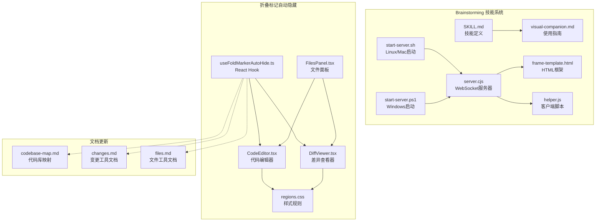
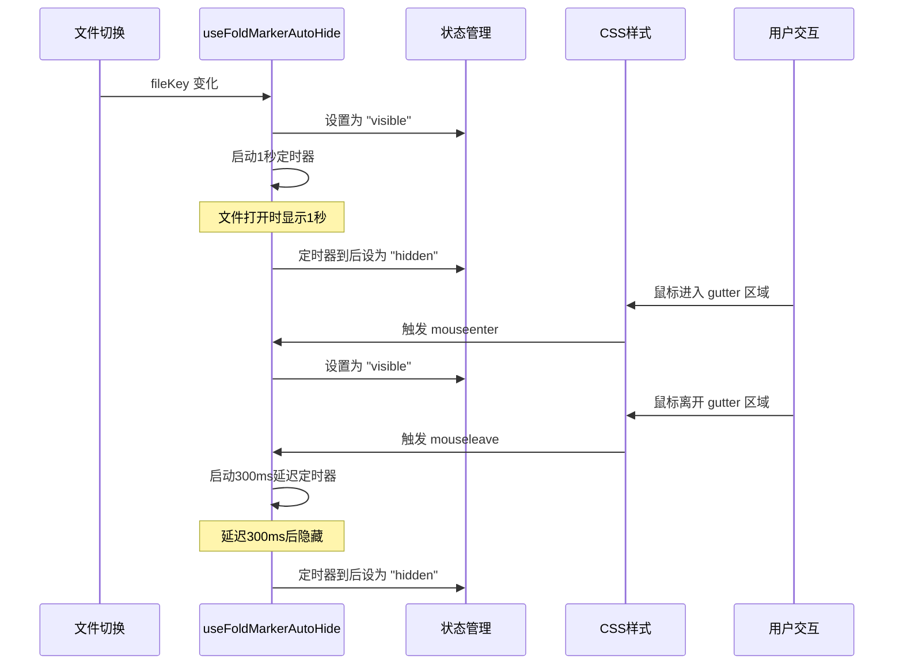

## 1. 高层摘要 (TL;DR)

**影响范围：** 🟢 **中等** - 新增完整的可视化头脑风暴技能系统 + 改进代码编辑器UI体验

**核心变更：**
- ✨ **新增 Brainstorming 技能系统** - 包含WebSocket服务器、HTML框架模板、跨平台启动脚本，支持浏览器可视化协作
- 🎨 **代码编辑器折叠标记自动隐藏** - 新增 `useFoldMarkerAutoHide` Hook，折叠图标默认隐藏，仅在打开文件时短暂显示或鼠标悬停时显示
- 📝 **文档更新** - 更新操作手册和代码库映射，记录新功能使用说明

---

## 2. 可视化概览 (代码与逻辑映射)



---

## 3. 详细变更分析

### 🎯 组件一：Brainstorming 可视化技能系统

#### 📋 变更说明
新增完整的浏览器可视化头脑风暴系统，允许AI助手在浏览器中展示UI原型、架构图、选项对比等可视化内容，用户可通过点击交互反馈。

#### 📁 新增文件清单

| 文件路径 | 类型 | 功能描述 |
|---------|------|---------|
| `.trae/skills/brainstorming/SKILL.md` | 技能定义 | 定义头脑风暴技能的工作流程、检查清单和关键原则 |
| `.trae/skills/brainstorming/visual-companion.md` | 使用指南 | 详细说明何时使用浏览器、如何启动会话、编写HTML内容片段 |
| `.trae/skills/brainstorming/spec-document-reviewer-prompt.md` | 提示模板 | 规范文档审查子代理的提示模板 |
| `.trae/skills/brainstorming/scripts/server.cjs` | Node.js服务器 | WebSocket服务器，支持RFC 6455协议，文件监控，自动重载 |
| `.trae/skills/brainstorming/scripts/frame-template.html` | HTML模板 | 包含CSS主题、响应式布局、深色模式支持的框架模板 |
| `.trae/skills/brainstorming/scripts/helper.js` | 客户端脚本 | WebSocket连接管理、事件捕获、选择状态跟踪 |
| `.trae/skills/brainstorming/scripts/start-server.sh` | Bash脚本 | Linux/Mac启动脚本，支持后台/前台模式 |
| `.trae/skills/brainstorming/scripts/start-server.ps1` | PowerShell脚本 | Windows启动脚本，支持后台/前台模式 |
| `.trae/skills/brainstorming/scripts/stop-server.sh` | Bash脚本 | Linux/Mac停止脚本 |
| `.trae/skills/brainstorming/scripts/stop-server.ps1` | PowerShell脚本 | Windows停止脚本 |

#### 🔑 核心功能特性

**服务器功能 (`server.cjs`)：**
- 🌐 HTTP服务器 + WebSocket升级支持
- 📁 文件监控：监听 `content/` 目录下HTML文件变化
- 🔄 自动重载：文件变更时广播 `reload` 消息
- ⏱️ 生命周期管理：30分钟无活动自动关闭，所有者进程退出时自动关闭
- 📝 事件记录：用户点击事件记录到 `state/events` 文件

**启动脚本功能：**
- 🎲 随机端口分配（49152-65535范围）
- 🆔 唯一会话ID生成（PID-时间戳格式）
- 📂 支持项目目录持久化（`.superpowers/brainstorm/`）或临时目录
- ⏳ 启动超时检测（5秒）

**HTML框架模板特性：**
- 🎨 完整的CSS主题（浅色/深色模式）
- 📱 响应式布局
- 🎯 预定义CSS类：`.options`, `.cards`, `.mockup`, `.split`, `.pros-cons`
- ✨ 交互指示器栏（显示选择状态）

---

### 🎯 组件二：折叠标记自动隐藏功能

#### 📋 变更说明
改进代码编辑器用户体验，折叠标记（`+`/`-`图标）默认隐藏，仅在特定场景下显示，减少视觉干扰。

#### 📁 文件变更

| 文件路径 | 变更类型 | 变更内容 |
|---------|---------|---------|
| `useFoldMarkerAutoHide.ts` | 新增 | React Hook，管理折叠标记显示状态 |
| `CodeEditor.tsx` | 修改 | 集成 `useFoldMarkerAutoHide`，添加 `fileKey` prop |
| `DiffViewer.tsx` | 修改 | 两个子组件都集成 `useFoldMarkerAutoHide` |
| `FilesPanel.tsx` | 修改 | 传递 `fileKey` 到编辑器组件 |
| `cmTheme.ts` | 修改 | 调整折叠标记过渡动画 |
| `regions.css` | 修改 | 新增折叠标记自动隐藏样式规则 |

#### 🔑 核心逻辑

**`useFoldMarkerAutoHide` Hook 工作流程：**



**状态机逻辑：**

| 触发条件 | 状态变化 | 说明 |
|---------|---------|------|
| 文件切换 (`fileKey` 变化) | `hidden` → `visible` | 打开新文件时显示 |
| 文件打开1秒后 | `visible` → `hidden` | 自动隐藏 |
| 鼠标进入 gutter | `hidden` → `visible` | 显示折叠标记 |
| 鼠标离开 gutter | `visible` → `hidden` (延迟300ms) | 延迟隐藏 |
| 鼠标悬停在单个图标上 | 保持 `visible` | 覆盖隐藏逻辑 |

#### 🎨 CSS样式规则

```css
/* 默认隐藏 */
.adl-cm-fold-marker {
  opacity: 0;
  pointer-events: none;
}

/* 状态可见时显示 */
[data-fold-marker-state="visible"] .adl-cm-fold-marker {
  opacity: 0.6;
  pointer-events: auto;
}

/* gutter 悬停时显示 */
.cm-foldGutter:hover .adl-cm-fold-marker {
  opacity: 0.6;
  pointer-events: auto;
}

/* 单个图标悬停时高亮 */
.adl-cm-fold-marker:hover {
  opacity: 1;
  box-shadow: 0 0 0 4px rgba(128, 128, 128, 0.12);
}

/* 点击效果 */
.adl-cm-fold-marker:active {
  transform: scale(0.9);
}

/* 键盘导航焦点 */
.adl-cm-fold-marker:focus-visible {
  outline: 2px solid var(--accent, #4a9eff);
}
```

#### 📝 代码片段（关键实现）

**Hook核心逻辑：**
```typescript
export function useFoldMarkerAutoHide(
  containerEl: HTMLElement | null,
  fileKey: string,
): FoldMarkerState {
  const [state, setState] = useState<FoldMarkerState>("hidden");
  
  // 文件切换时显示1秒
  useEffect(() => {
    show();
    revealTimerRef.current = setTimeout(() => {
      if (!isHoveringRef.current) {
        setState("hidden");
      }
    }, REVEAL_DURATION_MS);
  }, [fileKey]);
  
  // gutter 鼠标事件
  useEffect(() => {
    const handleMouseEnter = () => {
      isHoveringRef.current = true;
      show();
    };
    const handleMouseLeave = () => {
      isHoveringRef.current = false;
      scheduleHide(); // 延迟300ms
    };
    // 绑定事件...
  }, [containerEl]);
  
  return state;
}
```

---

### 🎯 组件三：文档更新

#### 📋 变更说明
更新操作手册和代码库映射文档，记录新功能的使用说明和代码结构变化。

#### 📁 文件变更

| 文件路径 | 变更类型 | 变更内容 |
|---------|---------|---------|
| `.trae/rules/codebase-map.md` | 修改 | 添加 `useFoldMarkerAutoHide` 到右侧面板组件列表 |
| `UIOperationManual/rightpanel/tools/changes.md` | 修改 | 更新折叠标记状态表格，添加auto-hide说明 |
| `UIOperationManual/rightpanel/tools/files.md` | 修改 | 同上 |

#### 📝 文档内容更新

**折叠标记状态表格更新：**

| 状态 | 行号数字 | 折叠图标 | gutter 区域 |
|------|----------|----------|-------------|
| ✅ 开启 | 显示 | 显示（auto-hide：打开文件时显示1秒后自动隐藏，鼠标进入行号区重新显示） | 正常宽度 |
| ❌ 关闭 | 隐藏 | 隐藏 | 完全消失，正文左移 |

**新增说明：**
> 折叠图标默认隐藏，仅在以下情况显示：打开文件时短暂显示1秒、鼠标悬停在行号区、鼠标悬停在单个图标上。

---

## 4. 影响与风险评估

### ⚠️ 破坏性变更
**无** - 所有变更为新增功能或向后兼容的UI改进

### 🧪 测试建议

#### Brainstorming 技能系统测试
- ✅ **服务器启动测试**
  - Linux/Mac: `scripts/start-server.sh --project-dir /path/to/project`
  - Windows: `scripts/start-server.ps1 -ProjectDir "E:\path\to\project"`
  - 验证返回JSON包含正确的 `port`、`url`、`screen_dir`、`state_dir`
- ✅ **文件监控测试**
  - 写入HTML文件到 `screen_dir`
  - 验证浏览器自动刷新
- ✅ **WebSocket连接测试**
  - 验证客户端自动重连
  - 验证点击事件正确记录到 `state/events`
- ✅ **生命周期测试**
  - 验证30分钟无活动自动关闭
  - 验证所有者进程退出时自动关闭
- ✅ **跨平台兼容性**
  - 测试Windows PowerShell脚本
  - 测试Linux/Mac Bash脚本

#### 折叠标记自动隐藏测试
- ✅ **文件切换测试**
  - 打开文件，验证折叠标记显示1秒后隐藏
  - 快速切换多个文件，验证每个文件都正确触发显示
- ✅ **鼠标交互测试**
  - 鼠标进入gutter区域，验证折叠标记立即显示
  - 鼠标离开gutter区域，验证300ms后隐藏
  - 鼠标悬停在单个图标上，验证保持显示
- ✅ **键盘导航测试**
  - 使用Tab键导航到折叠标记，验证焦点环正确显示
- ✅ **多编辑器测试**
  - 同时打开代码编辑器和差异查看器，验证各自独立管理状态
- ✅ **主题切换测试**
  - 切换浅色/深色主题，验证折叠标记样式正确

### 🔍 潜在风险点
1. **WebSocket服务器端口冲突** - 随机端口范围可能被占用（概率低）
2. **文件监控性能** - 大量文件变更时可能影响性能（已添加防抖）
3. **React Hook依赖** - `fileKey` 变化频繁时可能导致状态闪烁（已优化）

---

## 5. 总结

本次变更包含两个独立的功能模块：

1. **Brainstorming可视化技能系统** - 完整的新增功能，为AI助手提供浏览器可视化协作能力，支持UI原型展示、架构图绘制、选项对比等场景。系统设计完善，包含跨平台支持、自动生命周期管理、事件记录等功能。

2. **折叠标记自动隐藏** - UI体验改进，通过React Hook和CSS实现智能显示逻辑，减少视觉干扰同时保持功能可用性。实现优雅，支持键盘导航和主题切换。

两个功能模块相互独立，无依赖关系，可分别测试和部署。文档更新完整，便于后续维护。