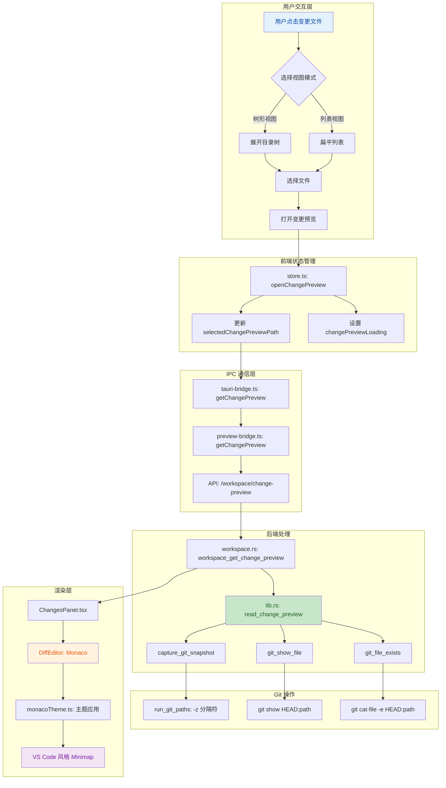
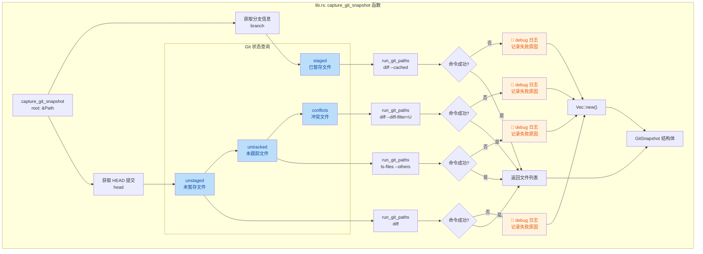

## 1. 高层摘要 (TL;DR)

**影响范围：** 🔴 **高** - 新增核心 Git 变更预览功能，重构 ChangesPanel，优化 Monaco 编辑器体验

**关键变更：**
- ✨ 新增 **Git 变更预览功能**：支持查看文件的 HEAD 版本与工作区版本的差异对比
- 🎨 **Monaco 编辑器深度优化**：实现 VS Code 风格的 Minimap（字符渲染、缩放、主题感知阴影）
- 🌳 **ChangesPanel 重构**：支持树形/列表双视图模式，新增状态徽章和上下文菜单
- 🔄 **Git 状态捕获改进**：从 `--porcelain` 改为 `-z` 分隔符，提升路径解析可靠性
- 📦 **代码复用优化**：提取通用文件树组件 `FileTree` 和 Monaco 主题模块

---

## 2. 可视化概览 (代码与逻辑映射)



---

## 3. 详细变更分析

### 3.1 后端核心变更 (Rust)

#### 📁 **ai-digital-life/crates/kernel/src/types.rs**
**新增类型定义：**
- `WorkspaceChangeKind` 枚举：`Added | Modified | Deleted`
- `WorkspaceChangeStatus` 枚举：`Staged | Modified | Untracked | Conflicted`
- `WorkspaceChangePreview` 结构体：包含路径、变更类型、状态、文件存在性、内容等完整信息

#### 📁 **ai-digital-life/crates/workspace/src/lib.rs**
**关键逻辑变更：**

| 函数 | 变更类型 | 说明 |
|------|---------|------|
| `capture_git_snapshot` | 🔧 重构 | 从 `--porcelain` 改为 `-z` 分隔符，提升特殊路径处理能力 |
| `read_change_preview` | ✨ 新增 | 核心函数：读取文件变更预览，对比 HEAD 与工作区 |
| `run_git_bytes` | ✨ 新增 | 执行 git 命令并返回字节流 |
| `run_git_paths` | ✨ 新增 | 解析 `-z` 分隔的路径列表 |
| `git_show_file` | ✨ 新增 | 获取 HEAD 版本文件内容 |
| `git_file_exists` | ✨ 新增 | 检查文件在 HEAD 中是否存在 |

**Git 命令变更对比：**

| 操作 | 旧方式 | 新方式 |
|------|--------|--------|
| 已暂存文件 | `git status --porcelain` 解析 | `git diff --name-only --cached -z` |
| 未暂存文件 | `git status --porcelain` 解析 | `git diff --name-only -z` |
| 未跟踪文件 | `git status --porcelain` 解析 | `git ls-files --others --exclude-standard -z` |
| 冲突文件 | `git status --porcelain` 解析 | `git diff --name-only --diff-filter=U -z` |

**新增测试用例：**
- `captures_git_snapshot_for_untracked_and_unstaged_files`：验证 Git 快照捕获
- `reads_deleted_change_preview_from_head`：验证删除文件的变更预览

#### 📁 **ai-digital-life/src-tauri/src/commands/workspace.rs**
- 新增 Tauri 命令：`workspace_get_change_preview`

---

### 3.2 前端核心变更 (TypeScript/React)

#### 📁 **ai-digital-life/frontend/src/app/monacoTheme.ts** (新文件)
**功能：** 统一 Monaco 编辑器主题配置

**核心函数：**
- `buildMonacoThemeData(theme)`：从 CSS 变量读取主题色并构建 Monaco 主题数据
- `ensureAdlMonacoThemes(monaco)`：注册 `adl-light` 和 `adl-dark` 主题

**支持的 CSS 变量：**
```css
--editor-bg, --editor-fg, --editor-lineNumber, --editor-cursor
--editor-selection, --editor-lineHighlight, --editor-indentGuide
--editor-diff-insert-bg, --editor-diff-remove-bg
--editor-syntax-{comment,keyword,string,number,...}
```

#### 📁 **ai-digital-life/frontend/src/app/regions/right-panel/ChangesPanel.tsx**
**重大重构：**

| 功能 | 旧实现 | 新实现 |
|------|--------|--------|
| 变更列表 | 分组列表（staged/modified/untracked/conflicts） | 树形/列表双视图 |
| 文件选择 | 点击打开补丁文件 | 点击打开变更预览或补丁 |
| 编辑器 | 仅补丁编辑器 | 支持 DiffEditor（inline/side-by-side） |
| 工具栏 | 基础操作 | 新增行号/换行开关、diff 布局切换 |

**新增状态管理：**
- `changesNavigatorMode`：`"tree" | "list"`
- `expandedChangesTreePaths`：变更树展开状态
- `lineNumbersEnabled`：行号显示开关
- `wordWrapEnabled`：自动换行开关

**新增组件：**
- 差异视图切换按钮（inline/side-by-side）
- 树形视图展开/折叠全部按钮
- 变更统计徽章（A/M/D/C/S/U）

#### 📁 **ai-digital-life/frontend/src/app/regions/right-panel/changesTree.ts** (新文件)
**功能：** 构建变更树和扁平列表

| 函数 | 功能 |
|------|------|
| `buildChangeEntries` | 合并 Git 快照和补丁摘要，去重并合并状态 |
| `buildChangeTree` | 构建层级树结构，计算目录文件数 |
| `buildFlatChangeNodes` | 构建扁平列表视图 |

**状态优先级：** `conflicted > modified > staged > untracked`

#### 📁 **ai-digital-life/frontend/src/app/regions/right-panel/fileTree.tsx** (新文件)
**功能：** 通用文件树组件

**特性：**
- 支持自定义渲染元数据 `renderMeta`
- 支持右键上下文菜单
- 支持自定义节点样式 `getNodeClassName`
- 自动边界约束菜单位置

#### 📁 **ai-digital-life/frontend/src/app/regions/right-panel/FilesPanel.tsx**
**优化：**
- 移除重复的 Monaco 主题代码，改用 `monacoTheme.ts`
- 移除内联的 `TreeNode` 组件，改用 `FileTree` 组件
- 优化 Monaco 编辑器选项配置

#### 📁 **ai-digital-life/frontend/src/app/store.ts**
**新增状态：**
- `selectedChangePreviewPath`：当前选中的变更预览路径
- `changePreview`：变更预览数据
- `changePreviewLoading`：加载状态

**新增方法：**
- `openChangePreview(relativePath)`：打开变更预览

**逻辑优化：**
- `fetchGitStatus` 后自动刷新当前变更预览
- 切换工作区时清空变更预览状态

#### 📁 **ai-digital-life/frontend/src/app/ui-store.ts**
**新增状态：**
- `changesNavigatorMode`：变更导航器模式
- `expandedChangesTreePaths`：变更树展开路径

**新增方法：**
- `setChangesNavigatorMode`：设置导航器模式
- `setChangesTreePathExpanded`：设置路径展开状态
- `toggleChangesTreePath`：切换路径展开状态
- `expandChangesTreePathChain`：展开路径链
- `collapseAllChangesTreePaths`：折叠所有路径

---

### 3.3 样式优化 (CSS)

#### 📁 **ai-digital-life/frontend/src/styles/regions.css**
**Monaco Minimap 优化：**

| 属性 | 标准编辑器 | 变更预览编辑器 |
|------|-----------|---------------|
| 宽度 | 84px | 84px |
| 位置 | right: 12px | right: 12px |
| 字符渲染 | ✅ 启用 | ✅ 启用 |
| 最大列数 | 80 | 80 |
| 缩放比例 | 1.5 | 1.5 |
| Slider 最小高度 | 40px | 40px |
| Slider 最大高度 | 40% | 40% |

**主题感知阴影：**
```css
/* 浅色主题 */
box-shadow: inset -1px 0 0 rgba(0, 0, 0, 0.18),
            -2px 0 4px rgba(0, 0, 0, 0.06);
filter: drop-shadow(-2px 2px 6px rgba(0, 0, 0, 0.08))
       drop-shadow(-6px 4px 14px rgba(0, 0, 0, 0.04));

/* 深色主题 */
box-shadow: inset -1px 0 0 rgba(0, 0, 0, 0.80),
            -2px 0 3px rgba(0, 0, 0, 0.35);
filter: drop-shadow(-2px 1px 3px rgba(0, 0, 0, 0.30))
       drop-shadow(-5px 2px 8px rgba(0, 0, 0, 0.15));
```

**行号间距优化：**
```css
/* 变更预览编辑器 */
.line-numbers {
  padding-left: 8px !important;
  padding-right: 12px !important;
  text-align: left !important;
}

/* 并排视图 - 原始版本 */
.original .line-numbers {
  text-align: right !important;
  padding-right: 10px !important;
}
```

**新增样式类：**
- `.adl-filetree__status-badge`：变更状态徽章（A/M/D/C/S/U）
- `.adl-filetree__count-badge`：变更计数徽章
- `.adl-tool-editor--changes`：变更预览编辑器容器
- `.adl-tool-context__diff-view`：diff 视图切换按钮组

---

### 3.4 桥接层变更

| 文件 | 新增内容 |
|------|---------|
| `shared/ipc.ts` | `getChangePreview` 方法签名 |
| `tauri-bridge.ts` | `workspace_get_change_preview` IPC 调用 |
| `preview-bridge.ts` | `/workspace/change-preview` API 调用 |
| `mock-bridge.ts` | `buildMockChangePreview` 模拟实现 |

---

### 3.5 测试文件

| 文件 | 测试内容 |
|------|---------|
| `changesEditorOptions.test.ts` | 验证变更预览编辑器选项配置 |
| `changesEditorSpacing.test.ts` | 验证行号间距和 Minimap 样式 |
| `changesTree.test.ts` | 验证变更树构建逻辑 |
| `filesEditorOptions.test.ts` | 验证文件面板编辑器选项 |

---

## 4. 影响与风险评估

### ⚠️ 破坏性变更

| 变更类型 | 影响 | 缓解措施 |
|---------|------|---------|
| Git 状态捕获方式变更 | 可能影响依赖 `--porcelain` 输出的外部工具 | 使用 `-z` 分隔符更可靠，无需迁移 |
| ChangesPanel UI 重构 | 用户体验变化 | 新增树形/列表切换，保留原有功能 |

### ✅ 测试建议

#### 后端测试
- [ ] 验证包含特殊字符（空格、换行）的文件路径解析
- [ ] 验证删除文件的变更预览（baseContent 存在，currentContent 为空）
- [ ] 验证新增文件的变更预览（baseContent 为空，currentContent 存在）
- [ ] 验证冲突文件的变更预览状态

#### 前端测试
- [ ] 验证树形视图展开/折叠功能
- [ ] 验证列表视图与树形视图切换
- [ ] 验证 inline/side-by-side diff 布局切换
- [ ] 验证行号和自动换行开关
- [ ] 验证深色/浅色主题下 Monaco Minimap 渲染
- [ ] 验证右键上下文菜单位置约束
- [ ] 验证变更预览加载状态显示

#### 集成测试
- [ ] 验证从变更列表打开预览的完整流程
- [ ] 验证 Git 状态更新后自动刷新变更预览
- [ ] 验证切换工作区后清空变更预览状态
- [ ] 验证大文件预览（超过 `DEFAULT_MAX_FILE_BYTES`）

---

## 5. 技术亮点

### 🎯 代码复用
- 提取 `FileTree` 通用组件，同时用于 FilesPanel 和 ChangesPanel
- 提取 `monacoTheme.ts` 统一主题配置，消除重复代码

### 🔧 可靠性提升
- Git 命令使用 `-z` 分隔符，正确处理包含特殊字符的文件路径
- 新增完整的单元测试覆盖核心逻辑

### 🎨 用户体验优化
- Monaco Minimap 采用 VS Code 风格，提升代码可读性
- 变更树支持状态徽章，快速识别文件变更类型
- Diff 视图支持 inline/side-by-side 切换，适应不同场景

### 📦 架构改进
- 前后端类型定义同步（Rust ↔ TypeScript）
- 清晰的分层架构：UI 层 → 状态层 → IPC 层 → 后端层

---

## 1. 高层摘要 (TL;DR)

*   **影响范围：** 🟢 **低** - 优化了 Git 快照捕获函数的错误处理逻辑
*   **核心变更：**
    *   将 `unwrap_or_default()` 替换为 `unwrap_or_else()` 以提供更详细的错误日志
    *   为 4 个 Git 命令调用添加了调试日志记录
    *   改善了非 Git 仓库环境下的可观测性

## 2. 可视化概览 (代码与逻辑映射)



## 3. 详细变更分析

### 📦 组件：Git 快照捕获模块 (`lib.rs`)

#### 🔄 变更说明
优化了 `capture_git_snapshot()` 函数中的错误处理机制，将静默失败改为记录调试日志，提升了系统在非 Git 仓库或 Git 命令失败场景下的可观测性。

#### 📊 Git 命令错误处理变更表

| Git 命令 | 变量名 | 旧处理方式 | 新处理方式 | 新增日志内容 |
|---------|--------|-----------|-----------|------------|
| `diff --name-only --cached -z` | `staged` | `unwrap_or_default()` | `unwrap_or_else(\|\| { ... })` | 记录 "git diff --cached failed" |
| `diff --name-only -z` | `unstaged` | `unwrap_or_default()` | `unwrap_or_else(\|\| { ... })` | 记录 "git diff failed" |
| `ls-files --others --exclude-standard -z` | `untracked` | `unwrap_or_default()` | `unwrap_or_else(\|\| { ... })` | 记录 "git ls-files --others failed" |
| `diff --name-only --diff-filter=U -z` | `conflicts` | `unwrap_or_default()` | `unwrap_or_else(\|\| { ... })` | 记录 "git diff --diff-filter=U failed" |

#### 💡 技术细节

**变更模式：**
```rust
// 旧代码
let staged = run_git_paths(root, &["diff", "--name-only", "--cached", "-z"]).unwrap_or_default();

// 新代码
let staged = run_git_paths(root, &["diff", "--name-only", "--cached", "-z"]).unwrap_or_else(|| {
    debug!(root = %root.to_string_lossy(), "git diff --cached failed, defaulting to empty staged list");
    Vec::new()
});
```

**关键改进点：**
1. **延迟求值**：`unwrap_or_else` 只在 `Err` 时才执行闭包，避免不必要的日志记录
2. **上下文信息**：日志包含 `root` 路径，便于定位问题
3. **明确意图**：日志明确说明 "defaulting to empty X list"，让开发者了解降级行为

## 4. 影响与风险评估

### ✅ 无破坏性变更
- **API 兼容性**：函数签名和返回值类型完全不变
- **行为兼容性**：失败时仍返回空 `Vec`，仅增加了日志输出

### 🧪 测试建议

| 测试场景 | 验证点 |
|---------|--------|
| **正常 Git 仓库** | 确认所有 4 个状态列表正确获取，无日志输出 |
| **非 Git 目录** | 确认返回空列表，检查日志中记录了 4 条失败信息 |
| **Git 命令权限不足** | 确认降级为空列表，日志记录具体失败的命令 |
| **部分命令失败** | 确认成功的命令返回正确结果，失败的命令记录日志 |

### ⚠️ 潜在影响
- **日志量增加**：在非 Git 环境下，每次调用 `capture_git_snapshot` 会产生 4 条 debug 日志
- **性能影响**：`unwrap_or_else` 的闭包调用开销可忽略不计（仅在失败时执行）

### 📝 备注
此变更属于**可观测性增强**，主要目的是在开发调试阶段更好地诊断 Git 相关问题。生产环境中若日志级别设置为 `info` 或更高，这些 debug 日志不会输出。

---
