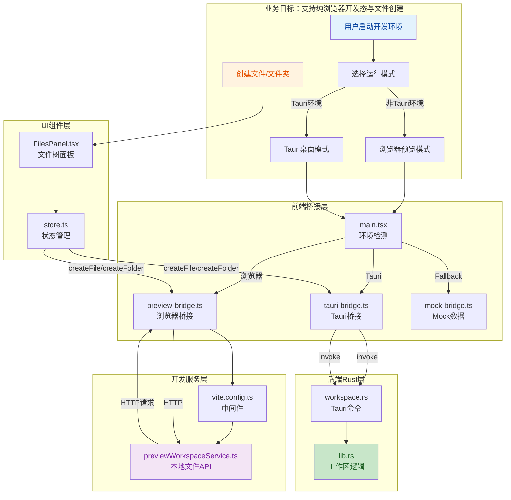
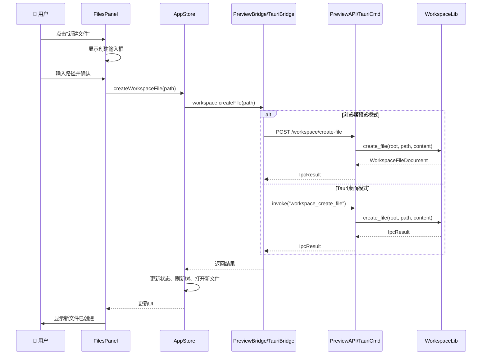

## 1. 高层摘要（TL;DR）

- **影响范围：** 🟡 **中等** - 新增浏览器预览工作区功能、文件/文件夹创建能力，以及多项UI优化
- **核心变更：**
  - ✨ 新增纯浏览器开发态工作区访问能力（通过本地Vite API）
  - ✨ 实现文件/文件夹创建功能（后端、IPC、UI完整链路）
  - 🎨 Monaco编辑器主题与Shell背景统一
  - 🛡️ 工作区树遍历增加安全限制（深度、节点数、符号链接过滤）
  - 📝 文件树视觉优化（徽章紧凑化、样式调整）

---

## 2. 可视化概览（代码与逻辑映射）





---

## 3. 详细变更分析

### 📦 组件一：浏览器预览工作区服务

**变更文件：** `frontend/dev/previewWorkspaceService.ts`（新增）

**变更说明：**
- 新增完整的本地Vite开发服务端工作区API，提供与Tauri命令等效的功能
- 实现工作区检测、文件树遍历、文件读取、搜索、大纲提取、Git快照等功能
- 通过HTTP中间件暴露 `/__adl_preview_api__/*` 路径

**核心功能表：**

| API端点 | 方法 | 功能 | 对应Tauri命令 |
|---------|------|------|---------------|
| `/workspace/open` | POST | 打开工作区 | `workspace_open` |
| `/workspace/reveal` | POST | 在文件管理器中显示 | `workspace_reveal_in_file_manager` |
| `/workspace/create-file` | POST | 创建文件 | `workspace_create_file` |
| `/workspace/create-folder` | POST | 创建文件夹 | `workspace_create_folder` |
| `/workspace/file` | GET | 读取文件 | `workspace_read_file` |
| `/workspace/tree` | GET | 获取文件树 | `workspace_list_tree` |
| `/workspace/search` | GET | 搜索文件内容 | `workspace_search` |
| `/workspace/outline` | GET | 获取文件大纲 | `workspace_outline` |
| `/workspace/git-status` | GET | 获取Git状态 | `workspace_get_git_status` |
| `/retrieval/status` | GET | 获取检索快照 | `retrieval_get_status` |

**安全限制：**
- 最大文件大小：1MB
- 最大搜索结果：200条
- 最大树深度：64层
- 最大树节点：200,000个
- 忽略目录：`.git`, `target`, `node_modules`, `dist`, `build`, `.next`, `.cache`
- 跳过符号链接
- 路径逃逸检测

---

### 🌉 组件二：前端桥接层重构

**变更文件：**
- `frontend/src/preview-bridge.ts`（新增）
- `frontend/src/tauri-bridge.ts`（更新）
- `frontend/src/mock-bridge.ts`（更新）
- `frontend/src/shared/ipc.ts`（更新）
- `frontend/src/main.tsx`（更新）

**变更说明：**

#### 1. 新增 `preview-bridge.ts`
- 实现纯浏览器开发态桥接层
- 通过 `fetch` 调用本地Vite API
- 管理最近工作区（存储在 `localStorage`）
- 继承 `mockDigitalLifeBridge` 作为fallback

#### 2. 更新 `tauri-bridge.ts`
```typescript
// 新增命令映射
createFile: (relativePath: string, content = "") =>
  invokeIpc<WorkspaceFileDocument>("workspace_create_file", { relativePath, content }),
createFolder: (relativePath: string) =>
  invokeIpc<boolean>("workspace_create_folder", { relativePath }),
```

#### 3. 更新 `mock-bridge.ts`
- 支持动态工作区路径（从 `VITE_ADL_DEFAULT_WORKSPACE_PATH` 读取）
- 新增 `createFile` 和 `createFolder` mock实现
- 重构 `listTree` 使用动态构建的树结构

#### 4. 更新 `shared/ipc.ts`
```typescript
// DigitalLifeBridge 接口新增
createFile: (relativePath: string, content?: string) => Promise<IpcResult<WorkspaceFileDocument>>;
createFolder: (relativePath: string) => Promise<IpcResult<boolean>>;
```

#### 5. 更新 `main.tsx`
```typescript
// 环境检测逻辑
if (isTauriShell()) {
  window.digitalLife = createTauriBridge();
} else {
  setupPreviewBridge();  // 替代原来的 setupMockBridge()
}
```

---

### 📁 组件三：后端文件创建功能

**变更文件：**
- `crates/workspace/src/lib.rs`（更新）
- `src-tauri/src/commands/workspace.rs`（更新）
- `src-tauri/src/main.rs`（更新）
- `src-tauri/permissions/digital-life.toml`（更新）

**变更说明：**

#### 1. Rust工作区库（`lib.rs`）

**新增函数：**

| 函数 | 签名 | 功能 |
|------|------|------|
| `create_file` | `fn(root: &Path, relative_path: &str, content: &str) -> Result<WorkspaceFileDocument, AppError>` | 创建新文件 |
| `create_folder` | `fn(root: &Path, relative_path: &str) -> Result<bool, AppError>` | 创建新文件夹 |
| `file_modified_at` | `fn(path: &Path) -> i64` | 获取文件修改时间 |

**工作区树遍历优化：**
```rust
// 新增常量
const MAX_TREE_DEPTH: usize = 64;
const MAX_TREE_NODES: usize = 200_000;

// 新增参数控制
fn list_tree_inner(
    root: &Path,
    dir: &Path,
    depth: usize,
    remaining: &mut usize,  // 新增：剩余节点计数
) -> Result<Vec<WorkspaceTreeNode>, AppError>
```

**安全增强：**
- 跳过符号链接
- 目录读取失败时返回空列表（而非崩溃）
- 单个条目读取失败时跳过（继续处理其他条目）
- 子目录读取失败时返回空子树

#### 2. Tauri命令（`workspace.rs`）

```rust
#[tauri::command]
pub fn workspace_create_file(
    state: tauri::State<'_, AppState>,
    relative_path: String,
    content: String,
) -> IpcResult<WorkspaceFileDocument>

#[tauri::command]
pub fn workspace_create_folder(
    state: tauri::State<'_, AppState>,
    relative_path: String,
) -> IpcResult<bool>
```

#### 3. 权限配置（`digital-life.toml`）

```toml
commands.allow = [
    # ... 其他命令
    "workspace_create_file",
    "workspace_create_folder",
    # ...
]
```

---

### 🎨 组件四：UI文件创建功能

**变更文件：**
- `frontend/src/app/store.ts`（更新）
- `frontend/src/app/regions/right-panel/FilesPanel.tsx`（更新）
- `frontend/src/app/regions/right-panel/types.ts`（更新）
- `frontend/src/app/copy.ts`（更新）

**变更说明：**

#### 1. Store状态管理（`store.ts`）

**新增状态方法：**

```typescript
createWorkspaceFile: async (relativePath: string, content = "") => {
  // 1. 调用桥接层创建文件
  // 2. 刷新工作区树
  // 3. 获取文件大纲
  // 4. 打开新文件标签页
  // 5. 更新脏文件列表
  // 6. 清除外部文件变更标记
}

createWorkspaceFolder: async (relativePath: string) => {
  // 1. 调用桥接层创建文件夹
  // 2. 刷新工作区树
  // 3. 展开新文件夹路径
}
```

#### 2. FilesPanel组件（`FilesPanel.tsx`）

**新增UI元素：**
- 创建文件/文件夹输入框
- 确认按钮
- 取消按钮

**交互逻辑：**
- 点击"新建文件"/"新建文件夹"按钮 → 显示输入框
- 输入框自动填充默认路径（基于当前选中文件）
- 支持 `Enter` 确认、`Escape` 取消
- 路径验证：禁止绝对路径、禁止 `.` 和 `..`
- 创建成功后自动展开路径并打开新文件

**代码片段：**
```typescript
const handleStartCreate = (target: "file" | "folder") => {
  setCreateTarget(target);
  setCreatePathValue(
    buildDefaultCreationPath(selectedFilePath, target === "file" ? "untitled.md" : "new-folder")
  );
};

const handleSubmitCreate = async () => {
  const relativePath = normalizeCreationPath(createPathValue);
  if (!relativePath) return;
  
  if (createTarget === "file") {
    const createdPath = await onCreateWorkspaceFile(relativePath);
    if (createdPath) {
      expandFileTreePathChain(createdPath);
    }
  } else {
    const createdPath = await onCreateWorkspaceFolder(relativePath);
    if (createdPath) {
      expandFileTreePathChain(createdPath);
      setFileTreePathExpanded(createdPath, true);
    }
  }
  handleCancelCreate();
};
```

#### 3. 国际化（`copy.ts`）

新增翻译：
```typescript
cancel: "取消",  // zh-CN
cancel: "Cancel",  // en-US
```

---

### 🎨 组件五：Monaco编辑器主题统一

**变更文件：**
- `frontend/src/app/regions/right-panel/FilesPanel.tsx`（更新）
- `docs/design-system/themes.md`（更新）
- `docs/design-system/README.md`（更新）
- `docs/architecture/theming.md`（更新）

**变更说明：**

#### 1. Monaco主题定义

```typescript
const MONACO_THEME_LIGHT = "adl-light";
const MONACO_THEME_DARK = "adl-dark";

// 浅色主题
monaco.editor.defineTheme(MONACO_THEME_LIGHT, {
  base: "vs",
  inherit: true,
  rules: [],
  colors: {
    "editor.background": "#F8F8F8",      // 与Shell背景一致
    "editorGutter.background": "#F8F8F8",
    "minimap.background": "#F8F8F8"
  }
});

// 深色主题
monaco.editor.defineTheme(MONACO_THEME_DARK, {
  base: "vs-dark",
  inherit: true,
  rules: [],
  colors: {
    "editor.background": "#141414",      // 与Shell背景一致
    "editorGutter.background": "#141414",
    "minimap.background": "#141414"
  }
});
```

#### 2. 文档更新

**`themes.md` 新增章节：**
```markdown
## Embedded editor surfaces

- Embedded editors that do not consume CSS custom properties directly, such as Monaco, must still resolve against the same shell background baseline.
- The default editor canvas, gutter, and minimap background should use `rgb(248, 248, 248)` in light mode and `rgb(20, 20, 20)` in dark mode.
- When an embedded editor requires a programmatic theme definition, that theme should be treated as an implementation mirror of the design tokens.
```

**`README.md` 更新：**
> Exception: third-party embedded surfaces such as Monaco that require programmatic theme objects may mirror documented semantic/background values in code, but those values must stay aligned with `themes.md`.

---

### 🌳 组件六：文件树视觉优化

**变更文件：**
- `frontend/src/app/regions/right-panel/fileTreeVisuals.ts`（更新）
- `frontend/src/styles/regions.css`（更新）

**变更说明：**

#### 1. 徽章标签紧凑化

**原逻辑：** 显示完整扩展名（最多4字符）
**新逻辑：** 显示首尾字符（最多2字符）

```typescript
function compactBadgeLabel(label: string): string {
  const normalized = label.replace(/[^a-z0-9]/gi, "").toUpperCase();
  if (!normalized) return "FI";
  if (normalized.length <= 2) return normalized;
  return `${normalized[0]}${normalized[normalized.length - 1]}`;
}

// 示例：
// "typescript" → "TS"
// "javascript" → "JT"
// "rust" → "RT"
// "py" → "PY"
```

#### 2. 样式调整

| 元素 | 原样式 | 新样式 | 说明 |
|------|--------|--------|------|
| 文件树节点高度 | 26px | 24px | 更紧凑 |
| 文件树间距 | 2px | 1px | 更紧凑 |
| 徽章宽度 | 24px | 2ch | 自适应 |
| 徽章字体 | sans-serif | monospace | 等宽对齐 |
| 徽章对齐 | left | center | 居中对齐 |
| 空箭头占位 | 有 | 无 | 移除透明占位 |

#### 3. 悬停效果优化

```css
.adl-filetree__node {
  width: calc(100% + var(--adl-filetree-hover-offset));
  margin-inline-start: calc(-1 * var(--adl-filetree-hover-offset));
  padding-inline-start: calc(8px + var(--adl-filetree-hover-offset));
}
```

---

### ⚙️ 组件七：Vite配置集成

**变更文件：** `frontend/vite.config.ts`

**变更说明：**

```typescript
import { handlePreviewWorkspaceApi, isPreviewWorkspaceApiRequest } from "./dev/previewWorkspaceService";

export default defineConfig({
  plugins: [
    react(),
    {
      name: "adl-preview-workspace-api",
      configureServer(server) {
        server.middlewares.use((req, res, next) => {
          if (!isPreviewWorkspaceApiRequest(req.url)) {
            next();
            return;
          }
          void handlePreviewWorkspaceApi(req, res);
        });
      }
    }
  ],
  // ...
});
```

---

### 📚 组件八：文档更新

**变更文件：**
- `.cursor/rules/ai-digital-life-codebase-map.mdc`（更新）
- `.cursor/rules/ai-digital-life-quality-gates.mdc`（更新）
- `.cursor/rules/ai-digital-life-tauri-shell.mdc`（更新）
- `.cursor/skills/run-project-surfaces/SKILL.md`（新增）
- `ai-digital-life/AGENTS.md`（更新）
- `ai-digital-life/CONTRIBUTING.md`（更新）
- `ai-digital-life/README.md`（更新）
- `ai-digital-life/docs/architecture/rust-migration-plan.md`（更新）
- `ai-digital-life/docs/architecture/workspace-and-retrieval.md`（更新）
- `ai-digital-life/docs/design-system/components.md`（更新）

**关键文档变更：**

#### 1. 代码库映射（`codebase-map.mdc`）
```
- `src/mock-bridge.ts`：对话、补丁、终端等非文件系统开发态 mock 数据
+ `src/preview-bridge.ts`：纯浏览器预览桥接；通过本地 Vite 工作区接口提供真实文件树 / 文件读取 / 搜索 / outline / 基础创建
+ `dev/previewWorkspaceService.ts`：Vite 开发服务侧工作区 API，实现真实本地目录的开发态访问
```

#### 2. 质量门禁（`quality-gates.mdc`）
```
- 工作区壳与关键 Tauri Command：`tests/integration/frontend-shell.rs` 或前端 `vitest`；invoke 形状变更时同步前端 mock（`frontend/src/mock-bridge.ts`）。
+ 工作区壳与关键 Tauri Command：`tests/integration/frontend-shell.rs` 或前端 `vitest`；`DigitalLifeBridge` 形状变更时同步 `frontend/src/shared/ipc.ts`、`frontend/src/tauri-bridge.ts`，以及浏览器开发态对应桥接（`frontend/src/preview-bridge.ts`；必要时含 `frontend/src/mock-bridge.ts`）。
```

#### 3. 安全基线（`tauri-shell.mdc`）
```
+ 纯浏览器开发态同样**不得**由前端直接读取本机文件系统；只能通过开发态本地服务暴露的受控工作区接口访问真实工作区，禁止把浏览器权限 API 或任意 Node 能力直接泄漏到 UI 组件。
```

#### 4. 新增技能文档（`run-project-surfaces/SKILL.md`）
定义了启动项目的三种模式：
- `npm run dev:browser` - 仅浏览器预览
- `npm run dev:tauri` - 仅桌面应用
- `npm run dev:both` - 同时启动两者

---

## 4. 影响与风险评估

### ⚠️ 破坏性变更

| 变更项 | 影响 | 缓解措施 |
|--------|------|----------|
| `main.tsx` 桥接层切换 | 浏览器预览从mock切换到真实API | `mock-bridge.ts` 仍作为fallback保留 |
| `FilesPanel` 移除 `RepoMapView` | UI不再直接显示repo-map | repo-map仍可通过API获取，用于模型消费 |
| 文件树样式调整 | 视觉变化 | 样式向后兼容，仅优化布局 |

### 🔒 安全考虑

1. **路径逃逸防护：**
   - `resolveWorkspacePath` 函数验证路径是否逃逸工作区根目录
   - 禁止绝对路径、`.` 和 `..` 路径段

2. **资源限制：**
   - 最大文件大小：1MB
   - 最大树深度：64层
   - 最大树节点：200,000个
   - 最大搜索结果：200条

3. **符号链接过滤：**
   - 工作区树遍历跳过符号链接，防止路径遍历攻击

### 🧪 测试建议

#### 必测场景：

1. **浏览器预览模式：**
   - [ ] 启动 `npm run dev:browser` 并验证工作区打开
   - [ ] 验证文件树正确显示
   - [ ] 验证文件读取、搜索功能
   - [ ] 验证创建文件/文件夹功能
   - [ ] 验证路径逃逸防护（尝试输入绝对路径、`..`等）

2. **Tauri桌面模式：**
   - [ ] 启动 `npm run dev:tauri` 并验证工作区打开
   - [ ] 验证所有文件操作功能
   - [ ] 验证权限配置正确

3. **文件创建功能：**
   - [ ] 创建单层文件（如 `test.md`）
   - [ ] 创建嵌套文件（如 `docs/nested/test.md`）
   - [ ] 创建文件夹
   - [ ] 创建已存在的文件/文件夹（应报错）
   - [ ] 验证创建后自动打开新文件

4. **Monaco主题：**
   - [ ] 切换浅色/深色主题
   - [ ] 验证编辑器背景与Shell一致
   - [ ] 验证gutter和minimap颜色正确

5. **边界情况：**
   - [ ] 超大工作区（>200K节点）
   - [ ] 深层嵌套目录（>64层）
   - [ ] 符号链接目录
   - [ ] 无权限目录

6. **UI交互：**
   - [ ] 文件树悬停效果
   - [ ] 创建输入框焦点管理
   - [ ] 键盘快捷键（Enter确认、Escape取消）
   - [ ] 徽章标签显示正确

---

## 5. 总结

本次变更实现了**纯浏览器开发态工作区访问**和**文件/文件夹创建**两大核心功能，同时优化了Monaco编辑器主题一致性和文件树视觉效果。

**架构亮点：**
- 🔌 **三层桥接设计**：`tauri-bridge`（桌面）、`preview-bridge`（浏览器）、`mock-bridge`（fallback）
- 🛡️ **安全优先**：路径验证、资源限制、符号链接过滤
- 🎨 **主题统一**：Monaco编辑器与Shell背景完全对齐
- 📦 **完整链路**：从Rust后端到前端UI的端到端实现

**后续建议：**
1. 补充集成测试覆盖浏览器预览API
2. 添加文件创建操作的审计日志
3. 考虑支持文件重命名和删除功能
4. 优化大工作区的性能（增量加载、虚拟滚动）

---

验证问题的存在性并进行修复：

标题: 默认工作区路径硬编码
详情: 默认工作区路径硬编码为 'E:\\OnlineEditing'，这在不同操作系统上可能不兼容。建议使用跨平台的路径处理方式，或提供更灵活的环境变量配置。
`ai-digital-life/frontend/src/app/App.tsx#L179-186`

验证问题的存在性并进行修复：

标题: 路径规范化函数缺少错误处理
详情: `normalizeCreationPath` 函数在路径包含非法字符时返回 undefined，但未提供明确的错误信息。建议添加验证错误提示，例如：当路径包含绝对路径前缀或非法字符时，抛出具体错误信息帮助用户理解问题。
`ai-digital-life/frontend/src/app/regions/right-panel/FilesPanel.tsx#L67-93`