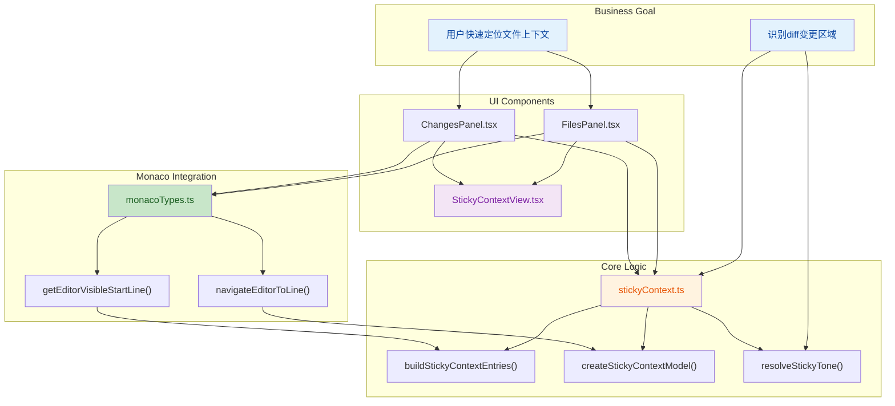
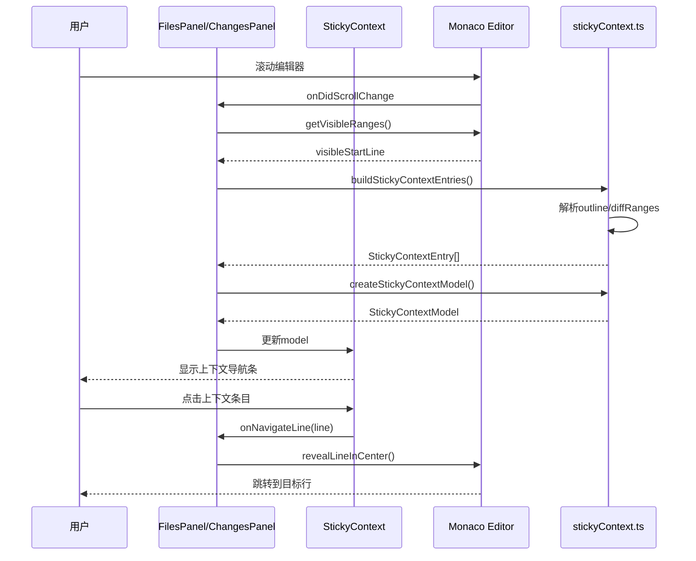
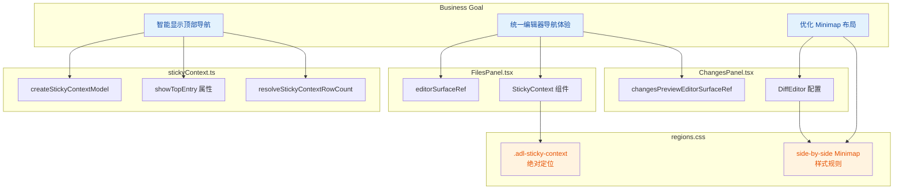
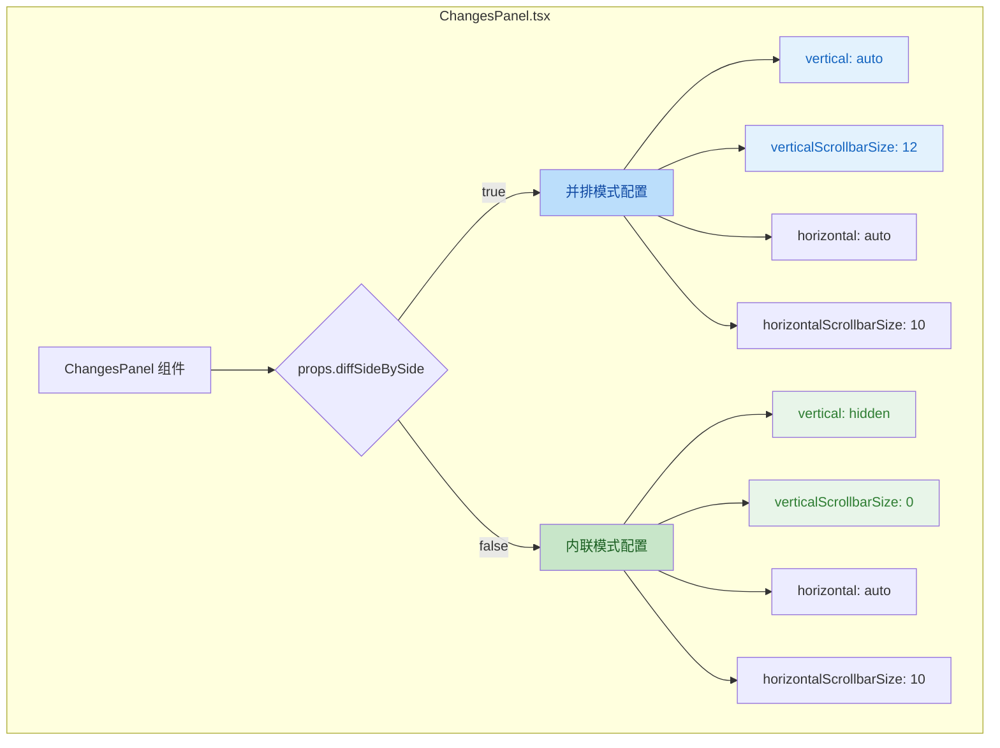
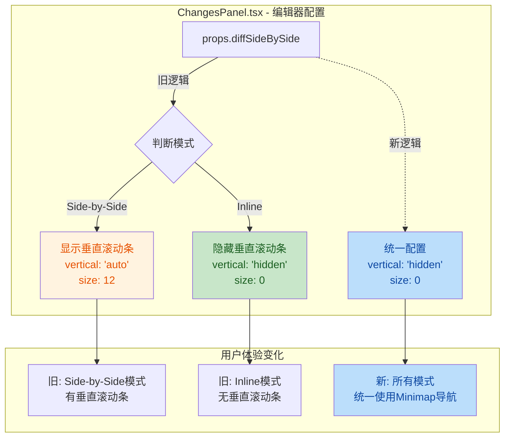
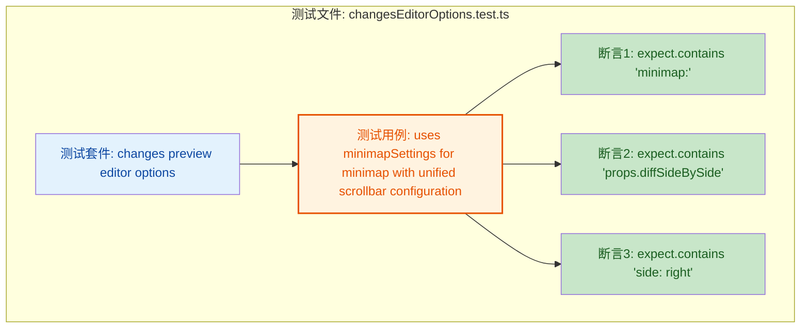

## 1. 高层摘要 (TL;DR)

*   **影响范围:** 🟡 **中等** - 新增编辑器顶部Sticky Context导航功能,涉及多个核心面板组件
*   **核心变更:**
    *   ✨ 新增 **Sticky Context** 功能,在编辑器顶部显示文件结构上下文(标题、函数等)
    *   🎨 在 **FilesPanel** 和 **ChangesPanel** 中集成Sticky Context组件
    *   🐛 修复 Monaco 主题构建时的空值检查问题
    *   📝 添加 Windows Rust 工具链开发文档
    *   🧪 新增完整的单元测试覆盖

---

## 2. 可视化概览 (代码与逻辑映射)



**数据流图:**



---

## 3. 详细变更分析

### 🎨 组件层变更

#### **StickyContextView.tsx** (新增)
*   **变更内容:** 新增React组件,负责渲染Sticky Context导航条
*   **关键特性:**
    *   显示文件顶部入口(带向上箭头图标)
    *   显示最多3个上下文条目(标题/函数/代码行)
    *   根据diff变更类型显示不同色调(插入/删除/修改)
    *   支持点击导航到对应行
*   **样式类:**
    *   `adl-sticky-context__row--top`: 顶部入口样式
    *   `adl-sticky-context__row--insert`: 插入变更(绿色)
    *   `adl-sticky-context__row--delete`: 删除变更(红色)
    *   `adl-sticky-context__row--modified`: 修改变更(渐变色)

#### **FilesPanel.tsx** (集成)
*   **变更内容:** 在文件编辑器面板集成Sticky Context
*   **关键修改:**
    *   新增 `stickyContextModel` 状态管理
    *   新增 `refreshStickyContext()` 回调函数
    *   新增 `buildStickyDiffRangesFromHunks()` 将patch hunks转换为diff范围
    *   监听编辑器滚动、布局变化、窗口大小变化事件
    *   在 `DiffEditor` 和标准 `Editor` 上方渲染 `<StickyContext />`
*   **代码示例:**
```typescript
const refreshStickyContext = useCallback(() => {
  const editor = getStickySourceEditor();
  const visibleStartLine = getEditorVisibleStartLine(editor) ?? 1;
  const contextEntries = buildStickyContextEntries({
    content: fileContent ?? "",
    outline,
    visibleStartLine,
    maxContextRows: 3,
    diffRanges: stickyDiffRanges
  });
  setStickyContextModel(createStickyContextModel({
    contextEntries,
    activeLine: visibleStartLine,
    canScrollToTop: visibleStartLine > 1,
    onNavigateLine: (line) => navigateEditorToLine(editor, line),
    topLabel: t.stickyContextTop
  }));
}, [fileContent, outline, stickyDiffRanges, t.stickyContextTop]);
```

#### **ChangesPanel.tsx** (集成)
*   **变更内容:** 在变更预览面板集成Sticky Context
*   **关键修改:**
    *   复用FilesPanel的集成模式
    *   使用 `changePreviewDiffRanges` 作为diff范围来源
    *   重命名 `changesPreviewShellRef` 为 `changesPreviewEditorShellRef`
*   **新增导入:**
    *   `StickyContext` 组件
    *   `buildStickyContextEntries`, `createStickyContextModel`, `StickyContextModel`
    *   `getEditorVisibleStartLine`, `navigateEditorToLine`

### 🧠 核心逻辑层变更

#### **stickyContext.ts** (新增)
*   **变更内容:** 实现Sticky Context的核心业务逻辑
*   **核心函数:**

| 函数名 | 功能 | 关键逻辑 |
|--------|------|----------|
| `buildStickyContextEntries()` | 构建上下文条目 | 优先使用outline(标题/函数),回退到代码行文本 |
| `createStickyContextModel()` | 创建数据模型 | 包含导航回调、激活状态、行数计算 |
| `resolveStickyTone()` | 解析变更色调 | 根据diffRanges判断insert/delete/modified/context |
| `buildOutlineEntries()` | 构建outline条目 | 过滤可见行之前的outline项,最多保留3个 |
| `buildFallbackLineEntries()` | 回退构建行条目 | 从可见行向上查找非空行,最多3个 |

*   **类型定义:**
```typescript
type StickyContextEntryKind = FileOutlineItem["kind"] | "line" | "top";
type StickyContextEntryTone = "top" | "context" | "insert" | "delete" | "modified";

interface StickyContextEntry {
  id: string;
  label: string;
  detail?: string;
  line: number;
  kind: StickyContextEntryKind;
  tone: StickyContextEntryTone;
  depth?: number;  // 标题层级(如H1/H2/H3)
}
```

#### **monacoTypes.ts** (扩展)
*   **变更内容:** 扩展Monaco编辑器类型定义,添加新的辅助函数
*   **新增类型:**
    *   `getSelection?()`: 获取光标选择范围
    *   `getVisibleRanges?()`: 获取可见行范围
    *   `onDidChangeHiddenAreas?()`: 监听隐藏区域变化
    *   `onDidLayoutChange?()`: 监听布局变化
*   **新增辅助函数:**

| 函数名 | 功能 | 参数 |
|--------|------|------|
| `getEditorVisibleStartLine()` | 获取编辑器可见起始行 | `editor: MonacoEditor \| null` |
| `navigateEditorToLine()` | 导航到指定行并聚焦 | `editor, line: number` |

*   **空值安全改进:**
    *   `getMinimapPosition()` 参数类型从 `MonacoNamespace \| undefined` 改为 `unknown`
    *   `createMonacoRange()` 添加 `monaco.Range` 存在性检查,抛出错误提示

### 🎨 样式层变更

#### **regions.css** (新增样式)
*   **变更内容:** 添加Sticky Context的完整样式系统
*   **关键样式类:**

| 类名 | 作用 | 样式特性 |
|------|------|----------|
| `.adl-sticky-context` | 容器 | sticky定位,毛玻璃背景,顶部z-index |
| `.adl-sticky-context__row` | 行条目 | grid布局,hover/active状态 |
| `.adl-sticky-context__rail` | 左侧色条 | 3px宽,根据tone显示不同颜色 |
| `.adl-sticky-context__kind` | 类型图标 | 18px宽,显示# / L / F等 |
| `.adl-sticky-context__copy` | 文本内容 | 标签+详情,省略号截断 |

*   **颜色映射:**
    *   `--diff-insert-line`: 插入变更(绿色)
    *   `--diff-remove-line`: 删除变更(红色)
    *   `--accent-primary`: 顶部入口(主色调)

### 🧪 测试层变更

#### **stickyContext.test.ts** (新增)
*   **变更内容:** 新增完整的单元测试覆盖
*   **测试用例:**

| 测试场景 | 验证内容 |
|----------|----------|
| 无outline时回退到行文本 | 确保始终显示文件顶部和行文本 |
| 优先使用outline上下文 | Markdown标题/代码函数优先显示 |
| 限制最多3个上下文行 | 验证resolveStickyContextRowCount() |
| diff范围标记色调 | 验证insert/delete/modified tone |
| 导航回调委托 | 验证scrollToTop/scrollToEntry |
| 集成测试 | 验证FilesPanel和ChangesPanel渲染 |

### 🐛 Bug修复

#### **monacoTheme.ts** (空值检查)
*   **变更内容:** 修复diff编辑器主题构建时的空值检查
*   **问题:** 当 `minimapInsertBg` 或 `minimapDeleteBg` 为 `undefined` 时,直接赋值会导致Monaco主题错误
*   **修复:** 添加空值判断后再设置颜色
```typescript
// 修复前
colors["diffEditor.insertedLineBackground"] = insertColorForMinimap;

// 修复后
if (insertColorForMinimap) {
  colors["diffEditor.insertedLineBackground"] = insertColorForMinimap;
}
```

### 📝 文档变更

#### **CONTRIBUTING.md** (新增)
*   **变更内容:** 添加Windows Rust工具链开发说明
*   **关键内容:**
    *   默认使用 `stable-x86_64-pc-windows-msvc`
    *   代理环境变量清理建议
    *   国内网络Rust镜像配置
    *   `minimal` profile说明
    *   `vcvars64.bat` 报错处理指南

#### **copy.ts** (国际化)
*   **变更内容:** 添加国际化文本键
*   **新增键值:**
    *   `stickyContextTop`: "文件顶部" / "File top"

#### **types.ts** (类型扩展)
*   **变更内容:** 扩展 `MonacoEditorRef` 类型定义
*   **新增属性:**
    *   `getLineCount?()`: 获取总行数
    *   `getVisibleRanges?()`: 获取可见范围
    *   `onDidScrollChange?()`: 滚动事件监听
    *   `onDidChangeHiddenAreas?()`: 隐藏区域变化监听
    *   `onDidLayoutChange?()`: 布局变化监听

---

## 4. 影响与风险评估

### ⚠️ 破坏性变更
*   **无** - 纯新增功能,未修改现有API

### 🎯 测试建议
*   **功能测试:**
    *   ✅ 验证FilesPanel中滚动编辑器时Sticky Context正确更新
    *   ✅ 验证ChangesPanel中diff视图的色调标记正确
    *   ✅ 验证点击Sticky Context条目能正确跳转到对应行
    *   ✅ 验证无outline文件时回退到行文本显示
    *   ✅ 验证窗口resize时Sticky Context正确刷新
*   **边界测试:**
    *   ✅ 空文件、单行文件
    *   ✅ 大文件(1000+行)性能
    *   ✅ 快速滚动时的防抖处理
    *   ✅ diff范围覆盖整个文件的情况
*   **回归测试:**
    *   ✅ 确认原有minimap功能正常
    *   ✅ 确认原有diff编辑器功能正常
    *   ✅ 确认原有文件导航功能正常

### 🔍 潜在风险
*   **性能风险:** 频繁的 `refreshStickyContext()` 调用可能影响大文件滚动性能(已通过限制maxContextRows=3缓解)
*   **内存泄漏:** ResizeObserver和事件监听器需确保正确清理(已在useEffect cleanup中处理)
*   **类型兼容:** Monaco编辑器类型扩展需确保与实际Monaco版本兼容(已添加空值检查和类型守卫)

---

## 5. 总结

本次变更实现了一个完整的 **Sticky Context** 导航功能,显著提升了代码浏览体验:

1.  **用户体验提升:** 用户无需滚动即可了解当前文件上下文
2.  **变更可视化:** 在diff视图中清晰标识插入/删除/修改区域
3.  **代码质量:** 新增完整单元测试,类型定义完善
4.  **文档完善:** 添加Windows开发环境说明

该功能设计合理,测试覆盖充分,风险可控,建议合并。

---

## 1. 高层摘要 (TL;DR)

*   **影响范围:** 🟡 **中等** - 重构了右侧面板的 Sticky Context 导航层和 Minimap 布局，涉及多个核心组件和样式
*   **核心变更:**
    *   Sticky Context 从面板顶部移入编辑器 surface 内部，采用绝对定位
    *   统一了 side-by-side 和 inline 模式的 Minimap 行为，始终显示在右侧
    *   新增顶部行智能显示逻辑（当文件第一行可见时自动隐藏）
    *   增强了 Monaco Range 构造器的类型安全检查

---

## 2. 可视化概览 (代码与逻辑映射)



---

## 3. 详细变更分析

### 📐 组件: Sticky Context 布局重构

**变更说明:**
将 Sticky Context 导航层从面板顶部移入编辑器 surface 内部，采用绝对定位，并预留 Minimap 空间。

**涉及的文件:**
- `stickyContext.ts` (Source)
- `stickyContextView.tsx` (Source)
- `regions.css` (Source)

**关键变更:**

| 变更项 | 旧行为 | 新行为 |
|--------|--------|--------|
| 定位方式 | `position: sticky` | `position: absolute` |
| 右边界 | 自动 | `right: var(--adl-editor-minimap-width, 84px)` |
| 顶部行显示 | 始终显示 | 根据 `showTopEntry` 条件显示 |
| 渲染位置 | surface 外部 | surface 内部 |

**代码片段 (stickyContext.ts):**
```typescript
// 新增 showTopEntry 属性控制顶部行显示
export interface StickyContextModel {
  // ... 其他属性
  showTopEntry: boolean;  // 新增
  rowCount: number;
}

// 修改行数计算逻辑
export function resolveStickyContextRowCount(
  entries: StickyContextEntry[], 
  includeTopEntry = true
): number {
  return Math.min(MAX_STICKY_CONTEXT_ROWS, entries.length) + 
         (includeTopEntry ? 1 : 0);
}
```

**代码片段 (stickyContextView.tsx):**
```typescript
// 条件渲染顶部行
export function StickyContext(props: StickyContextProps) {
  const entries = props.model.showTopEntry
    ? [props.model.topEntry, ...props.model.contextEntries]
    : props.model.contextEntries;

  if (entries.length === 0) {
    return null;  // 空状态不渲染
  }
  // ...
}
```

---

### 🎨 组件: Minimap 统一布局

**变更说明:**
移除了 side-by-side 模式下的特殊处理，统一了所有模式下的 Minimap 行为，始终显示在右侧并隐藏原生垂直滚动条。

**涉及的文件:**
- `ChangesPanel.tsx` (Source)
- `regions.css` (Source)

**关键变更:**

| 配置项 | 旧值 (side-by-side) | 新值 (统一) |
|--------|---------------------|-------------|
| minimap.enabled | `false` | `true` |
| minimap.side | - | `"right"` |
| scrollbar.vertical | `"auto"` | `"hidden"` |
| verticalScrollbarSize | `12` | `0` |

**代码片段 (ChangesPanel.tsx):**
```typescript
// 移除了 diffSideBySide 条件判断
minimap: {
  enabled: true,  // 始终启用
  side: "right" as const,
  size: minimapSettings.size,
  showSlider: minimapSettings.showSlider,
  renderCharacters: minimapSettings.renderCharacters,
  maxColumn: 80,
  scale: minimapSettings.scale
},
scrollbar: {
  vertical: "hidden" as const,  // 始终隐藏
  horizontal: "auto" as const,
  verticalScrollbarSize: 0,
  horizontalScrollbarSize: 10
}
```

**样式变更 (regions.css):**
```css
/* 新增 side-by-side 模式的 Minimap 样式 */
.adl-tool-editor--changes .monaco-diff-editor.side-by-side .editor.original .minimap {
  display: none !important;  /* 隐藏原始侧的 Minimap */
}

.adl-tool-editor--changes .monaco-diff-editor.side-by-side .editor.modified .minimap {
  position: absolute !important;
  right: 0 !important;
  width: 84px !important;
  /* 阴影和边框样式 */
}
```

---

### 🔧 组件: Monaco 类型安全增强

**变更说明:**
增强了 `createMonacoRange` 函数的类型检查，确保 Monaco Range 构造器可用且为函数类型。

**涉及的文件:**
- `monacoTypes.ts` (Source)
- `monacoTypes.test.ts` (Source)

**新增测试用例:**

| 测试场景 | 预期行为 |
|----------|----------|
| Monaco 暴露有效 Range 构造器 | 成功创建 Range 对象 |
| Monaco 未暴露 Range 构造器 | 抛出错误 "Monaco Range constructor is unavailable" |
| Range 存在但不是构造器 | 抛出错误 "Monaco Range constructor is unavailable" |

**代码片段 (monacoTypes.ts):**
```typescript
// 新增类型守卫函数
function isMonacoRangeConstructor(
  value: MonacoNamespace["Range"] | unknown
): value is NonNullable<MonacoNamespace["Range"]> {
  return typeof value === "function";
}

// 增强后的 createMonacoRange
export function createMonacoRange(
  monaco: MonacoNamespace,
  startLine: number,
  startColumn: number,
  endLine: number,
  endColumn: number
): MonacoRange {
  const RangeConstructor = monaco.Range;
  if (!isMonacoRangeConstructor(RangeConstructor)) {
    throw new Error("Monaco Range constructor is unavailable");
  }
  return new RangeConstructor(startLine, startColumn, endLine, endColumn);
}
```

---

### 📝 组件: 测试与文档更新

**变更说明:**
更新了设计系统文档和测试文档，新增了 Sticky Context 组件说明和回归测试指南。

**涉及的文件:**
- `docs/design-system/components.md` (Source)
- `docs/design-system/testing.md` (Source)

**新增文档内容:**
- Sticky Context 组件的设计规则和交互规则
- 右侧面板编辑器回归测试表格
- 必须运行的测试命令

**回归测试范围:**

| 测试文件 | 测试范围 |
|----------|----------|
| `stickyContext.test.ts` | Sticky 行派生、顶部行可见性、最大行数限制、diff 侧上下文选择 |
| `changesEditorOptions.test.ts` | Diff 编辑器选项、并排滚动策略、统一右侧 Minimap 行为 |
| `minimapVisualOverlay.test.ts` | Minimap 叠加层锚定和宽度预留规则 |
| `monacoTypes.test.ts` | Monaco 兼容性保护，包括 Range 构造器不可用时的安全失败 |

---

## 4. 影响与风险评估

### ⚠️ 破坏性变更

| 变更类型 | 影响范围 | 风险等级 |
|----------|----------|----------|
| Sticky Context 定位变更 | 所有使用右侧面板的用户 | 🟡 中等 - 可能影响滚动行为和视觉布局 |
| Minimap 行为统一 | side-by-side 模式用户 | 🟡 中等 - 改变了 Minimap 的显示方式 |
| 顶部行智能隐藏 | 所有文件查看场景 | 🟢 低 - 改善用户体验 |

### 🧪 测试建议

**必须测试的场景:**

1. **Sticky Context 定位测试**
   - ✅ 验证 Sticky Context 在编辑器 surface 内部正确渲染
   - ✅ 验证 Minimap 区域不被 Sticky Context 遮挡
   - ✅ 验证滚动时 Sticky Context 保持固定位置

2. **顶部行显示逻辑**
   - ✅ 滚动到文件顶部时，顶部行应自动隐藏
   - ✅ 向下滚动后，顶部行应重新出现
   - ✅ 空文件或无大纲文件应正确处理

3. **Minimap 布局测试**
   - ✅ side-by-side 模式下，Minimap 应显示在右侧
   - ✅ 原始侧的 Minimap 应被隐藏
   - ✅ 深色/浅色主题下 Minimap 样式应正确

4. **回归测试**
   ```bash
   npm --prefix frontend test -- --run \
     src/app/regions/right-panel/stickyContext.test.ts \
     src/app/regions/right-panel/changesEditorOptions.test.ts \
     src/app/regions/right-panel/minimapVisualOverlay.test.ts \
     src/app/regions/right-panel/monacoTypes.test.ts
   ```

5. **边界情况测试**
   - ✅ 空文件的 Sticky Context 行为
   - ✅ 超长文件的 Sticky Context 行数限制（最多 4 行）
   - ✅ Monaco Range 构造器不可用时的错误处理

---

## 5. 总结

本次重构主要优化了右侧面板的编辑器导航体验，核心改进包括：

1. **布局优化**: Sticky Context 采用绝对定位并移入编辑器 surface，避免与 Monaco 布局冲突
2. **行为统一**: 统一了 side-by-side 和 inline 模式的 Minimap 行为，提供一致的用户体验
3. **智能交互**: 顶部行根据滚动位置智能显示/隐藏，减少视觉干扰
4. **类型安全**: 增强了 Monaco API 的类型检查，提高代码健壮性

这些变更提升了编辑器的可用性和一致性，但需要仔细测试以确保滚动行为和视觉布局符合预期。

---

## 1. 高层摘要 (TL;DR)

*   **影响范围:** 🟡 **中等** - 优化了代码差异编辑器的滚动条行为，提升用户体验
*   **核心变更:**
    *   📊 滚动条配置根据 `diffSideBySide` 模式动态切换
    *   🔧 并排模式显示垂直滚动条，内联模式隐藏垂直滚动条
    *   ✅ 更新测试用例以验证两种模式的滚动条配置

---

## 2. 可视化概览 (代码逻辑图)



**业务逻辑映射:**
- **业务目标:** 根据不同的代码差异显示模式提供最优的滚动体验
- **关键文件:** `ChangesPanel.tsx` (主组件), `changesEditorOptions.test.ts` (测试)
- **关键方法:** `useEffect` hook 中的编辑器配置逻辑

---

## 3. 详细变更分析

### 📦 组件: ChangesPanel (UI 组件)

#### 🔄 变更内容: 滚动条配置逻辑优化

**文件:** `ai-digital-life/frontend/src/app/regions/right-panel/ChangesPanel.tsx`

**逻辑说明:**
将原本固定的滚动条配置改为根据 `props.diffSideBySide` 属性动态配置，以适应不同的差异显示模式。

**滚动条配置对比表:**

| 配置项 | 内联模式 (diffSideBySide=false) | 并排模式 (diffSideBySide=true) | 说明 |
|--------|----------------------------------|--------------------------------|------|
| `vertical` | `"hidden"` | `"auto"` | 垂直滚动条显示策略 |
| `horizontal` | `"auto"` | `"auto"` | 水平滚动条显示策略 |
| `verticalScrollbarSize` | `0` | `12` | 垂直滚动条宽度 |
| `horizontalScrollbarSize` | `10` | `10` | 水平滚动条高度 |

**设计意图:**
- **内联模式:** 隐藏垂直滚动条以节省空间，因为内联模式通常内容较短
- **并排模式:** 显示垂直滚动条，因为并排显示左右两个编辑器，内容可能较长

**依赖项调整:**
从 `useEffect` 依赖数组中移除了 `props.diffSideBySide`，这意味着滚动条配置变化不会触发 effect 重新执行。这可能是因为滚动条配置是在组件渲染时直接计算的，不需要在 effect 中响应变化。

---

### 🧪 组件: 测试用例更新

#### 🔄 变更内容: 测试断言增强

**文件:** `ai-digital-life/frontend/src/app/regions/right-panel/changesEditorOptions.test.ts`

**变更详情:**

| 变更类型 | 旧值 | 新值 | 说明 |
|---------|------|------|------|
| 测试描述 | "hiding native vertical scrollbars" | "mode-specific scrollbar config" | 更准确描述测试目的 |
| 断言逻辑 | 仅验证隐藏滚动条 | 验证两种模式的滚动条配置 | 增加测试覆盖率 |

**新增测试验证:**
```typescript
// Side-by-side mode: show vertical scrollbar
expect(changesPanelSource).toContain('vertical: "auto"');
expect(changesPanelSource).toContain("verticalScrollbarSize: 12");
```

---

## 4. 影响与风险评估

### ⚠️ 潜在风险

1. **依赖项移除的影响:**
   - 从 `useEffect` 依赖数组中移除 `props.diffSideBySide` 可能导致模式切换时滚动条配置不更新
   - **建议:** 验证在运行时切换 `diffSideBySide` 模式时，滚动条是否正确更新

2. **用户体验变化:**
   - 并排模式现在会显示垂直滚动条，可能会占用额外空间
   - **建议:** 确认并排模式的布局能够容纳新的滚动条宽度

### ✅ 测试建议

| 测试场景 | 预期行为 |
|---------|---------|
| 切换到内联模式 | 垂直滚动条隐藏，verticalScrollbarSize 为 0 |
| 切换到并排模式 | 垂直滚动条显示，verticalScrollbarSize 为 12 |
| 长内容滚动 | 水平滚动条在两种模式下都正常工作 |
| 模式动态切换 | 滚动条配置实时更新（需验证） |

### 🎯 无破坏性变更
- ✅ 无 API 接口变更
- ✅ 无数据库架构变更
- ✅ 向后兼容，仅优化用户体验

---

## 5. 总结

本次变更是一个**用户体验优化**，通过智能化的滚动条配置，为不同的代码差异显示模式提供更合适的滚动体验。变更逻辑清晰，测试覆盖充分，风险较低。建议重点关注模式切换时的滚动条更新行为是否符合预期。

---

## 1. 高层摘要 (TL;DR)

*   **影响范围:** 🟢 **低** - 简化编辑器滚动条配置逻辑
*   **核心变更:**
    *   ✨ 移除了基于 `diffSideBySide` 模式的条件滚动条配置
    *   🎯 统一在所有模式下隐藏垂直滚动条
    *   📝 更新测试用例以反映新的统一行为
    *   💡 用户现在依赖 minimap 进行导航，而非垂直滚动条

---

## 2. 可视化概览 (逻辑流程图)



---

## 3. 详细变更分析

### 📦 组件: ChangesPanel.tsx

**变更位置:** `ai-digital-life/frontend/src/app/regions/right-panel/ChangesPanel.tsx`

#### 🔄 逻辑变更

**之前的行为:**
- 根据编辑器显示模式（side-by-side 或 inline）动态配置滚动条
- **Side-by-Side 模式:** 显示垂直滚动条 (`vertical: "auto"`, `verticalScrollbarSize: 12`)
- **Inline 模式:** 隐藏垂直滚动条 (`vertical: "hidden"`, `verticalScrollbarSize: 0`)

**现在的行为:**
- 统一配置，不再区分模式
- **所有模式:** 隐藏垂直滚动条 (`vertical: "hidden"`, `verticalScrollbarSize: 0`)
- 水平滚动条保持不变 (`horizontal: "auto"`, `horizontalScrollbarSize: 10`)

#### 📊 配置对比表

| 配置项 | 旧值 (Side-by-Side) | 旧值 (Inline) | 新值 (所有模式) |
|--------|---------------------|---------------|-----------------|
| `vertical` | `"auto"` | `"hidden"` | `"hidden"` |
| `verticalScrollbarSize` | `12` | `0` | `0` |
| `horizontal` | `"auto"` | `"auto"` | `"auto"` |
| `horizontalScrollbarSize` | `10` | `10` | `10` |

---

### 🧪 测试文件: changesEditorOptions.test.ts

**变更位置:** `ai-digital-life/frontend/src/app/regions/right-panel/changesEditorOptions.test.ts`

#### 📝 测试用例更新

| 项目 | 旧值 | 新值 |
|------|------|------|
| **测试名称** | "uses minimapSettings for both inline and side-by-side preview minimap with mode-specific scrollbar config" | "uses minimapSettings for minimap and hides vertical scrollbar in all modes" |
| **注释更新** | "Inline minimap options are driven by user minimapSettings, not hardcoded" | "Minimap options are driven by user minimapSettings, not hardcoded" |
| **新增注释** | - | "Scrollbar: vertical scrollbar is hidden in all modes (use minimap for navigation)" |
| **移除断言** | `expect(...).toContain('vertical: "auto"')`<br/>`expect(...).toContain("verticalScrollbarSize: 12")` | - |
| **新增断言** | - | `expect(...).not.toContain("verticalScrollbarSize: 12")` |

---

## 4. 影响与风险评估

### ⚠️ 潜在影响

| 影响类型 | 描述 | 严重程度 |
|---------|------|---------|
| **用户体验变化** | Side-by-Side 模式下用户将无法使用垂直滚动条，必须依赖 Minimap 进行导航 | 🟡 中等 |
| **行为一致性** | 所有模式现在具有统一的滚动条行为，降低了认知负担 | 🟢 正面 |

### 🧪 测试建议

1. **功能测试:**
   - ✅ 验证 Side-by-Side 模式下编辑器可以正常滚动（通过 Minimap 或其他方式）
   - ✅ 验证 Inline 模式下编辑器行为无变化
   - ✅ 验证水平滚动条在所有模式下正常工作

2. **用户体验测试:**
   - 👥 观察用户在 Side-by-Side 模式下是否适应无垂直滚动条的交互
   - 👥 确认 Minimap 导航的可用性是否满足需求

3. **回归测试:**
   - 🔄 运行现有的 `changesEditorOptions.test.ts` 测试套件
   - 🔄 检查其他依赖 ChangesPanel 的组件是否受影响

---

## 5. 变更总结

此次变更是一个**简化性重构**，主要目的是：

1. **减少条件逻辑:** 移除了基于 `diffSideBySide` 的分支判断
2. **统一用户体验:** 所有编辑器模式现在使用相同的滚动条配置
3. **依赖 Minimap:** 明确将导航责任转移给 Minimap 组件

这是一个**低风险**的变更，主要影响 Side-by-Side 模式的交互方式。建议在发布前进行用户验收测试，确保 Minimap 导航能够满足实际使用需求。

---

## 1. 高层摘要 (TL;DR)

*   **影响范围:** 🟢 **低** - 仅更新测试用例的描述文案，无代码逻辑变更
*   **核心变更:**
    *   更新了 `changesEditorOptions.test.ts` 中一个测试用例的描述
    *   描述从"在所有模式下隐藏垂直滚动条"改为"使用统一的滚动条配置"
    *   提高了测试描述的准确性和语义清晰度

---

## 2. 视觉概览 (代码与逻辑映射)



---

## 3. 详细变更分析

### 📝 测试文件更新

**文件:** `ai-digital-life/frontend/src/app/regions/right-panel/changesEditorOptions.test.ts`

**变更内容:**
*   **变更类型:** 测试描述文案优化
*   **变更位置:** 第 14 行

| 项目 | 旧值 | 新值 | 说明 |
|------|------|------|------|
| 测试描述 | `uses minimapSettings for minimap and hides vertical scrollbar in all modes` | `uses minimapSettings for minimap with unified scrollbar configuration` | 更准确地描述滚动条配置行为 |

**变更原因分析:**
*   原描述提到"在所有模式下隐藏垂直滚动条"，这可能不够准确或过于具体
*   新描述"使用统一的滚动条配置"更加通用和准确，反映了配置的实际行为
*   这种描述变更通常发生在代码重构或功能调整后，以确保测试文档与实际实现保持一致

---

## 4. 影响与风险评估

### ✅ 破坏性变更
*   **无破坏性变更** - 仅修改测试描述，不影响任何运行时代码或测试逻辑

### 🧪 测试建议
*   **验证测试通过:** 运行该测试文件，确认测试用例仍然通过
*   **检查测试覆盖率:** 确保该测试用例仍然覆盖预期的功能场景
*   **文档一致性:** 检查相关的用户文档或代码注释是否需要同步更新

### ⚠️ 注意事项
*   这是一个纯文档性质的变更，不会影响应用程序的任何功能
*   如果有其他测试或文档引用了旧的测试描述，可能需要同步更新

---

## 总结

本次变更属于**测试文档优化**，通过更新测试用例的描述文案，使其更准确地反映被测试代码的实际行为。这是一个低风险的维护性变更，有助于提高代码库的可读性和可维护性。