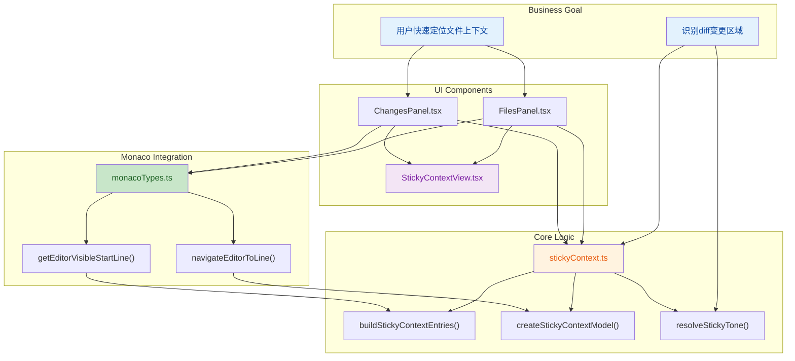
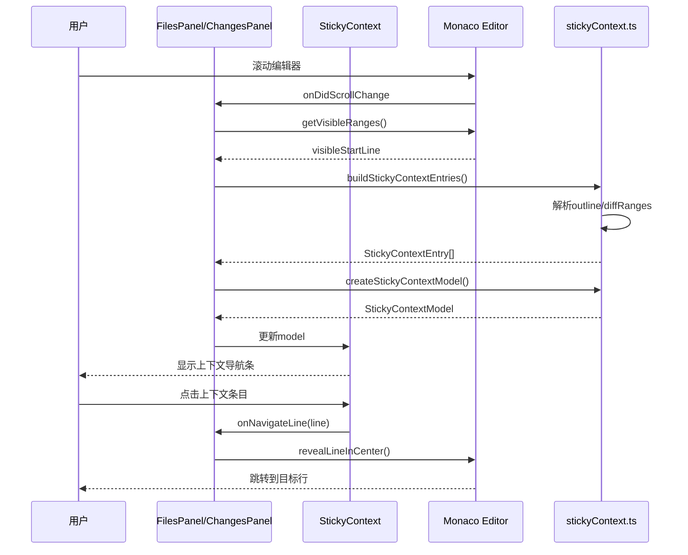

## 1. 高层摘要 (TL;DR)

*   **影响范围:** 🟡 **中等** - 新增编辑器顶部Sticky Context导航功能,涉及多个核心面板组件
*   **核心变更:**
    *   ✨ 新增 **Sticky Context** 功能,在编辑器顶部显示文件结构上下文(标题、函数等)
    *   🎨 在 **FilesPanel** 和 **ChangesPanel** 中集成Sticky Context组件
    *   🐛 修复 Monaco 主题构建时的空值检查问题
    *   📝 添加 Windows Rust 工具链开发文档
    *   🧪 新增完整的单元测试覆盖

---

## 2. 可视化概览 (代码与逻辑映射)



**数据流图:**



---

## 3. 详细变更分析

### 🎨 组件层变更

#### **StickyContextView.tsx** (新增)
*   **变更内容:** 新增React组件,负责渲染Sticky Context导航条
*   **关键特性:**
    *   显示文件顶部入口(带向上箭头图标)
    *   显示最多3个上下文条目(标题/函数/代码行)
    *   根据diff变更类型显示不同色调(插入/删除/修改)
    *   支持点击导航到对应行
*   **样式类:**
    *   `adl-sticky-context__row--top`: 顶部入口样式
    *   `adl-sticky-context__row--insert`: 插入变更(绿色)
    *   `adl-sticky-context__row--delete`: 删除变更(红色)
    *   `adl-sticky-context__row--modified`: 修改变更(渐变色)

#### **FilesPanel.tsx** (集成)
*   **变更内容:** 在文件编辑器面板集成Sticky Context
*   **关键修改:**
    *   新增 `stickyContextModel` 状态管理
    *   新增 `refreshStickyContext()` 回调函数
    *   新增 `buildStickyDiffRangesFromHunks()` 将patch hunks转换为diff范围
    *   监听编辑器滚动、布局变化、窗口大小变化事件
    *   在 `DiffEditor` 和标准 `Editor` 上方渲染 `<StickyContext />`
*   **代码示例:**
```typescript
const refreshStickyContext = useCallback(() => {
  const editor = getStickySourceEditor();
  const visibleStartLine = getEditorVisibleStartLine(editor) ?? 1;
  const contextEntries = buildStickyContextEntries({
    content: fileContent ?? "",
    outline,
    visibleStartLine,
    maxContextRows: 3,
    diffRanges: stickyDiffRanges
  });
  setStickyContextModel(createStickyContextModel({
    contextEntries,
    activeLine: visibleStartLine,
    canScrollToTop: visibleStartLine > 1,
    onNavigateLine: (line) => navigateEditorToLine(editor, line),
    topLabel: t.stickyContextTop
  }));
}, [fileContent, outline, stickyDiffRanges, t.stickyContextTop]);
```

#### **ChangesPanel.tsx** (集成)
*   **变更内容:** 在变更预览面板集成Sticky Context
*   **关键修改:**
    *   复用FilesPanel的集成模式
    *   使用 `changePreviewDiffRanges` 作为diff范围来源
    *   重命名 `changesPreviewShellRef` 为 `changesPreviewEditorShellRef`
*   **新增导入:**
    *   `StickyContext` 组件
    *   `buildStickyContextEntries`, `createStickyContextModel`, `StickyContextModel`
    *   `getEditorVisibleStartLine`, `navigateEditorToLine`

### 🧠 核心逻辑层变更

#### **stickyContext.ts** (新增)
*   **变更内容:** 实现Sticky Context的核心业务逻辑
*   **核心函数:**

| 函数名 | 功能 | 关键逻辑 |
|--------|------|----------|
| `buildStickyContextEntries()` | 构建上下文条目 | 优先使用outline(标题/函数),回退到代码行文本 |
| `createStickyContextModel()` | 创建数据模型 | 包含导航回调、激活状态、行数计算 |
| `resolveStickyTone()` | 解析变更色调 | 根据diffRanges判断insert/delete/modified/context |
| `buildOutlineEntries()` | 构建outline条目 | 过滤可见行之前的outline项,最多保留3个 |
| `buildFallbackLineEntries()` | 回退构建行条目 | 从可见行向上查找非空行,最多3个 |

*   **类型定义:**
```typescript
type StickyContextEntryKind = FileOutlineItem["kind"] | "line" | "top";
type StickyContextEntryTone = "top" | "context" | "insert" | "delete" | "modified";

interface StickyContextEntry {
  id: string;
  label: string;
  detail?: string;
  line: number;
  kind: StickyContextEntryKind;
  tone: StickyContextEntryTone;
  depth?: number;  // 标题层级(如H1/H2/H3)
}
```

#### **monacoTypes.ts** (扩展)
*   **变更内容:** 扩展Monaco编辑器类型定义,添加新的辅助函数
*   **新增类型:**
    *   `getSelection?()`: 获取光标选择范围
    *   `getVisibleRanges?()`: 获取可见行范围
    *   `onDidChangeHiddenAreas?()`: 监听隐藏区域变化
    *   `onDidLayoutChange?()`: 监听布局变化
*   **新增辅助函数:**

| 函数名 | 功能 | 参数 |
|--------|------|------|
| `getEditorVisibleStartLine()` | 获取编辑器可见起始行 | `editor: MonacoEditor \| null` |
| `navigateEditorToLine()` | 导航到指定行并聚焦 | `editor, line: number` |

*   **空值安全改进:**
    *   `getMinimapPosition()` 参数类型从 `MonacoNamespace \| undefined` 改为 `unknown`
    *   `createMonacoRange()` 添加 `monaco.Range` 存在性检查,抛出错误提示

### 🎨 样式层变更

#### **regions.css** (新增样式)
*   **变更内容:** 添加Sticky Context的完整样式系统
*   **关键样式类:**

| 类名 | 作用 | 样式特性 |
|------|------|----------|
| `.adl-sticky-context` | 容器 | sticky定位,毛玻璃背景,顶部z-index |
| `.adl-sticky-context__row` | 行条目 | grid布局,hover/active状态 |
| `.adl-sticky-context__rail` | 左侧色条 | 3px宽,根据tone显示不同颜色 |
| `.adl-sticky-context__kind` | 类型图标 | 18px宽,显示# / L / F等 |
| `.adl-sticky-context__copy` | 文本内容 | 标签+详情,省略号截断 |

*   **颜色映射:**
    *   `--diff-insert-line`: 插入变更(绿色)
    *   `--diff-remove-line`: 删除变更(红色)
    *   `--accent-primary`: 顶部入口(主色调)

### 🧪 测试层变更

#### **stickyContext.test.ts** (新增)
*   **变更内容:** 新增完整的单元测试覆盖
*   **测试用例:**

| 测试场景 | 验证内容 |
|----------|----------|
| 无outline时回退到行文本 | 确保始终显示文件顶部和行文本 |
| 优先使用outline上下文 | Markdown标题/代码函数优先显示 |
| 限制最多3个上下文行 | 验证resolveStickyContextRowCount() |
| diff范围标记色调 | 验证insert/delete/modified tone |
| 导航回调委托 | 验证scrollToTop/scrollToEntry |
| 集成测试 | 验证FilesPanel和ChangesPanel渲染 |

### 🐛 Bug修复

#### **monacoTheme.ts** (空值检查)
*   **变更内容:** 修复diff编辑器主题构建时的空值检查
*   **问题:** 当 `minimapInsertBg` 或 `minimapDeleteBg` 为 `undefined` 时,直接赋值会导致Monaco主题错误
*   **修复:** 添加空值判断后再设置颜色
```typescript
// 修复前
colors["diffEditor.insertedLineBackground"] = insertColorForMinimap;

// 修复后
if (insertColorForMinimap) {
  colors["diffEditor.insertedLineBackground"] = insertColorForMinimap;
}
```

### 📝 文档变更

#### **CONTRIBUTING.md** (新增)
*   **变更内容:** 添加Windows Rust工具链开发说明
*   **关键内容:**
    *   默认使用 `stable-x86_64-pc-windows-msvc`
    *   代理环境变量清理建议
    *   国内网络Rust镜像配置
    *   `minimal` profile说明
    *   `vcvars64.bat` 报错处理指南

#### **copy.ts** (国际化)
*   **变更内容:** 添加国际化文本键
*   **新增键值:**
    *   `stickyContextTop`: "文件顶部" / "File top"

#### **types.ts** (类型扩展)
*   **变更内容:** 扩展 `MonacoEditorRef` 类型定义
*   **新增属性:**
    *   `getLineCount?()`: 获取总行数
    *   `getVisibleRanges?()`: 获取可见范围
    *   `onDidScrollChange?()`: 滚动事件监听
    *   `onDidChangeHiddenAreas?()`: 隐藏区域变化监听
    *   `onDidLayoutChange?()`: 布局变化监听

---

## 4. 影响与风险评估

### ⚠️ 破坏性变更
*   **无** - 纯新增功能,未修改现有API

### 🎯 测试建议
*   **功能测试:**
    *   ✅ 验证FilesPanel中滚动编辑器时Sticky Context正确更新
    *   ✅ 验证ChangesPanel中diff视图的色调标记正确
    *   ✅ 验证点击Sticky Context条目能正确跳转到对应行
    *   ✅ 验证无outline文件时回退到行文本显示
    *   ✅ 验证窗口resize时Sticky Context正确刷新
*   **边界测试:**
    *   ✅ 空文件、单行文件
    *   ✅ 大文件(1000+行)性能
    *   ✅ 快速滚动时的防抖处理
    *   ✅ diff范围覆盖整个文件的情况
*   **回归测试:**
    *   ✅ 确认原有minimap功能正常
    *   ✅ 确认原有diff编辑器功能正常
    *   ✅ 确认原有文件导航功能正常

### 🔍 潜在风险
*   **性能风险:** 频繁的 `refreshStickyContext()` 调用可能影响大文件滚动性能(已通过限制maxContextRows=3缓解)
*   **内存泄漏:** ResizeObserver和事件监听器需确保正确清理(已在useEffect cleanup中处理)
*   **类型兼容:** Monaco编辑器类型扩展需确保与实际Monaco版本兼容(已添加空值检查和类型守卫)

---

## 5. 总结

本次变更实现了一个完整的 **Sticky Context** 导航功能,显著提升了代码浏览体验:

1.  **用户体验提升:** 用户无需滚动即可了解当前文件上下文
2.  **变更可视化:** 在diff视图中清晰标识插入/删除/修改区域
3.  **代码质量:** 新增完整单元测试,类型定义完善
4.  **文档完善:** 添加Windows开发环境说明

该功能设计合理,测试覆盖充分,风险可控,建议合并。