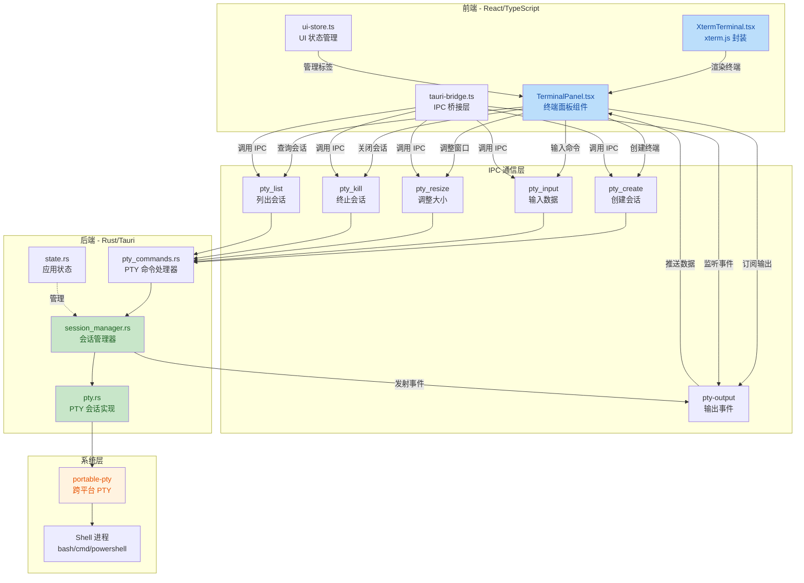

## 1. 高层摘要 (TL;DR)

*   **影响范围**: 🔴 **高** - 核心终端功能从简单的命令流式输出重构为完整的交互式 PTY（伪终端）系统
*   **关键变更**:
    *   ✨ 新增 Rust crate `adl-terminal`，实现 PTY 会话管理和会话管理器
    *   🎨 前端集成 xterm.js，提供完整的终端模拟器体验
    *   🔄 重构终端面板 UI，支持多标签页、会话切换、复制粘贴等功能
    *   📡 新增 PTY 相关的 Tauri IPC 命令和事件系统
    *   🗑️ 移除旧的流式命令执行接口（`command_run_stream`, `command_stop_stream`）

---

## 2. 可视化概览 (代码与逻辑映射)



---

## 3. 详细变更分析

### 📦 组件 1: Rust 后端 - PTY 核心实现

#### 新增文件: `ai-digital-life/crates/terminal/src/pty.rs`

**功能**: 实现单个 PTY 会话的核心逻辑

**关键变更**:
- 新增 `PtyStatus` 枚举（`Running`, `Terminated`）
- 实现 `PtySession` 结构体，包含会话 ID、shell 类型、工作目录、尺寸等信息
- 核心方法:
    - `create()`: 创建 PTY 会话并启动 shell 进程
    - `read_output()`: 从 PTY 读取输出数据
    - `write_input()`: 向 PTY 写入用户输入
    - `resize()`: 调整终端尺寸
    - `kill()`: 终止会话
    - `try_wait()`: 检查子进程退出状态

**Shell 映射逻辑**:
```rust
match shell {
    "bash" => {
        #[cfg(windows)] ("wsl", vec!["bash", "-l"])
        #[cfg(not(windows))] ("bash", vec!["-l"])
    }
    "cmd" => ("cmd", vec![]),
    _ => ("powershell", vec![])
}
```

#### 新增文件: `ai-digital-life/crates/terminal/src/session_manager.rs`

**功能**: 管理多个 PTY 会话的生命周期

**关键变更**:
- 实现 `SessionManager` 结构体，使用 `HashMap<String, PtySessionHandle>` 存储会话
- 核心方法:
    - `create()`: 创建新会话并启动输出读取线程
    - `write()`: 向指定会话写入数据
    - `resize()`: 调整指定会话的终端尺寸
    - `kill()`: 终止指定会话并清理资源
    - `list()`: 列出所有活跃会话信息

**输出读取机制**:
- 使用独立线程持续读取 PTY 输出
- 通过 Tauri 事件系统（`digital-life://pty-output`）实时推送数据到前端
- 使用 `oneshot::channel` 实现线程取消机制

#### 修改文件: `ai-digital-life/crates/terminal/src/lib.rs`

**变更**: 导出新模块
```rust
pub mod pty;
pub mod session_manager;
```

---

### 🔌 组件 2: Tauri 命令层

#### 新增文件: `ai-digital-life/src-tauri/src/commands/pty_commands.rs`

**功能**: 暴露 PTY 功能给前端

**新增命令**:

| 命令 | 输入参数 | 返回值 | 描述 |
|------|---------|--------|------|
| `pty_create` | `{shell?, cwd?, cols, rows}` | `{sessionId}` | 创建新的 PTY 会话 |
| `pty_input` | `sessionId, data` | `boolean` | 向会话写入输入数据 |
| `pty_resize` | `sessionId, cols, rows` | `boolean` | 调整终端尺寸 |
| `pty_kill` | `sessionId` | `boolean` | 终止会话 |
| `pty_list` | 无 | `PtySessionInfo[]` | 列出所有会话 |

**默认行为**:
- `shell`: 默认为 `"powershell"`
- `cwd`: 默认为当前工作空间根路径

#### 修改文件: `ai-digital-life/src-tauri/src/commands/mod.rs`

**变更**: 注册新模块
```rust
pub mod pty_commands;
```

#### 修改文件: `ai-digital-life/src-tauri/src/main.rs`

**变更**: 注册 Tauri 命令
```rust
commands::pty_commands::pty_create,
commands::pty_commands::pty_input,
commands::pty_commands::pty_resize,
commands::pty_commands::pty_kill,
commands::pty_commands::pty_list,
```

#### 修改文件: `ai-digital-life/src-tauri/src/state.rs`

**变更**: 更新应用状态结构
```rust
// 移除
pub command_cancellations: Arc<tokio::sync::Mutex<HashMap<String, oneshot::Sender<()>>>>,

// 新增
pub pty_sessions: Arc<Mutex<SessionManager>>,
```

#### 修改文件: `ai-digital-life/src-tauri/src/setup.rs`

**变更**: 初始化会话管理器
```rust
pty_sessions: std::sync::Arc::new(std::sync::Mutex::new(SessionManager::new())),
```

#### 修改文件: `ai-digital-life/src-tauri/permissions/digital-life.toml`

**变更**: 更新权限配置

| 移除的命令 | 新增的命令 |
|-----------|-----------|
| `command_get_profiles` | `pty_create` |
| `command_run_stream` | `pty_input` |
| `command_stop_stream` | `pty_resize` |
| | `pty_kill` |
| | `pty_list` |

---

### 🎨 组件 3: 前端 - React/TypeScript

#### 新增文件: `ai-digital-life/frontend/src/app/components/terminal/XtermTerminal.tsx`

**功能**: 封装 xterm.js 终端模拟器

**核心特性**:
- 使用 `forwardRef` 暴露控制接口（`write`, `clear`, `focus`, `getSelection`）
- 集成 `FitAddon` 和 `WebLinksAddon` 插件
- 自动适配容器大小（`ResizeObserver`）
- 动态主题适配（监听 `data-theme` 属性变化）
- 支持复制、粘贴、清除等操作

**主题配置**:
```typescript
theme: {
  background: "--bg",
  foreground: "--text-primary",
  cursor: "--text-primary",
  selectionBackground: "--selection"
}
```

#### 修改文件: `ai-digital-life/frontend/src/app/regions/right-panel/TerminalPanel.tsx`

**功能**: 重构终端面板 UI

**主要变更**:

1. **移除的属性**:
    - `commandBinary`, `commandArgs`
    - `terminalOutput`, `activeTerminalExecutionId`
    - `onCommandBinaryChange`, `onCommandArgsChange`
    - `onRunCommand`, `onRunCommandStream`, `onStopCommandStream`

2. **新增功能**:
    - 集成 `XtermTerminal` 组件
    - 实现多标签页管理（创建、切换、关闭）
    - 支持复制、粘贴、清除终端内容
    - 支持终止进程和关闭所有标签
    - 实时订阅 PTY 输出事件

3. **核心方法**:
    ```typescript
    handleCreateTab()      // 创建新标签并启动 PTY 会话
    handleSelectTab()      // 切换标签并恢复输出
    handleCloseTab()       // 关闭标签并终止会话
    handleCloseAllTabs()   // 关闭所有标签
    handleXtermData()      // 处理用户输入
    handleCopy()           // 复制选中内容
    handlePaste()          // 粘贴剪贴板内容
    handleClear()          // 清除终端
    handleKill()           // 终止当前会话
    ```

4. **输出缓存机制**:
    ```typescript
    const sessionOutputsRef = useRef<Map<string, string>>(new Map());
    ```
    - 缓存每个会话的输出历史
    - 切换标签时恢复之前的内容

#### 修改文件: `ai-digital-life/frontend/src/app/ui-store.ts`

**功能**: 更新终端状态管理

**数据结构变更**:

| 旧字段 | 新字段 | 说明 |
|--------|--------|------|
| `commandBinary: string` | 移除 | 不再存储命令二进制 |
| `commandArgs: string` | 移除 | 不再存储命令参数 |
| `live: boolean` | `status: "idle" \| "running" \| "terminated"` | 更细粒度的状态 |
| 新增 | `sessionId?: string` | 关联 PTY 会话 ID |

**移除的功能**:
- `terminalLayout` 类型及相关方法
- `terminalSetLayout()` 方法
- 默认终端标签（`defaultTerminalTabs()` 返回空数组）

**修改的方法**:
- `terminalCreateTab()`: 新建标签时状态设为 `"idle"`
- `terminalCloseTab()`: 修复关闭标签时的活跃标签选择逻辑

#### 修改文件: `ai-digital-life/frontend/src/shared/ipc.ts`

**功能**: 更新 IPC 接口定义

**新增类型**:
```typescript
export interface PtySessionInfo {
  sessionId: string;
  shell: string;
  cwd: string;
  cols: number;
  rows: number;
  status: "Running" | "Terminated";
}

export interface PtyOutputEvent {
  sessionId: string;
  data: string;
}
```

**新增方法**:
```typescript
subscribePtyOutput: (listener: (event: PtyOutputEvent) => void) => () => void;
```

**新增命令组**:
```typescript
pty: {
  create: (input: {...}) => Promise<IpcResult<{sessionId: string}>>;
  input: (sessionId: string, data: string) => Promise<IpcResult<boolean>>;
  resize: (sessionId: string, cols: number, rows: number) => Promise<IpcResult<boolean>>;
  kill: (sessionId: string) => Promise<IpcResult<boolean>>;
  list: () => Promise<IpcResult<PtySessionInfo[]>>;
}
```

**移除的命令**:
- `command.getProfiles()`
- `command.runStream()`
- `command.stopStream()`
- `subscribeTerminalStream()`

#### 修改文件: `ai-digital-life/frontend/src/tauri-bridge.ts`

**功能**: 实现 PTY IPC 桥接

**新增实现**:
```typescript
subscribePtyOutput: (listener: (event: PtyOutputEvent) => void) =>
  subscribeChannel<PtyOutputEvent>("digital-life://pty-output", listener),

pty: {
  create: (input) => invokeIpc("pty_create", { input }),
  input: (sessionId, data) => invokeIpc("pty_input", { sessionId, data }),
  resize: (sessionId, cols, rows) => invokeIpc("pty_resize", { sessionId, cols, rows }),
  kill: (sessionId) => invokeIpc("pty_kill", { sessionId }),
  list: () => invokeIpc("pty_list")
}
```

#### 修改文件: `ai-digital-life/frontend/src/app/regions/right-panel/types.ts`

**功能**: 清理终端面板属性

**移除的属性**:
```typescript
commandBinary: string;
commandArgs: string;
terminalOutput: string;
activeTerminalExecutionId?: string;
onCommandBinaryChange: (value: string) => void;
onCommandArgsChange: (value: string) => void;
onRunCommand: () => void;
onRunCommandStream: () => void;
onStopCommandStream: () => void;
```

---

### 📦 组件 4: 依赖管理

#### 修改文件: `ai-digital-life/crates/terminal/Cargo.toml`

**新增依赖**:
```toml
portable-pty.workspace = true
tauri.workspace = true
serde_json.workspace = true
```

#### 修改文件: `ai-digital-life/frontend/package.json`

**新增依赖**:
```json
"@xterm/addon-fit": "^0.11.0",
"@xterm/addon-web-links": "^0.12.0",
"@xterm/xterm": "^6.0.0"
```

---

## 4. 影响与风险评估

### ⚠️ 破坏性变更

| 变更类型 | 影响范围 | 说明 |
|---------|---------|------|
| **API 移除** | Tauri 命令 | 移除 `command_run_stream`, `command_stop_stream`, `command_get_profiles` |
| **事件移除** | IPC 事件 | 移除 `subscribeTerminalStream`，改为 `subscribePtyOutput` |
| **UI 属性** | 组件接口 | `TerminalPanel` 组件的 props 大幅简化 |
| **状态结构** | UI Store | `TerminalTabState` 结构变更，`terminalLayout` 移除 |

### ✅ 测试建议

1. **基础功能测试**:
   - ✅ 创建新的终端会话（PowerShell/Bash/CMD）
   - ✅ 输入命令并验证输出
   - ✅ 测试多标签页切换
   - ✅ 关闭单个标签和关闭所有标签
   - ✅ 调整终端窗口大小

2. **交互功能测试**:
   - ✅ 复制选中内容
   - ✅ 粘贴剪贴板内容
   - ✅ 清除终端屏幕
   - ✅ 终止正在运行的进程

3. **边界情况测试**:
   - ✅ 切换标签时输出是否正确恢复
   - ✅ 关闭标签后是否会正确清理 PTY 资源
   - ✅ 会话异常退出时的处理
   - ✅ Windows 上 WSL Bash 的启动

4. **性能测试**:
   - ✅ 大量输出时的渲染性能
   - ✅ 多个并发会话的资源占用
   - ✅ 长时间运行的会话稳定性

### 🔒 安全考虑

- ⚠️ PTY 会话具有完整的 shell 访问权限，需要确保：
    - 会话 ID 不会被恶意伪造
    - 终止会话时正确清理子进程
    - 工作目录限制在授权范围内

---

## 5. 架构亮点

### 🎯 设计模式

1. **会话管理器模式**: 集中管理所有 PTY 会话的生命周期
2. **事件驱动架构**: 使用 Tauri 事件系统实现实时输出推送
3. **前端缓存策略**: 使用 `useRef` 缓存会话输出，避免重复渲染
4. **插件化终端**: xterm.js 通过插件扩展功能（Fit, WebLinks）

### 📊 数据流

```
用户输入 → XtermTerminal → handleXtermData → pty_input → PTY 会话 → Shell 进程
                                                                              ↓
用户界面 ← XtermTerminal ← subscribePtyOutput ← 事件发射 ← 输出读取线程 ← PTY 会话
```

### 🔄 状态同步

- **前端**: 使用 `ui-store` 管理标签状态
- **后端**: 使用 `SessionManager` 管理会话状态
- **同步**: 通过 `sessionId` 关联前后端状态

---

## 6. 总结

这次重构将终端功能从简单的**命令流式输出**升级为完整的**交互式 PTY 终端**，提供了更接近原生终端的体验。主要改进包括：

- ✨ **真正的交互式终端**: 支持完整的 shell 交互，包括命令历史、自动补全等
- 🎨 **现代化 UI**: 集成 xterm.js，提供专业的终端模拟器
- 🏗️ **清晰的架构**: 前后端职责分离，通过 IPC 通信
- 🔧 **可扩展性**: 易于添加新的 shell 类型和终端功能

**建议后续优化**:
- 添加终端主题配置
- 支持自定义字体和字号
- 实现命令历史持久化
- 添加快捷键支持