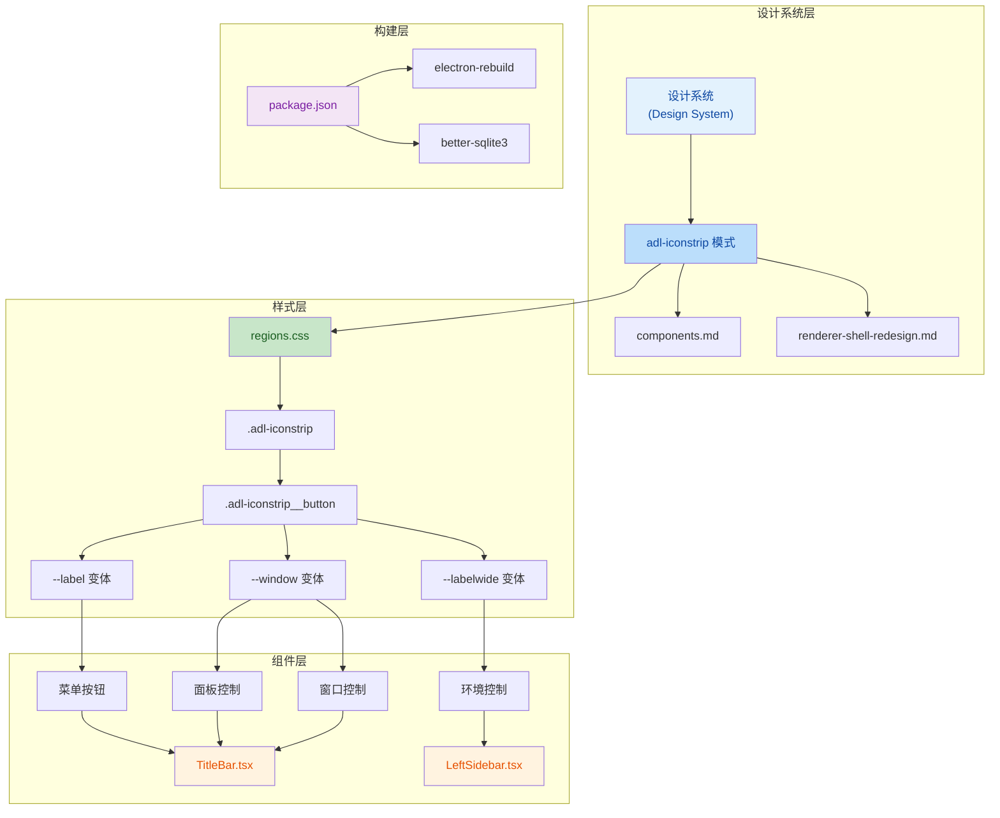

## 1. 高层摘要（TL;DR）

*   **影响：** 中等 - 将统一的图标条（`adl-iconstrip`）设计模式扩展到整个桌面应用的 shell 区域，包括标题栏和左侧边栏
*   **关键变更：**
    *   ✨ 在 **TitleBar** 和 **LeftSidebar** 组件中应用统一的 `adl-iconstrip` 样式模式
    *   🎨 新增三种按钮变体：`--label`（短文本）、`--labelwide`（宽文本）、`--window`（窗口控制）
    *   📐 重构 CSS 布局，采用全高度拉伸和零间距设计，实现边缘贴合效果
    *   📚 更新设计系统文档，记录新的视觉语法和设计规则
    *   📦 添加 `better-sqlite3` 依赖及自动重建脚本

---

## 2. 可视化概览（代码与逻辑图）



---

## 3. 详细变更分析

### 🎨 组件层：UI 组件样式统一

#### **TitleBar.tsx** - 标题栏重构
*   **变更说明：** 将标题栏的所有控制区域（菜单、面板控制、窗口控制）统一应用 `adl-iconstrip` 模式
*   **具体改动：**
    *   菜单触发器添加 `adl-iconstrip__button adl-iconstrip__button--label` 类
    *   命令面板按钮添加 `adl-iconstrip__button` 类
    *   设置按钮移入新的 `adl-titlebar__action-group` 容器
    *   面板控制按钮添加 `adl-iconstrip__button` 类
    *   窗口控制按钮（最小化、最大化、关闭）添加 `adl-iconstrip__button adl-iconstrip__button--window` 类

#### **LeftSidebar.tsx** - 左侧边栏环境控制
*   **变更说明：** 底部环境控制区域（主题/语言切换）采用边缘贴合的图标条设计
*   **具体改动：**
    *   容器添加 `adl-iconstrip` 类和 `aria-label="Environment controls"`
    *   主题和语言按钮添加 `adl-iconstrip__button adl-iconstrip__button--labelwide` 类

---

### 🎯 样式层：CSS 架构重构

#### **regions.css** - 核心样式系统

**新增 CSS 变量系统：**
```css
--adl-iconstrip-height: var(--titlebar-height);  /* 图标条高度 */
--adl-iconstrip-button-size: 36px;              /* 按钮尺寸 */
```

**布局策略变更：**

| 属性 | 旧值 | 新值 | 说明 |
|------|------|------|------|
| `gap` | `var(--space-1)` / `2px` | `0` | 消除按钮间距，实现边缘贴合 |
| `height` | 自动 | `100%` | 按钮拉伸至全高度 |
| `align-self` | 自动 | `stretch` | 容器内元素拉伸 |
| `border-radius` | `var(--radius-sm)` | `0` | 移除圆角，实现无缝连接 |

**新增按钮变体：**

| 变体类名 | 用途 | 特性 |
|---------|------|------|
| `.adl-iconstrip__button--label` | 标题栏菜单按钮 | 宽度自适应，短文本 |
| `.adl-iconstrip__button--labelwide` | 左侧边栏环境控制 | 全宽，图标+文本 |
| `.adl-iconstrip__button--window` | 窗口控制按钮 | 固定宽度，对齐系统控制 |

**交互状态优化：**
```css
/* 悬停/激活/聚焦状态统一 */
.adl-iconstrip__button:hover,
.adl-iconstrip__button.is-open,
.adl-iconstrip__button.is-active,
.adl-iconstrip__button[aria-pressed="true"] {
  background: var(--surface-hover);
  color: var(--text-primary);
}
```

**条件分隔符逻辑：**
- 使用 `:has()` 伪类实现相邻高亮状态时的视觉分隔
- 仅在相邻按钮都处于高亮状态时显示分隔线
- 通过 `:hover`、`.is-open`、`.is-active`、`[aria-pressed="true"]` 触发

---

### 📚 文档层：设计系统更新

#### **components.md** - 组件文档
*   **新增内容：**
    - 记录三种新的按钮变体（`--label`、`--labelwide`、`--window`）
    - 说明标题栏使用场景：全高度轨道，菜单/图标/窗口控制共享同一视觉语言
    - 补充设计规则：集群间使用真实边框分隔，集群内使用条件分隔符覆盖层

#### **renderer-shell-redesign.md** - 架构文档
*   **更新说明：**
    - 明确 `adl-iconstrip` 模式现已覆盖右侧面板工具切换器和桌面标题栏
    - 强调这是产品的紧凑命令语言，适用于未来所有 shell 表面

---

### 🔧 构建层：依赖配置

#### **package.json** - 构建脚本更新

| 脚本/依赖 | 旧值 | 新值 | 说明 |
|-----------|------|------|------|
| `scripts.rebuild` | - | `npx electron-rebuild --target 35.7.5` | 新增重建脚本 |
| `scripts.postinstall` | - | `npm run rebuild` | 安装后自动重建原生模块 |
| `dependencies.better-sqlite3` | - | `^12.9.0` | 新增 SQLite 数据库依赖 |

---

## 4. 影响与风险评估

### ⚠️ 破坏性变更
*   **CSS 类名变更：** 所有标题栏和左侧边栏按钮的类名结构已改变，可能影响自定义样式覆盖
*   **布局行为变更：** 按钮从固定宽度/圆角改为全高度拉伸/无圆角，可能影响依赖旧布局的第三方组件

### 🧪 测试建议
*   **视觉回归测试：**
  - 验证标题栏在不同窗口尺寸下的布局表现
  - 检查左侧边栏环境控制按钮的文本换行行为
  - 确认窗口控制按钮（最小化/最大化/关闭）的对齐和交互
  
*   **交互测试：**
  - 测试相邻按钮同时悬停时的分隔符显示逻辑
  - 验证菜单下拉时的 `.is-open` 状态样式
  - 检查面板切换按钮的 `[aria-pressed="true"]` 状态

*   **无障碍测试：**
  - 确认所有新增的 `aria-label` 属性正确显示
  - 验证键盘导航和焦点状态可见性

*   **构建测试：**
  - 运行 `npm install` 确认 `better-sqlite3` 自动重建成功
  - 验证 Electron 应用启动时原生模块加载正常

---

## 5. 设计理念总结

本次变更将 **"边缘贴合、零间距、全高度拉伸"** 作为 shell 区域的核心设计语言，通过统一的 `adl-iconstrip` 模式实现：

1. **视觉一致性：** 标题栏、左侧边栏、右侧面板共享同一视觉语法
2. **空间效率：** 消除冗余间距，最大化可用交互区域
3. **状态感知：** 条件分隔符仅在必要时出现，减少视觉噪音
4. **扩展性：** 通过 CSS 变量和修饰符类支持未来新的 shell 表面