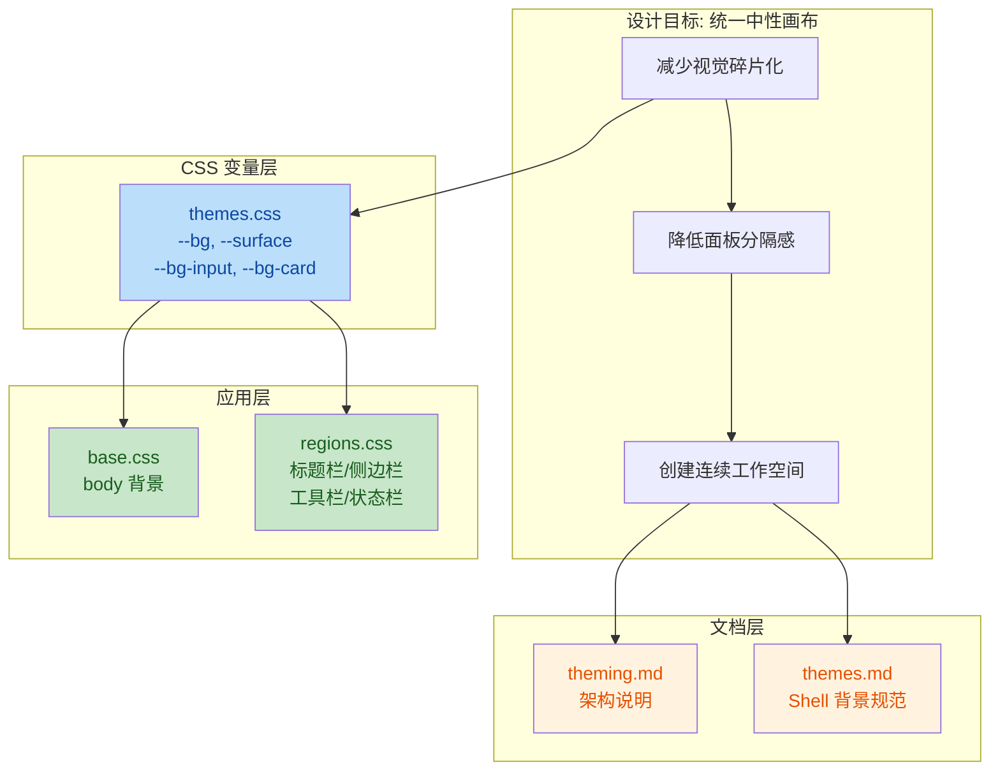

## 1. 高层摘要 (TL;DR)

- **影响范围**: 🟡 **中等** - 涉及桌面应用整个渲染器的视觉系统重构
- **核心变更**:
  - 🎨 将多个结构区域的背景色统一为单一基准色 (`--bg`)
  - 🌗 调整浅色和深色主题的色值，使界面更加柔和统一
  - 📝 更新设计系统文档，明确"统一中性画布"的设计原则

---

## 2. 可视化概览 (代码与逻辑映射)



---

## 3. 详细变更分析

### 🎨 3.1 主题变量系统重构

**文件**: `ai-digital-life/apps/desktop/renderer/src/styles/themes.css`

#### 浅色主题调整

| 变量名 | 旧值 | 新值 | 说明 |
|--------|------|------|------|
| `--bg` | `#f3f3f3` | `#f8f8f8` | 主背景色更亮更柔和 |
| `--bg-secondary` | `#e6e6e6` | `#f8f8f8` | 与主背景统一 |
| `--bg-elevated` | `#ffffff` | `#f8f8f8` | 与主背景统一 |
| `--bg-card` | `#ffffff` | `#fbfbfb` | 卡片背景微调 |
| `--surface` | `#ffffff` | `#f8f8f8` | 表面层与背景统一 |
| `--surface-elevated` | `#ffffff` | `#fafafa` | 提升层微调 |
| `--surface-sunken` | `#e8e8e8` | `#f8f8f8` | 下沉层与背景统一 |

#### 深色主题调整

| 变量名 | 旧值 | 新值 | 说明 |
|--------|------|------|------|
| `--bg-secondary` | `#212121` | `#141414` | 与主背景统一 |
| `--bg-strong` | `#1e1e1e` | `#1c1c1c` | 强调色微调 |
| `--bg-elevated` | `rgba(30,30,30,0.95)` | `#141414` | 与主背景统一 |
| `--bg-card` | `#282828` | `#1a1a1a` | 卡片背景更深 |
| `--bg-input` | `#1e1e1e` | `#1c1c1c` | 输入框背景调整 |
| `--surface` | `#1e1e1e` | `#141414` | 表面层与背景统一 |
| `--surface-elevated` | `#252525` | `#171717` | 提升层微调 |
| `--surface-sunken` | `#181818` | `#141414` | 下沉层与背景统一 |
| `--surface-raised` | `#282828` | `#1c1c1c` | 浮起层调整 |

---

### 🧩 3.2 结构区域背景统一

**文件**: `ai-digital-life/apps/desktop/renderer/src/styles/regions.css`

将多个结构区域的背景从 `var(--surface)` 或 `var(--surface-raised)` 统一改为 `var(--bg)`:

| 区域 | 旧背景 | 新背景 | 行号 |
|------|--------|--------|------|
| 标题栏 | `--surface` | `--bg` | 114 |
| 左侧栏容器 | `--surface` | `--bg` | 438 |
| 左侧栏内容 | 无 | `--bg` | 467 |
| 快速按钮栏 | 无 | `--bg` | 494 |
| 工作区工具栏 | 无 | `--bg` | 553 |
| 环境按钮区 | 无 | `--bg` | 1042 |
| 中心区域头部 | `--surface` | `--bg` | 1084 |
| 搜索输入框 | `--surface-raised` | `--bg-input` | 1367 |
| 右侧面板容器 | `--surface` | `--bg` | 1552 |
| 右侧面板内容 | 无 | `--bg` | 1580 |
| 工具切换器 | 无 | `--bg` | 1610 |
| 工具主体 | 无 | `--bg` | 1646 |
| 工具侧边栏 | 无 | `--bg` | 1662 |
| 工具主区域 | 无 | `--bg` | 1758 |
| 工具主头部 | `--surface-subtle` | `--bg` | 1775 |
| 工具主滚动区 | 无 | `--bg` | 1812 |
| 状态栏 | `--surface` | `--bg` | 2122 |

---

### 🌑 3.3 深色主题背景简化

**文件**: `ai-digital-life/apps/desktop/renderer/src/styles/base.css`

移除了深色主题下 `body` 的复杂渐变背景:

```css
/* 旧代码 - 复杂渐变 */
[data-theme="dark"] body {
  background:
    radial-gradient(circle at top left, var(--accent-soft) 0%, transparent 28%),
    radial-gradient(circle at top right, var(--info-soft) 0%, transparent 24%),
    linear-gradient(160deg, var(--bg) 0%, #000 200%);
}

/* 新代码 - 纯净背景 */
[data-theme="dark"] body {
  background: var(--bg);
}
```

---

### 📚 3.4 文档更新

#### 架构文档

**文件**: `ai-digital-life/docs/architecture/theming.md`

新增说明:
> "The shell now uses a unified neutral canvas for most structural regions so title bar, sidebars, center header, tool switcher, tool panes, and status bar read as one continuous workspace."

明确当前基准色:
- 浅色模式: `rgb(248, 248, 248)`
- 深色模式: `rgb(20, 20, 20)`

#### 设计系统文档

**文件**: `ai-digital-life/docs/design-system/themes.md`

新增 **"Shell background baseline"** 章节:

| 规则项 | 说明 |
|--------|------|
| 设计原则 | 渲染器外壳偏好统一的背景以减少面板碎片化和视觉噪声 |
| 浅色模式 | 使用 `--bg: rgb(248, 248, 248)` 作为主画布 |
| 深色模式 | 使用 `--bg: rgb(20, 20, 20)` 作为主画布 |
| 结构容器 | 标题栏、左侧栏、中心头部、工具栏等优先使用 `--bg` |
| 提升控件 | 输入框、菜单、弹出层可使用 `--bg-input`、`--surface-elevated` 或 `--surface-raised` |

---

## 4. 影响与风险评估

### ✅ 4.1 积极影响

- **视觉一致性提升**: 整个应用界面呈现统一的视觉风格，减少面板间的割裂感
- **降低认知负荷**: 用户可以更专注于内容而非界面结构
- **性能优化**: 移除复杂的渐变背景，减少渲染计算
- **可维护性增强**: 背景色系统更加简洁，便于后续调整

### ⚠️ 4.2 潜在风险

| 风险项 | 严重程度 | 缓解措施 |
|--------|----------|----------|
| **层级区分度降低** | 🟡 中等 | 输入框、弹出层等仍使用独立的背景色 (`--bg-input`, `--surface-raised`) |
| **用户习惯改变** | 🟢 低 | 这是一个渐进式改进，新用户会更容易接受 |
| **对比度问题** | 🟢 低 | 文本颜色变量未变，WCAG 合规性保持 |

### 🧪 4.3 测试建议

1. **视觉回归测试**:
   - 对比浅色/深色模式下的界面截图
   - 检查标题栏、侧边栏、工具栏等区域的视觉连续性

2. **交互测试**:
   - 验证输入框、下拉菜单、弹出层是否仍然清晰可见
   - 测试悬停和激活状态的视觉反馈

3. **边界场景**:
   - 在不同屏幕尺寸下测试 (640px - 1920px+)
   - 验证长内容滚动时的视觉一致性

4. **可访问性验证**:
   - 使用对比度检查工具验证文本可读性
   - 测试屏幕阅读器对界面结构的感知

---

## 5. 总结

本次重构将应用的视觉系统从"多层分离"转向"统一中性画布"的设计理念。通过将大部分结构区域的背景统一为 `--bg`，同时保留输入框和弹出层的独立背景，在视觉简洁性和交互清晰度之间取得了良好的平衡。这是一个渐进式的改进，不会破坏现有功能，但会显著提升整体的用户体验。

---

验证问题的存在性并进行修复：

标题: 重复背景属性定义
详情: 第467行重复定义了 `background: var(--bg)`，而第464-466行已经定义了相同的属性。建议删除重复定义以保持代码简洁。
`ai-digital-life/apps/desktop/renderer/src/styles/regions.css#L467-467`

验证问题的存在性并进行修复：

标题: 重复背景属性定义
详情: 第1580行重复定义了 `background: var(--bg)`，而第1577-1579行已经定义了相同的属性。建议删除重复定义以保持代码一致性。
`ai-digital-life/apps/desktop/renderer/src/styles/regions.css#L1580-1580`