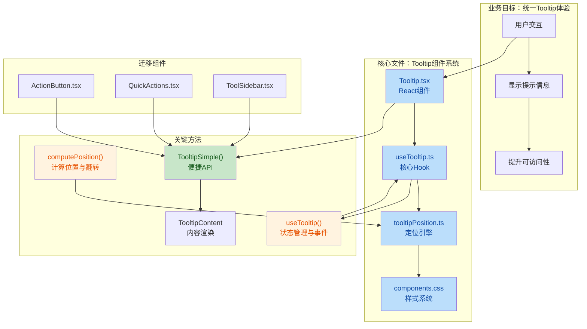
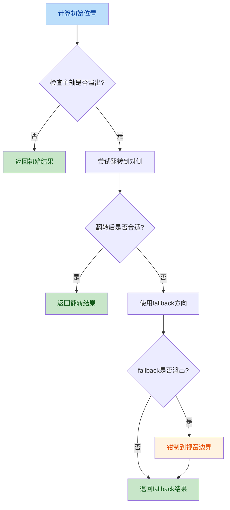

## 1. 高层摘要（TL;DR）

**影响范围：** 🟡 **中高** - 新增核心UI组件，涉及多个组件的Tooltip迁移

**关键变更：**
- ✨ **新增完整的Tooltip组件系统**：包含React组件、核心Hook、定位引擎和完整测试
- 🔄 **迁移原生title属性**：将ActionButton、QuickActions、ToolSidebar等组件的原生`title`属性替换为`TooltipSimple`组件
- 📐 **手写轻量级定位引擎**：不引入外部依赖，实现4方向定位、自动翻转和边界检测
- 🧪 **强制红绿测试规则**：新增mandatory-testing规则，要求UI/UX变更必须执行完整测试
- 📚 **完善文档和规范**：更新设计系统、代码库映射和AGENTS规则

---

## 2. 可视化概览（代码与逻辑映射）



---

## 3. 详细变更分析

### 🎯 组件一：Tooltip组件系统（新增）

#### **文件：** `ai-digital-life/apps/desktop/renderer/src/app/components/Tooltip.tsx`

**变更说明：**
- 新增完整的Tooltip组件，采用组合模式API（类似Radix UI）
- 提供三种使用方式：`Tooltip` + `TooltipTrigger` + `TooltipContent`（组合模式）、`TooltipSimple`（便捷模式）
- 使用`createPortal`将Tooltip渲染到`document.body`，避免父元素`overflow: hidden`影响
- 支持受控和非受控两种模式

**核心组件结构：**

| 组件 | 用途 | 关键Props |
|------|------|-----------|
| `Tooltip` | 根组件，提供Context | `defaultPlacement`, `trigger`, `showDelay`, `hideDelay`, `dismissible`, `showArrow` |
| `TooltipTrigger` | 触发元素包装器 | `asChild`（Slot模式） |
| `TooltipContent` | Tooltip内容 | `side`, `align`, `sideOffset`, `className` |
| `TooltipSimple` | 便捷API（推荐） | `content`, `placement`, `align` |

**关键实现细节：**
- `cloneElementWithRef`函数：处理`asChild`模式下的ref合并
- 延迟卸载机制：关闭后等待200ms再卸载DOM，保证动画完整播放
- 箭头定位：根据`placement`和`alignment`动态计算箭头位置

---

### 🧩 组件二：useTooltip核心Hook（新增）

#### **文件：** `ai-digital-life/apps/desktop/renderer/src/app/hooks/useTooltip.ts`

**变更说明：**
- 实现Tooltip的核心状态管理和事件处理逻辑
- 支持三种触发方式：`hover`、`focus`、`click`、`manual`
- 实现延迟显示/隐藏机制（默认300ms显示，150ms隐藏）
- 实现"鼠标桥接"行为：鼠标从触发元素移动到Tooltip时不消失

**核心功能：**

| 功能 | 实现方式 |
|------|----------|
| 延迟控制 | `showTimerRef`和`hideTimerRef`管理定时器 |
| 位置更新 | `requestAnimationFrame`节流，避免抖动 |
| 尺寸监听 | `ResizeObserver`监听触发元素和Tooltip尺寸变化 |
| 滚动感知 | 自动检测并监听滚动容器（包括window） |
| 键盘可访问性 | Escape键关闭，focus/blur触发 |
| 清理机制 | unmount时清除所有定时器、事件监听器和RAF |

**关键代码片段：**
```typescript
// 鼠标桥接逻辑
const handleTooltipEnter = useCallback(() => {
  isPointerInTooltipRef.current = true;  // 标记鼠标在Tooltip内
  clearTimers();  // 清除隐藏定时器
}, [clearTimers]);
```

---

### 📍 组件三：tooltipPosition定位引擎（新增）

#### **文件：** `ai-digital-life/apps/desktop/renderer/src/app/utils/tooltipPosition.ts`

**变更说明：**
- 纯函数实现的定位计算引擎，无外部依赖
- 支持4个方向：`top`、`bottom`、`left`、`right`
- 支持3种对齐方式：`start`、`center`、`end`
- 自动翻转：空间不足时翻转到对侧
- 边界约束：确保Tooltip不超出视窗范围

**定位算法流程：**



**关键函数：**

| 函数 | 职责 |
|------|------|
| `computePosition()` | 主函数，计算Tooltip位置 |
| `calculate()` | 内部函数，计算指定placement的位置 |
| `fitsInViewport()` | 检查坐标是否在视窗内 |
| `computeArrowPosition()` | 计算箭头的偏移位置 |

---

### 🎨 组件四：CSS样式扩展（修改）

#### **文件：** `ai-digital-life/apps/desktop/renderer/src/styles/components.css`

**变更说明：**
- 扩展现有的`.tooltip`样式，从简单的opacity过渡升级为完整的Tooltip样式系统
- 添加箭头（使用CSS伪元素实现）
- 添加关闭按钮样式（dismissible模式）
- 添加动画效果（进入/退出）
- 支持高对比度模式和减弱动效偏好

**样式对比：**

| 样式特性 | 旧版本 | 新版本 |
|----------|--------|--------|
| 定位 | `position: absolute` | `position: fixed` |
| 交互 | `pointer-events: none` | `pointer-events: auto` |
| 动画 | 简单opacity过渡 | scale + translateY动画 |
| 箭头 | 无 | CSS伪元素实现 |
| 关闭按钮 | 无 | 支持 |
| 主题适配 | 基础 | 高对比度 + 减弱动效 |

**关键CSS变量：**
- `var(--z-tooltip)`：z-index层级
- `var(--text-primary)`：Tooltip背景色
- `var(--bg)`：Tooltip文字色
- `var(--shadow-lg)`：阴影效果

---

### 🧪 组件五：单元测试（新增）

#### **文件：** `ai-digital-life/tests/unit/components/Tooltip.test.tsx`

**变更说明：**
- 新增620行的完整单元测试，覆盖Tooltip的所有功能
- 使用Vitest + React Testing Library
- 包含ResizeObserver polyfill（用于jsdom环境）

**测试覆盖范围：**

| 测试类别 | 测试数量 | 覆盖内容 |
|----------|----------|----------|
| 基础渲染 | 4 | 单行文本、多行文本、富HTML内容、空内容 |
| 交互行为 | 8 | hover/focus/click触发、延迟生效、鼠标桥接、Escape键、关闭按钮 |
| 定位测试 | 2 | data-side属性、data-state属性 |
| 可访问性 | 1 | role="tooltip"属性 |
| 受控模式 | 1 | controlled open state |
| 边界情况 | 2 | 卸载清理、快速enter/leave |
| 定位引擎 | 9 | 4方向、对齐、翻转、边界钳制 |

**测试示例：**
```typescript
it("flips to bottom when top would overflow viewport top", () => {
  const trigger = makeRect(100, 5, 40, 30);  // 靠近顶部
  const result = computePosition({
    triggerRect: trigger,
    tooltipRect: { width: 120, height: 50 },
    placement: "top",
    offset: 8
  });
  expect(result.placement).toBe("bottom");  // 自动翻转
});
```

---

### 🔄 组件六：原生title属性迁移

#### **文件：** 多个组件文件

**变更说明：**
将以下组件的原生`title`属性替换为`TooltipSimple`组件：

| 组件 | 原代码 | 新代码 |
|------|--------|--------|
| `ActionButton.tsx` | `<button title={label}>` | `<TooltipSimple content={label}><button>` |
| `QuickActions.tsx` | `<button title={tooltip}>` | `<TooltipSimple content={tooltip}><button>` |
| `ToolSidebar.tsx` | `<button title={action.title}>` | `<TooltipSimple content={action.title}><button>` |

**迁移示例（ActionButton.tsx）：**
```tsx
// 旧版本
<button title={appearance.label} aria-label={appearance.label}>
  <Icon name={appearance.icon} size="md" />
</button>

// 新版本
<TooltipSimple content={appearance.label} placement="top">
  <button aria-label={appearance.label}>
    <Icon name={appearance.icon} size="md" />
  </button>
</TooltipSimple>
```

---

### 📋 组件七：规则与文档更新

#### **文件：** 多个规则文档

**变更说明：**

| 文件 | 变更内容 |
|------|----------|
| `.trae/rules/design-system.md` | 新增Tooltip组件规范，禁止使用原生`title`属性 |
| `.trae/rules/mandatory-testing.md` | 新增强制红绿测试规则，要求UI/UX变更必须执行完整测试 |
| `.trae/rules/codebase-map.md` | 更新测试目录结构，添加`unit/components/` |
| `AGENTS.md` | 添加禁止项：使用原生HTML `title`属性、跳过红绿测试 |

**新增规则摘要：**
- ❌ **禁止**使用原生HTML `title`属性作为Tooltip
- ✅ **必须**使用`TooltipSimple`组件
- 🧪 UI/UX变更后**必须**执行红绿测试
- 📝 新增组件**必须**覆盖：基础渲染、交互行为、主题适配、可访问性、边界情况

---

### ⚙️ 组件八：测试配置更新

#### **文件：** `ai-digital-life/vitest.config.ts`

**变更说明：**
- 更新测试包含模式，支持`.tsx`文件
- 添加`/logo.png?url`别名，用于mock静态资源

**变更内容：**
```typescript
// 旧版本
include: ["tests/unit/**/*.test.ts", "tests/integration/**/*.test.ts"]

// 新版本
include: ["tests/unit/**/*.test.ts", "tests/unit/**/*.test.tsx", "tests/integration/**/*.test.ts"]
```

---

## 4. 影响与风险评估

### ⚠️ 破坏性变更

| 变更类型 | 影响范围 | 风险等级 |
|----------|----------|----------|
| 原生title属性移除 | ActionButton、QuickActions、ToolSidebar | 🟡 中 |
| 新增测试依赖 | vitest.config.ts | 🟢 低 |
| CSS样式变更 | components.css | 🟢 低（向后兼容） |

### ✅ 测试建议

**必须测试的场景：**

1. **基础功能测试**
   - [ ] Tooltip在hover后300ms显示
   - [ ] Tooltip在鼠标离开后150ms隐藏
   - [ ] 鼠标从触发元素移动到Tooltip时不消失（鼠标桥接）
   - [ ] Escape键关闭Tooltip

2. **定位测试**
   - [ ] Tooltip在视窗中央正确显示
   - [ ] Tooltip在视窗边缘时自动翻转
   - [ ] Tooltip在滚动容器内正确定位
   - [ ] 窗口resize时Tooltip位置更新

3. **主题测试**
   - [ ] Light主题下Tooltip颜色正确
   - [ ] Dark主题下Tooltip颜色正确
   - [ ] 高对比度模式下边框可见

4. **迁移组件测试**
   - [ ] ActionButton的Tooltip正常显示
   - [ ] QuickActions的Tooltip正常显示
   - [ ] ToolSidebar的Tooltip正常显示

5. **性能测试**
   - [ ] 快速hover多个Tooltip不卡顿
   - [ ] 组件卸载时定时器正确清理

### 🔍 潜在风险

1. **内存泄漏风险**
   - **风险点：** `useTooltip` Hook中的定时器和事件监听器
   - **缓解措施：** 已实现完整的清理逻辑，包括`clearTimers`、`cancelAnimationFrame`和`cleanupRef`

2. **定位抖动风险**
   - **风险点：** 频繁的resize/scroll事件导致位置计算过于频繁
   - **缓解措施：** 使用`requestAnimationFrame`节流，合并连续的位置更新

3. **Portal清理风险**
   - **风险点：** `TooltipContent`使用`createPortal`，可能存在DOM节点未清理
   - **缓解措施：** 实现延迟卸载机制（200ms后卸载），确保动画完整播放

4. **测试环境兼容性**
   - **风险点：** jsdom环境不支持`ResizeObserver`
   - **缓解措施：** 已添加polyfill

---

## 5. 后续建议

### 📋 迁移计划

根据`.trae/documents/custom-tooltip-component-plan.md`，建议按以下优先级继续迁移：

| 优先级 | 组件 | 理由 |
|--------|------|------|
| P0 | TitleBar按钮 | 窗口控制，用户常驻区域 |
| P1 | SessionManagement | 会话列表，次要交互 |
| P2 | 其他组件 | 低频交互区域 |

### 🚀 性能优化建议

1. **虚拟化优化**：隐藏时将Tooltip移出视口而非仅`opacity:0`
2. **事件委托**：全局只监听一次scroll/resize，通过Map管理多个Tooltip实例
3. **Memo化**：内容不变时不重新渲染Tooltip DOM

### 📚 文档完善

1. 添加Storybook示例（如果项目使用）
2. 补充API文档（使用TypeDoc或类似工具）
3. 添加可访问性最佳实践文档

---