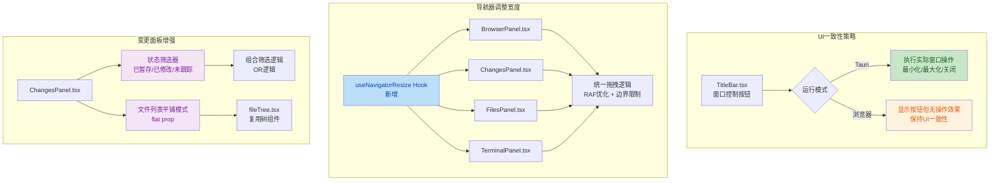
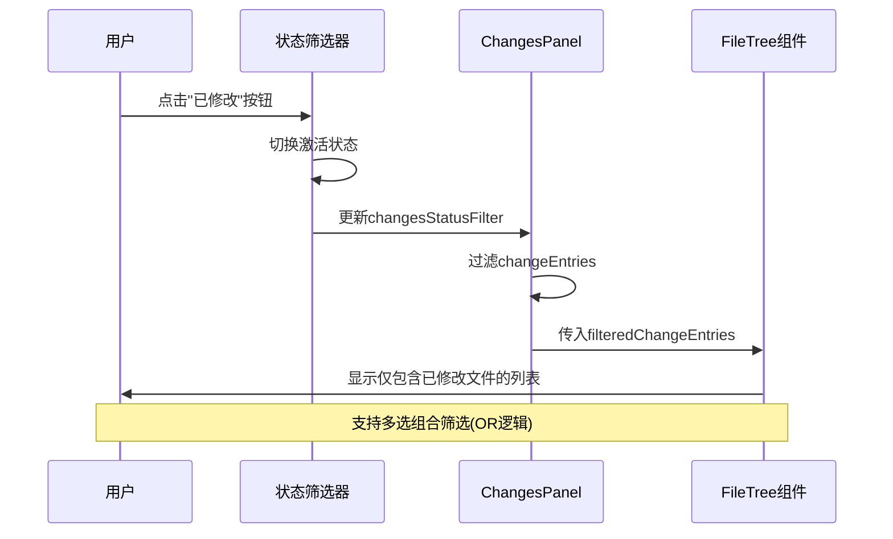

## 1. 高层摘要 (TL;DR)

**影响范围:** 🟡 **中等** - 涉及跨平台UI行为调整和变更面板功能增强

**核心变更:**
- 🪟 **窗口控制按钮策略调整**: 浏览器模式下从"隐藏"改为"显示但无实际操作效果",保持UI一致性
- 📐 **导航器调整宽度逻辑重构**: 提取为共享Hook `useNavigatorResize`,统一4个面板的拖拽行为
- 🔍 **变更面板状态筛选**: 新增"已暂存/已修改/未跟踪"三态筛选功能,支持组合筛选
- 📋 **文件列表平铺模式**: 变更面板支持无层级平铺显示文件列表

---

## 2. 可视化概览 (代码与逻辑映射)



**交互流程图:**



---

## 3. 详细变更分析

### 📄 文档与规范更新

| 文件 | 变更内容 |
|------|----------|
| `.trae/rules/desktop-ui-verification.md` | 窗口控制按钮验证规则: 浏览器模式从"隐藏"改为"显示但无实际操作效果" |
| `.trae/rules/quality-gates.md` | 质量门禁规则同步更新 |
| `.trae/rules/tauri-shell.md` | 平台差异说明更新 |
| `AGENTS.md` | Agent平台差异表更新 |
| `UIOperationManual/titlebar/window.md` | 窗口控制行为说明更新 |
| `UIOperationManual/rightpanel/tools/changes.md` | 新增文件列表模式、状态筛选完整文档 |

---

### 🪟 标题栏窗口控制策略

**变更文件:** `ai-digital-life/frontend/src/app/regions/TitleBar.tsx`

**变更逻辑:**
- **移除条件渲染**: 删除 `isTauriShell()` 三元表达式判断
- **统一渲染**: 窗口控制按钮在Tauri和浏览器模式下均渲染
- **行为差异**: 
  - Tauri模式: 通过桥接层执行实际窗口操作
  - 浏览器模式: 按钮显示但点击无效果(浏览器不支持自定义窗口操作)

**代码变更:**
```tsx
// 之前: 仅在Tauri模式渲染
{isTauriShell() ? (
  <div className="adl-titlebar__window-group">...</div>
) : null}

// 之后: 所有模式渲染
<div className="adl-titlebar__window-group">...</div>
```

---

### 📐 导航器调整宽度逻辑重构

**新增文件:** `ai-digital-life/frontend/src/app/hooks/useNavigatorResize.ts`

**核心功能:**
- **统一拖拽逻辑**: 封装指针事件处理、RAF优化、边界限制
- **性能优化**: 使用 `requestAnimationFrame` 避免频繁重排
- **边界控制**: 支持自定义 `minWidth` 和 `maxWidth`
- **状态管理**: 自动添加/移除 `adl-is-resizing` body类

**使用方式:**
```typescript
const { handlePointerDown } = useNavigatorResize({
  onWidthCommit: setChangesNavigatorWidth,
  minWidth: 180,
  maxWidth: 300
});
```

**影响组件:**

| 组件 | 之前 | 之后 |
|------|------|------|
| `BrowserPanel.tsx` | 内联50行拖拽逻辑 | 使用Hook |
| `ChangesPanel.tsx` | 内联60行拖拽逻辑+预览元素 | 使用Hook |
| `FilesPanel.tsx` | 内联60行拖拽逻辑+预览元素 | 使用Hook |
| `TerminalPanel.tsx` | 内联20行拖拽逻辑 | 使用Hook |

---

### 🔍 变更面板状态筛选功能

**变更文件:** `ai-digital-life/frontend/src/app/regions/right-panel/ChangesPanel.tsx`

**新增功能:**

#### 1. 状态筛选器UI
将原有的静态统计卡片改为可点击的筛选按钮:

| 状态 | 按钮标签 | 计数来源 | 筛选逻辑 |
|------|----------|----------|----------|
| 已暂存 | `S:0` | `snapshot?.staged.length` | 仅显示已暂存文件 |
| 已修改 | `M:8` | `snapshot?.unstaged.length` | 仅显示已修改文件 |
| 未跟踪 | `U:0` | `snapshot?.untracked.length` | 仅显示未跟踪文件 |

#### 2. 筛选逻辑实现
```typescript
const [changesStatusFilter, setChangesStatusFilter] = useState<Set<ChangeFileState>>(() => new Set());

const filteredChangeEntries = useMemo(() => {
  if (changesStatusFilter.size === 0 || changesStatusFilter.size === 3) return changeEntries;
  return changeEntries.filter((entry) => 
    entry.states.some((state) => changesStatusFilter.has(state))
  );
}, [changeEntries, changesStatusFilter]);
```

#### 3. 交互行为
- **单选**: 点击一个状态按钮,仅显示该状态文件
- **多选**: 支持组合筛选(OR逻辑),如同时显示"已暂存"+"已修改"
- **取消**: 再次点击已激活按钮取消该状态筛选
- **重置**: 取消所有选中或选中全部三种状态 = 显示全部文件

#### 4. 视觉状态
| 状态 | 背景 | 边框 |
|------|------|------|
| 默认 | `var(--surface-raised)` | 透明 |
| 悬停 | 透明(透出渐变背景) | 灰色 |
| 激活 | 透明(透出渐变背景) | 透明 |

---

### 📋 文件列表平铺模式

**变更文件:** 
- `ai-digital-life/frontend/src/app/regions/right-panel/ChangesPanel.tsx`
- `ai-digital-life/frontend/src/app/regions/right-panel/fileTree.tsx`

**实现方式:**
1. **复用FileTree组件**: 文件列表模式与文件树模式共用同一套组件
2. **flat prop控制**: 通过 `flat={true}` 移除缩进占位符
3. **样式调整**: 添加 `.adl-filetree__indent--flat` 类,设置宽度为0

**代码变更:**
```tsx
// ChangesPanel.tsx - 文件列表模式
<FileTree
  nodes={flatNodes}
  flat  // 新增: 启用平铺模式
/>

// fileTree.tsx - 条件渲染缩进
indentClassName={`adl-filetree__indent${flat ? " adl-filetree__indent--flat" : ""}`}
```

**显示效果:**
- **文件树模式**: 显示目录层级,支持展开/折叠
- **文件列表模式**: 平铺显示所有文件,无缩进,无展开/折叠操作

---

### 🎨 样式调整

**变更文件:** `ai-digital-life/frontend/src/styles/regions.css`

**移除样式:**
- ❌ `.adl-tool-surface--files.is-collapse-preview` - 文件面板折叠预览
- ❌ `.adl-files-collapse-preview` - 折叠预览渐变背景
- ❌ `.adl-tool-navigator__resize-preview` - 调整宽度预览元素

**新增/调整样式:**
- ✅ `.adl-tool-navigator__summary-stat` - 状态筛选按钮基础样式
- ✅ `.adl-tool-navigator__summary-stat:hover` - 悬停状态
- ✅ `.adl-tool-navigator__summary-stat.is-active` - 激活状态
- ✅ `.adl-filetree__indent--flat` - 平铺模式无缩进
- ✅ `.adl-filetree__meta` - 文件元数据对齐
- ✅ `.adl-tool-navigator__summary` - 添加底部边框

---

## 4. 影响与风险评估

### ⚠️ 破坏性变更

| 变更项 | 影响范围 | 风险等级 |
|--------|----------|----------|
| 窗口控制按钮浏览器模式行为 | 标题栏UI | 🟢 低 - 仅视觉变化,功能无影响 |
| 导航器调整宽度逻辑 | 4个面板的拖拽行为 | 🟡 中 - 需验证拖拽流畅度和边界控制 |
| 变更面板状态筛选 | 变更面板交互 | 🟢 低 - 新增功能,不影响现有功能 |
| 文件列表平铺模式 | 变更面板显示 | 🟢 低 - 新增显示模式 |

### 🧪 测试建议

#### 必测场景:
1. **窗口控制按钮**
   - [ ] Tauri模式: 验证最小化/最大化/关闭按钮正常工作
   - [ ] 浏览器模式: 验证按钮显示但点击无效果,无报错

2. **导航器调整宽度**
   - [ ] 4个面板(Browser/Changes/Files/Terminal)的拖拽流畅度
   - [ ] 最小宽度限制(180px)和最大宽度限制(300px/420px)
   - [ ] 快速拖拽时的性能表现(RAF优化效果)
   - [ ] 拖拽过程中body类 `adl-is-resizing` 的添加/移除

3. **变更面板状态筛选**
   - [ ] 单选: 分别点击"已暂存"/"已修改"/"未跟踪"
   - [ ] 多选: 组合筛选(如"已暂存"+"已修改")
   - [ ] 取消筛选: 再次点击已激活按钮
   - [ ] 重置状态: 取消所有选中
   - [ ] 空状态: 筛选后无文件时的提示显示

4. **文件列表平铺模式**
   - [ ] 切换到文件列表模式,验证无缩进显示
   - [ ] 验证文件项点击选中状态
   - [ ] 验证长文件名的截断省略显示

#### 边界测试:
- [ ] 窗口宽度极小情况下的导航器拖拽
- [ ] 快速连续点击状态筛选按钮
- [ ] 筛选后刷新Git状态,验证筛选状态保持

---

## 5. 技术亮点

✨ **代码复用性提升**
- 提取 `useNavigatorResize` Hook,消除4个组件中的重复代码
- 文件列表模式复用 `FileTree` 组件,通过 `flat` prop 控制显示

✨ **性能优化**
- 使用 `requestAnimationFrame` 优化拖拽性能
- 移除不必要的DOM预览元素,减少重绘

✨ **用户体验增强**
- 状态筛选支持组合筛选,提供更灵活的文件过滤
- 窗口控制按钮在双端保持UI一致性,减少用户困惑
- 状态筛选按钮采用透明背景设计,视觉更轻盈