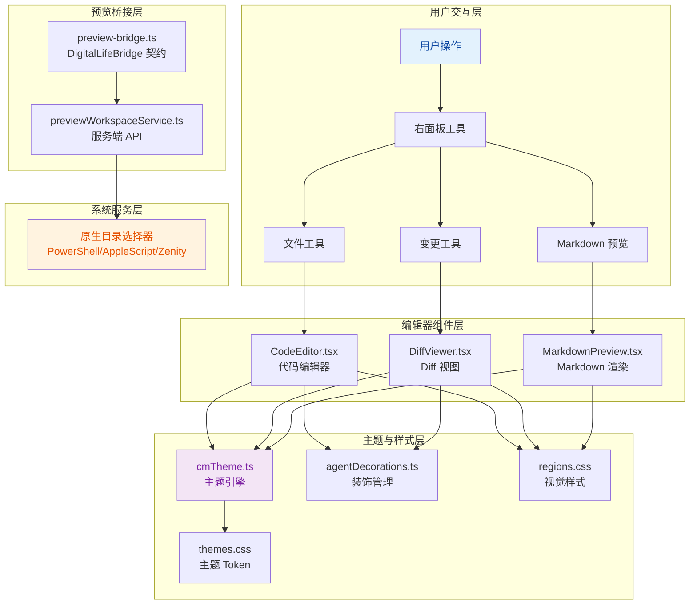

## 1. 高层摘要（TL;DR）

*   **影响：高** - 重大 UI 视觉重构，从 Monaco 时代遗留样式迁移到 CodeMirror 原生语义，新增原生目录选择器功能
*   **关键变更：**
    *   🎨 **视觉系统重构**：移除冗余 gutter 装饰，采用"安静专业"的行内背景高亮方案
    *   📝 **Markdown 引擎迁移**：从 `react-markdown` 迁移到 `markdown-it` + `highlight.js`
    *   📁 **原生目录选择器**：新增跨平台（Windows/macOS/Linux）的原生目录选择 API
    *   🎯 **主题系统升级**：大幅扩展语法高亮 token，支持更多语言元素
    *   🧪 **样式测试**：新增视觉约定测试文件，确保样式一致性

---

## 2. 视觉概览（代码与逻辑映射）



---

## 3. 详细变更分析

### 📦 组件：依赖管理

**变更说明**：新增 Markdown 渲染相关依赖

| 包名 | 版本 | 用途 |
|------|------|------|
| `@types/markdown-it` | `^14.1.2` | markdown-it TypeScript 类型定义 |
| `highlight.js` | `^11.11.1` | 代码语法高亮引擎 |
| `markdown-it` | `^14.1.1` | Markdown 解析与渲染引擎 |

**来源**：`ai-digital-life/frontend/package.json`

---

### 🔧 组件：预览工作区服务

**变更说明**：新增跨平台原生目录选择器功能

#### 新增 API 端点

| 端点 | 方法 | 功能 |
|------|------|------|
| `/workspace/pick-directory` | POST | 调用原生目录选择对话框 |

#### 平台实现方案

| 平台 | 实现方式 | 命令 |
|------|----------|------|
| **Windows** | PowerShell | `System.Windows.Forms.FolderBrowserDialog` |
| **macOS** | AppleScript | `choose folder with prompt` |
| **Linux** | Zenity | `zenity --file-selection --directory` |

**代码片段**（来源：`ai-digital-life/frontend/dev/previewWorkspaceService.ts`）：
```typescript
async function pickDirectory(): Promise<string | undefined> {
  const script =
    process.platform === "win32"
      ? {
          cmd: "powershell",
          args: [
            "-NoProfile",
            "-Command",
            [
              "Add-Type -AssemblyName System.Windows.Forms",
              "$dialog = New-Object System.Windows.Forms.FolderBrowserDialog",
              "$dialog.ShowNewFolderButton = $true",
              'if ($dialog.ShowDialog() -eq [System.Windows.Forms.DialogResult]::OK) {',
              "  [Console]::Write($dialog.SelectedPath)",
              "}"
            ].join("\n")
          ]
        }
      : process.platform === "darwin"
        ? {
            cmd: "osascript",
            args: [
              "-e",
              'set chosenFolder to choose folder with prompt "Select workspace folder"',
              "-e",
              "POSIX path of chosenFolder"
            ]
          }
        : {
            cmd: "zenity",
            args: ["--file-selection", "--directory", "--title=Select workspace folder"]
          };
  // ... Promise 包装与子进程管理
}
```

---

### 🎨 组件：CodeMirror 编辑器重构

#### CodeEditor.tsx - 动态配置系统

**变更说明**：使用 Compartment 模式实现动态行号、折叠、换行切换

| 新增 Compartment | 用途 | 动态切换内容 |
|------------------|------|--------------|
| `lineNumbersCompartment` | 行号控制 | `lineNumbers()` / `[]` |
| `wordWrapCompartment` | 换行控制 | `EditorView.lineWrapping` / `[]` |
| `foldGutterCompartment` | 折叠 gutter | `foldGutter()` / `[]` |

**移除的导入**：
- ❌ `defaultHighlightStyle` - 不再使用默认高亮样式
- ✅ 改用自定义 `getThemeExtension(theme)`

**来源**：`ai-digital-life/frontend/src/app/regions/right-panel/CodeEditor.tsx`

#### DiffViewer.tsx - Gutter 禁用与动态配置

**变更说明**：禁用 CodeMirror Merge gutter，采用行内背景高亮

| 配置项 | 旧值 | 新值 | 影响 |
|--------|------|------|------|
| `gutter` | `true` | `false` | 移除独立的 gutter 列 |
| 行号控制 | 静态配置 | Compartment 动态切换 | 支持运行时切换 |

**来源**：`ai-digital-life/frontend/src/app/regions/right-panel/DiffViewer.tsx`

---

### 📝 组件：Markdown 预览引擎迁移

**变更说明**：从 `react-markdown` 迁移到 `markdown-it` + `highlight.js`

#### 迁移对比

| 方面 | 旧方案 | 新方案 |
|------|--------|--------|
| **解析引擎** | `react-markdown` + `remark-gfm` | `markdown-it` |
| **语法高亮** | 无 | `highlight.js` |
| **渲染方式** | React 组件 | `dangerouslySetInnerHTML` |
| **代码块样式** | 无语言标识 | 带语言标签的代码块 |

**新增功能**：
- ✅ 代码块语言标签显示
- ✅ 语法高亮支持
- ✅ 更好的性能

**代码片段**（来源：`ai-digital-life/frontend/src/app/regions/right-panel/MarkdownPreview.tsx`）：
```typescript
function createMdInstance(theme: "light" | "dark"): MarkdownIt {
  return new MarkdownIt({
    html: false,
    linkify: true,
    typographer: true,
    highlight(str: string, lang: string): string {
      if (lang && hljs.getLanguage(lang)) {
        try {
          const highlighted = hljs.highlight(str, {
            language: lang,
            ignoreIllegals: true,
          }).value;
          return (
            `<div class="adl-md-code-header"><span class="adl-md-code-lang">${escapeHtml(lang)}</span></div>` +
            `<pre class="hljs"><code>${highlighted}</code></pre>`
          );
        } catch {
          // fallback
        }
      }
      const escaped = escapeHtml(str);
      return `<pre class="hljs"><code>${escaped}</code></pre>`;
    },
  });
}
```

---

### 🎨 组件：主题系统升级

#### cmTheme.ts - 语法高亮扩展

**新增语法 Token**（来源：`ai-digital-life/frontend/src/app/regions/right-panel/cmTheme.ts`）：

| Token 类别 | 新增 Token | 默认颜色（深色） |
|------------|-----------|------------------|
| **Markdown** | `syntaxHeading` | `#61afef` |
| | `syntaxStrong` | 继承前景色 |
| | `syntaxEmphasis` | `#c678dd` |
| | `syntaxLink` | `#61afef` |
| **代码结构** | `syntaxProperty` | `#e06c75` |
| **编辑器** | `gutterBg` | `#181818` |
| | `indentGuide` | `rgba(255,255,255,0.08)` |
| | `indentGuideActive` | `rgba(255,255,255,0.16)` |
| | `foldPlaceholder` | `rgba(255,255,255,0.1)` |

#### 移除的 Gutter 装饰

| 移除内容 | 原因 |
|----------|------|
| `AGENT_GUTTER_INSERT_CLASS` | 与行内背景重复 |
| `AGENT_GUTTER_MODIFY_CLASS` | 与行内背景重复 |
| `AGENT_GUTTER_DELETE_CLASS` | 与行内背景重复 |
| `AgentGutterMarker` 类 | 不再需要独立 gutter 列 |
| `agentGutterField` StateField | 不再需要 gutter 状态管理 |
| `agentGutter` gutter 扩展 | 禁用 gutter 列 |

**来源**：`ai-digital-life/frontend/src/app/regions/right-panel/agentDecorations.ts`

---

### 🎯 组件：视觉样式重构

#### regions.css - 移除 Monaco 遗留样式

**移除的样式类**：
- ❌ `.adl-cm-minimap` - 代码地图
- ❌ `.monaco-diff-editor` - Monaco Diff 编辑器
- ❌ `.adl-inline-diff-line` - 内联 Diff 行
- ❌ `.adl-inline-diff-background-band` - 内联 Diff 背景

**新增的样式类**：
- ✅ `.adl-cm-diff-viewer` - CodeMirror Diff 容器
- ✅ `.adl-md-code-header` - Markdown 代码块头部
- ✅ `.adl-unsupported-preview` - 不支持预览的文件提示
- ✅ `.adl-unsupported-preview__icon` - 提示图标
- ✅ `.adl-unsupported-preview__text` - 提示文本
- ✅ `.adl-unsupported-preview__hint` - 提示副文本

#### Markdown 预览样式

| 元素 | 样式特点 |
|------|----------|
| **标题** | H1-H6 渐进式字号，H1/H2 带下划线 |
| **代码块** | 带语言标签的头部，圆角边框 |
| **引用块** | 左侧强调色边框，淡色背景 |
| **链接** | 主题色，悬停下划线 |
| **图片** | 响应式，圆角，垂直间距 |

**来源**：`ai-digital-life/frontend/src/styles/regions.css`

---

### 🧪 组件：样式测试

**新增测试文件**：`cmPreviewStyling.test.ts`

**测试用例**：

| 测试项 | 验证内容 |
|--------|----------|
| 自定义主题 | 使用 `getThemeExtension(theme)` 而非 `defaultHighlightStyle` |
| Diff 状态渲染 | 使用安静行背景而非竖直状态栏 |
| 选择器隔离 | CodeMirror 与 Monaco 选择器独立 |
| Agent 注释 | 行内装饰，无额外 gutter 列 |

**来源**：`ai-digital-life/frontend/src/app/regions/right-panel/cmPreviewStyling.test.ts`

---

### 📚 组件：文档更新

#### UI 操作手册

**新增章节**：

1. **变更工具 - 显示语义与视觉约定**（`changes.md`）
   - 视觉元素对照表
   - 行号切换行为说明
   - 已移除的冗余提示列表
   - 颜色 token 对照表

2. **文件工具 - 显示语义与视觉约定**（`files.md`）
   - 预览语义说明
   - 行号切换行为
   - 已移除的冗余提示

#### 视觉约定原则

| 原则 | 说明 |
|------|------|
| **主语义在正文区** | Gutter 只保留基础行号定位 |
| **层级用深浅表达** | 绿色/红色深浅表示"范围"与"实际变更行" |
| **可读性优先** | 不把 gutter 设计成第二条状态栏 |

---

## 4. 影响与风险评估

### ⚠️ 破坏性变更

| 变更类型 | 影响范围 | 缓解措施 |
|----------|----------|----------|
| **Gutter 装饰移除** | 所有使用 Agent 装饰的组件 | 已迁移到行内背景高亮 |
| **Markdown 引擎替换** | Markdown 预览功能 | 保持相同渲染结果，增强功能 |
| **Monaco 样式移除** | 依赖旧样式的自定义组件 | 已完全迁移到 CodeMirror |

### ✅ 测试建议

1. **功能测试**：
   - ✅ 验证原生目录选择器在 Windows/macOS/Linux 上的行为
   - ✅ 测试行号切换功能（开启/关闭）
   - ✅ 测试换行切换功能
   - ✅ 测试折叠功能

2. **视觉测试**：
   - ✅ 验证 Diff 视图的行内背景高亮
   - ✅ 验证 Markdown 代码块的语法高亮
   - ✅ 验证不支持预览文件的提示 UI
   - ✅ 验证明暗主题切换

3. **回归测试**：
   - ✅ 确保所有编辑器功能正常工作
   - ✅ 确保主题切换无闪烁
   - ✅ 确保性能无明显下降

---

## 5. 总结

本次变更是一次**重大的视觉系统重构**，核心目标是：

1. **统一视觉语义**：从 Monaco 时代的遗留样式迁移到 CodeMirror 原生语义
2. **简化视觉层次**：移除冗余的 gutter 装饰，采用更简洁的行内背景高亮
3. **增强用户体验**：新增原生目录选择器、改进 Markdown 预览、扩展语法高亮
4. **提升可维护性**：新增样式测试、完善文档、统一主题系统

变更涉及 17 个文件，涵盖服务端 API、前端组件、样式系统、测试和文档，是一次**全面的前端工程化改进**。