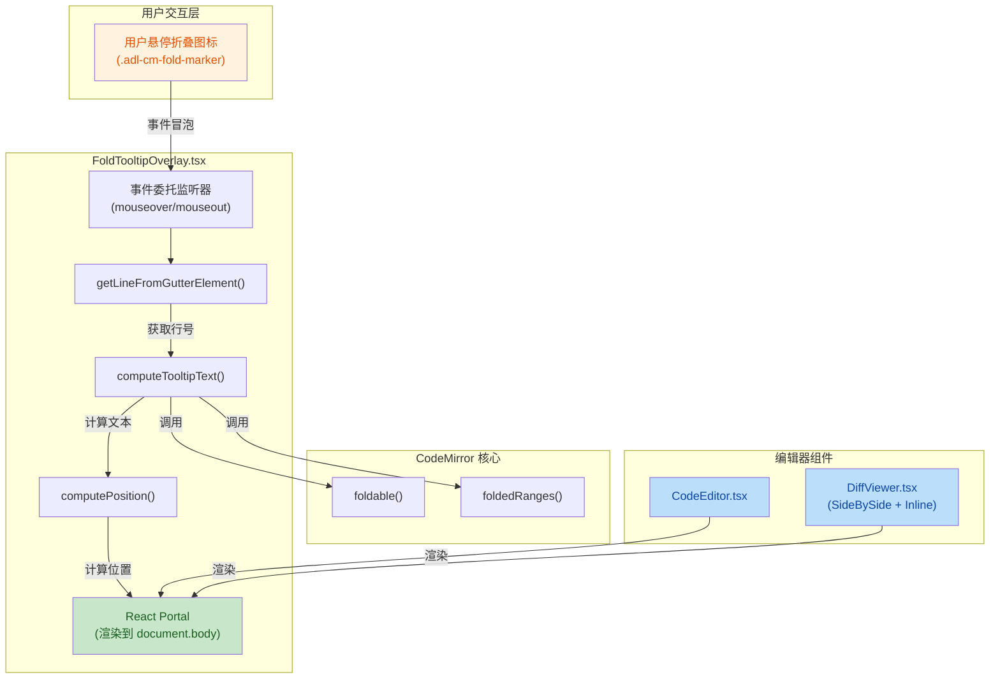
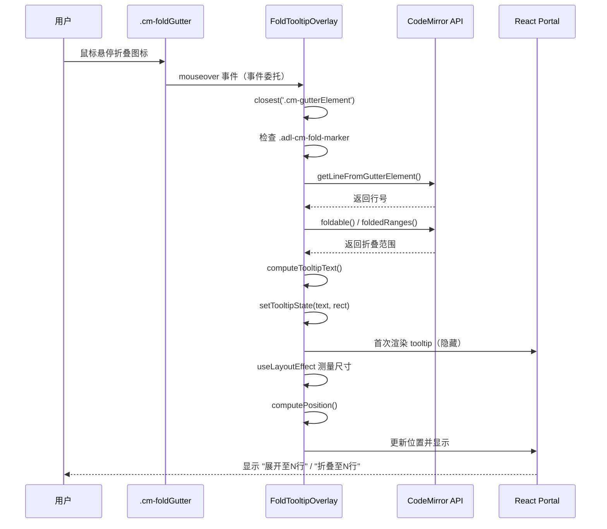

## 1. 高层摘要 (TL;DR)

- **影响**: 🟡 **中等** - 重构了 CodeMirror 编辑器折叠图标的 tooltip 实现方式，涉及多个核心编辑器组件
- **关键变更**:
  - ✨ 新增 `FoldTooltipOverlay.tsx` 组件，使用 React Portal 替代原生 `title` 属性
  - 🗑️ 删除 `cmFoldingTooltip.ts`（旧的 ViewPlugin 实现）
  - 🔧 在 `CodeEditor`、`DiffViewer` 中集成新的 tooltip overlay
  - 🧹 从 `FilesPanel`、`ChangesPanel` 中移除旧的扩展引用
  - 📝 更新测试断言和文档

---

## 2. 可视化概览 (代码与逻辑映射)



### 核心工作流程



---

## 3. 详细变更分析

### 📦 新增组件：`FoldTooltipOverlay.tsx`

**业务目标**: 提供可靠的折叠图标 tooltip，替代不可靠的原生 `title` 属性

**核心功能**:
- 通过 React Portal 将 tooltip 渲染到 `document.body`
- 使用事件委托监听 `.cm-foldGutter` 上的鼠标事件
- 实时计算折叠状态和 tooltip 文本
- 智能定位（优先右侧，空间不足时翻转到左侧）

**关键方法**:

| 方法 | 功能 |
|------|------|
| `getLineFromGutterElement()` | 从 gutter 元素获取行号 |
| `computeTooltipText()` | 计算显示文本（"展开至N行" / "折叠至N行"） |
| `computePosition()` | 计算 tooltip 位置，处理边界情况 |
| `hide()` / `scheduleHide()` | 隐藏 tooltip，支持延迟隐藏 |

**定位逻辑**:
```typescript
// 默认右侧，空间不足时翻转到左侧
let side: "right" | "left" = "right";
if (rightPos + tooltipWidth > viewportW - padding) {
  side = "left";
}
// 上下边界 clamp
top = Math.max(padding, Math.min(viewportH - tooltipHeight - padding, top));
```

---

### 🔄 编辑器组件集成

#### `CodeEditor.tsx`

**变更内容**:
- 新增 `useState<EditorView \| null>` 管理编辑器视图状态
- 在 `handleCreateEditorView` 中设置 `editorView` 状态
- 用 `div.adl-cm-editor-wrapper` 包装 `CodeMirror` 和 `FoldTooltipOverlay`

**代码片段**:
```tsx
<div className="adl-cm-editor-wrapper" style={{ position: "relative", width: "100%", height: "100%" }}>
  <CodeMirror ... />
  <FoldTooltipOverlay view={editorView} />
</div>
```

#### `DiffViewer.tsx`

**SideBySideDiffViewer 变更**:
- 新增 `mergeViewARef`、`mergeViewBRef` 和对应的 state
- 在 MergeView 创建后设置两个编辑器视图
- 渲染两个 `FoldTooltipOverlay` 实例（左右各一个）

**InlineDiffViewer 变更**:
- 新增 `editorView` state
- 在视图创建/销毁时更新状态
- 渲染单个 `FoldTooltipOverlay`

**代码片段**:
```tsx
// SideBySideDiffViewer
<div className="adl-cm-diff-viewer-wrapper" style={{ position: "relative", width: "100%", height: "100%" }}>
  <div ref={containerRef} className="adl-cm-diff-viewer adl-cm-diff-viewer--side-by-side" />
  <FoldTooltipOverlay view={editorViewA} />
  <FoldTooltipOverlay view={editorViewB} />
</div>
```

---

### 🗑️ 删除旧实现：`cmFoldingTooltip.ts`

**删除原因**:
- 原生 `title` 属性在 CodeMirror 动态 DOM 环境下不可靠
- 违反设计系统规则（禁止使用原生 title）
- ViewPlugin 方式与 React 生态不匹配

**被替代的功能**:
- ❌ `FoldingTooltipPlugin` ViewPlugin
- ❌ `getFoldingTooltipExtension()` 导出函数
- ✅ `FoldTooltipOverlay` React 组件

---

### 🧹 清理旧引用

#### `FilesPanel.tsx` & `ChangesPanel.tsx`

**变更内容**:
- 移除 `import { getFoldingTooltipExtension } from "./cmFoldingTooltip"`
- 从 `editorExtensions` / `diffExtensions` 数组中移除 `getFoldingTooltipExtension()`

**影响范围**:
| 组件 | 移除位置 |
|------|----------|
| `FilesPanel` | `editorExtensions`、`diffEditorExtensions` |
| `ChangesPanel` | `diffExtensions`、`previewEditorExtensions` |

---

### 🧪 测试更新

#### `changesEditorOptions.test.ts`

**变更内容**:
```typescript
// 旧测试
it("passes CodeMirror extensions for minimap and folding", () => {
  expect(changesPanelSource).toContain("getFoldingTooltipExtension");
});

// 新测试
it("passes CodeMirror extensions for minimap", () => {
  // 移除 getFoldingTooltipExtension 断言
});

it("uses the shared custom CodeMirror fold gutter marker and tooltip overlay", () => {
  expect(diffViewerSource).toContain("FoldTooltipOverlay");
});
```

#### `filesEditorOptions.test.ts`

**变更内容**:
- 移除 `expect(filesPanelSource).toContain("getFoldingTooltipExtension")`
- 添加 `expect(codeEditorSource).toContain("FoldTooltipOverlay")`

---

### 🎨 样式调整

#### `components.css`

**变更内容**: 调整 tooltip 箭头的垂直居中
```css
.tooltip[data-side="left"] .tooltip__arrow,
.tooltip[data-side="right"] .tooltip__arrow {
  top: 50%;
  transform: translateY(-50%);
}
```

#### `regions.css`

**变更内容**:

| 元素 | 变更 |
|------|------|
| `.cm-gutterElement` | 添加 `cursor: pointer` |
| `.adl-cm-fold-marker::after` | 宽度从 `5px` 改为 `6px` |
| `.adl-cm-fold-marker--open::before/after` | 宽度调整为 `5.5px` |
| `.adl-cm-fold-marker--closed::before/after` | 位置微调（`left: 1px`, `top: 2px`） |

#### `cmFoldGutter.ts`

**变更内容**: 添加 `dataset.open` 属性
```typescript
marker.dataset.open = String(open);
```

---

### 📝 文档更新

#### `editor-comparison.md`

**变更内容**:
```markdown
# 旧
- `cmFoldingTooltip.ts` — 折叠控件 Tooltip

# 新
- `FoldTooltipOverlay.tsx` — 折叠图标 Tooltip 浮层
```

#### `fold-tooltip-fix-plan.md` (新增)

**内容**: 详细的修复计划文档，包含：
- 当前状态分析
- 问题根因
- 设计方案
- 文件变更清单
- 验证步骤

---

## 4. 影响与风险评估

### ⚠️ 破坏性变更

| 变更类型 | 影响范围 | 说明 |
|----------|----------|------|
| API 删除 | `cmFoldingTooltip.ts` | `getFoldingTooltipExtension()` 不再导出 |
| 组件结构 | `CodeEditor` / `DiffViewer` | 外层新增 wrapper div |
| 测试断言 | 测试文件 | 需要更新测试期望值 |

### ✅ 测试建议

| 测试场景 | 验证内容 |
|----------|----------|
| **基础功能** | 悬停折叠图标显示正确的 "展开至N行" / "折叠至N行" |
| **边界情况** | 右侧空间不足时 tooltip 翻转到左侧 |
| **多编辑器** | SideBySideDiffViewer 两个编辑器的 tooltip 独立工作 |
| **滚动行为** | 编辑器滚动时 tooltip 自动关闭 |
| **主题切换** | tooltip 颜色跟随 light/dark 主题变化 |
| **快速移动** | 鼠标快速在 gutter 元素间移动时 tooltip 正确切换 |
| **性能** | 大文件悬停时无性能问题 |

### 🔍 潜在风险

| 风险 | 缓解措施 |
|------|----------|
| **Portal 渲染延迟** | 使用 `useLayoutEffect` 确保同步测量 |
| **内存泄漏** | useEffect cleanup 正确移除事件监听器 |
| **多实例冲突** | 每个实例独立管理状态，通过 `view` prop 区分 |
| **定位计算错误** | 添加 viewport clamp 防止溢出 |

---

## 5. 技术亮点

✨ **架构设计**:
- 使用 **DOM-to-React 桥接方案**，在非 React 管理的 DOM 上实现 React 组件
- **事件委托** 模式，减少监听器数量
- **Portal 渲染** 避免层级遮挡问题

✨ **用户体验**:
- **智能定位**：自动检测边界并翻转方向
- **延迟隐藏**：150ms 延迟，避免闪烁
- **实时计算**：始终反映最新的折叠状态

✨ **代码质量**:
- 完整的 TypeScript 类型定义
- 清晰的函数职责分离
- 详细的内联注释