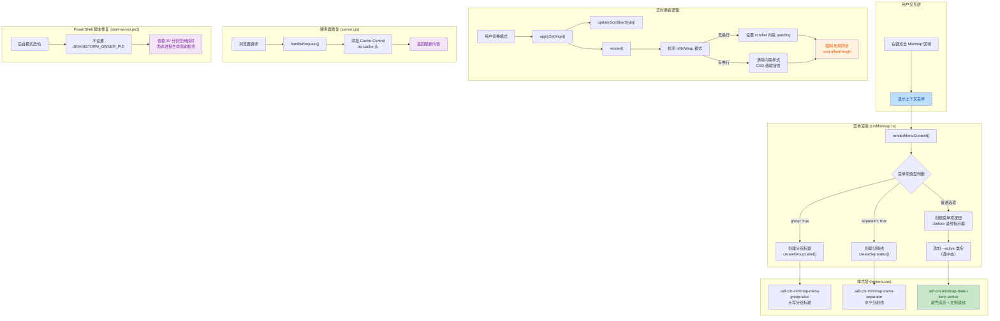

## 1. 高层摘要 (TL;DR)

*   **影响范围**：🟡 **中等** - 涉及 UI 组件重构、服务器修复和文档更新
*   **核心变更**：
    *   ✨ 重构 Minimap 右键菜单为极简线条风格（下划线分段控件 + 左侧竖线指示器）
    *   🐛 修复 Windows 后台模式下服务器 60 秒后自动关闭的问题
    *   ⚡ 修复滚动条模式切换时编辑器布局不实时更新的问题
    *   📚 完善设计系统文档，添加 Surface 交互语义层规范

---

## 2. 可视化概览



---

## 3. 详细变更分析

### 🎨 组件 1：Minimap 右键菜单重构

**变更文件**：
- `frontend/src/app/regions/right-panel/cmMinimap.ts`
- `frontend/src/styles/regions.css`

**变更内容**：

#### 3.1 菜单样式重写（极简线条风）

| 设计元素 | 旧样式 | 新样式 |
|---------|--------|--------|
| **分段控件** | 边框包围 + 背景色填充 | 下划线标签式 |
| **选中指示** | 尾部勾选（√） | `::before` 左侧竖线 + 底色高亮 |
| **菜单项圆角** | `var(--radius-sm)` | `border-radius: 0`（直角） |
| **菜单项文字** | 带前缀（如"缩放: 100%"） | 纯数值（如"100%"） |
| **分组方式** | 分隔线 | 分组标题 + 分隔线 |

#### 3.2 新增 CSS 类

```css
/* 分组标题样式 */
.adl-cm-minimap-menu-group-label {
  padding: 8px 12px 3px;
  font-size: 10px;
  font-weight: 600;
  color: var(--text-muted);
  text-transform: uppercase;
  letter-spacing: 0.8px;
}

/* 左侧竖线指示器 */
.adl-cm-minimap-menu-item::before {
  content: '';
  position: absolute;
  left: 0;
  top: 0;
  bottom: 0;
  width: 3px;
  background: transparent;
  transition: background 0.1s;
}

/* 选中态 */
.adl-cm-minimap-menu-item--active {
  background: var(--surface-active);
  font-weight: 500;
}

.adl-cm-minimap-menu-item--active::before {
  background: var(--text-primary);
}
```

#### 3.3 菜单结构变更

| 分组 | 菜单项 | 说明 |
|------|--------|------|
| **模式切换** | 缩略图 / 标准 | 下划线标签式切换 |
| **显示** | 渲染字符 | 仅缩略图模式显示 |
| **缩放** | 50% / 100% / 150% / 200% | 控制缩略图缩放比 |
| **宽度** | 60px / 80px / 100px | 控制缩略图轨道宽度 |
| **滑块突出** | 明显 / 正常 | 调整滑块可见度 |
| **设置** | 全局 / 独立 | 配置作用域 |

#### 3.4 TypeScript 类型扩展

```typescript
// 新增 group 类型支持
type MenuItem = { 
  label: string; 
  checked: boolean; 
  onClick: () => void; 
  separator?: boolean; 
  group?: boolean  // 新增
};
```

---

### ⚡ 组件 2：滚动条模式切换实时更新修复

**变更文件**：
- `frontend/src/app/regions/right-panel/cmMinimap.ts`

**问题根因**：

1. **CSS 变量级联断点**：无换行模式下，CSS 规则 `.adl-cm-no-word-wrap .cm-scroller { padding-right: 0 }` 硬编码了 `0`，CSS 变量无法穿透
2. **双重计空间隙**：scroller 和 wrapper 同时拥有 padding 时，垂直滚动条轨道被双重计数

**修复方案**：

```typescript
private render() {
  const width = this.getTrackWidth();
  const wrapper = this.scrollElement.closest<HTMLElement>(".adl-cm-diff-viewer-wrapper, .adl-cm-editor-wrapper");

  if (wrapper) {
    // 统一设置 CSS 变量
    wrapper.style.setProperty("--adl-editor-minimap-width", `${width}px`);

    const isNoWrap = wrapper.classList.contains("adl-cm-no-word-wrap");
    if (isNoWrap) {
      // 无换行：scroller 内联 padding 直接覆盖 CSS padding-right:0
      const sbw = Number.parseFloat(getComputedStyle(this.scrollElement).getPropertyValue("--adl-scrollbar-width")) || 0;
      this.scrollElement.style.paddingRight = `${Math.max(0, width - sbw)}px`;
      wrapper.style.paddingRight = "0";  // 防双重计空
    } else {
      // 有换行：清除内联，CSS 级联接管
      this.scrollElement.style.paddingRight = "";
      wrapper.style.paddingRight = "";
    }
  }
  // 强制布局同步
  void (wrapper ?? this.scrollElement).offsetHeight;
}
```

**实时更新效果**：

| 场景 | 修复前 | 修复后 |
|------|--------|--------|
| 切换 Minimap ↔ 标准 | 按钮位置不变 | ✅ 按钮立即移动 |
| 自动换行模式 | 间隙出现 | ✅ 无间隙 |
| 取消换行模式 | 按钮位置不变 | ✅ 按钮立即移动 |

---

### 🐛 组件 3：Brainstorming 服务器修复

#### 3.1 Windows 后台模式自动关闭问题

**变更文件**：`.trae/skills/brainstorming/scripts/start-server.ps1`

**问题**：后台模式（`-Foreground` 未指定）下，服务器启动约 60 秒后自动关闭。

**根因**：`start-server.ps1` 在后台模式中传入了 `BRAINSTORM_OWNER_PID`（PowerShell 的父进程 PID）。由于 `Start-Process` 的后台 PowerShell 脚本执行完后其父进程退出，`server.cjs` 的 60 秒生命周期检测发现 owner PID 已死，自动关闭服务器。

**修复**：

```powershell
if ($Foreground) {
  # 前台模式 — 跟踪 owner PID
  $env:BRAINSTORM_OWNER_PID = "$OwnerPid"
  "$PID" | Out-File -FilePath $PidFile -Encoding ascii
  & node server.cjs
  exit $LASTEXITCODE
} else {
  # 后台模式 — 不设置 BRAINSTORM_OWNER_PID
  # 依赖 server.cjs 自带的 30 分钟空闲超时进行清理
  "$PID" | Out-File -FilePath $PidFile -Encoding ascii
  $startInfo = @{
    FilePath = "node"
    ArgumentList = @("server.cjs")
    # ...
  }
}
```

#### 3.2 浏览器缓存问题修复

**变更文件**：`.trae/skills/brainstorming/scripts/server.cjs`

**问题**：浏览器缓存导致编辑后内容不立即更新。

**修复**：

```javascript
function handleRequest(req, res) {
  touchActivity();
  // 禁用缓存，确保浏览器立即反映编辑
  const noCache = { 
    'Content-Type': 'text/html; charset=utf-8', 
    'Cache-Control': 'no-cache, no-store, must-revalidate', 
    'Pragma': 'no-cache', 
    'Expires': '0' 
  };
  
  if (req.method === 'GET' && req.url === '/') {
    // ...
    res.writeHead(200, noCache);
    res.end(html);
  } else if (req.method === 'GET' && req.url.startsWith('/files/')) {
    // ...
    res.writeHead(200, { 
      'Content-Type': contentType, 
      'Cache-Control': 'no-cache, no-store, must-revalidate' 
    });
    res.end(fs.readFileSync(filePath));
  }
}
```

---

### 📚 组件 4：设计系统文档更新

#### 4.1 Surface 交互语义层

**变更文件**：
- `.trae/rules/design-system.md`
- `ai-digital-life/docs/design-system/tokens.md`
- `ai-digital-life/docs/design-system/themes.md`

**新增 Token**：

| Token | 用途 | 浅色主题 | 深色主题 |
|-------|------|---------|---------|
| `--surface-hover` | 悬停态轻微底色 | `rgba(34, 34, 34, 0.06)` | `rgba(255, 255, 255, 0.08)` |
| `--surface-active` | 选中/激活态稍深底色 | `rgba(34, 34, 34, 0.08)` | `rgba(255, 255, 255, 0.12)` |
| `--surface-raised` | 弹出层背景 | 已存在 | 已存在 |

#### 4.2 组件文档新增

**变更文件**：`ai-digital-life/docs/design-system/components.md`

新增 **Context menu (Minimap scrollbar)** 组件文档，记录了：
- CSS 类名规范
- 子组件说明
- 视觉设计风格（方案 C · 极简线条风）

#### 4.3 代码库映射更新

**变更文件**：`.trae/rules/codebase-map.md`

```markdown
ai-digital-life/
  ├── docs/               # 架构与设计文档
  │   ├── architecture/   # 系统架构
  │   ├── design-system/  # 设计系统
  │   └── superpowers/    # 功能设计 & 实施计划 (specs/ + plans/)
```

---

### 📝 组件 5：UI 操作手册更新

**变更文件**：`UIOperationManual/rightpanel/tools/changes.md`

新增详细的 Minimap 菜单说明，包括：
- 菜单结构表格
- 视觉设计规范
- 模式间差异对比
- 实时更新行为说明
- 交互约定

---

## 4. 影响与风险评估

### ⚠️ 破坏性变更

| 变更类型 | 影响范围 | 说明 |
|---------|---------|------|
| **CSS 类名变更** | Minimap 菜单 | `.adl-cm-minimap-menu-item--checked` → `.adl-cm-minimap-menu-item--active` |
| **移除 DOM 元素** | Minimap 菜单项 | 移除 `.adl-cm-minimap-menu-item__check` 勾选元素 |
| **菜单项文字** | 用户可见 | "滑动条: Minimap" → "缩略图"，"缩放: 100%" → "100%" |

### ✅ 测试建议

1. **Minimap 菜单功能测试**：
   - 右键点击 Minimap 区域，验证菜单显示
   - 切换"缩略图 / 标准"模式，验证分段控件下划线样式
   - 验证分组标题正确显示（显示、缩放、宽度、滑块突出、设置）
   - 验证选中项显示左侧竖线 + 底色高亮
   - 验证深色/浅色主题切换时颜色正确

2. **实时更新测试**：
   - 在自动换行模式下切换 Minimap ↔ 标准，验证 Accept/Reject 按钮立即移动
   - 在取消换行模式下切换 Minimap ↔ 标准，验证 Accept/Reject 按钮立即移动
   - 验证模式切换时无间隙出现

3. **服务器测试**：
   - Windows 后台模式启动服务器，等待 65 秒，用 `netstat -ano \| findstr :<port>` 确认端口仍处于 LISTENING 状态
   - 编辑 HTML 文件后刷新浏览器，验证内容立即更新（无缓存）

4. **回归测试**：
   - 运行前端测试：`npm --prefix frontend test`
   - 运行类型检查：`npm --prefix frontend run typecheck`

---

## 5. 新增文档清单

| 文档路径 | 类型 | 说明 |
|---------|------|------|
| `ai-digital-life/docs/superpowers/plans/2026-05-17-minimap-context-menu.md` | 实施计划 | Minimap 菜单重构的详细实施步骤 |
| `ai-digital-life/docs/superpowers/plans/2026-05-17-scrollbar-mode-real-time-fix.md` | 实施计划 | 滚动条模式切换实时修复总结 |
| `ai-digital-life/docs/superpowers/specs/2026-05-17-minimap-context-menu-design.md` | 设计规范 | Minimap 菜单的设计决策和颜色体系 |